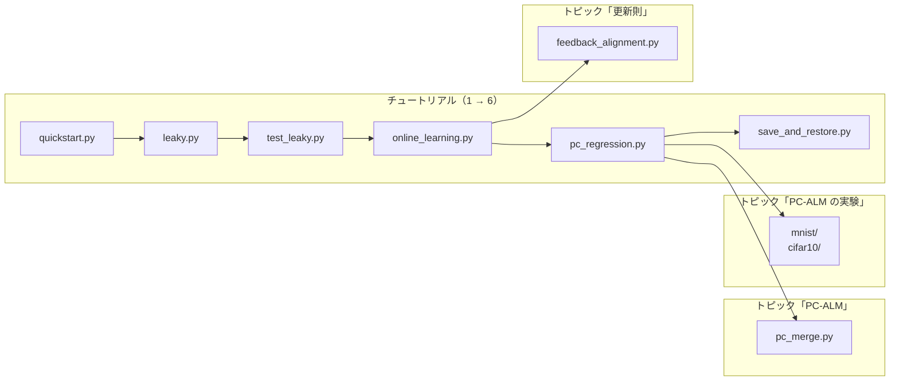

# 💡 サンプル

サンプルはすべてリポジトリの `examples/` にあり、各ページはそれをそのまま取り込むので、載っているコードはそのまま実行できる。



## やりたいことから探す {#by-goal}

| やりたいこと                                         | プログラム              | 主な API                                                                                                               | 説明のページ                                             |
| ---------------------------------------------------- | ----------------------- | ---------------------------------------------------------------------------------------------------------------------- | -------------------------------------------------------- |
| とにかく 1 つ動かす                                  | `quickstart.py`         | [`run`][mujou.run]、[`write`][mujou.Run.write]、[`wait_for`][mujou.Run.wait_for]                                       | [1. ネットワークを走らせる](tutorial/1-run.md)           |
| ネットワークを分岐させ、合流させる                   | `branching.py`          | [`Port`][mujou.Port]、[`MultiPort`][mujou.MultiPort]、[`Channel`][mujou.Channel]、[`send_to`][mujou.MultiPort.send_to] | [Port と Channel](topics/ports.md#fan-out)               |
| 連続時間で変わる状態を持つノードを書く               | `leaky.py`              | [`on_update`][mujou.Node.on_update]                                                                                    | [2. ノードを書く](tutorial/2-node.md)                    |
| ノードを決定的にテストする                           | `test_leaky.py`         | [`run_manually`][mujou.run_manually]、[`step`][mujou.ManualRun.step]                                                   | [3. ノードをテストする](tutorial/3-test.md)              |
| ノードの中の BP で、ストリームから学び続ける         | `online_learning.py`    | PyTorch の autograd                                                                                                    | [4. ノードの中で学習する](tutorial/4-learn-in-a-node.md) |
| 自作の則でノードをまたいで学ぶ                       | `feedback_alignment.py` | [`pc.clock.LearnClock`][mujou.pc.clock.LearnClock]                                                                     | [更新則](topics/update-rules.md)                         |
| PC-ALM で回帰を数十行で学ぶ                          | `pc_regression.py`      | [`pc.Chain`][mujou.pc.Chain]、[`pc.show`][mujou.pc.show]                                                               | [5. PC-ALM で学習する](tutorial/5-learn-with-pc.md)      |
| PC-ALM のノードを自分で書く（入力が 2 つ）           | `pc_merge.py`           | [`pc.functional`][mujou.pc.functional]、`pc.clock.LearnClock`                                                          | [PC-ALM](topics/pc.md#own-node)                          |
| PC-ALM で MNIST を学び、BP と比べる                  | `mnist/`                | `pc.Chain`                                                                                                             | [PC-ALM の実験](topics/pc-benchmarks.md#mnist)           |
| GPU 上の ResNet で CIFAR-10 を学び、BP と比べる      | `cifar10/`              | `pc.Chain`、[`pc.optim.AdamW`][mujou.pc.optim.AdamW]                                                                   | [PC-ALM の実験](topics/pc-benchmarks.md#cifar-10)        |
| 状態を保存し、その続きから再開する                   | `save_and_restore.py`   | [`Run.state_dict`][mujou.Run.state_dict]、`run(..., state=...)`                                                        | [6. 保存と再開](tutorial/6-save-and-resume.md)           |
| 複数のネットワークを一緒に走らせる                   | `group.py`              | [`Group`][mujou.Group]                                                                                                 | [Group](topics/groups.md)                                |
| 新しい出力を追い続ける（途中の値は飛ばしうる）       | `subscribe.py`          | [`subscribe`][mujou.Run.subscribe]                                                                                     | [ホストの入出力](topics/host-io.md#read)                 |
| 実行専用のタイマー、時間の速さ、複数の実行の一時停止 | `timers.py`             | [`Timer`][mujou.time.Timer]、[`Timestamp`][mujou.time.Timestamp]                                                       | [時間](topics/time.md)                                   |
| ネットワークを計算能力いっぱいでシミュレーションする | `simulation.py`         | `run_manually`、`step`                                                                                                 | [シミュレーション](topics/simulation.md)                 |
| ノードが例外を投げたときの動きを知る                 | `errors.py`             | [`NetworkError`][mujou.NetworkError]                                                                                   | [例外と終了](topics/errors.md)                           |
| ネットワークのグラフを描いてブラウザで開く           | `visualize.py`          | [`viz.to_html`][mujou.viz.to_html]                                                                                     | [ネットワークの可視化](topics/visualize.md)              |

## 走らせ方 {#run}

[ソースからビルドした](install.md#source)環境で、リポジトリのルートから `uv run python` を使って実行する。

```sh
uv run python examples/quickstart.py
uv run python examples/mnist/main.py
uv run python examples/cifar10/main.py
```

| プログラム                  | かかる時間                              | 初回のダウンロード    | GPU         |
| --------------------------- | --------------------------------------- | --------------------- | ----------- |
| `mnist/` と `cifar10/` 以外 | 15 秒以内                               | —                     | 不要        |
| `mnist/`                    | 既定の 3 epoch で約 2 分                | MNIST（約 11 MB）     | 不要        |
| `cifar10/`                  | 既定の 3 epoch で、RTX 4090 なら約 4 分 | CIFAR-10（約 160 MB） | CUDA が要る |
