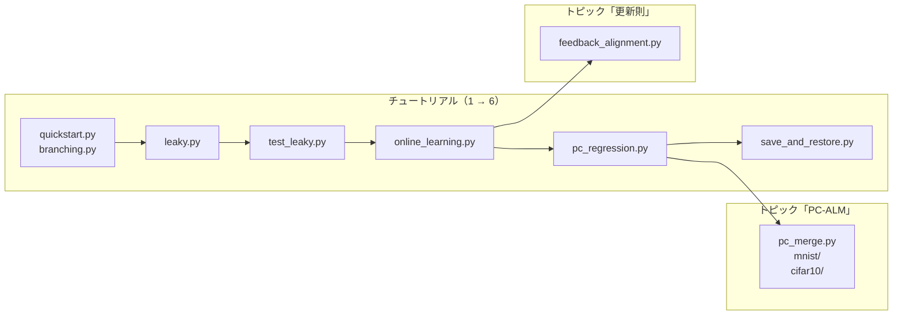

# 💡 サンプル

mujou の使い方を示すサンプルプログラムの一覧。どれもリポジトリの `examples/` にある。サイトの各ページはこれらをそのまま取り込んでいるので、載っているコードはそのまま実行できる。`examples/` は利用者への手引きで、テストでは実行しない。

チュートリアル（1〜6）のプログラムは、矢印の順に読むと積み上がる。その先は、トピック「更新則」と「PC-ALM」のプログラムへ進める。



## やりたいことから探す

| やりたいこと                                         | プログラム              | 詳しい説明                                                                                                                       |
| ---------------------------------------------------- | ----------------------- | -------------------------------------------------------------------------------------------------------------------------------- |
| とにかく 1 つ動かす                                  | `quickstart.py`         | [1. ネットワークを走らせる](tutorial/1-run.md)                                                                                   |
| ネットワークを分岐させ、合流させる                   | `branching.py`          | [1. ネットワークを走らせる](tutorial/1-run.md#%E5%88%86%E5%B2%90%E3%81%A8%E5%90%88%E6%B5%81)、[Port と Channel](topics/ports.md) |
| 連続時間で変わる状態を持つノードを書く               | `leaky.py`              | [2. ノードを書く](tutorial/2-node.md)                                                                                            |
| ノードを決定的にテストする                           | `test_leaky.py`         | [3. ノードをテストする](tutorial/3-test.md)                                                                                      |
| ノードの中の BP で、ストリームから学び続ける         | `online_learning.py`    | [4. ノードの中で学習する](tutorial/4-learn-in-a-node.md)                                                                         |
| 自作の則でノードをまたいで学ぶ                       | `feedback_alignment.py` | [更新則](topics/update-rules.md)                                                                                                 |
| PC-ALM で回帰を数十行で学ぶ                          | `pc_regression.py`      | [5. PC-ALM で学習する](tutorial/5-learn-with-pc.md)                                                                              |
| PC-ALM のノードを自分で書く（入力が 2 つ）           | `pc_merge.py`           | [PC-ALM](topics/pc.md#%E8%87%AA%E5%88%86%E3%81%AE%E3%83%8E%E3%83%BC%E3%83%89%E3%82%92%E6%9B%B8%E3%81%8F)                         |
| PC-ALM で MNIST を学び、BP と比べる                  | `mnist/`                | [PC-ALM](topics/pc.md#mnist)                                                                                                     |
| GPU 上の ResNet で CIFAR-10 を学び、BP と比べる      | `cifar10/`              | [PC-ALM](topics/pc.md#cifar-10)                                                                                                  |
| 状態を保存し、その続きから再開する                   | `save_and_restore.py`   | [6. 保存と再開](tutorial/6-save-and-resume.md)                                                                                   |
| 複数のネットワークを一緒に走らせる                   | `group.py`              | [Group](topics/groups.md)                                                                                                        |
| 新しい出力を追い続ける（途中の値は飛ばしうる）       | `subscribe.py`          | [ホストの入出力](topics/host-io.md#%E8%AA%AD%E3%82%80)                                                                           |
| 実行専用のタイマー、時間の速さ、複数の実行の一時停止 | `timers.py`             | [時間](topics/time.md)                                                                                                           |
| ネットワークを計算能力いっぱいでシミュレーションする | `simulation.py`         | [シミュレーション](topics/simulation.md)                                                                                         |
| ノードが例外を投げたときの動きを知る                 | `errors.py`             | [例外と終了](topics/errors.md)                                                                                                   |
| ネットワークのグラフを描いてブラウザで開く           | `visualize.py`          | [ネットワークの可視化](topics/visualize.md)                                                                                      |

## 各プログラムが示すこと

!!! abstract "要点"

    プログラムは用途で 5 つに分かれる。使い方を知りたい API があれば、表の「主な API」から探せる。

### 走らせる・つなぐ

| プログラム      | 示すこと                                                                                                   | 主な API                                                 |
| --------------- | ---------------------------------------------------------------------------------------------------------- | -------------------------------------------------------- |
| `quickstart.py` | 2 ノードのネットワークを走らせ、入力を書き、期待した出力が届くまで待つ                                     | `with mujou.run(...)`、`write`、`wait_for`               |
| `branching.py`  | 送るだけの `Port` を 2 つの枝につなぎ、`MultiPort` で合流。後半は `MultiPort` から、相手ごとに違う値を送る | `Port`、`MultiPort`、`connect` の返す Channel、`send_to` |
| `group.py`      | 複数のネットワークを一緒に走らせる。ノードのパスの付き方（`"enc.scale"`）                                  | `Group(enc=..., dec=...)`                                |
| `subscribe.py`  | まず最新の出力を、その後は新しい出力を 1 つずつ受け取る。`break` で止める                                  | `run.subscribe`                                          |

### ノードを書く・テストする

| プログラム      | 示すこと                                                                                                                                 | 主な API                                        |
| --------------- | ---------------------------------------------------------------------------------------------------------------------------------------- | ----------------------------------------------- |
| `leaky.py`      | リーク積分器。連続時間で定義し厳密解で進めるので、どんな `dt` でも安定。2 つ並べた鎖の入力を切り替え、各出力を送られた時刻の厳密解と比較 | `on_update(dt)`                                 |
| `test_leaky.py` | `leaky.py` のノードのテスト。厳密解との比較、離散アルゴリズムとのビット単位の一致、再開した実行と止めずに続けた実行の一致                | `mujou.run_manually` の仮想タイマー、手動の更新 |
| `errors.py`     | ノードが例外を投げたときの動き。`on_exception` → `on_stop` の順、`on_start` の例外は `mujou.run` が送出                                  | `NetworkError` とその `__cause__`               |

`test_leaky.py` はテストとして実行する:

```sh
uv run pytest examples/test_leaky.py
```

### 学習する

| プログラム              | 学び方                         | 示すこと                                                                                                                                                                             | 主な API                               |
| ----------------------- | ------------------------------ | ------------------------------------------------------------------------------------------------------------------------------------------------------------------------------------ | -------------------------------------- |
| `online_learning.py`    | ノードの中の BP                | 教師がホストの書いて変える `a` で y = a x + b のバッチを送る。学習するノードは新しいバッチごとに、前のバッチからの時間だけ学ぶ。ホストは損失が下がり、跳ね上がり、また下がるのを追う | 素の PyTorch の autograd               |
| `feedback_alignment.py` | 自作の則（feedback alignment） | 2 つのノードで 2 層のネットワークを学ぶ。両方向の Port、活動と一緒に中継する目標、サンプルごとに 1 回の学習                                                                          | `pc.clock.LearnClock`                  |
| `pc_regression.py`      | PC-ALM                         | 流れてくるバッチから回帰を学ぶ。損失は各バッチから学ぶ前に測る                                                                                                                       | `pc.Chain`、`pc.show`                  |
| `pc_merge.py`           | PC-ALM（自作のノード）         | 入力を 2 つ持つノード `Merge` で 2 本の塔を合流させ、回帰を学ぶ                                                                                                                      | `pc.functional`、`pc.clock.LearnClock` |
| `mnist/`                | PC-ALM と BP                   | 784-256-256-10 のネットワークで MNIST を学ぶ。同じネットワークを同じ初期重みとバッチで BP でも学ぶ                                                                                   | `pc.Chain`                             |
| `cifar10/`              | PC-ALM と BP（GPU）            | CUDA のデバイスに載せた ResNet-20 をステージごとのノードに分け、CIFAR-10 を学ぶ。同じネットワークを同じ初期重み・バッチ・optimizer で、GPU 上の BP でも学ぶ                          | `pc.Chain`、`pc.optim.AdamW`           |

`mnist/` と `cifar10/` は複数のファイルからなる。入口はどちらも `main.py`。

| ファイル     | `mnist/`                            | `cifar10/`                                         |
| ------------ | ----------------------------------- | -------------------------------------------------- |
| `main.py`    | 入口                                | 入口                                               |
| `data.py`    | データを読む                        | データを読んで拡張する                             |
| `metrics.py` | 測る                                | 測る                                               |
| `bp.py`      | BP の基準を学習させる               | BP の基準を学習させる                              |
| `watch.py`   | ノードの `dt` を数える（`--watch`） | —                                                  |
| `resnet.py`  | —                                   | ネットワークを組み、少ないノードに切る理由を述べる |

### 時間・状態・シミュレーション

| プログラム            | 示すこと                                                                                                                                                                                                      | 主な API                                                      |
| --------------------- | ------------------------------------------------------------------------------------------------------------------------------------------------------------------------------------------------------------- | ------------------------------------------------------------- |
| `save_and_restore.py` | 状態を取得して保存し、新しいインスタンスで再開。再開した実行は専用のタイマーで走る                                                                                                                            | `run.state_dict()`、`torch.save`、`mujou.run(..., state=...)` |
| `timers.py`           | 時間の速さを変えた実行専用のタイマー、グローバルタイマーの速さ、グローバルタイマーを止めて 2 つの実行の状態を同じ時刻で取得。一方から再開した実行は専用のタイマーで続く                                       | `Timestamp`、`Timer`                                          |
| `simulation.py`       | `leaky.py` の chain に正弦波を入れ、1 ms 刻みでシミュレーションし、実時間でかかった時間を表示。入力はステップの間に書く。ワーカーの数によらず同じ結果になること、`step(dt)` とノードを渡す 2 通りの順の比較も | `mujou.run_manually`、`step(dt)`                              |

### 見る

| プログラム     | 示すこと                                                                                          | 主な API            |
| -------------- | ------------------------------------------------------------------------------------------------- | ------------------- |
| `visualize.py` | 2 つのネットワークと 1 つのノードからなるネットワークと `pc.Chain` のページを、走らせずに書き出す | `mujou.viz.to_html` |

## 走らせ方

!!! abstract "要点"

    ソースからビルドした環境（[インストール](install.md)）で、リポジトリのルートから `uv run python` で実行する。

```sh
uv run python examples/quickstart.py
uv run python examples/mnist/main.py
uv run python examples/cifar10/main.py
```

| プログラム                  | かかる時間                              | 初回のダウンロード    | GPU         |
| --------------------------- | --------------------------------------- | --------------------- | ----------- |
| `mnist/` と `cifar10/` 以外 | 15 秒以内                               | —                     | 不要        |
| `mnist/`                    | 既定の 3 epoch で約 2 分                | MNIST（約 11 MB）     | 不要        |
| `cifar10/`                  | 既定の 3 epoch で、RTX 4090 なら約 4 分 | CIFAR-10（約 160 MB） | CUDA が要る |
