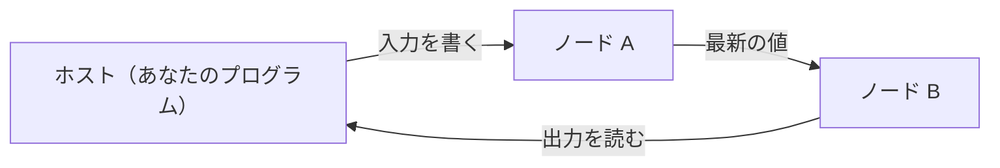

# Mujou

mujou は、推論と学習を同時に行い続ける深層学習フレームワークである。PyTorch のコードでノードを書き、ノードをつないだネットワークを走らせる。

!!! warning "開発の初期段階"

    mujou はまだ開発の初期段階にある。API は予告なく変わることがある。

## 学び続けるネットワーク

従来の機械学習は、学習を終えたら重みを固定して推論する。mujou のネットワークは、走っている間ずっと入力を受け取って出力を出し、同時に学び続ける。学習と推論を切り替えるモードも、エポックも無い。

名前は「諸行無常」の「無常」（常が無いこと）から取った。ストリームから学び続け、常に変わり続ける機械を作るためのフレームワークだからである。リアルタイム処理やロボティクスのように、動きながら学ぶ用途を狙う。

## 設計の要点

| 要点                     | 内容                                                                                                                                                                                                                                   |
| ------------------------ | -------------------------------------------------------------------------------------------------------------------------------------------------------------------------------------------------------------------------------------- |
| 内側は同期、外側は非同期 | 計算の単位はノードである。ノードの内側は普通の PyTorch のコードで同期的に計算する。ノード同士は互いを待たず、相手が最後に送った値を読むだけである                                                                                      |
| 1 本のグローバル時間     | ノードは、前回の更新からの経過時間 `dt` に比例した量だけ更新する。更新の速さが違うノード同士でも、同じ時間の流れの上で動く                                                                                                             |
| 差し替えられる更新手法   | 既定の更新手法は [PC-ALM](https://pub.sakana.ai/pc-alm/)（Augmented Lagrangian Predictive Coding。実装予定）で、各ノードが局所的な更新で学ぶ。更新手法はほかの手法に差し替えられ、1 つのノードの内側に閉じた誤差逆伝播法（BP）も使える |



各ノードは自分のスレッドで更新を繰り返す。ホスト（ネットワークを走らせるプログラム）は、走っているネットワークに入力を書き、出力を読む。

## 最小のプログラム

次のプログラムは、2 つのノードで $y = 2x + 1$ を計算するネットワークを走らせ、出力を読む。各行の意味は[クイックスタート](getting-started/quickstart.md)で説明する。

??? example "examples/quickstart.py"

    ```python
    --8<-- "examples/quickstart.py"
    ```

## 読み進め方

| 章                                    | 内容                                                         |
| ------------------------------------- | ------------------------------------------------------------ |
| [はじめに](getting-started/index.md)  | インストールして、最初のネットワークを走らせる               |
| [概念](concepts/index.md)             | ノード・Port・ネットワーク・グローバル時間・状態の考え方     |
| [ユーザーガイド](user-guide/index.md) | ノードの書き方、ネットワークの組み方と走らせ方などの作業手順 |
| [サンプル](examples/index.md)         | 動くプログラムの一覧                                         |
| [API リファレンス](api/index.md)      | mujou のクラスと関数。docstring から生成した英語のページ     |
