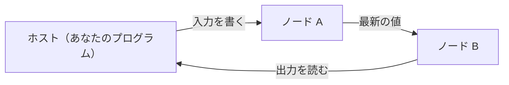

# Mujou

連続的継続学習のための非同期分散型深層学習フレームワーク
{ .mujou-tagline }

<figure class="mujou-figure" markdown="span">
  { .mujou-hero }
  <figcaption>画像は、落合陽一の作品「リキッドユニバース」をもとに新たに制作したもの</figcaption>
</figure>

mujou は推論と学習を同時に行い続ける深層学習フレームワークである。ノードをつなぎ、ネットワークを構築する。

!!! warning "開発の初期段階"

    mujou はまだ開発の初期段階にある。API は予告なく変わることがある。

## 🌱 学び続けるネットワーク

従来の機械学習は学習を終えたら重みを固定し推論する。mujou のネットワークは、実行中常に入力を受け取って出力を出し、同時に学び続ける。

学習と推論を切り替えるモードも、エポックも無い。

名前は「諸行無常」の「無常」（常が無いこと）から取った。ストリームから学び続け、常に変わり続ける機械を作るためのフレームワーク。リアルタイム処理やロボティクスのように、動きながら学ぶ用途を狙う。

次のプログラムがそのネットワーク。PC-ALM のノードの鎖が、流れてくるバッチから回帰を学ぶ（学ぶノードは 3 つ）。ノードは動き続けたまま、各バッチから学ぶ前にそのバッチを予測する。

```python
--8<-- "examples/pc_regression.py:chain"

--8<-- "examples/pc_regression.py:run"
```

## ✨ 特徴

- 🔄 **推論と学習を同時に**: 学習のモードも推論のモードも、エポックも無い
- 🧩 **PyTorch で書くノード**: 各ノードは PyTorch で書き実行する
- ⚡ **非同期のノード**: 各ノードは自分の周期で更新し、ほかのノードを待たない
- ⏱️ **連続時間**: 実際に経った時間 `dt` に比例して更新する
- 🧠 **更新則は自由**: ノードの中の BP、ノードをまたぐ PC-ALM、自作の則
- 💾 **状態を保存**: ネットワークの状態を取得、後でその状態から再開
- 🧪 **決定的なテスト**: 仮想のタイマーと手動の更新でノードをテスト可能

## ⚙️ 動き方



各ノードは自分の周期で更新を繰り返し、ほかのノードを待たない。読むのは、隣のノードが最後に送った値である。

ホスト（ネットワークを走らせるプログラム）は、走っているネットワークに入力を書き、出力を読む。

## 🧭 読み進め方

- **初めてなら**

    インストール → Mujou の仕組み → チュートリアルを最初のページから

- **さらに詳しく**

    → トピック、サンプル、API リファレンスへ

<div class="grid cards" markdown>

- **📦 インストール**

    ______________________________________________________________________

    ソースから mujou をビルド、動作確認。

    [:octicons-arrow-right-24: インストール](install.md)

- **🧠 Mujou の仕組み**

    ______________________________________________________________________

    ノード、Port、ネットワーク、実行、時間、状態、テスト、学習と、ノードが守る規則について。

    [:octicons-arrow-right-24: Mujou の仕組み](concepts.md)

- **🚀 チュートリアル**

    ______________________________________________________________________

    ネットワークを走らせ、ノードを書いてテストし、ノードの中と PC-ALM で学習、保存と再開まで。

    [:octicons-arrow-right-24: チュートリアル](tutorial/1-run.md)

- **🗺️ トピック**

    ______________________________________________________________________

    Port、Group、ホストの入出力、時間、スレッドとデバイス、例外、更新則、PC-ALM。

    [:octicons-arrow-right-24: トピック](topics/ports.md)

- **💡 サンプル**

    ______________________________________________________________________

    サンプルプログラムの一覧。実際に扱う際の参考に。

    [:octicons-arrow-right-24: サンプル](examples.md)

- **📚 API リファレンス**

    ______________________________________________________________________

    公開されているクラスと関数すべて （docstring から生成）

    [:octicons-arrow-right-24: API リファレンス](api/node-and-ports.md)

</div>
