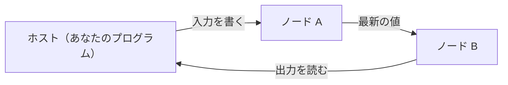

# Mujou

mujou は、推論と学習を同時に行い続ける深層学習フレームワークである。PyTorch のコードでノードを書き、ノードをつないだネットワークを走らせる。

!!! warning "開発の初期段階"

    mujou はまだ開発の初期段階にある。API は予告なく変わることがある。

## 学び続けるネットワーク

従来の機械学習は、学習を終えたら重みを固定して推論する。mujou のネットワークは、走っている間ずっと入力を受け取って出力を出し、同時に学び続ける。学習と推論を切り替えるモードも、エポックも無い。

名前は「諸行無常」の「無常」（常が無いこと）から取った。ストリームから学び続け、常に変わり続ける機械を作るためのフレームワークだからである。リアルタイム処理やロボティクスのように、動きながら学ぶ用途を狙う。

## 動き方



各ノードは自分のスレッドで更新を繰り返し、ほかのノードを待たない。読むのは、隣のノードが最後に送った値である。ホスト（ネットワークを走らせるプログラム）は、走っているネットワークに入力を書き、出力を読む。

## 最小のプログラム

次のプログラムは、2 つのノードで $y = 2x + 1$ を計算するネットワークを走らせ、出力を読む。何をしているかは[クイックスタート](getting-started/quickstart.md)で説明する。

??? example "examples/quickstart.py"

    ```python
    --8<-- "examples/quickstart.py"
    ```

## 読み進め方

- はじめて使うなら: [インストール](getting-started/installation.md)、[クイックスタート](getting-started/quickstart.md)、[Mujou の仕組み](concepts.md)の順に読む
- 自分のノードとネットワークを書くなら: [ユーザーガイド](user-guide/index.md)、[サンプル](examples/index.md)、[API リファレンス](api/index.md)
