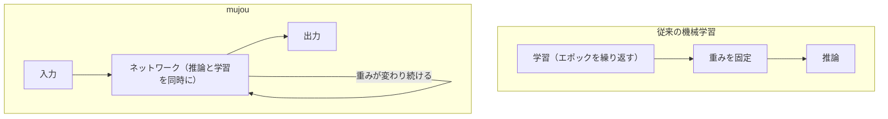

# Mujou

連続的継続学習のための非同期分散型深層学習フレームワーク
{ .mujou-tagline }

<figure class="mujou-figure" markdown="span">
  { .mujou-hero }
  <figcaption>画像は、落合陽一の作品「リキッドユニバース」をもとに新たに制作したもの</figcaption>
</figure>

mujou は、ノードをつないだネットワークで推論と学習を同時に行い続ける深層学習フレームワークである。

!!! warning "開発の初期段階"

    mujou はまだ開発の初期段階にある。API は予告なく変わることがある。

## 学び続けるネットワーク {#continual}



名前は「諸行無常」の「無常」（常が無いこと）から取った。ストリームから学び続けて常に変わり続ける機械を作り、リアルタイム処理やロボティクスのように動きながら学ぶ用途を狙う。

次のプログラムでは、PC-ALM のノードの鎖（学ぶノードは 3 つ）が動き続けたまま、流れてくるバッチごとに、まずそのバッチを予測してからそのバッチで回帰を学ぶ（読み解きは [5. PC-ALM で学習する](tutorial/5-learn-with-pc.md)）。

```python
--8<-- "examples/pc_regression.py:chain"

--8<-- "examples/pc_regression.py:run"
```

## 特徴 {#features}

- 🔄 **[推論と学習を同時に](concepts.md#learning)**: 学習のモードも推論のモードも、エポックも無い
- 🧩 **[PyTorch で書くノード](concepts.md#nodes)**: 各ノードは PyTorch で書き実行する
- ⚡ **[非同期のノード](concepts.md#ports)**: 各ノードは自分の周期で更新し、ほかのノードを待たない
- ⏱️ **[連続時間](concepts.md#time)**: 実際に経った時間 `dt` に比例して更新する
- 🧠 **[更新則は自由](concepts.md#learning)**: ノードの中の BP、ノードをまたぐ PC-ALM、自作の則
- 💾 **[状態を保存](tutorial/6-save-and-resume.md)**: ネットワークの状態を取得、後でその状態から再開
- 🧪 **[シミュレーションと決定的なテスト](topics/simulation.md)**: 仮想時間を手で進め、計算能力いっぱいでシミュレーション可能

## 読み進め方 {#next}

<div class="grid cards" markdown>

- **📦 インストール**

    ______________________________________________________________________

    入れ方と動作の確かめ方。

    [:octicons-arrow-right-24: インストール](install.md)

- **🧠 Mujou の仕組み**

    ______________________________________________________________________

    仕組みを図で。

    [:octicons-arrow-right-24: Mujou の仕組み](concepts.md)

- **🚀 チュートリアル**

    ______________________________________________________________________

    コードで順に。

    [:octicons-arrow-right-24: チュートリアル](tutorial/1-run.md)

- **🗺️ トピック**

    ______________________________________________________________________

    主題ごとの使い分けと決め方。

    [:octicons-arrow-right-24: トピック](topics/ports.md)

- **💡 サンプル**

    ______________________________________________________________________

    やりたいことからプログラムを探す。

    [:octicons-arrow-right-24: サンプル](examples.md)

- **📚 API リファレンス**

    ______________________________________________________________________

    公開しているクラスと関数のすべて（docstring から生成）。

    [:octicons-arrow-right-24: API リファレンス](api/node-and-ports.md)

</div>
