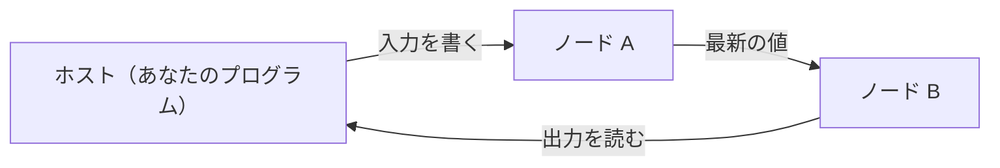

# Mujou

連続的継続学習のための非同期分散型深層学習フレームワーク
{ .mujou-tagline }

<figure class="mujou-figure" markdown="span">
  { .mujou-hero }
  <figcaption>画像は、落合陽一の作品「リキッドユニバース」をもとに新たに制作したもの</figcaption>
</figure>

mujou は推論と学習を同時に行い続ける深層学習フレームワークである。ノードをつなぎ、ネットワークを構築する。

!!! warning "開発の初期段階"

    mujou はまだ開発の初期段階にある。API は予告なく変わることがある。

## 🌱 学び続けるネットワーク

従来の機械学習は学習を終えたら重みを固定し推論する。mujou のネットワークは、実行中常に入力を受け取って出力を出し、同時に学び続ける。

学習と推論を切り替えるモードも、エポックも無い。

名前は「諸行無常」の「無常」（常が無いこと）から取った。ストリームから学び続け、常に変わり続ける機械を作るためのフレームワーク。リアルタイム処理やロボティクスのように、動きながら学ぶ用途を狙う。

## ✨ 特徴

- 🔄 **推論と学習を同時に**: 学習のモードも推論のモードも、エポックも無い
- 🧩 **PyTorch で書くノード**: 各ノードは PyTorch で書き実行する
- ⚡ **非同期のノード**: 各ノードは自分のスレッドで更新し、ほかのノードを待たない
- ⏱️ **連続時間**: 実際に経った時間 `dt` に比例して更新する
- 💾 **状態を保存**: ネットワークの状態を取得、後でその状態からリスタート
- 🧪 **決定的なテスト**: 仮想のタイマーと手動の更新でノードをテスト可能

## ⚙️ 動き方



各ノードは自分のスレッドで更新を繰り返し、ほかのノードを待たない。読むのは、隣のノードが最後に送った値である。

ホスト（ネットワークを走らせるプログラム）は、走っているネットワークに入力を書き、出力を読む。

## 🚀 最小のプログラム

次のプログラムは、2 つのノードで $y = 2x + 1$ を計算するネットワークを走らせ、出力を読む。何をしているかは[クイックスタート](getting-started/quickstart.md)で説明する。

??? example "examples/quickstart.py"

    ```python
    --8<-- "examples/quickstart.py"
    ```

## 🧭 読み進め方

- **初めてなら**

    インストール → クイックスタート → Mujou の仕組み

- **自分のノードとネットワークを書く**

    → ユーザーガイド、サンプル、API リファレンスへ

<div class="grid cards" markdown>

- **📦 インストール**

    ______________________________________________________________________

    PyPIからのインストール、ソースから mujou をビルド、動作確認。

    [:octicons-arrow-right-24: インストール](getting-started/installation.md)

- **🚀 クイックスタート**

    ______________________________________________________________________

    最小のプログラムを走らせてみる。

    [:octicons-arrow-right-24: クイックスタート](getting-started/quickstart.md)

- **🧠 Mujou の仕組み**

    ______________________________________________________________________

    ノード、Port と Channel、ネットワーク、グローバルタイマー、状態について。

    [:octicons-arrow-right-24: Mujou の仕組み](concepts.md)

- **🧭 ユーザーガイド**

    ______________________________________________________________________

    自分のノードを書いてネットワークを組み、走らせる。

    [:octicons-arrow-right-24: ユーザーガイド](user-guide/index.md)

- **💡 サンプル**

    ______________________________________________________________________

    サンプルプログラムの一覧。実際に扱う際の参考に。

    [:octicons-arrow-right-24: サンプル](examples/index.md)

- **📚 API リファレンス**

    ______________________________________________________________________

    公開されているクラスと関数すべて （docstring から生成）

    [:octicons-arrow-right-24: API リファレンス](api/index.md)

</div>
