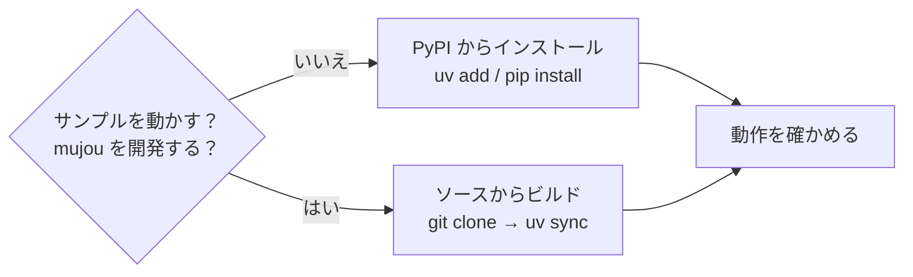

# 📦 インストール



## 必要なもの {#requirements}

| もの    | 条件                                                                                                                                                | PyPI から                        | ソースから |
| ------- | --------------------------------------------------------------------------------------------------------------------------------------------------- | -------------------------------- | ---------- |
| Python  | 3.14 以上。free-threaded 版の 3.14t を推奨、GIL ありも可（[理由](topics/threads-and-devices.md#workers)）                                           | 要る                             | 要る       |
| PyTorch | mujou の依存として自動でインストールされる。CPU 版・別の CUDA 版は [PyTorch のインストールの手引き](https://pytorch.org/get-started/locally/)に従う | 自動                             | 自動       |
| Rust    | 1.85 以上を [rustup](https://rustup.rs/) でインストール。ソースからのビルド用                                                                       | wheel の無いプラットフォームだけ | 要る       |
| uv      | [uv](https://docs.astral.sh/uv/)。ソースからのビルド用                                                                                              | `uv add` を使うなら              | 要る       |

## PyPI からインストールする {#pypi}

=== "uv"

    uv のプロジェクトで:

    ```sh
    uv add mujou
    ```

=== "pip"

    Python 3.14 以上の仮想環境で:

    ```sh
    pip install mujou
    ```

wheel を公開しているプラットフォーム（ビルドは要らない）:

| OS      | アーキテクチャ  | Python        |
| ------- | --------------- | ------------- |
| Linux   | x86_64、aarch64 | 3.14 と 3.14t |
| macOS   | arm64           | 3.14 と 3.14t |
| Windows | x86_64          | 3.14 と 3.14t |

依存ではマイナーバージョンを固定し、上げる前に [変更履歴](changelog.md) を読む。

```toml
dependencies = ["mujou~=0.1.0"]
```

## ソースからビルドする {#source}

```sh
git clone https://github.com/Geson-anko/mujou.git
cd mujou
uv sync  # .venv/ を作り、依存（サンプルが使う numpy なども）を入れ、Rust のコアをビルドする
```

使う Python は `uv sync` の引数で選ぶ。

=== "3.14t（free-threaded、既定）"

    ```sh
    uv sync
    ```

=== "3.14（GIL あり）"

    ```sh
    uv sync --python 3.14
    ```

## 動作を確かめる {#check}

=== "uv"

    ```sh
    uv run python -c "import mujou; print(mujou.__version__)"  # 0.1.0 のようなバージョンを表示する
    ```

=== "pip"

    ```sh
    python -c "import mujou; print(mujou.__version__)"  # 0.1.0 のようなバージョンを表示する
    ```

最初のプログラムは [1. ネットワークを走らせる](tutorial/1-run.md#program) で走らせる。
