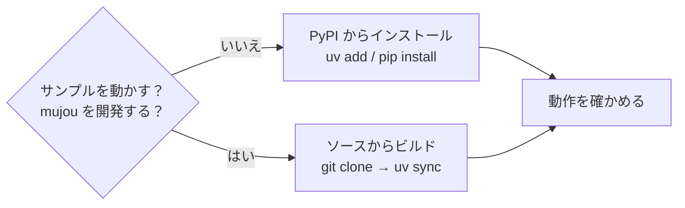
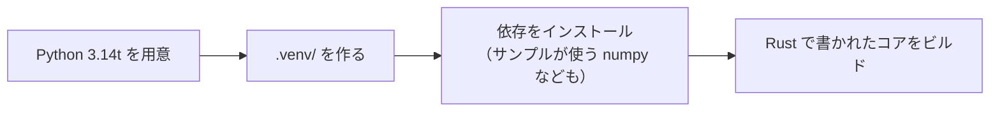

# 📦 インストール

!!! abstract "このページで分かること"

    - mujou を動かすのに必要なもの
    - PyPI からインストールする方法と、ソースからビルドする方法
    - インストールできたことの確かめ方



## 必要なもの

!!! abstract "要点"

    PyPI からインストールするなら Python 3.14 以上があればよい（wheel の無いプラットフォームでは Rust も要る）。ソースからビルドするには Rust と uv も要る。

| もの    | 条件                                                                          | PyPI から                        | ソースから |
| ------- | ----------------------------------------------------------------------------- | -------------------------------- | ---------- |
| Python  | 3.14 以上。free-threaded 版の 3.14t を推奨。GIL ありでも良い                  | 要る                             | 要る       |
| PyTorch | mujou の依存として自動でインストールされる                                    | 自動                             | 自動       |
| Rust    | 1.85 以上を [rustup](https://rustup.rs/) でインストール。ソースからのビルド用 | wheel の無いプラットフォームだけ | 要る       |
| uv      | [uv](https://docs.astral.sh/uv/)。ソースからのビルド用                        | `uv add` を使うなら              | 要る       |

### Python の版

| 版                     | Python で書いたノード同士        | 選び方       |
| ---------------------- | -------------------------------- | ------------ |
| 3.14t（free-threaded） | 並列に動く                       | 推奨         |
| 3.14（GIL あり）       | GIL を取り合い、並列に動きにくい | 使っても良い |

??? question "free-threaded 版を勧めるのはなぜ？"

    ノードは複数のワーカースレッドで同時に動くため、GIL の無い 3.14t を勧める。GIL ありの版では Python のノード同士が GIL を取り合い、並列に動きにくい。

!!! warning "API はまだ変わる"

    mujou は 0.x の段階にあり、リリースの種類によって API の変わり方が違う。

    | リリース          | 変わること             |
    | ----------------- | ---------------------- |
    | マイナー（0.x.0） | API が壊れることがある |
    | パッチ（0.x.y）   | バグの修正だけ         |

    === "避ける"

        ```toml
        dependencies = ["mujou"]  # 次のマイナーリリースで API が壊れうる
        ```

    === "こう書く"

        ```toml
        dependencies = ["mujou~=0.1.0"]  # マイナーバージョンを固定する
        ```

    マイナーバージョンを上げる前に [変更履歴](changelog.md) を読む。

## PyPI からインストールする

!!! abstract "要点"

    `uv add mujou` か `pip install mujou` でインストールする。下の表のプラットフォームには wheel があり、ビルドは要らない。

=== "uv"

    uv のプロジェクトで:

    ```sh
    uv add mujou
    ```

=== "pip"

    Python 3.14 以上の仮想環境で:

    ```sh
    pip install mujou
    ```

公開している wheel:

| OS      | アーキテクチャ  | Python        |
| ------- | --------------- | ------------- |
| Linux   | x86_64、aarch64 | 3.14 と 3.14t |
| macOS   | arm64           | 3.14 と 3.14t |
| Windows | x86_64          | 3.14 と 3.14t |

上の表にないプラットフォームでは pip が sdist からビルドするため、Rust（1.85 以上）が要る。

!!! tip "CPU 版や別の CUDA 版の PyTorch"

    PyTorch もほかの依存と同じく PyPI からインストールされる。CPU 版や別の CUDA 版を使うなら、[PyTorch のインストール案内](https://pytorch.org/get-started/locally/) を見る。

## ソースからビルドする

!!! abstract "要点"

    サンプルプログラムを動かすときや mujou 自体を開発するときは、リポジトリを clone して `uv sync` を実行する。

```sh
git clone https://github.com/Geson-anko/mujou.git
cd mujou
uv sync
```

`uv sync` がすること:



使う Python は `uv sync` の引数で選ぶ。

=== "3.14t（free-threaded、既定）"

    ```sh
    uv sync
    ```

=== "3.14（GIL あり）"

    ```sh
    uv sync --python 3.14
    ```

## 動作を確かめる

!!! abstract "要点"

    バージョンを表示し、最小のサンプル `quickstart.py` を走らせる。

=== "ソースからビルドした場合"

    clone したリポジトリで:

    ```sh
    uv run python -c "import mujou; print(mujou.__version__)"
    uv run python examples/quickstart.py
    ```

=== "pip でインストールした場合"

    [`examples/quickstart.py`](https://github.com/Geson-anko/mujou/blob/main/examples/quickstart.py) を手元にコピーしてから:

    ```sh
    python -c "import mujou; print(mujou.__version__)"
    python quickstart.py
    ```

| コマンド                   | 表示の例                                                |
| -------------------------- | ------------------------------------------------------- |
| `import mujou` して表示    | `0.1.0` のようなバージョン                              |
| `quickstart.py` を走らせる | `y = tensor([3., 5., 7.]) at t = 0.017 s` のような 1 行 |

2 つ目のプログラム `quickstart.py` とその出力は、[チュートリアルの最初のページ](tutorial/1-run.md)で説明する。
