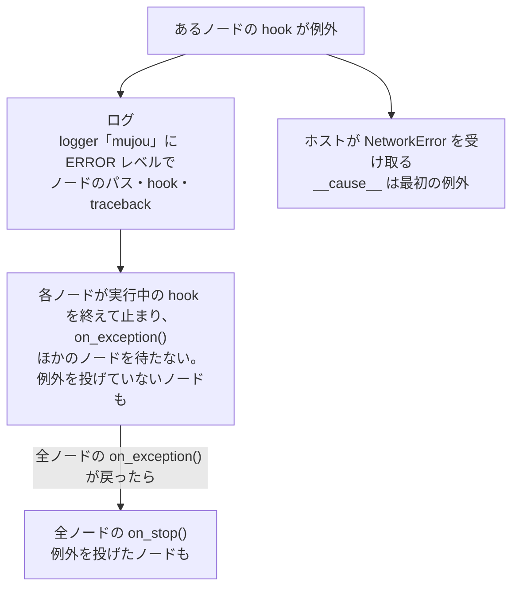
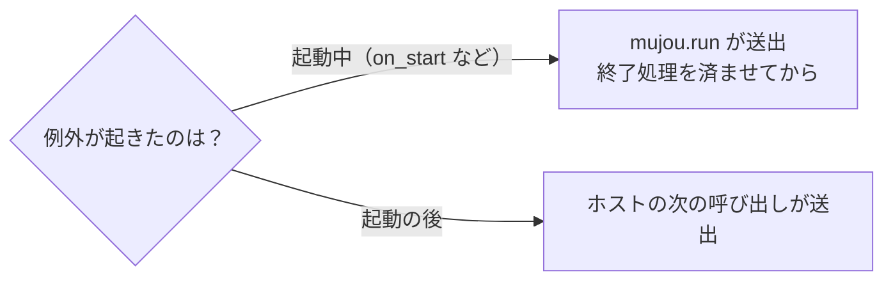
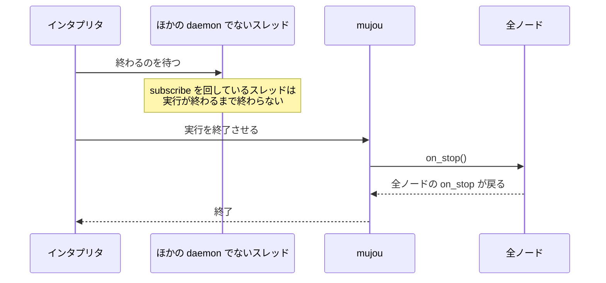

# 🚨 例外と終了

ノードの hook が例外を投げると何が起きるか、ホストがどこでそれを受け取るか、ホストの呼び出しのタイムアウトを説明する。

!!! abstract "このページで分かること"

    - 1 つのノードの例外で実行全体が止まるまでの流れ
    - ホストが `NetworkError` を受け取る場所と、`on_exception`・`on_stop` に書くこと
    - ホストの呼び出しのタイムアウトと、インタプリタの終了

## 1 つのノードの例外で全体が止まる

!!! abstract "要点"

    どのノードのどの hook（`on_update`・`on_start`・`state_dict` などどれでも）が例外を投げても、実行全体が止まる。全ノードで `on_exception()` → `on_stop()` の順に呼ばれる。



1. mujou がノードのパス・hook・traceback を logger `"mujou"` に ERROR レベルで出す
2. 各ノードは実行中の hook を終えて止まり、ほかのノードを待たずに自分の `on_exception()` を呼ぶ。例外を投げていないノードでも呼ばれる
3. 全ノードの `on_exception()` が戻ったら、全ノードの `on_stop()` を呼ぶ。例外を投げたノードでも呼ばれる
4. ホストは `NetworkError`（`RuntimeError` の派生）を受け取る。`__cause__` は最初の例外。ほぼ同時に投げられたほかのノードの例外はログに出るだけ

??? question "例外を投げたノードだけを止めないのはなぜ？"

    例外を投げたノードだけを止めると、隣のノードがその古い値を読み続け、気づかないうちに平衡から外れてしまう。

```python
--8<-- "examples/errors.py"
```

## ホストが受け取る場所

!!! abstract "要点"

    起動中の例外は `mujou.run` が、起動の後の例外はホストの次の呼び出しが `NetworkError` として送出する。



| 例外が起きたとき          | `NetworkError` を送出するもの                                                                                                                       |
| ------------------------- | --------------------------------------------------------------------------------------------------------------------------------------------------- |
| 起動中（`on_start` など） | `mujou.run`。終了処理（`on_exception`・`on_stop`）を済ませてから送出する                                                                            |
| 起動の後                  | 次の `write`・`read`・`read_with_time`・`subscribe`（とそのイテレータ）・`wait_for`・`state_dict`・`shutdown`・`join`、または `ManualRun` の `step` |

起動後の例外はホストの次の呼び出しで届くので、待つだけのホストは気づかない。`run.timer.sleep` ではなく `run.join(timeout=...)` で待つ（下のタブ）。

=== "避ける"

    ```python
    run = mujou.run(net)
    run.timer.sleep(10.0)  # ノードが例外を投げても気づかない
    ```

=== "こう書く"

    ```python
    run = mujou.run(net)
    run.join(timeout=10.0)  # ノードの例外は NetworkError で届く（10 秒で止まらなければ TimeoutError）
    ```

ノードが例外を投げた実行では、`with` ブロックの終わりで `shutdown` が送出する。

| `with` ブロックの本体 | ホストに伝わる例外                                                  |
| --------------------- | ------------------------------------------------------------------- |
| 正常に終わった        | `shutdown` が送出する `NetworkError`                                |
| 本体も例外を投げた    | 本体の例外。`NetworkError` は捨てられる（ノードの例外はログに残る） |

## `on_exception` と `on_stop`

!!! abstract "要点"

    `on_exception()` は異常終了に固有の処理、`on_stop()` は毎回の資源の解放。

| hook             | 呼ばれるとき                            | 書くこと                                           |
| ---------------- | --------------------------------------- | -------------------------------------------------- |
| `on_exception()` | 例外による終了時。全ノードで先に        | アクチュエータの安全停止など、異常終了に固有の処理 |
| `on_stop()`      | 終了のたびに 1 回。正常終了でも例外でも | I/O などの資源の解放。状態は変えない               |

| 疑問                                         | 答え                                                                                                                    |
| -------------------------------------------- | ----------------------------------------------------------------------------------------------------------------------- |
| ノードは止まった原因の例外を知る？           | 知らない。`on_exception` は引数を取らない。原因に応じた対処はホストが `__cause__` を見て行う                            |
| ノードの中で例外に対処するには？             | その hook の中で `try` で捕まえる。捕まえた例外は実行を止めない                                                         |
| `on_exception`・`on_stop` が例外を投げたら？ | ログに出るだけ。終了処理は続く                                                                                          |
| これらの hook の中の `self.timer` は？       | 進まない（[ノードが守る規則](../concepts.md#%E3%83%8E%E3%83%BC%E3%83%89%E3%81%8C%E5%AE%88%E3%82%8B%E8%A6%8F%E5%89%87)） |

## ログ

!!! abstract "要点"

    ノードの例外は traceback 付きで logger `"mujou"` に出る。出力先は Python の `logging` で変える。

ログを設定しないと標準エラー出力に出るが、次のコードは出力先を標準出力に変える。

```python
--8<-- "examples/errors.py:logging"
```

## 例外の後の状態

!!! abstract "要点"

    例外で終了した実行の状態は残らない。残したい状態は実行中に取得しておく。

| 場面                          | すること・起きること               |
| ----------------------------- | ---------------------------------- |
| 例外の後の `run.state_dict()` | `NetworkError` を送出              |
| 残したい状態                  | 実行中に取得。長い実行では定期的に |
| もう一度走らせる              | 新しいインスタンスを作る           |

## タイムアウト

!!! abstract "要点"

    待つ呼び出しは実時間の秒で `timeout` を取る。既定の `math.inf` は必要なだけ待つ。

`timeout` を取るのは `shutdown`・`join`・`subscribe`・`wait_for`・`state_dict`。実行のタイマーではなく実時間で数える。

| 呼び出し                                 | 時間切れのとき                                                                                                                 |
| ---------------------------------------- | ------------------------------------------------------------------------------------------------------------------------------ |
| `run.shutdown(timeout=...)`              | `TimeoutError`。終了の要求は取り消されず、ノードはもう更新しない。終了処理は続くので `join` で待つ                             |
| `run.join(timeout=...)`                  | `TimeoutError`。何も変わらない                                                                                                 |
| `run.subscribe(port, timeout=...)`       | イテレータが `TimeoutError` を送出する。時間はループの本体を含む反復全体で数える。実行は走り続ける                             |
| `run.wait_for(port, until, timeout=...)` | `TimeoutError`。実行は走り続ける                                                                                               |
| `run.state_dict(timeout=...)`            | 止まらないノードがあると `TimeoutError`（各ノードは実行中の `on_update` を終えてから止まる）。状態は取得せず、実行は走り続ける |

!!! warning "長い `on_update` は一時停止を遅らせる"

    1 回の `on_update` が長いノード（重い BP など）は、状態の取得のための一時停止をいつも遅らせる（各ノードは実行中の `on_update` を終えてから止まるため）。

## インタプリタの終了

!!! abstract "要点"

    実行中にインタプリタが終了すると、mujou が実行を終了させる。実行は `shutdown` か `with` ブロックで自分で終了させる。



実行中にインタプリタが終わると、ほかの daemon でないスレッドが終わった後に、mujou が実行を終了させて全ノードの `on_stop` を待つ。`subscribe` を回すスレッドは実行が終わるまで終われないので、実行は `shutdown` か `with` ブロックで自分で終了させる。
