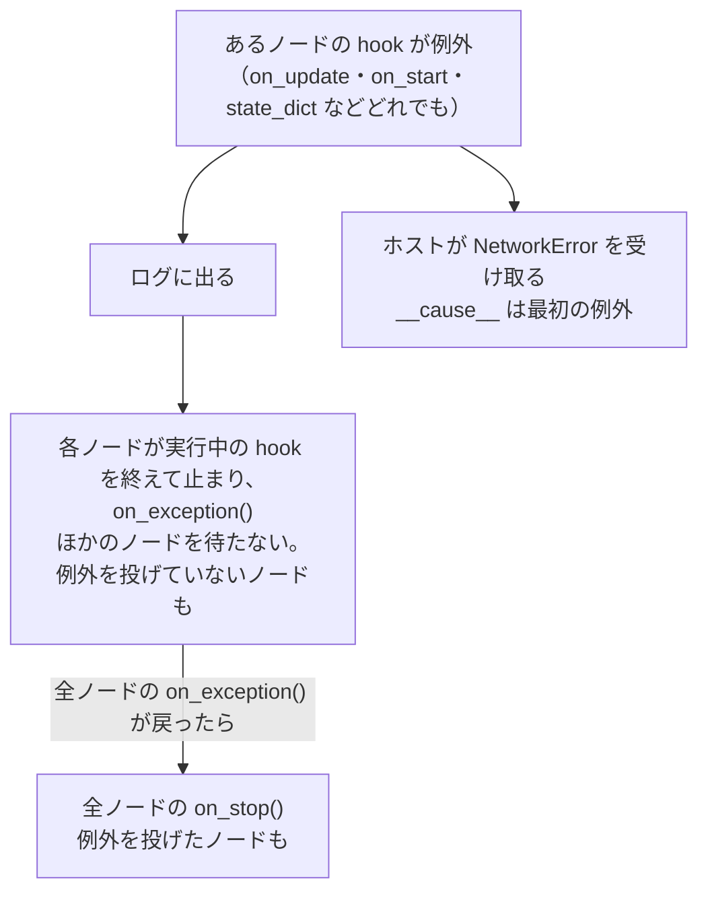
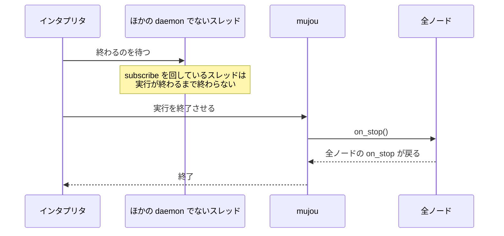

# 🚨 例外と終了

## 1 つのノードの例外で全体が止まる {#stop}



```python
--8<-- "examples/errors.py"
```

??? question "例外を投げたノードだけを止めないのはなぜ？"

    例外を投げたノードだけを止めると、隣のノードがその古い値を読み続け、気づかないうちに平衡から外れてしまう。

## ホストが受け取る場所 {#where}

起動中（`on_start` など）の例外は `mujou.run` が、起動後の例外はホストが次に呼ぶ [`Run`][mujou.Run] のメソッドが [`NetworkError`][mujou.NetworkError] として送出する。そのため待つだけのホストは `run.timer.sleep` ではなく `run.join(timeout=...)` で待つ。

=== "避ける"

    ```python
    run = mujou.run(net)
    run.timer.sleep(10.0)  # ノードが例外を投げても気づかない
    ```

=== "こう書く"

    ```python
    run = mujou.run(net)
    run.join(timeout=10.0)  # ノードの例外は NetworkError で届く（10 秒で止まらなければ TimeoutError）
    ```

## `on_exception` と `on_stop` {#hooks}

| hook                                        | 書くこと                                           |
| ------------------------------------------- | -------------------------------------------------- |
| [`on_exception()`][mujou.Node.on_exception] | アクチュエータの安全停止など、異常終了に固有の処理 |
| [`on_stop()`][mujou.Node.on_stop]           | I/O などの資源の解放。毎回の終了で呼ばれる         |

`on_exception` は引数を取らないため、ノードは止まった原因を知らず、原因に応じた対処はホストが `NetworkError` の `__cause__` を見て行う。ノードの中で例外に対処するなら、その hook の中で `try` で捕まえる（捕まえた例外は実行を止めない）。

## ログ {#logging}

ノードの例外は traceback 付きでログに出る（logger の名前とレベルは [`NetworkError`][mujou.NetworkError]）。出力先は Python の logging で変えられる。[上のプログラム](#stop) は `logging.basicConfig` の行で標準出力に変えている（設定しなければ標準エラー出力）。

## 例外の後の状態 {#state}

例外で終了した実行の状態は残らないので、残したい状態は実行中に（長い実行では定期的に）取得し、もう一度走らせるには新しいインスタンスを作る。

## タイムアウト {#timeouts}

待つ呼び出しの `timeout` がどの秒で数えるかは [時間の単位](time.md#units) の表にある。

!!! warning "長い `on_update` は一時停止を遅らせる"

    1 回の `on_update` が長いノード（重い BP など）は、状態の取得のための一時停止をいつも遅らせる（各ノードは実行中の `on_update` を終えてから止まるため）。

## インタプリタの終了 {#exit}


