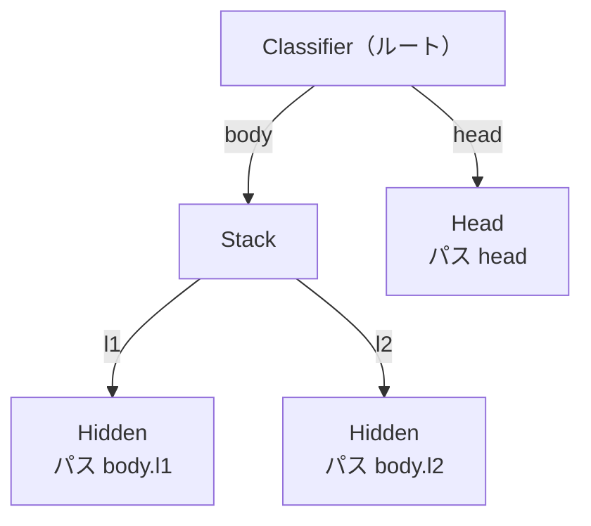
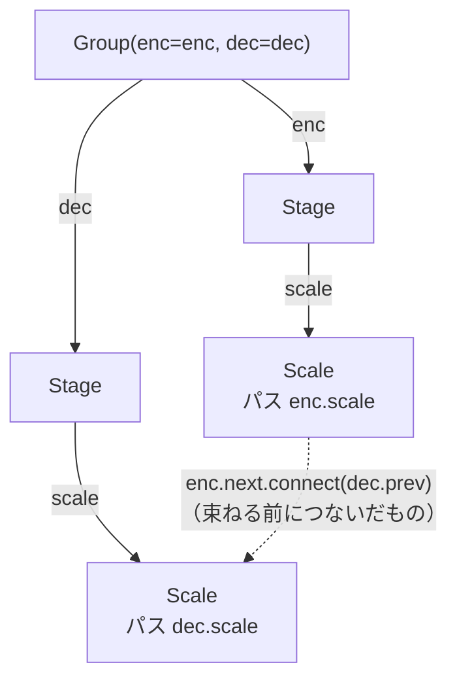
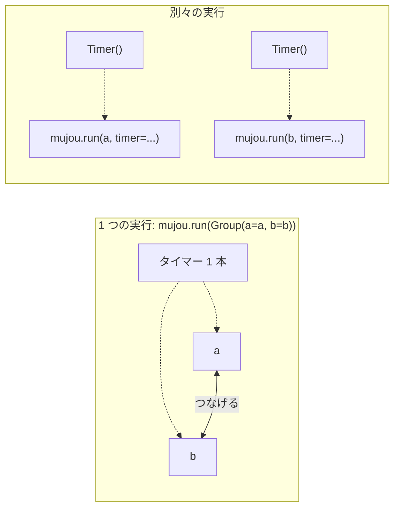
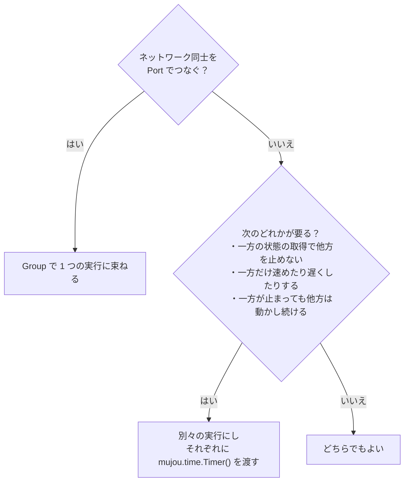

# 🗂️ Group

`mujou.run` が走らせるルートは 1 つ。複数のネットワークを 1 つの実行で走らせるには `mujou.Group` に並べる。

!!! abstract "このページで分かること"

    - ノードのパスの付き方
    - `Group` で複数のネットワークを 1 つの実行に並べる書き方
    - 1 つの実行に束ねるか、別々の実行に分けるかの選び方

## パス

!!! abstract "要点"

    ノードはパスで呼ぶ。パスはルートからの属性名を `.` でつないだもの。

```python
class Stack(mujou.Network):
    def __init__(self) -> None:
        super().__init__()
        self.l1 = Hidden(784, 256)
        self.l2 = Hidden(256, 256)
        self.l1.next.connect(self.l2.prev)
        self.prev, self.next = self.l1.prev, self.l2.next


class Classifier(mujou.Network):
    def __init__(self) -> None:
        super().__init__()
        self.body = Stack()  # ネットワークの中のネットワーク
        self.head = Head()
        self.body.next.connect(self.head.prev)  # body.next の実体は l2.next
        self.prev = self.body.prev  # 子が公開した Port を、さらに公開する
```



実行は属性を代入した順に読み、それが木の順になる。`Classifier` なら `"body.l1"`、`"body.l2"`、`"head"` の順。ルートとして渡したノード自身のパスは `""`。

!!! warning "属性名を変えると、保存した状態を復元できない"

    パスは状態の木のキーになる。そのためネットワークのパスは走らせ方によらず同じで、属性名を変えると、変える前に保存した状態は復元できなくなる。

## Group

!!! abstract "要点"

    `Group(enc=a, dec=b)` は各ネットワークをキーワードの下に置く。何もつながない入れ物。



```python
--8<-- "examples/group.py:group"
```

| ルート                    | `a` の中のノード `l1` のパス |
| ------------------------- | ---------------------------- |
| `a`                       | `"l1"`                       |
| `Group(enc=a, dec=b)`     | `"enc.l1"`                   |
| `node`（ノード 1 つだけ） | `""`                         |
| `Group(n=node)`           | `"n"`                        |

### 束ねるときの規則

| 規則                                           | 内容                                                                        |
| ---------------------------------------------- | --------------------------------------------------------------------------- |
| `Group` は何もつながない                       | ネットワーク同士は束ねる前か後に、`connect` でつなぐ                        |
| 入出力はネットワークの Port のまま             | `enc.prev`、`dec.next` をそのまま `inputs=` や `read` に使う                |
| 復元するときは同じキーワードで束ねる           | キーワードがパスの先頭になり、状態の木のキーになるため                      |
| 単独で走らせたネットワークは後から束ねられない | ノードは 1 回だけ走る。最初からまとめて走らせるか、新しいインスタンスを作る |

ノードが 1 回だけ走る規則は [ノードが守る規則](../concepts.md#%E3%83%8E%E3%83%BC%E3%83%89%E3%81%8C%E5%AE%88%E3%82%8B%E8%A6%8F%E5%89%87) にある。

=== "避ける"

    ```python
    with mujou.run(enc) as run:  # enc を単独で走らせた
        ...
    with mujou.run(Group(enc=enc, dec=dec)) as run:  # enc はもう走ったので RuntimeError
        ...
    ```

=== "こう書く"

    ```python
    with mujou.run(Group(enc=enc, dec=dec)) as run:  # 最初からまとめて走らせる
        ...
    ```

## 1 つの実行か、複数か

!!! abstract "要点"

    束ねたネットワークは 1 つの実行になり、1 本のタイマー・1 つの状態の木・1 つの終了を共有する。共有したくないなら別々の実行にし、それぞれに `Timer` を渡す。



| 項目       | 1 つの実行に束ねたとき                   | 別々の実行で、それぞれに `Timer` を渡したとき |
| ---------- | ---------------------------------------- | --------------------------------------------- |
| つなぐこと | できる                                   | できない。別の実行の Port はつなげない        |
| 状態の取得 | 全ノードを止め、同じ時刻の木を 1 つ取得  | 実行ごとに 1 つ。止まるのはその実行だけ       |
| 時間の速さ | 全ノードで同じ                           | 実行ごとに変えられる                          |
| 例外       | 1 つのノードの例外で全ネットワークが終了 | 例外を投げたノードの実行だけが終了            |

### 選び方



!!! warning "timer を渡さない実行はグローバルタイマーを共有する"

    `timer` を渡さない実行はどれも `mujou.time.global_timer` で走るので、1 つの状態を取得するとほかも止まる。止め合いたくないなら、それぞれに `Timer` を渡す（[時間](time.md)）。
