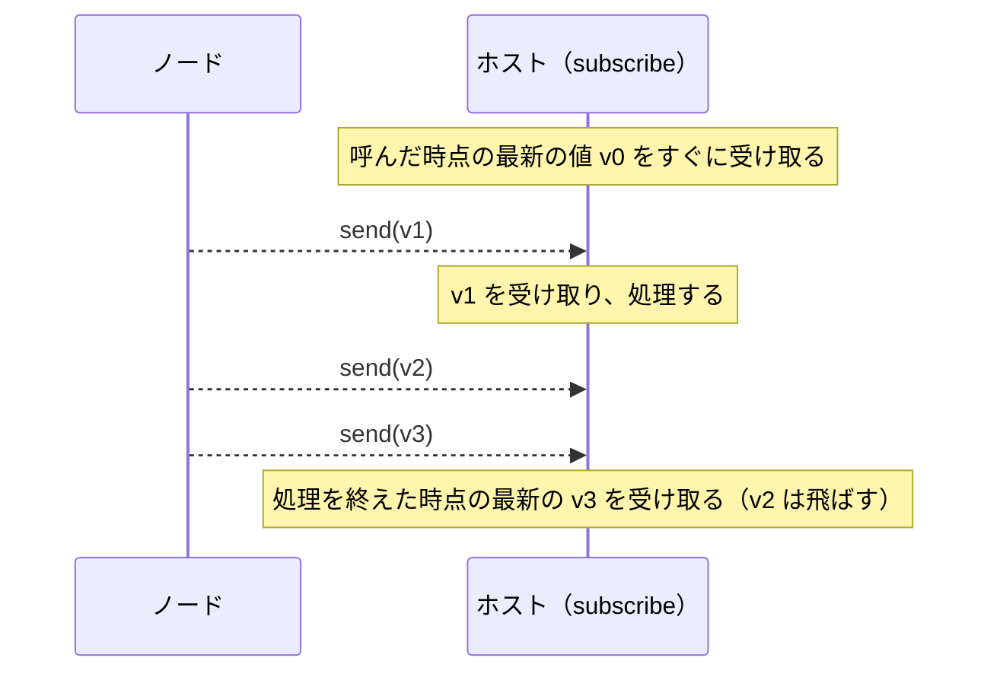

# 🏃 ホストの入出力

| したいこと                 | 使うもの                                                                                                                                         | 節                                             |
| -------------------------- | ------------------------------------------------------------------------------------------------------------------------------------------------ | ---------------------------------------------- |
| 入力を書く                 | [`run.write`][mujou.Run.write]                                                                                                                   | [書く](#write)                                 |
| 最初の更新から入力を見せる | [`mujou.run`][mujou.run] の `inputs=`                                                                                                            | [初期値](#initial-values)                      |
| 入力を一定時間見せる       | [`run.timer.sleep`][mujou.time.Timer.sleep]                                                                                                      | [入力をしばらく見せる](#show-input)            |
| 出力を読む・待つ           | [`run.read`][mujou.Run.read]・[`read_with_time`][mujou.Run.read_with_time]・[`subscribe`][mujou.Run.subscribe]・[`wait_for`][mujou.Run.wait_for] | [読む](#read)                                  |
| 状態を取得する             | [`run.state_dict`][mujou.Run.state_dict]                                                                                                         | [保存と再開](../tutorial/6-save-and-resume.md) |
| 実行を終える               | `with` ブロック・[`run.shutdown`][mujou.Run.shutdown]・[`run.join`][mujou.Run.join]                                                              | [終了させる](#shutdown)                        |

## 書く {#write}

ホストが [`Run.write`][mujou.Run.write] で書けるのは、受け取る型を持ちつながっていない Port だけ（ほかの Port はノードが書く）。
書いた値は次に書くまで残り、ノードは同じ値を何度も読む。
入力とその目標のように組になる値は 1 回の write で書く（理由は [組になる値は DictSpec で](ports.md#pairs)）。

```python
run.write({net.prev: x, net.teacher: y})  # x と y は一緒に切り替わる
```

## 初期値 {#initial-values}

| 方法                                          | 使う Port         | 読む側が受け取るもの                   | その時刻             |
| --------------------------------------------- | ----------------- | -------------------------------------- | -------------------- |
| 何もしない                                    | —                 | spec の初期値（[spec](ports.md#spec)） | `None`               |
| [`Port(send=..., initial=value)`][mujou.Port] | ノードが送る Port | Port が最初に送るまで `value`          | `None`               |
| `mujou.run(net, inputs={port: value})`        | ホストが書く Port | 最初の更新から `value`                 | 実行が始まった時刻   |
| `run.write({port: value})`                    | ホストが書く Port | 書き込みの後は `value`                 | `write` が返した時刻 |

=== "避ける"

    ```python
    with mujou.run(net) as run:  # mujou.run が戻るとすぐにノードは更新を始める
        run.write({net.prev: x})  # それより前の何回かの更新はゼロを読むことがある
    ```

=== "こう書く"

    ```python
    with mujou.run(net, inputs={net.prev: x}) as run:  # 最初の更新から x
        ...
    ```

## 入力をしばらく見せる {#show-input}

```python
for x in stream:
    run.write({net.prev: x})
    run.timer.sleep(0.1)  # x を実行の時間で 0.1 秒見せる
    y = run.read(net.next)  # 見せ終わる時点の出力
```

<figure class="mujou-diagram">
<svg viewBox="0 0 640 230" role="img" aria-label="入力は write の時刻に段のように切り替わり、出力はそれより遅れてなめらかに追いつく。write の直後に読むと前の入力への出力が返り、sleep の後に読むと新しい入力への出力が返る">
<line class="mujou-axis" x1="90" y1="205" x2="620" y2="205"/>
<text class="mujou-label" x="620" y="222" text-anchor="end">実行のタイマー →</text>
<text class="mujou-label" x="10" y="64">入力</text>
<text class="mujou-label" x="10" y="150">出力</text>
<path d="M 90 80 L 330 80 L 330 45 L 620 45" style="fill: none; stroke: var(--md-typeset-a-color); stroke-width: 2.5"/>
<text class="mujou-note" x="200" y="72" text-anchor="middle">x₁</text>
<text class="mujou-note" x="475" y="37" text-anchor="middle">x₂</text>
<path d="M 90 175 C 140 175 170 137 330 136 C 380 136 410 110 620 108" style="fill: none; stroke: var(--md-accent-fg-color); stroke-width: 2.5"/>
<line class="mujou-lane" x1="330" y1="28" x2="330" y2="198" style="stroke-dasharray: 4 3"/>
<text class="mujou-note" x="330" y="20" text-anchor="middle">write(x₂)</text>
<circle cx="340" cy="136" r="4" style="fill: var(--md-default-fg-color--light)"/>
<text class="mujou-note" x="348" y="158">直後の read → x₁ への出力</text>
<circle cx="560" cy="109" r="4" style="fill: var(--md-default-fg-color--light)"/>
<text class="mujou-note" x="560" y="96" text-anchor="middle">sleep 後の read</text>
<path class="mujou-brace" d="M 332 186 Q 332 193 340 193 L 552 193 Q 560 193 560 186"/>
<text class="mujou-note" x="446" y="182" text-anchor="middle">run.timer.sleep で見せる時間</text>
</svg>
<figcaption>出力の遅れはノードの時定数や段数で決まる。十分な時間を見せる</figcaption>
</figure>

期待する出力が分かっているなら、sleep の代わりに [`wait_for`][mujou.Run.wait_for] で届くまで待つ（[実行](../tutorial/1-run.md#run)）。

## 読む {#read}

| 方法                                             | 向いている用途             |
| ------------------------------------------------ | -------------------------- |
| [`run.read`][mujou.Run.read]                     | 好きなときに最新の値を読む |
| [`run.read_with_time`][mujou.Run.read_with_time] | 値がどれだけ新しいかを知る |
| [`run.subscribe`][mujou.Run.subscribe]           | 新しい出力ごとに処理する   |
| [`run.wait_for`][mujou.Run.wait_for]             | 期待した出力が届くまで待つ |

実行の送る Port なら、つながっていても読める。つながっている Port を読めば、ネットワークの途中の値を変えずに観測できる。

### subscribe {#subscribe}



```python
--8<-- "examples/subscribe.py:subscribe"
```

## 終了させる {#shutdown}

=== "避ける"

    ```python
    run = mujou.run(net)
    ...  # run を捨てても、shutdown かインタプリタの終了まで走り続ける
    ```

=== "こう書く"

    ```python
    with mujou.run(net) as run:
        ...  # ブロックを抜けると shutdown() が呼ばれる
    ```

終了した後に `Run` のメソッドを呼んだときにどうなるかは [ホストが受け取る場所](errors.md#where) にある。
