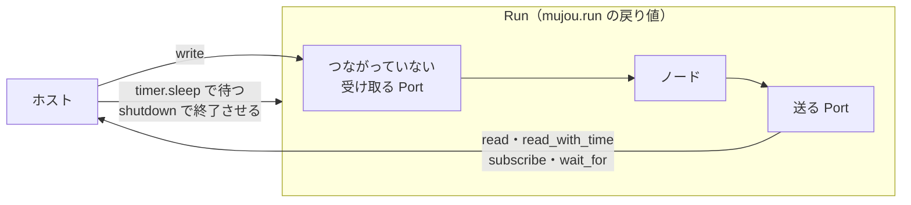
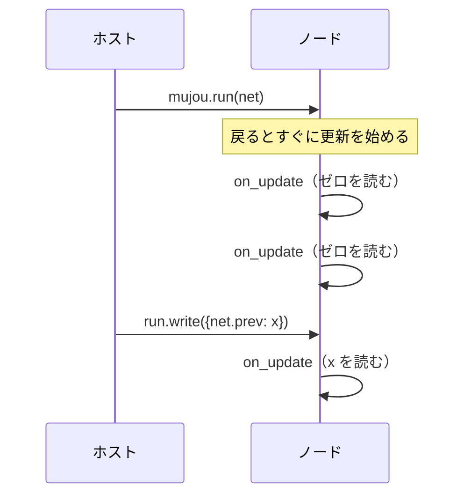
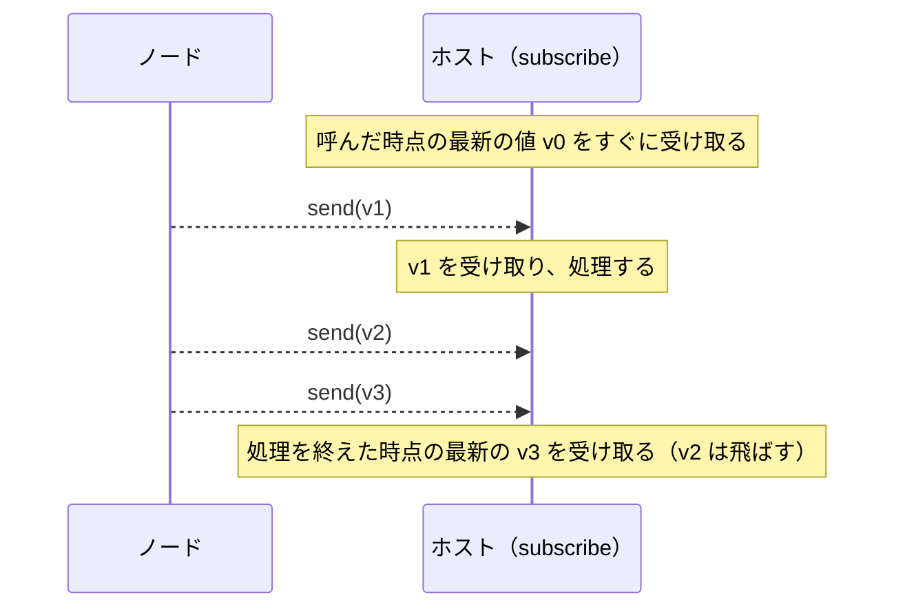
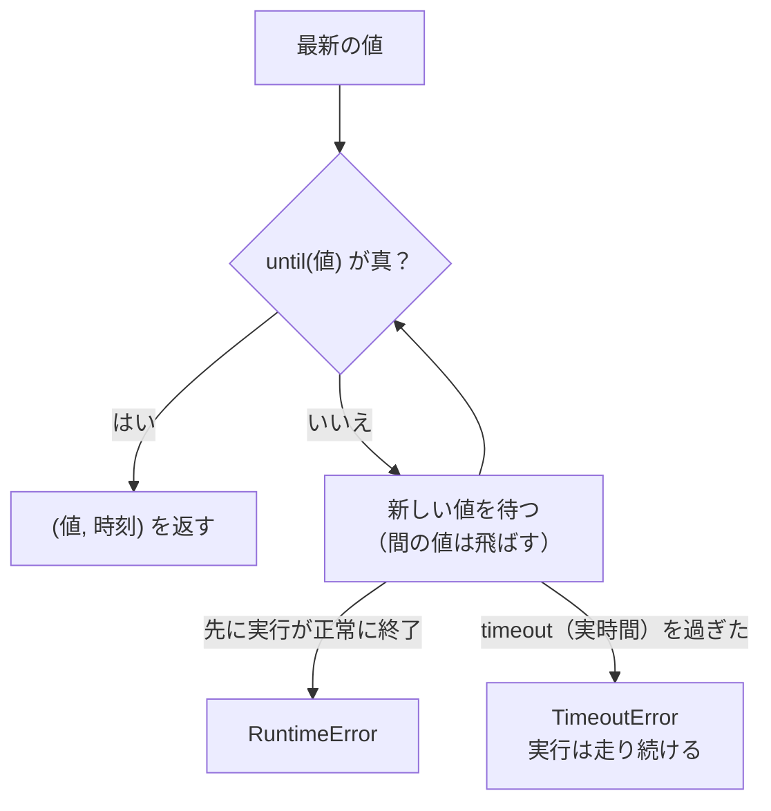
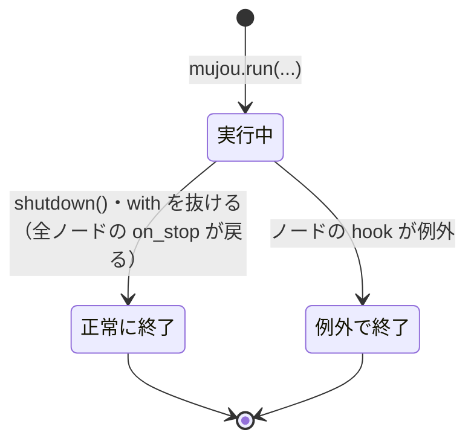

# 🏃 ホストの入出力

ホストはネットワークを走らせるプログラム。`mujou.run` が返す `Run` を通して実行とやり取りし、入力を書き、出力を読み、待ち、終了させる。



| したいこと                 | 使うもの                                    | 節                                                                                                                  |
| -------------------------- | ------------------------------------------- | ------------------------------------------------------------------------------------------------------------------- |
| 入力を書く                 | `run.write`                                 | [書く](#%E6%9B%B8%E3%81%8F)                                                                                         |
| 最初の更新から入力を見せる | `mujou.run(..., inputs=)`                   | [初期値](#%E5%88%9D%E6%9C%9F%E5%80%A4)                                                                              |
| 入力を一定時間見せる       | `run.timer.sleep`                           | [入力をしばらく見せる](#%E5%85%A5%E5%8A%9B%E3%82%92%E3%81%97%E3%81%B0%E3%82%89%E3%81%8F%E8%A6%8B%E3%81%9B%E3%82%8B) |
| 出力を読む・待つ           | `run.read`・`subscribe`・`wait_for` など    | [読む](#%E8%AA%AD%E3%82%80)                                                                                         |
| 実行を終える               | `with` ブロック・`run.shutdown`・`run.join` | [終了させる](#%E7%B5%82%E4%BA%86%E3%81%95%E3%81%9B%E3%82%8B)                                                        |

## 書く

!!! abstract "要点"

    ホストが書けるのは、受け取る型を持ちつながっていない `Port` だけ。書いた値は次に書くまで残る。

```python
t = run.write({net.prev: x, net.teacher: y})  # 書き込みの時刻を返す
```

書けるのは、実行の Port のうち受け取る型を持ち、つながっていないものだけ。ほかの Port はノードが書き、それ以外の Port に書くと `ValueError` になる。

| 性質             | 内容                                                       |
| ---------------- | ---------------------------------------------------------- |
| 次に書くまで残る | 入力は時間とともに変わる信号。ノードは同じ入力を何度も読む |
| 一緒に切り替わる | 1 回の `write` の値は同時に切り替わり、同じ時刻を持つ      |
| コピーされる     | 書いた後でテンソルを書き換えても、ネットワークには届かない |

### 組になる値は 1 回の write で

1 回の `write` の値は同時に切り替わるので、ある瞬間のノードには全部が新しいか全部が古いかのどちらかに見える。ただし、ノードが 2 つを順に読む間に次の `write` が割り込むことはある。時刻を比べれば分かる。入力とその目標のように組になる値は、1 回の `write` で書くか、1 つの `DictSpec` のメッセージにする。

=== "避ける"

    ```python
    run.write({net.prev: x})
    run.write({net.teacher: y})  # ノードは新しい x と古い y を読みうる
    ```

=== "こう書く"

    ```python
    run.write({net.prev: x, net.teacher: y})  # x と y は一緒に切り替わる
    ```

### 書けない値

書けない値を書くと、次の例外が送出される。どの例外も問題の Port をパスと属性名で名指しする。

| 書いた値                                      | 例外            |
| --------------------------------------------- | --------------- |
| 書けない Port（つながっている・受け取らない） | `ValueError`    |
| shape や dtype が spec と違う                 | `ValueError`    |
| 種別が違う（`IntSpec` にテンソルなど）        | `TypeError`     |
| キーの足りない dict・余分なキーのある dict    | `TypeError`     |
| `IntSpec` の範囲外の `int`                    | `OverflowError` |

## 初期値

!!! abstract "要点"

    ノードは `mujou.run` が戻るとすぐに更新を始める。最初の更新から入力を見せるなら `inputs=` で渡す。

| 方法                                   | 読む側が受け取るもの                 | その時刻             |
| -------------------------------------- | ------------------------------------ | -------------------- |
| 何もしない                             | ゼロ（スカラーは `0`、`False` など） | `None`               |
| `Port(send=..., initial=value)`        | Port が最初に送るまで `value`        | `None`               |
| `mujou.run(net, inputs={port: value})` | 最初の更新から `value`               | 実行が始まった時刻   |
| `run.write({port: value})`             | 書き込みの後は `value`               | `write` が返した時刻 |

`initial` はノードが送る Port の初期値に、`inputs` と `write` はホストが書く Port に使う。



=== "避ける"

    ```python
    with mujou.run(net) as run:
        run.write({net.prev: x})  # それより前の何回かの更新はゼロを読むことがある
    ```

=== "こう書く"

    ```python
    with mujou.run(net, inputs={net.prev: x}) as run:  # 最初の更新から x
        ...
    ```

## 入力をしばらく見せる

!!! abstract "要点"

    入力を書いたら `run.timer.sleep(seconds)` で見せる時間だけ待つ。出力は入力より遅れて追いつく。

```python
for x in stream:
    run.write({net.prev: x})
    run.timer.sleep(0.1)  # x を実行の時間で 0.1 秒見せる
    y = run.read(net.next)  # 見せ終わる時点の出力
```

<figure class="mujou-diagram">
<svg viewBox="0 0 640 230" role="img" aria-label="入力は write の時刻に段のように切り替わり、出力はそれより遅れてなめらかに追いつく。write の直後に読むと前の入力への出力が返り、sleep の後に読むと新しい入力への出力が返る">
<line class="mujou-axis" x1="90" y1="205" x2="620" y2="205"/>
<text class="mujou-label" x="620" y="222" text-anchor="end">実行のタイマー →</text>
<text class="mujou-label" x="10" y="64">入力</text>
<text class="mujou-label" x="10" y="150">出力</text>
<path d="M 90 80 L 330 80 L 330 45 L 620 45" style="fill: none; stroke: var(--md-typeset-a-color); stroke-width: 2.5"/>
<text class="mujou-note" x="200" y="72" text-anchor="middle">x₁</text>
<text class="mujou-note" x="475" y="37" text-anchor="middle">x₂</text>
<path d="M 90 175 C 140 175 170 137 330 136 C 380 136 410 110 620 108" style="fill: none; stroke: var(--md-accent-fg-color); stroke-width: 2.5"/>
<line class="mujou-lane" x1="330" y1="28" x2="330" y2="198" style="stroke-dasharray: 4 3"/>
<text class="mujou-note" x="330" y="20" text-anchor="middle">write(x₂)</text>
<circle cx="340" cy="136" r="4" style="fill: var(--md-default-fg-color--light)"/>
<text class="mujou-note" x="348" y="158">直後の read → x₁ への出力</text>
<circle cx="560" cy="109" r="4" style="fill: var(--md-default-fg-color--light)"/>
<text class="mujou-note" x="560" y="96" text-anchor="middle">sleep 後の read</text>
<path class="mujou-brace" d="M 332 186 Q 332 193 340 193 L 552 193 Q 560 193 560 186"/>
<text class="mujou-note" x="446" y="182" text-anchor="middle">run.timer.sleep で見せる時間</text>
</svg>
<figcaption>入力は <code>write</code> の時刻に切り替わり、出力は遅れて追いつく。遅れはネットワークのダイナミクスで決まる</figcaption>
</figure>

`sleep` は実行のタイマーで待つため、実行の時間の速さと一時停止に従う。出力の遅れはノードの時定数や段数で決まるので、十分な時間を見せる。`write` の直後に読むと前の入力への出力が返るので、期待する出力が分かっているなら `wait_for` で待つ。

## 読む

!!! abstract "要点"

    実行の送る Port なら、つながっていてもいなくても読める。返すのは最後に `send` した値の、CPU の上の新しいコピー。

| 方法                        | 返すもの                                                       | 向いている用途             |
| --------------------------- | -------------------------------------------------------------- | -------------------------- |
| `run.read(port)`            | 最新の値                                                       | 好きなときに読む           |
| `run.read_with_time(port)`  | 最新の値と送られた時刻の組 `(value, Timestamp \| None)`        | 値がどれだけ新しいかを知る |
| `run.subscribe(port)`       | 前より新しい `(value, Timestamp \| None)` を順に返すイテレータ | 新しい出力ごとに処理する   |
| `run.wait_for(port, until)` | `until` を満たす最初の `(value, Timestamp \| None)`            | 期待した出力が届くまで待つ |

つながっている Port を読めば、ネットワークの途中の値を変えずに観測できる。最初に `send` するまでは初期値が返り、その時刻は `None` になる。

### subscribe



| いつ                     | どうなるか                       |
| ------------------------ | -------------------------------- |
| 最初の 1 回              | 最新の値を待たずに返す           |
| その後                   | 新しい値を 1 つずつ待って返す    |
| ホストの読むのが遅い     | 間の値は飛ばされる               |
| 実行が正常に終了         | 反復が終わる                     |
| `break` でループを抜ける | 反復が終わる。実行は走り続ける   |
| `timeout=` を過ぎる      | `TimeoutError`。実行は走り続ける |

```python
--8<-- "examples/subscribe.py:subscribe"
```

### wait_for



```python
y, t = run.wait_for(net.next, lambda y: torch.equal(y, expected), timeout=5.0)
```

`timeout` は実時間の秒で、既定は無期限。時間切れになると `TimeoutError` が送出されるが、実行は走り続ける。詳しくは [例外と終了](errors.md#%E3%82%BF%E3%82%A4%E3%83%A0%E3%82%A2%E3%82%A6%E3%83%88)。

## 終了させる

!!! abstract "要点"

    実行は自分で終了させる。通常は `with mujou.run(...) as run:` で書く。



| 方法                          | すること                                                                                         |
| ----------------------------- | ------------------------------------------------------------------------------------------------ |
| `with mujou.run(...) as run:` | ブロックを抜けるときに `shutdown()` を呼ぶ。通常はこれを使う                                     |
| `run.shutdown(timeout=...)`   | 全ノードに終了を求め、全ノードの `on_stop` が戻るまで待つ                                        |
| `run.join(timeout=...)`       | 終了を求めずに終了まで待つ。別のスレッドが `shutdown` を呼んだ後や、ノードの例外を待つときに使う |

=== "避ける"

    ```python
    run = mujou.run(net)
    ...  # run を捨てても、shutdown かインタプリタの終了まで走り続ける
    ```

=== "こう書く"

    ```python
    with mujou.run(net) as run:
        ...  # ブロックを抜けると shutdown() が呼ばれる
    ```

### 終了した後の呼び出し

| 呼び出し           | 正常に終了した後       | ノードの例外で終了した後 |
| ------------------ | ---------------------- | ------------------------ |
| `run.shutdown()`   | 何もしない             | `NetworkError`           |
| `run.write(...)`   | `RuntimeError`         | `NetworkError`           |
| `run.state_dict()` | 最後の状態を取得できる | `NetworkError`           |

ノードが例外を投げると、以後の `Run` の呼び出しは `NetworkError` を送出する。詳しくは [例外と終了](errors.md)。
