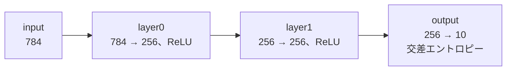
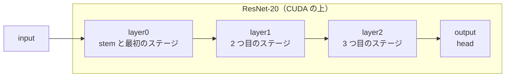

# 📊 PC-ALM の実験

`examples/mnist/` と `examples/cifar10/` で [`pc.Chain`][mujou.pc.Chain] を学習させ、同じ初期重み・同じバッチの BP と比べた結果と、ネットワークの切り方・`cuda_graph` が速さに与える効果。

## MNIST {#mnist}



| 結果（seed 0）            | PC-ALM                                      | BP     |
| ------------------------- | ------------------------------------------- | ------ |
| 3 epoch 後のテスト精度    | 97.69%                                      | 97.53% |
| prequential 精度          | どの epoch も BP との差が 0.11 ポイント以内 | —      |
| 1 バッチの計算時間（CPU） | BP の約 40 倍                               | —      |

```sh
uv run python examples/mnist/main.py            # 3 epoch、約 2 分
uv run python examples/mnist/main.py --epochs 1 --watch
```

```python
--8<-- "examples/mnist/main.py:chain"
```

```python
--8<-- "examples/mnist/main.py:run"
```

| 用語・オプション           | 意味                                                                                                                                                                         |
| -------------------------- | ---------------------------------------------------------------------------------------------------------------------------------------------------------------------------- |
| prequential 精度（学習中） | 各バッチへの最初の予測（[`pc.show`][mujou.pc.show] が返すもの）で測る。まだ見ていないデータをどれだけ当てられるか                                                            |
| テスト精度                 | ホストはテストのバッチを `mask` をすべて False にして見せるので、どのノードもそこから学ばない。採点には元の `mask` を取っておく。切り替える推論モードは無い                  |
| 最後のバッチ               | `data.batches` は、どのバッチも spec の大きさになるよう、最後のバッチの不足分を `mask` が False のゼロで埋める。正解を数えるのは元の `mask` が True のサンプルだけ           |
| `--watch`                  | 各ノードの `dt` を数え（`watch.py`）、更新が中央値で 1.5 周期、99% 点で 2 周期より遅れると警告する。`--time-scale 2` でも更新の 99% が 1.25 周期以内に来て、精度も同じだった |

| ファイル     | `mnist/`                            | `cifar10/`                                         |
| ------------ | ----------------------------------- | -------------------------------------------------- |
| `main.py`    | 入口                                | 入口                                               |
| `data.py`    | データを読む                        | データを読んで拡張する                             |
| `metrics.py` | 測る                                | 測る                                               |
| `bp.py`      | BP の基準を学習させる               | BP の基準を学習させる                              |
| `watch.py`   | ノードの `dt` を数える（`--watch`） | —                                                  |
| `resnet.py`  | —                                   | ネットワークを組み、少ないノードに切る理由を述べる |

`data.py`・`metrics.py`・`bp.py` は `mujou.pc` に依存せず、データは素のテンソル、BP の基準は素の PyTorch で書く。

## CIFAR-10 {#cifar-10}



| 結果（seed 0）          | PC-ALM | BP      |
| ----------------------- | ------ | ------- |
| 3 epoch 目 prequential  | 57.11% | 55.91%  |
| 3 epoch 後 テスト       | 59.47% | 61.76%  |
| 10 epoch 目 prequential | 73.05% | 73.20%  |
| 10 epoch 後 テスト      | 73.90% | 74.35%  |
| 1 epoch の時間          | 48 秒  | 8〜9 秒 |

学習率は減衰させないので、テスト精度はどちらも epoch ごとに数ポイント動く。GPU の計算は実行ごとにビット単位では一致しない。

```sh
uv run python examples/cifar10/main.py              # 3 epoch、RTX 4090 で約 4 分
uv run python examples/cifar10/main.py --epochs 10  # 約 13 分
```

```python
--8<-- "examples/cifar10/main.py:chain"
```

| 設定                 | 内容                                                                                                                                                                                        |
| -------------------- | ------------------------------------------------------------------------------------------------------------------------------------------------------------------------------------------- |
| ステージごとのノード | ノードの内側では autograd がモジュール（ブロックとそのスキップ接続・活性化を含む）を微分し（BP）、ノードの間には PC-ALM のメッセージだけが流れる                                            |
| 1 バッチに 12 周期   | 32 サンプルのバッチを 12 周期ずつ見せ、学ぶのはその 0.9 の時点。`Input` から `Output` までの credit の往復は最大 8 周期                                                                     |
| GPU で実時間の 2 倍  | `device="cuda"`（[メッセージの通り道](threads-and-devices.md#message-paths)）。`tau.h` は 10 ms で、周期はタイマーで 5 ms。`--time-scale 2` で実時間では 2.5 ms。更新の間隔は平均 1.00 周期 |
| バッチは 32          | 1 回の更新のコストは 32 サンプルでも 128 サンプルでもほぼ同じ。大きいバッチで得をするのは BP のほう                                                                                         |
| AdamW                | [optimizer を選ぶ](pc.md#optimizer)の換算で Adam の `lr` から作る。BP の基準も同じ `pc.optim.AdamW` をモデル全体に束ね、1 バッチに 1 回、見せる時間だけ進める                               |
| GroupNorm            | BatchNorm の代わり。移動統計も切り替えるモードも無い。詰め物も含め、バッチの中のサンプルは互いに影響しない                                                                                  |

## ノードの数と周期 {#node-count}

GPU 1 枚では全ノードの 1 周期のコストが切り方によらずほぼ同じで、CPU からのカーネル起動で律速される（1 回の更新に約 1.7 ms）。

| 切り方               | ノード数 | バッチ | 1 バッチの周期 | 周期                           | 結果                                                               |
| -------------------- | -------- | ------ | -------------- | ------------------------------ | ------------------------------------------------------------------ |
| ステージごと（既定） | 5        | 32     | 12             | タイマーで 5 ms、実時間 2.5 ms | [CIFAR-10](#cifar-10) の結果                                       |
| 残差ブロックごと     | 11       | —      | 24             | 実時間 2.5 ms                  | ノードが周期に追いつかなかった                                     |
| 残差ブロックごと     | 11       | 128    | —              | 5 ms                           | 3 epoch 目は prequential 53.94%・テスト 57.67%。時間は BP の 17 倍 |

## cuda_graph {#cuda-graph}

```python
layer = pc.Layer(stage, act_spec=spec, tau=tau, optimizer=optimizer, learn_interval=learn_interval, device="cuda", cuda_graph=True)
```

GPU で小さいバッチを扱う [`pc.Layer`][mujou.pc.Layer] の更新は CPU からのカーネル起動で律速されるが、`cuda_graph=True` で vector-Jacobian product を CUDA graph から再生すると、ViT の視覚のステージ・1 サンプル（RTX 4090）で積が 2.06 ms から 0.47 ms になった。
