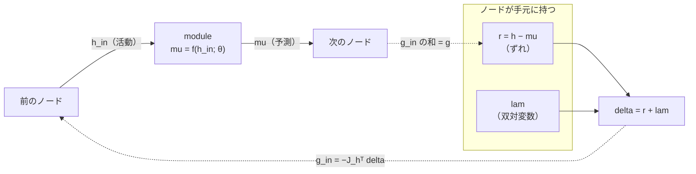
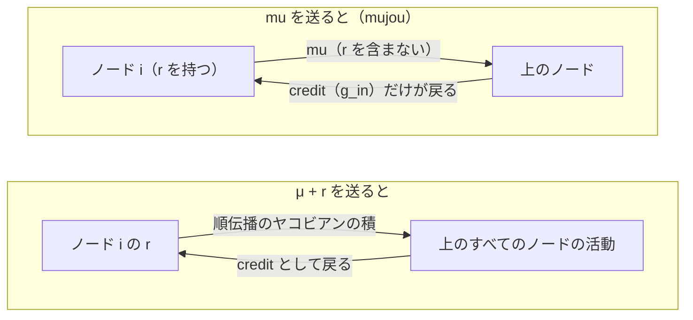
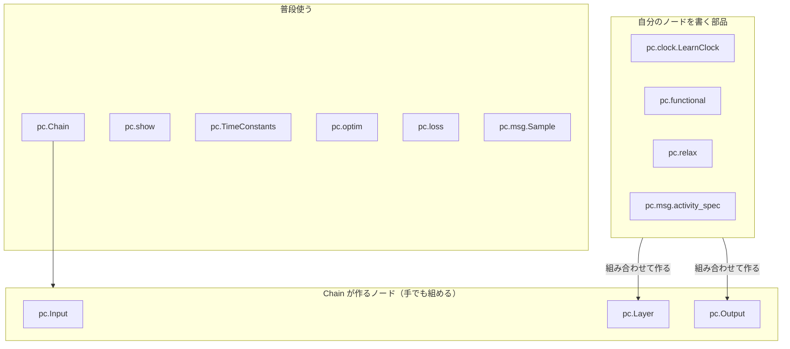
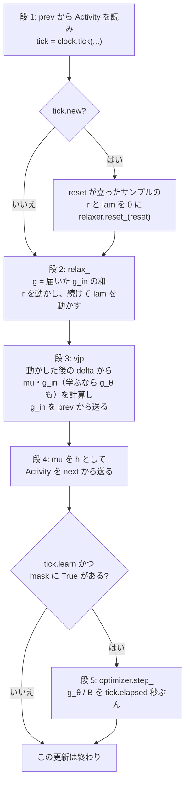
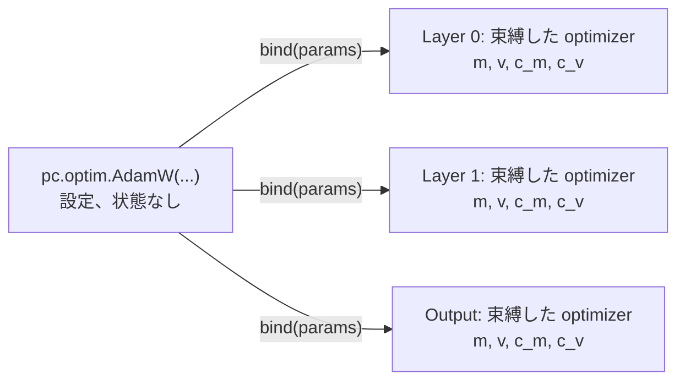

# 🔩 mujou.pc の仕組み

`mujou.pc` の部品の役割と、1 回の更新で何を計算するかを説明する。読み終えると [PC-ALM](pc.md) の「自分のノードを書く」と `examples/pc_merge.py` に出てくる名前が分かる。使い方は [5. PC-ALM で学習する](../tutorial/5-learn-with-pc.md) で。

!!! abstract "このページで分かること"

    - `mujou.pc` の部品の役割と、利用者が直接使う部品・自分のノードを書くときに使う部品
    - ノードの間を流れるメッセージと Port の向き
    - `pc.Layer` が 1 回の `on_update(dt)` で行うこと
    - `pc.clock.LearnClock` が返す `Tick` と `pc.TimeConstants` の意味
    - `pc.optim.SGD` と `pc.optim.AdamW` が重みを、`pc.relax.Euler` がずれ `r` を時間で動かす仕組み

    前提は PyTorch・誤差逆伝播法（BP）と、[Mujou の仕組み](../concepts.md)のノード・Port・`dt`。predictive coding の知識は要らない。

## 節の案内

| 節                                                                                                                       | 分かること                                         |
| ------------------------------------------------------------------------------------------------------------------------ | -------------------------------------------------- |
| [ノードが持つ量](#%E3%83%8E%E3%83%BC%E3%83%89%E3%81%8C%E6%8C%81%E3%81%A4%E9%87%8F)                                       | `h`・`mu`・`r`・`lam`・`delta`・`g_in`・`g` の意味 |
| [1. 部品](#1-%E9%83%A8%E5%93%81)                                                                                         | `mujou.pc` の部品と使う場面                        |
| [2. つながりと流れるもの](#2-%E3%81%A4%E3%81%AA%E3%81%8C%E3%82%8A%E3%81%A8%E6%B5%81%E3%82%8C%E3%82%8B%E3%82%82%E3%81%AE) | メッセージと Port の向き                           |
| [3. Layer の 1 回の更新](#3-layer-%E3%81%AE-1-%E5%9B%9E%E3%81%AE%E6%9B%B4%E6%96%B0)                                      | `on_update(dt)` の 5 段                            |
| [4. LearnClock](#4-learnclock)                                                                                           | いつ学ぶか                                         |
| [5. TimeConstants](#5-timeconstants)                                                                                     | `r` と `lam` の速さ                                |
| [6. optimizer](#6-optimizer)                                                                                             | 重みを秒で動かす仕組み                             |
| [7. relaxer](#7-relaxer)                                                                                                 | `r` を秒で動かす仕組み                             |

## ノードが持つ量

!!! abstract "要点"

    各ノードは前のノードの活動から自分の活動を予測する。`pc.Layer` は予測からのずれ `r` と双対変数 `lam` を手元に持ち、予測 `mu` だけを次のノードへ送る。

各ノードには**活動** `h` があり、前のノードの活動から自分の活動を**予測**する。`pc.Layer` は予測からの**ずれ** `r` を持ち、予測 `mu` を次のノードへ送る。量はすべて下の図と表にある。



実線は前へ流れる活動、点線は後ろへ戻る勾配。`h = mu + r` はノードの中にとどまる。

| 量      | 式                                   | 意味                                                                         |
| ------- | ------------------------------------ | ---------------------------------------------------------------------------- |
| `h_in`  |                                      | 前のノードから届いた活動                                                     |
| `mu`    | $\mu = f(h_{\mathrm{in}};\theta)$    | 予測。ノードの `module` の出力。$\theta$ は `module` の重み                  |
| `r`     | $r = h - \mu$                        | 予測からのずれ。ノードはこれを持つ                                           |
| `h`     | $h = \mu + r$                        | 自分の活動。ノードの中にとどまり、次のノードは `mu` を読む                   |
| `lam`   | $\tau_\lambda\dot\lambda = r$        | 双対変数。ずれを時間で溜めた値                                               |
| `delta` | $\delta = r + \lambda$               | ノードの誤差                                                                 |
| `g_in`  | $g_{\mathrm{in}} = -J_h^\top \delta$ | 前のノードへ送り返す勾配（$J_h$ は `module` の `h_in` についてのヤコビアン） |
| `g`     |                                      | 次のノードたちから届いた `g_in` の和                                         |

`r` と `lam` は次の式に従って時間で動く。

$$
\tau_h \dot r = -(r + \lambda + g) - \frac{\tau_h}{\tau_r}\,r,\qquad
\tau_\lambda \dot\lambda = r
$$

| 量    | 動き方                                                   |
| ----- | -------------------------------------------------------- |
| `r`   | `delta` と `g` の和を打ち消す向き。時定数 `tau.r` で減衰 |
| `lam` | `r` が残る間、溜まり続ける                               |

`r` と `lam` が両方止まった点（平衡点）では次が成り立つ。

| 平衡点で   | 値                                      |
| ---------- | --------------------------------------- |
| `r`        | 0。`h` は forward の値                  |
| `lam`      | BP の credit $-\partial\ell/\partial h$ |
| 重みの勾配 | BP の勾配と一致                         |

理論の詳細は [PC-ALM の記事](https://pub.sakana.ai/pc-alm/)にある。記事のノードは `h` を持って `h` を送るが、mujou のノードは `r` を持ち `mu` を送る。その理由は次の節で述べる。

### ノードが r を持ち、mu を送る理由 {#r-mu}

!!! abstract "要点"

    `r` を持てば、予測 `mu` が跳んでも偽の誤差が出ない。`mu` を送れば credit は後ろへだけ流れ、1 ノードで安定な刻みがどの鎖でも安定する。

| 選び方             | 記事のノード: `h` を持ち $\mu + r$ を送る                                        | mujou のノード: `r` を持ち `mu` を送る |
| ------------------ | -------------------------------------------------------------------------------- | -------------------------------------- |
| `mu` が跳んだとき  | `h` が残り、$r = h - \mu$ が急に大きくなる。偽の誤差が `g_in` と重みの勾配に入る | ずれ `r` をそのまま保つ                |
| 前へ流れる活動     | $\mu + r$                                                                        | 順伝播の値 `mu`                        |
| credit の流れ      | `r` の動きが上のノードの活動を動かし、自分へ戻るループ                           | 後ろへだけ                             |
| 順伝播が増幅する鎖 | 刻みをどれだけ短くしても発散                                                     | 1 ノードで安定な刻みは、どの鎖でも安定 |
| 平衡点             | 同じ                                                                             | 同じ                                   |

予測 `mu` は (a) 新しいサンプルが来たとき、(b) 下のノードが学んだとき、(c) 自分が学んだときに一度に跳ぶ。上の表のとおり、`r` を持つノードはそのどれでもずれを保つ。



送るのを $\mu + r$ でなく `mu` にすることは、predictive coding の**固定予測の仮定**（fixed prediction assumption）にあたる。前へ流れるのは順伝播の値で、credit は後ろへだけ流れる。$\mu + r$ を送ると、`r` の動きがヤコビアンの積を通って上のすべてのノードの活動を動かし、credit として自分に戻る。増幅する鎖では、このループは刻みをどれだけ短くしても発散する。`mu` を送ればループを切れ、平衡点は変わらないので、1 ノードで安定な刻みはどの鎖でも安定になる。

!!! note "credit が戻る速さ"

    [5 節](#5-timeconstants)のふつうの値なら、1 回の更新で `delta` が `-g` になり、同じ更新のうちに前のノードへ送られる（[3 節](#3-layer-%E3%81%AE-1-%E5%9B%9E%E3%81%AE%E6%9B%B4%E6%96%B0)）。そのため credit は 1 ホップ（ノードの間の接続 1 つ）を最大 1 周期で戻る。

### 新しいサンプルのリセットと持ち越し

!!! abstract "要点"

    `r` と `lam` は見てきたサンプルの credit。無関係な次のサンプルでは 0 に戻し、前に続くサンプルでは持ち越す。

| 次のサンプル                         | ホストが書く `reset` | 各ノードがそのサンプルについて行うこと              |
| ------------------------------------ | -------------------- | --------------------------------------------------- |
| 無関係（シャッフルしたバッチなど）   | True                 | その書き込みを初めて見たときに `r` と `lam` を 0 に |
| 前に続く（ストリームの次のフレーム） | False                | `r` と `lam` を持ち越す                             |

シャッフルしたバッチのように次のサンプルが無関係なら、`r` と `lam` に残った credit は次のサンプルにとって誤り。そこでホストが `reset` を立て、各ノードはそのサンプルの `r` と `lam` を 0 にする。

## 1. 部品

!!! abstract "要点"

    利用者が普段使うのは `Chain`・`show`・`TimeConstants`・optimizer・損失・`Sample`。自分のノードを書くときに `LearnClock`・`functional`・`Activity` を使う。



| 部品                                                    | 種類       | 役割                                                                                                                      | 主に使う場面    |
| ------------------------------------------------------- | ---------- | ------------------------------------------------------------------------------------------------------------------------- | --------------- |
| `pc.Input`                                              | ノード     | ホストが書いた `x` をそのまま活動 `h` として送る。何も持たない                                                            | 手で組む        |
| `pc.Layer`                                              | ノード     | `module` を 1 つ持ち、`r` と `lam` を動かし、重みを学ぶ                                                                   | 手で組む        |
| `pc.Output`                                             | ノード     | 最後の `module` と損失を持ち、予測 `y_hat` を出し、重みを学ぶ。`r` と `lam` は持たない                                    | 手で組む        |
| `pc.Chain`                                              | Network    | `Input → Layer → … → Output` をまとめて作りつなぐ                                                                         | 普段            |
| `pc.show`                                               | 関数       | ホストがサンプルを書き、一定時間見せ、学ぶ前の予測を返す                                                                  | 普段            |
| `pc.msg.Sample`・`pc.msg.Activity`・`pc.msg.Prediction` | メッセージ | 流れるデータの型（[2 節](#2-%E3%81%A4%E3%81%AA%E3%81%8C%E3%82%8A%E3%81%A8%E6%B5%81%E3%82%8C%E3%82%8B%E3%82%82%E3%81%AE)） | `Sample` は普段 |
| `pc.TimeConstants`                                      | 設定       | `r` と `lam` の速さを秒で持つ（[5 節](#5-timeconstants)）                                                                 | 普段            |
| `pc.optim.SGD`・`pc.optim.RMSProp`・`pc.optim.AdamW`    | 設定       | optimizer。重みを時間でどう動かすか（[6 節](#6-optimizer)）                                                               | 普段            |
| `pc.relax.Euler`                                        | 設定       | relaxer。`r` を時間でどう動かすか。既定（[7 節](#7-relaxer)）                                                             | 既定のまま      |
| `pc.loss.MSELoss`・`pc.loss.CrossEntropyLoss`           | 損失       | サンプルごとの損失を返す。`Output` に渡す                                                                                 | 普段            |
| `pc.clock.LearnClock`                                   | 部品       | いつ学ぶかを決める（[4 節](#4-learnclock)）                                                                               | 自分のノード    |
| `pc.functional`                                         | 関数群     | 状態を持たない式（`vjp`・`loss_vjp`・`relax_`）。`Layer` と `Output` もこれで書く                                         | 自分のノード    |
| `pc.msg.activity_spec`                                  | 関数       | `Activity` の spec を作る                                                                                                 | 自分のノード    |

`Layer` と `Output` は `LearnClock`・`functional`・optimizer を組み合わせたもの。同じ部品を使えば、入力が 2 つのノードのように `Layer` で書けないノードも作れる。

## 2. つながりと流れるもの

!!! abstract "要点"

    前へは活動（予測 `mu`）を `Activity` で、後ろへは勾配 `g_in` を送る。目標 `y`・`mask`・`reset`・時刻 `time` は活動と同じメッセージに載せて中継する。


実線が前向き、点線が後ろ向き。`Input` は届いた `g_in` を読まない（`x` は固定）。

| メッセージ          | フィールド                        | 流れ                         |
| ------------------- | --------------------------------- | ---------------------------- |
| `pc.msg.Sample`     | `x`、`y`、`mask`、`reset`         | ホスト → `Input.prev`        |
| `pc.msg.Activity`   | `h`、`y`、`mask`、`reset`、`time` | `next` → 次のノードの `prev` |
| `g_in`              | テンソル（`h_in` と同じ shape）   | `prev` → 前のノードの `next` |
| `pc.msg.Prediction` | `y_hat`、`y`、`mask`、`time`      | `Output.next` → ホスト       |

活動と一緒に運ぶフィールドの意味。

| フィールド | 意味                                        | 値ごとのふるまい                                                                                                                                                      |
| ---------- | ------------------------------------------- | --------------------------------------------------------------------------------------------------------------------------------------------------------------------- |
| `mask`     | サンプルごとに目標があるか                  | False のサンプルは損失に入らない。`Layer` はその行の `delta` を 0 にするので `g_in` の行も 0。すべて False でも `r` と `lam` は緩和し、重みだけ学ばない（評価に使う） |
| `reset`    | サンプルごとに新しく始まるか                | True なら `Layer` はその書き込みを初めて見た更新で、その行の `r` と `lam` を 0 に。シャッフルしたサンプルでは True、前のフレームに続くフレームでは False              |
| `time`     | ホストがその入力を書いた時刻（`Timestamp`） | 書き込みの前は `Timestamp(ns=0)`                                                                                                                                      |

### Port の向き

| ノード   | Port   | 種類        | 受け取る                             | 送る         |
| -------- | ------ | ----------- | ------------------------------------ | ------------ |
| `Input`  | `prev` | `Port`      | `Sample`（ホストが書く）             | —            |
| `Input`  | `next` | `MultiPort` | `g_in`（読まない）                   | `Activity`   |
| `Layer`  | `prev` | `Port`      | `Activity`                           | `g_in`       |
| `Layer`  | `next` | `MultiPort` | 相手ごとの `g_in`（和を `g` にする） | `Activity`   |
| `Output` | `prev` | `Port`      | `Activity`                           | `g_in`       |
| `Output` | `next` | `Port`      | —                                    | `Prediction` |

`Input` と `Layer` の `next` は `MultiPort` なので、1 つのノードの活動を複数のノードが読める（`Layer` は相手ごとの `g_in` の和を `g` にする）。

??? question "なぜ目標を活動と同じメッセージで運ぶの？"

    ノードは非同期で、Port は最新値だけを持つ。目標を別の Port で送ると、`Output` は活動と目標を別々の瞬間に読み、別のサンプルの組になりうる。同じメッセージなら `y` は `x` と同じ経路を同じ遅れで進むので、ホストが伝播より速く次のサンプルを書いても、予測はいつも自分の目標と組になる（下の図）。

    ```mermaid
    sequenceDiagram
        participant H as ホスト
        participant I as Input
        participant L as Layer
        participant O as Output
        H->>I: Sample 1（x₁, y₁）
        I->>L: Activity（x₁, y₁）
        H->>I: Sample 2（x₂, y₂）
        L->>O: Activity（mu₁, y₁）
        Note over O: 予測と目標はどちらもサンプル 1 のもの
    ```

## 3. Layer の 1 回の更新

!!! abstract "要点"

    `Layer.on_update(dt)` は「読む → `tick` → `relax_` → `vjp` → `g_in` を送る → `Activity` を送る → `optimizer.step_`」の順に進む。届いた `g` で緩和し、動かした直後の `delta` から作った `g_in` を送り返す。



| 段  | 使う部品            | 計算                                                                                                                                                                                                                                                                                        |
| --- | ------------------- | ------------------------------------------------------------------------------------------------------------------------------------------------------------------------------------------------------------------------------------------------------------------------------------------- |
| 1   | `LearnClock.tick`   | `prev` から `Activity` を読み、`Tick`（`dt`・`new`・`learn`・`elapsed`）を得る。新しい入力なら（`tick.new`）、`reset` が立ったサンプルの `r` と `lam` を 0 にする                                                                                                                           |
| 2   | `functional.relax_` | `next` に届いた `g_in` を足して `g` にする。$r \leftarrow r - \frac{dt}{\tau_h}\big((1 + \frac{\tau_h}{\tau_r})\,r + \lambda + g\big)$（既定の relaxer の `pc.relax.Euler` が動かす形。[7 節](#7-relaxer)）、続けて動かした `r` で $\lambda \leftarrow \lambda + \frac{dt}{\tau_\lambda} r$ |
| 3   | `functional.vjp`    | $\mu = f(h_{\mathrm{in}})$、$g_{\mathrm{in}} = -J_h^\top\delta$、学ぶなら $g_\theta = -J_\theta^\top\delta$ を、段 2 の後の $\delta = r + \lambda$（`mask` が False のサンプルは 0）から 1 回の VJP で。`g_in` を `prev` から送る                                                           |
| 4   | `Activity`          | 予測 $\mu$ を `h` として、受け取った `y`・`mask`・`reset`・`time` を付けて `next` から送る                                                                                                                                                                                                  |
| 5   | `optimizer.step_`   | $g_\theta$ をサンプルの数 $B$ で割り、重みを `tick.elapsed` 秒ぶん動かす（[6 節](#6-optimizer)）。`tick.learn` が True で、`mask` に True があるときだけ                                                                                                                                    |

### 段の順を守る

段 3 の `delta` は、段 2 で動かした後の `r`・`lam` で作る。したがって受け取った credit は同じ更新のうちに前のノードへ渡る。自分のノードでもこの順を守る。`relax_` より前に `g_in` を送ると、受け取った credit を送るのが 1 回の更新ぶん遅れる。

=== "避ける"

    ```python
    # 緩和の前に g_in を送る: 受け取った credit を送るのが 1 回の更新ぶん遅れる
    mu, g_in, g_theta = pc.functional.vjp(self.module, act["h"], lambda _: self.r + self.lam, params)
    self.prev.send(g_in)
    pc.functional.relax_(self.r, self.lam, g, tick.dt, tau, self.relaxer)
    ```

=== "こう書く"

    ```python
    # 先に緩和し、動かした後の delta から g_in を作って送る
    pc.functional.relax_(self.r, self.lam, g, tick.dt, tau, self.relaxer)
    mu, g_in, g_theta = pc.functional.vjp(self.module, act["h"], lambda _: self.r + self.lam, params)
    self.prev.send(g_in)
    ```

### 細部

| 項目                     | 内容                                                                                                                   |
| ------------------------ | ---------------------------------------------------------------------------------------------------------------------- |
| 新しい入力（`tick.new`） | 段 1 で `relaxer.reset_(reset)` も呼ぶ（[7 節](#7-relaxer)）                                                           |
| バッチ                   | 勾配はバッチで和を取り、$B$ で割るのは段 5 だけ。`lam` はサンプルごとの credit、optimizer はバッチの平均勾配を受け取る |
| `vjp` の `delta`         | 値でなく、`mu` から `delta` を作る関数（`mu` は `vjp` の中で計算するため）。`r` を持つノードは `lambda mu: r + lam`    |
| 計算グラフ               | `vjp` は `h_in` を detach してから微分する。グラフは前のノードに届かない                                               |

### Output の 1 回の更新

`Output` は `r` も `lam` も持たない。`Layer` との違いは次のとおり。

| 段  | `Layer`                      | `Output`                                                                                                                                |
| --- | ---------------------------- | --------------------------------------------------------------------------------------------------------------------------------------- |
| 2   | `relax_`                     | 無し                                                                                                                                    |
| 3   | `vjp`。`g_in = -J_h^T delta` | `functional.loss_vjp`。損失 $\ell = \sum_b \mathrm{mask}_b\,\ell_b$ の勾配 $\partial\ell/\partial h_{\mathrm{in}}$ を `g_in` として送る |
| 4   | `Activity` を送る            | `Prediction` を送る                                                                                                                     |
| 5   | 学ぶ条件と `optimizer.step_` | `Layer` と同じ                                                                                                                          |

??? question "g_in を前のノードへ送るのは BP と何が違うの？"

    `g_in` の計算は BP の 1 層分と同じ VJP（$-J_h^\top\delta$）で、平衡点では `lam` が BP の credit と同じ漸化式を満たす。違いは `g_in` の扱い方にあり、下の表のとおり。

    | 項目                | BP                           | `mujou.pc`                                                                                     |
    | ------------------- | ---------------------------- | ---------------------------------------------------------------------------------------------- |
    | 届いた勾配          | VJP を掛けてすぐ前の層へ流す | 足して `g` にし、段 2 の `relax_` で自分の `r` と `lam` を動かす力に使う。前のノードへ流さない |
    | 送る勾配            | 届いた勾配から作る           | 動かしたばかりの自分の `delta = r + lam` から作り、同じ更新のうちに送る（段 3）                |
    | credit の伝わり方   | 1 回の逆向きの掃引           | 各ノードの緩和を通じ、1 回の更新に 1 ノードずつ入力側へ                                        |
    | forward と backward | 段階に分かれる               | 段階も、全ノードの待ち合わせも無い                                                             |
    | 使う `g`            | その掃引で計算した勾配       | 手元にある最新の `g`（古いこともある）                                                         |
    | 計算グラフ          | モデル全体                   | `vjp` が `h_in` を detach するので、ノードをまたがない                                         |
    | BP の勾配との一致   | 常に                         | 平衡点だけ                                                                                     |

    BP の勾配と一致するのは平衡点だけなので、ノードは学ぶまで `learn_interval` だけ待つ。

## 4. LearnClock

!!! abstract "要点"

    `r` と `lam` は毎回の更新で動かし、重みは `LearnClock` が決めた更新でだけ動かす。ノードは毎回その更新の `mu` を送るので、予測が跳んでも追加の処理は要らない。

ノードは毎回の更新で次を呼ぶ。

```python
tick = self.clock.tick(dt, act["time"], self.timer.now())
```

返る `Tick` の意味。

| フィールド | 意味                                                   | 使い道                             |
| ---------- | ------------------------------------------------------ | ---------------------------------- |
| `dt`       | `max_dt` で打ち切った `dt`                             | `relax_` に渡す                    |
| `new`      | 受け取った入力の `time` が前回と違う（新しいサンプル） | 新しく始まるサンプルをリセットする |
| `learn`    | この更新で学ぶか                                       | `step_` を呼ぶか決める             |
| `elapsed`  | 前に学んでからの、打ち切った `dt` の和。この更新を含む | `step_` に渡す時間                 |

`learn` が True になるのは次のとき。`learn_interval` は `Layer`・`Output`・`Chain`・`LearnClock` に渡す秒数。

| `learn_interval` | 学ぶ更新                                                                                                                                                                     |
| ---------------- | ---------------------------------------------------------------------------------------------------------------------------------------------------------------------------- |
| 正の秒数         | `time + learn_interval`、`time + 2 * learn_interval`、… の各時刻（`time` はホストが入力を書いた時刻）以降の最初の更新。ただし `new` が True の更新では学ばず、次の更新で学ぶ |
| `None`           | 毎回の更新（入力が新しくても）。入力がフレームごとに変わるストリーム向け                                                                                                     |
| `math.inf`       | 学ばない。学ばない方法はこれだけ（optimizer は `tau=math.inf` を受け付けない）                                                                                               |

<figure class="mujou-diagram">
<svg viewBox="0 0 640 200" role="img" aria-label="LearnClock が学ぶ更新。ホストが時刻 time に入力を書き、ノードは一定の間隔で更新する。time + L、time + 2L、time + 3L の各時刻以降の最初の更新で学び、学ぶ更新の間の時間が elapsed になる">
<text class="mujou-label" x="10" y="54">ホスト</text>
<line class="mujou-lane" x1="90" y1="50" x2="620" y2="50"/>
<g class="mujou-tick-b"><line x1="110" y1="38" x2="110" y2="62"/></g>
<text class="mujou-note" x="110" y="30" text-anchor="middle">書く（time）</text>
<text class="mujou-label" x="10" y="114">ノード</text>
<line class="mujou-lane" x1="90" y1="110" x2="620" y2="110"/>
<line class="mujou-lane" x1="270" y1="40" x2="270" y2="160" stroke-dasharray="4 3"/>
<line class="mujou-lane" x1="430" y1="40" x2="430" y2="160" stroke-dasharray="4 3"/>
<line class="mujou-lane" x1="590" y1="40" x2="590" y2="160" stroke-dasharray="4 3"/>
<g class="mujou-tick-a"><line x1="130" y1="98" x2="130" y2="122"/><line x1="170" y1="98" x2="170" y2="122"/><line x1="210" y1="98" x2="210" y2="122"/><line x1="250" y1="98" x2="250" y2="122"/><line x1="330" y1="98" x2="330" y2="122"/><line x1="370" y1="98" x2="370" y2="122"/><line x1="410" y1="98" x2="410" y2="122"/><line x1="490" y1="98" x2="490" y2="122"/><line x1="530" y1="98" x2="530" y2="122"/><line x1="570" y1="98" x2="570" y2="122"/></g>
<g class="mujou-tick-b"><line x1="290" y1="92" x2="290" y2="128"/><line x1="450" y1="92" x2="450" y2="128"/><line x1="610" y1="92" x2="610" y2="128"/></g>
<text class="mujou-note" x="130" y="142" text-anchor="middle">new</text>
<text class="mujou-note" x="290" y="142" text-anchor="middle">学ぶ</text>
<text class="mujou-note" x="450" y="142" text-anchor="middle">学ぶ</text>
<text class="mujou-note" x="610" y="142" text-anchor="end">学ぶ</text>
<path class="mujou-brace" d="M 292 90 Q 292 82 300 82 L 440 82 Q 448 82 448 90"/>
<text class="mujou-note" x="370" y="76" text-anchor="middle">elapsed ≈ L</text>
<line class="mujou-axis" x1="90" y1="160" x2="620" y2="160"/>
<text class="mujou-note" x="270" y="176" text-anchor="middle">time + L</text>
<text class="mujou-note" x="430" y="176" text-anchor="middle">time + 2L</text>
<text class="mujou-note" x="590" y="176" text-anchor="middle">time + 3L</text>
<text class="mujou-label" x="90" y="196">実行のタイマー →</text>
</svg>
<figcaption>L は正の <code>learn_interval</code>。細い縦線がノードの更新、太い縦線が学ぶ更新。<code>time + k·L</code> 以降の最初の更新で学ぶ</figcaption>
</figure>

| 場面                       | ふるまい                                                                                |
| -------------------------- | --------------------------------------------------------------------------------------- |
| `new` が True の更新       | 学ばない。緩和に使う `g` がまだ前の入力のもの（次のノードは新しい入力をまだ見ていない） |
| 同じ入力が続く間           | `learn_interval` 秒ごとに学ぶ。`elapsed` はおよそ `learn_interval`                      |
| 学ばないまま入力が変わった | `elapsed` に溜めた時間を捨てる                                                          |

自分のノードでは次のように作り、属性に置く。

```python
self.clock = pc.clock.LearnClock.of(tau, period=self.period, learn_interval=...)
```

`LearnClock` を属性に置くだけで、ノードの状態（キー `"clock"`）に入る。`LearnClock.of` は `max_dt` を省くと `tau.max_dt` を使う（`Layer` と同じ）。

??? question "なぜノードが入力を受け取った時刻でなく、ホストの書き込み時刻から数えるの？"

    経路上のノードは深さによらずほぼ同時に学ぶ。受け取った時刻から数えると深いノードほど遅れて学び、下のノードが学んだ重みにまだ応じていない `delta` で学んでしまう。どのノードも同じ実行のタイマーを読むので、バリアは要らない。

## 5. TimeConstants

!!! abstract "要点"

    速さはすべて実行のタイマーの秒で決める。各ノードは実際に経った `dt` だけ式を進めるので、周期の違うノードも時間あたり同じ速さで変化する。

```python
tau = pc.TimeConstants(h=4e-3, lam=2e-3, r=4e-3)  # 周期は 2e-3 秒
```

`pc.TimeConstants` は `r` と `lam` の時定数を秒で持つ。`h`・`lam`・`r` の 3 つはすべて必須のキーワード引数で、既定値は無い。重みの時定数は `TimeConstants` でなく optimizer が持つ（[6 節](#6-optimizer)）。

| 値        | 何の速さか                | 1 回の更新で動く割合                     | `math.inf` にすると                                              |
| --------- | ------------------------- | ---------------------------------------- | ---------------------------------------------------------------- |
| `tau.h`   | ずれ `r` が緩和する速さ   | `dt / tau.h`                             | 不可（有限で正）                                                 |
| `tau.lam` | `lam` が `r` を溜める速さ | `dt / tau.lam`                           | `lam` は 0 のまま。`r` が 0 に戻らず、代わりに credit を持つ     |
| `tau.r`   | ずれ `r` が減衰する速さ   | さらに `r` の `dt / tau.r` だけ 0 へ引く | 減衰しない。安定だが、`delta` が `-g` に追いつくのに複数回かかる |

### 時定数から決まる値

| 値           | 式                             | `tau.r = tau.h` なら                    | 意味                                                                        |
| ------------ | ------------------------------ | --------------------------------------- | --------------------------------------------------------------------------- |
| `tau.period` | `tau.h / (1 + tau.h / tau.r)`  | `tau.h / 2`                             | ノードの更新の間隔。`period=` を渡さないときの `Chain` の全ノードの周期     |
| `tau.max_dt` | `min(tau.period, 2 * tau.lam)` | `tau.lam >= tau.h / 4` なら `tau.h / 2` | 1 回の更新で数える `dt` の上限。超えた分は緩和からも `elapsed` からも捨てる |

!!! warning "周期は `max_dt` より長くしない"

    ノードの周期を自分の `max_dt` より長くすると `ValueError`。

### ふつうの値

| 値        | ふつうの値          |
| --------- | ------------------- |
| `tau.r`   | `tau.h`             |
| `tau.lam` | `tau.h / 2`         |
| 周期      | `tau.h / 2`（既定） |

この 3 つは組で決める。この組なら 1 周期の更新で `delta = r + lam` がちょうど `-g` になって行き過ぎず、同じ更新のうちに送り返せる。刻みを長くすると行き過ぎ、その分は通るノードごとに大きくなる。`Input` から `Output` までの接続の数を `hops` とすると、credit の戻る速さは下の表のとおり。

| 実行の仕方                                          | credit が 1 ホップ戻る時間 | 往復（入力が `Output` まで進み、credit が先頭の `Layer` まで戻る） |
| --------------------------------------------------- | -------------------------- | ------------------------------------------------------------------ |
| `ManualRun.step(dt)`（1 ステップに全ノードが 1 回） | 1 ステップ                 | `2 * hops` ステップ                                                |
| 自由実行（全ノードの周期が同じ）                    | 最大 1 周期                | 約 `hops` 周期                                                     |

### 平衡点と重みの速さ

| 設定                         | 平衡点・ふるまい                                                              |
| ---------------------------- | ----------------------------------------------------------------------------- |
| `tau.r`（どの値でも）        | 平衡点を動かさない。`lam` が `r` を溜めるので、平衡点では `r = 0`             |
| `tau.lam = tau.r = math.inf` | 固定予測の仮定を置いた predictive coding。誤差 `r` が BP の credit に落ち着く |
| optimizer の `tau` ≫ `tau.h` | 重みは活動が落ち着いた後の `delta` で学ぶ                                     |

optimizer の `tau` は `tau.h` よりずっと大きくする。重みが活動の落ち着く速さよりゆっくり動けば、推論と学習を同時に回しても重みは落ち着いた後の `delta` で学ぶ。値の決め方は [時定数を決める](pc.md#%E6%99%82%E5%AE%9A%E6%95%B0%E3%82%92%E6%B1%BA%E3%82%81%E3%82%8B)、引数の一覧は [API リファレンス](../api/pc.md)。

??? question "なぜ dt を max_dt で打ち切るの？"

    歩みは陽的なので、既定よりずっと長い刻みは行き過ぎ、`r` と `lam` が発散する。負荷でノードが止まると次の `dt` が伸びるので、1 回に数える時間を `max_dt` で打ち切り、超えた分は捨てる。

## 6. optimizer

!!! abstract "要点"

    重みも秒で動く。optimizer は時間に沿った流れで、時定数を秒で持ち、1 歩ごとにその歩みが受け持つ `elapsed` 秒だけ進む。だから学ぶ頻度を変えても、重みが 1 秒あたりに動く速さは変わらない。

### 設定を各ノードで束縛する

| optimizer の設定   | 引数（既定）                                                |
| ------------------ | ----------------------------------------------------------- |
| `pc.optim.SGD`     | `tau=`、`tau_m=None`                                        |
| `pc.optim.RMSProp` | `tau=`、`tau_v=`、`eps=1e-8`                                |
| `pc.optim.AdamW`   | `tau=`、`tau_m=`、`tau_v=`、`eps=1e-8`、`weight_decay=1e-2` |

上の 3 つは設定で、状態を持たない frozen な値。`Layer`・`Output`・`Chain` は必須の引数 `optimizer=` で受け取る。各ノードは設定を自分の勾配を取る重みに束縛し、**束縛した optimizer** を `self.optimizer` に置く。状態を持ち重みを動かすのは、束縛した optimizer のほう。



```python
self.optimizer = optimizer.bind(params)  # __init__ で。学ぶ重みだけを渡す
# on_update で、ノードが学ぶとき:
self.optimizer.step_([g / B for g in g_theta], tick.elapsed)
```

|                | 設定（`pc.optim.Optimizer`）                      | 束縛した optimizer（`pc.optim.BoundOptimizer`）                                        |
| -------------- | ------------------------------------------------- | -------------------------------------------------------------------------------------- |
| 状態           | 持たない（frozen）                                | 持つ（moment など）                                                                    |
| 共有           | 全ノードに 1 つを渡してよい（`Chain` はそうする） | ノードごとに 1 つ                                                                      |
| 置き場所       | 引数 `optimizer=`                                 | `self.optimizer`。ノードの状態のキー `"optimizer"`（`LearnClock` の `"clock"` と同じ） |
| 重みを動かすか | 動かさない                                        | `step_(grads, elapsed)` で動かす                                                       |

| `step_` の約束 | 内容                                                                      |
| -------------- | ------------------------------------------------------------------------- |
| バッチ         | ノードが $g_\theta$ を $B$ で割ってから渡す。optimizer はバッチを知らない |
| `elapsed == 0` | 重みも状態も動かさない                                                    |

### SGD・RMSProp・AdamW

平均の勾配を $g = g_\theta / B$ とする。

| optimizer                       | 時間に沿った流れ                                                                                                                                    | `elapsed` $= \Delta t$ 秒の 1 歩                                                                                                                      |
| ------------------------------- | --------------------------------------------------------------------------------------------------------------------------------------------------- | ----------------------------------------------------------------------------------------------------------------------------------------------------- |
| `pc.optim.SGD`                  | $\tau_\theta \dot\theta = -g$                                                                                                                       | $\theta \leftarrow \theta - \frac{\Delta t}{\tau_\theta} g$。学習率 $\Delta t / \tau_\theta$ の SGD                                                   |
| `tau_m` を渡した `pc.optim.SGD` | $\tau_m \dot m = g - m$、$\tau_\theta \dot\theta = -\hat m$                                                                                         | $m \leftarrow m + a_m (g - m)$。続けて $\theta \leftarrow \theta - \frac{\Delta t}{\tau_\theta} \hat m$                                               |
| `pc.optim.RMSProp`              | $\tau_v \dot v = g^2 - v$、$\tau_\theta \dot\theta = -\frac{g}{\sqrt{\hat v} + \varepsilon}$                                                        | $a_v = 1 - e^{-\Delta t/\tau_v}$ で $v \leftarrow v + a_v (g^2 - v)$。続けて $\theta \leftarrow \theta - \eta\,\frac{g}{\sqrt{\hat v} + \varepsilon}$ |
| `pc.optim.AdamW`                | $\tau_m \dot m = g - m$、$\tau_v \dot v = g^2 - v$、$\tau_\theta \dot\theta = -\left(\frac{\hat m}{\sqrt{\hat v} + \varepsilon} + w\,\theta\right)$ | $a_m = 1 - e^{-\Delta t/\tau_m}$ で $m \leftarrow m + a_m (g - m)$、$v$ も同様。続けて $\eta = \Delta t/\tau_\theta$ で AdamW の 1 歩                 |

引数と記号の対応。

| 引数           | 記号          | 単位   | 条件                                               | 意味                                                                                                     |
| -------------- | ------------- | ------ | -------------------------------------------------- | -------------------------------------------------------------------------------------------------------- |
| `tau`          | $\tau_\theta$ | 秒     | 有限で > 0                                         | 重みの時定数。学ばないならノードに `learn_interval=math.inf` を渡す                                      |
| `tau_m`        | $\tau_m$      | 秒     | 有限で > 0（SGD では momentum 無しの `None` も可） | 1 次の moment の時定数                                                                                   |
| `tau_v`        | $\tau_v$      | 秒     | 有限で > 0                                         | 2 次の moment の時定数                                                                                   |
| `eps`          | $\varepsilon$ | —      | > 0                                                | 勾配が 0 のままだった重みが `0 / 0` にならないように                                                     |
| `weight_decay` | $w$           | 無次元 | 有限で >= 0                                        | $\theta$ を時定数 $\tau_\theta / w$ で減衰。`torch.optim.AdamW` の `weight_decay` が `lr` と組むのと同じ |

各 optimizer のふるまい。

| optimizer       | ふるまい                                                                                                                                              |
| --------------- | ----------------------------------------------------------------------------------------------------------------------------------------------------- |
| SGD の momentum | $g$ を平均するだけで学習率は変えない。$g$ が一定なら $\hat m = g$ で、歩みは momentum 無しの SGD と同じ。$\tau_m \to 0$ で momentum 無しの SGD に戻る |
| RMSProp         | AdamW から 1 次の moment と weight decay を除いたもの。$\hat m$ の代わりに $g$ を使う                                                                 |
| AdamW           | 勾配の大きさによらず、1 歩で各重みをおよそ $\eta$ ずつ動かす                                                                                          |

Adam の `lr` に合わせるには、2 回の学習の間の時間を $\Delta t$ とし（1 入力につき 1 回学ぶなら入力を見せる時間）、`tau` を $\Delta t$ / `lr` にする。

### 質量 c: 時間で行う bias 補正

!!! abstract "要点"

    moment は 0 から始まるので最初は小さすぎる。`pc.optim` はステップを数える代わりに、moment ごとに「質量」$c$ を時間で動かして補正する。

| 補正の仕方 | `torch.optim.AdamW`    | `pc.optim.AdamW`            |
| ---------- | ---------------------- | --------------------------- |
| 数えるもの | ステップ数 $t$         | 時間。moment ごとの質量 $c$ |
| $m$ の補正 | $1 - \beta_1^t$ で割る | $\hat m = m / c_m$          |

質量 $c$ は、その moment のうちこれまでの勾配が占める割合（残りは初めの 0）で、moment と同じ時定数で動く（下の式）。

$$\tau_m \dot c_m = 1 - c_m,\quad c_m(0) = 0,\qquad \hat m = m / c_m$$

1 歩は moment と同じように $c_m \leftarrow c_m + a_m(1 - c_m)$ で質量を動かす。$t$ 秒ぶんの勾配の後は $c_m = 1 - e^{-t/\tau_m}$。$g$ が一定なら $m = c_m g$ なので、最初の 1 歩から $\hat m = g$。$v$ も自分の質量 $c_v$ を同じように持つ。1 歩は $g$ が $\Delta t$ の間一定だとして流れを厳密に解くので、moment と質量は歩みの回数でなく歩みの秒数の合計で決まる。$\tau_m = 0.1$ 秒の例が下の表と図。

| 歩み           | `pc.optim.AdamW` の $c_m$ | 0.05 秒の歩みに合わせて $\beta_1 = e^{-0.05/0.1}$ に固定し、ステップを数えると |
| -------------- | ------------------------- | ------------------------------------------------------------------------------ |
| 0.05 秒を 2 回 | $1 - e^{-1} = 0.632$      | $1 - \beta_1^2 = 0.632$                                                        |
| 0.1 秒を 1 回  | $1 - e^{-1} = 0.632$      | $1 - \beta_1^1 = 0.393$                                                        |

<figure class="mujou-diagram">
<svg viewBox="0 0 640 220" role="img" aria-label="質量 c_m の時間変化。τ_m = 0.1 秒で c_m = 1 − e^(−t/τ_m)。0.05 秒を 2 回進めても 0.1 秒を 1 回進めても 0.1 秒の時点で 0.632 になる。β を 0.05 秒に固定してステップを数えると、0.1 秒の 1 歩は 0.393 になる">
<line class="mujou-axis" x1="80" y1="180" x2="580" y2="180"/>
<line class="mujou-axis" x1="80" y1="180" x2="80" y2="20"/>
<line class="mujou-lane" x1="80" y1="30" x2="580" y2="30" stroke-dasharray="4 3"/>
<text class="mujou-note" x="72" y="34" text-anchor="end">1</text>
<text class="mujou-note" x="72" y="89" text-anchor="end">0.632</text>
<text class="mujou-note" x="72" y="125" text-anchor="end">0.393</text>
<text class="mujou-note" x="72" y="184" text-anchor="end">0</text>
<text class="mujou-note" x="80" y="196" text-anchor="middle">0</text>
<text class="mujou-note" x="200" y="196" text-anchor="middle">0.05</text>
<text class="mujou-note" x="320" y="196" text-anchor="middle">0.1</text>
<text class="mujou-note" x="440" y="196" text-anchor="middle">0.15</text>
<text class="mujou-note" x="560" y="196" text-anchor="middle">0.2</text>
<text class="mujou-label" x="580" y="214" text-anchor="end">歩みの秒数の合計（秒）→</text>
<text class="mujou-label" x="12" y="16">c_m</text>
<path class="mujou-brace" d="M 80 180 L 110 162.7 L 140 146.8 L 170 133.1 L 200 121.0 L 230 110.3 L 260 100.9 L 290 92.6 L 320 85.2 L 380 73.0 L 440 63.5 L 500 56.1 L 560 50.3"/>
<text class="mujou-note" x="420" y="48" text-anchor="middle">c_m = 1 − e^(−t/τ_m)、τ_m = 0.1 秒</text>
<circle cx="200" cy="121" r="5" style="fill: var(--md-typeset-a-color)"/>
<circle cx="320" cy="85.2" r="5" style="fill: var(--md-typeset-a-color)"/>
<circle cx="320" cy="85.2" r="9" style="fill: none; stroke: var(--md-typeset-a-color); stroke-width: 1.5"/>
<circle cx="320" cy="121" r="5" style="fill: var(--md-accent-fg-color)"/>
<text class="mujou-note" x="336" y="100">0.05 秒 × 2 も 0.1 秒 × 1 も 0.632</text>
<text class="mujou-note" x="336" y="136">β 固定でステップを数えた 0.1 秒 × 1 は 0.393</text>
</svg>
<figcaption>質量は歩みの秒数の合計だけで決まる。ステップを数える補正は、歩みの長さが変わるとずれる</figcaption>
</figure>

SGD の momentum は質量 $c_m$ を、RMSProp は質量 $c_v$ を、AdamW と同じように持つ。

#### torch.optim との対応

$\Delta t$ を 2 回の学習の間の時間とする。$\Delta t$ が一定なら、`pc.optim` の歩みは下の表の torch の optimizer と一致する。よって torch の $\beta$ からは $\tau_m = -\Delta t / \ln\beta_1$ と決まる。32 ms ごとに学ぶなら、$\beta_1 = 0.9$ は約 0.30 秒、$\beta_2 = 0.999$ は約 32 秒。

| `pc.optim`              | 一致する torch の optimizer（$\beta = e^{-\Delta t/\tau_m}$）                | 一致する時                                                                            |
| ----------------------- | ---------------------------------------------------------------------------- | ------------------------------------------------------------------------------------- |
| `AdamW`                 | `torch.optim.AdamW(lr=Δt / tau, betas=(exp(-Δt / tau_m), exp(-Δt / tau_v)))` | $\Delta t$ が一定なら最初から                                                         |
| `SGD`（`tau_m` を渡す） | `torch.optim.SGD(lr=Δt / tau, momentum=β, dampening=β)`                      | 質量が 1 になってから。差は `momentum` の $t$ 乗で減る。$g$ が一定なら最初の 1 歩から |
| `RMSProp`               | `torch.optim.RMSprop(lr=Δt / tau, alpha=exp(-Δt / tau_v), eps=eps)`          | 質量が 1 になってから。差は `alpha` の $t$ 乗で減る                                   |

`torch.optim.SGD` と `torch.optim.RMSprop` は bias 補正を持たないので、一致するのは質量が 1 になってから。SGD と AdamW の選び方と値は [optimizer を選ぶ](pc.md#optimizer-%E3%82%92%E9%81%B8%E3%81%B6)。

??? question "なぜ torch.optim を使わないの？"

    | 理由               | 内容                                                                                                                                 |
    | ------------------ | ------------------------------------------------------------------------------------------------------------------------------------ |
    | ステップを数える   | 時間を数えない。$\beta$ と `lr` が 1 ステップあたりなので、1 秒あたりの速さが `learn_interval` や歩みごとに異なる `elapsed` で変わる |
    | ステップ数が止まる | ステップ数が float32 のテンソルで、$2^{24}$ 回で増えなくなる（24 ms ごとに学ぶと約 4.7 日）。mujou は学び続ける機械のためのもの      |
    | GIL が戻る         | 作るときに `torch._dynamo` を import し、free-threaded の Python（3.14t）でプロセス全体の GIL を有効に戻す                           |

### 自分の optimizer

| クラス                                  | 継承する                                             | 実装する                                                          |
| --------------------------------------- | ---------------------------------------------------- | ----------------------------------------------------------------- |
| 設定                                    | `pc.optim.Optimizer`                                 | `bind(params)`                                                    |
| `bind` が返すもの（束縛した optimizer） | `pc.optim.BoundOptimizer`（`mujou.Stateful` の一種） | `step_(grads, elapsed)`・`state_dict()`・`load_state_dict(state)` |

自作の optimizer は上の 2 つのクラスで書く。どれかのメソッドが欠けたクラスは、作るときに `TypeError` になる。`bind` には学ぶ重みだけを渡す。例は [API リファレンス](../api/pc.md) にある。

## 7. relaxer

!!! abstract "要点"

    ずれ `r` が自分に掛かる力に沿ってどう動くかも設定である。relaxer は `r` にとっての optimizer にあたる。状態を持たない設定をノードごとに bind し、`r` を `dt` 秒だけ動かす。

optimizer と並べると次のとおり。

|                          | optimizer                                  | relaxer                                                                |
| ------------------------ | ------------------------------------------ | ---------------------------------------------------------------------- |
| 動かすもの               | 重み $\theta$                              | ずれ `r`                                                               |
| 沿うもの                 | 勾配                                       | 力 $F$                                                                 |
| 1 回に進む時間           | `elapsed`                                  | `dt`                                                                   |
| 設定の基底               | `pc.optim.Optimizer`                       | `pc.relax.Relaxer`                                                     |
| bind                     | `optimizer.bind(params)`                   | `relaxer.bind(r)`                                                      |
| bind したもの            | `pc.optim.BoundOptimizer`                  | `pc.relax.BoundRelaxer`                                                |
| ノードの属性・状態のキー | `self.optimizer`・`"optimizer"`            | `self.relaxer`・`"relaxer"`                                            |
| 受け取るもの             | `Layer`・`Output`・`Chain`（`optimizer=`） | `Layer`・`Chain`（`relaxer=`）。`Output` は `r` を持たないので取らない |
| 既定                     | 無し（必須）                               | `pc.relax.Euler()`                                                     |
| mujou にあるもの         | `SGD`・`RMSProp`・`AdamW`・`TimeScaled`    | `Euler` だけ。ほかは自作                                               |

relaxer の設定は状態を持たないので共有しても安全で、`Chain` は同じ設定を各 `Layer` に渡す。各 `Layer` は設定を自分の `r` に bind し、**bind した relaxer** を `self.relaxer` に持つ。状態を持ち `r` を動かすのは、bind した relaxer である。

```python
self.relaxer = relaxer.bind(self.r)  # __init__ で
# on_update の functional.relax_ の中で、力 F を渡して:
self.relaxer.step_(r, force, dt, tau.h)
# 新しい入力のとき、reset が立ったサンプルについて:
self.relaxer.reset_(act["reset"])
```

力を $F = (1 + \tau_h / \tau_r)\,r + \lambda + g$ とすると、`pc.relax.Euler` の `dt` $= \Delta t$ 秒の 1 回の動きは次のとおり。

$$r \leftarrow r - \frac{\Delta t}{\tau_h} F$$

| 場面                                           | ノードと relaxer がすること                                                                                                                                      |
| ---------------------------------------------- | ---------------------------------------------------------------------------------------------------------------------------------------------------------------- |
| 不動点                                         | $F = 0$ で、relaxer の状態は静止。relaxer が変えるのは `r` が不動点に着くまでの道で、不動点ではない                                                              |
| $\lambda$ の更新                               | relaxer は動かさない。どの relaxer が `r` を動かしても、$\lambda$ は動いたあとの `r` で進む（[3 節](#3-layer-%E3%81%AE-1-%E5%9B%9E%E3%81%AE%E6%9B%B4%E6%96%B0)） |
| 新しい入力で `reset` が立ったサンプル          | $r$ と $\lambda$ を 0 にし、`reset_(reset)` を呼ぶ。力を覚える relaxer（速度を持つものなど）は、そのサンプルの分を捨てる                                         |
| 新しい入力で前に続くサンプル                   | $r$・$\lambda$・relaxer の状態を保つ                                                                                                                             |
| 予測が跳んだ（自分や下のノードの重みが跳んだ） | $r$ も力も跳ばないので、`reset_` は呼ばない                                                                                                                      |

bind した relaxer はノードの状態のキー `"relaxer"` に入る。`pc.relax.Euler` は状態を持たないので、その状態は空で `reset_` は何もしない。relaxer と値の選び方は[relaxer を選ぶ](pc.md#relaxer-%E3%82%92%E9%81%B8%E3%81%B6)を見る。

### 自分の relaxer

| クラス                                 | 継承する                                           | 実装する                                                                                  |
| -------------------------------------- | -------------------------------------------------- | ----------------------------------------------------------------------------------------- |
| 設定                                   | `pc.relax.Relaxer`                                 | `bind(r)`。`r` と同じ shape・dtype・device の状態を作る                                   |
| `bind` が返すもの（bind した relaxer） | `pc.relax.BoundRelaxer`（`mujou.Stateful` の一種） | `step_(r, force, dt, tau_h)`・`reset_(samples)`・`state_dict()`・`load_state_dict(state)` |

自作の relaxer は上の 2 つのクラスで書く。どれかのメソッドが欠けたクラスは、作るときに `TypeError` になる。例は [API リファレンス](../api/pc.md)にある。

!!! warning "不動点は力が 0 のところ"

    自作の relaxer の不動点は、力 $F$ が 0 で、relaxer 自身の状態が静止しているところでなければならない。そうでないと `lam` は BP の credit にならない。
