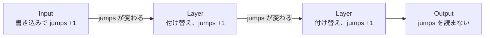
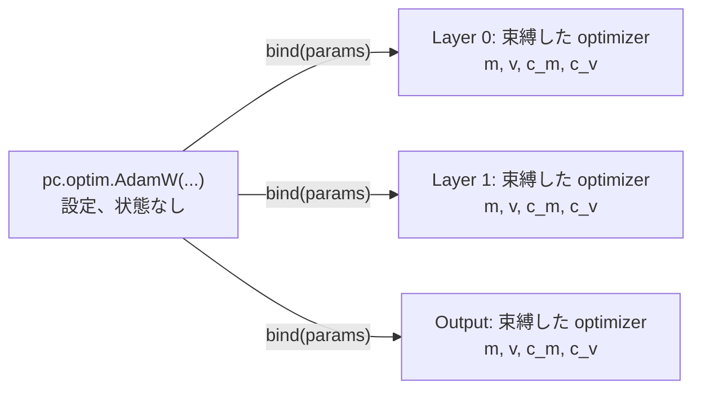

# 🔩 mujou.pc の仕組み

`mujou.pc` の部品が何をし、どうつながり、1 回の更新で何を計算するかを説明する。読み終えれば [PC-ALM](pc.md) の「自分のノードを書く」と `examples/pc_merge.py` に出てくる名前が分かる。使い方は [5. PC-ALM で学習する](../tutorial/5-learn-with-pc.md) で。

!!! abstract "このページで分かること"

    - `mujou.pc` の部品の役割と、利用者が直接使う部品・自分のノードを書くときに使う部品
    - ノードの間を流れるメッセージと Port の向き
    - `pc.Layer` が 1 回の `on_update(dt)` で行うこと
    - `pc.clock.LearnClock` が返す `Tick`、`jumps`、`pc.TimeConstants` の意味
    - `pc.optim.SGD` と `pc.optim.AdamW` が重みを、`pc.relax.Euler` と `pc.relax.HeavyBall` が活動を時間で動かす仕組み

    前提は PyTorch・誤差逆伝播法（BP）と、[Mujou の仕組み](../concepts.md)のノード・Port・`dt`。predictive coding の知識は要らない。

## ノードが持つ量

PC-ALM では各ノードが自分の**活動** `h` を持ち、前のノードの活動から自分の活動を**予測**する。理解に要る量はこれだけ。

| 量      | 式                                   | 意味                                                                         |
| ------- | ------------------------------------ | ---------------------------------------------------------------------------- |
| `h_in`  |                                      | 前のノードから届いた活動                                                     |
| `mu`    | $\mu = f(h_{\mathrm{in}};\theta)$    | 予測。ノードの `module` の出力。$\theta$ は `module` の重み                  |
| `h`     |                                      | 自分の活動。次のノードへ送る                                                 |
| `lam`   | $\tau_\lambda\dot\lambda = h - \mu$  | 双対変数。予測からのずれ $r = h - \mu$ を時間で溜めた値                      |
| `delta` | $\delta = h - \mu + \lambda$         | ノードの誤差                                                                 |
| `g_in`  | $g_{\mathrm{in}} = -J_h^\top \delta$ | 前のノードへ送り返す勾配（$J_h$ は `module` の `h_in` についてのヤコビアン） |
| `g`     |                                      | 次のノードたちから届いた `g_in` の和                                         |

`h` は `delta` と `g` の和を打ち消す向きに動き、`lam` は `r` が残る間溜まり続ける。両方が止まると `r = 0`（`h` は forward の値）になり、`lam` は BP の credit $-\partial\ell/\partial h$ に一致する。そのとき重みの勾配も BP と一致する。理論の詳細は [PC-ALM の記事](https://pub.sakana.ai/pc-alm/)にある。

## 1. 部品

!!! abstract "要点"

    利用者が普段使うのは `Chain`・`show`・`TimeConstants`・optimizer・損失・`Sample`。自分のノードを書くときに `LearnClock`・`functional`・`Activity` を使う。

| 部品                                                    | 種類       | 役割                                                                                                                      | 主に使う場面    |
| ------------------------------------------------------- | ---------- | ------------------------------------------------------------------------------------------------------------------------- | --------------- |
| `pc.Input`                                              | ノード     | ホストが書いた `x` をそのまま活動 `h` として送る。`h` も重みも持たない                                                    | 手で組む        |
| `pc.Layer`                                              | ノード     | `module` を 1 つ持ち、`h` と `lam` を動かし、重みを学ぶ                                                                   | 手で組む        |
| `pc.Output`                                             | ノード     | 最後の `module` と損失を持ち、予測 `y_hat` を出し、重みを学ぶ。`h` と `lam` は持たない                                    | 手で組む        |
| `pc.Chain`                                              | Network    | `Input → Layer → … → Output` をまとめて作りつなぐ                                                                         | 普段            |
| `pc.show`                                               | 関数       | ホストがサンプルを書き、一定時間見せ、学ぶ前の予測を返す                                                                  | 普段            |
| `pc.msg.Sample`・`pc.msg.Activity`・`pc.msg.Prediction` | メッセージ | 流れるデータの型（[2 節](#2-%E3%81%A4%E3%81%AA%E3%81%8C%E3%82%8A%E3%81%A8%E6%B5%81%E3%82%8C%E3%82%8B%E3%82%82%E3%81%AE)） | `Sample` は普段 |
| `pc.TimeConstants`                                      | 設定       | `h` と `lam` の速さを秒で持つ（[5 節](#5-timeconstants)）                                                                 | 普段            |
| `pc.optim.SGD`・`pc.optim.AdamW`                        | 設定       | optimizer。重みを時間でどう動かすか（[6 節](#6-optimizer)）                                                               | 普段            |
| `pc.loss.MSELoss`・`pc.loss.CrossEntropyLoss`           | 損失       | サンプルごとの損失を返す。`Output` に渡す                                                                                 | 普段            |
| `pc.clock.LearnClock`                                   | 部品       | いつ学ぶかを決める（[4 節](#4-learnclock-%E3%81%A8-jumps)）                                                               | 自分のノード    |
| `pc.functional`                                         | 関数群     | 状態を持たない式（`vjp`・`loss_vjp`・`relax_`）。`Layer` と `Output` もこれで書く                                         | 自分のノード    |
| `pc.msg.activity_spec`                                  | 関数       | `Activity` の spec を作る                                                                                                 | 自分のノード    |

`Layer` と `Output` は `LearnClock`・`functional`・optimizer を組み合わせたもの。同じ部品で入力が 2 つのノードのような `Layer` で書けないノードも作れる。

## 2. つながりと流れるもの

!!! abstract "要点"

    前へは活動を `Activity` で、後ろへは勾配 `g_in` を送る。目標 `y`・`mask`・時刻 `time` は活動と同じメッセージに載せて中継する。


実線が前向き、点線が後ろ向き。`Input` は届いた `g_in` を読まない（`x` は固定）。

| メッセージ          | フィールド                        | 流れ                         |
| ------------------- | --------------------------------- | ---------------------------- |
| `pc.msg.Sample`     | `x`、`y`、`mask`                  | ホスト → `Input.prev`        |
| `pc.msg.Activity`   | `h`、`jumps`、`y`、`mask`、`time` | `next` → 次のノードの `prev` |
| `g_in`              | テンソル（`h_in` と同じ shape）   | `prev` → 前のノードの `next` |
| `pc.msg.Prediction` | `y_hat`、`y`、`mask`、`time`      | `Output.next` → ホスト       |

- `mask`: サンプルごとに目標があるか。False のサンプルは損失に入らず、`Layer` はその行の `g_in` を 0 にする。`mask` がすべて False の入力でも `h` と `lam` は緩和し、重みだけ学ばない。評価はこれで行う
- `time`: ホストがその入力を書いた時刻（`Timestamp`）。書き込みの前は `Timestamp(ns=0)`
- `jumps`: 送り手の `h` が跳んだ回数（`int`）（[4 節](#4-learnclock-%E3%81%A8-jumps)）

### Port の向き

| ノード   | Port   | 種類        | 受け取る                             | 送る         |
| -------- | ------ | ----------- | ------------------------------------ | ------------ |
| `Input`  | `prev` | `Port`      | `Sample`（ホストが書く）             | —            |
| `Input`  | `next` | `MultiPort` | `g_in`（読まない）                   | `Activity`   |
| `Layer`  | `prev` | `Port`      | `Activity`                           | `g_in`       |
| `Layer`  | `next` | `MultiPort` | 相手ごとの `g_in`（和を `g` にする） | `Activity`   |
| `Output` | `prev` | `Port`      | `Activity`                           | `g_in`       |
| `Output` | `next` | `Port`      | —                                    | `Prediction` |

`next` は `MultiPort` なので 1 つのノードの活動を複数のノードが読める。

??? question "なぜ目標を活動と同じメッセージで運ぶの？"

    ノードは非同期で、Port は最新値だけを持つ。目標を別の Port で送ると、`Output` は活動と目標を別々の瞬間に読み、別のサンプルの組になりうる。同じメッセージなら `y` は `x` と同じ経路を同じ遅れで進む。ホストが伝播より速く次のサンプルを書いても予測はいつも自分の目標と組になる。

## 3. Layer の 1 回の更新

!!! abstract "要点"

    `Layer.on_update(dt)` は「読む → `tick` → `vjp` → `g_in` を送る → `relax_` → `Activity` を送る → `optimizer.step_`」の順に進む。

| 段  | 使う部品            | 計算                                                                                                                                                                                                                                                 |
| --- | ------------------- | ---------------------------------------------------------------------------------------------------------------------------------------------------------------------------------------------------------------------------------------------------- |
| 1   | `LearnClock.tick`   | `prev` から `Activity` を読み、`Tick`（`dt`・`new`・`learn`・`elapsed`）を得る                                                                                                                                                                       |
| 2   | —                   | 前の更新で自分の重みを学んでいれば、その跳びを `h` に足す（段 4 の付け替えとは別。[jumps](#jumps) の表の 3 行目）                                                                                                                                    |
| 3   | `functional.vjp`    | $\mu = f(h_{\mathrm{in}})$、$g_{\mathrm{in}} = -J_h^\top\delta$、学ぶなら $g_\theta = -J_\theta^\top\delta$ を 1 回の VJP で。`g_in` を `prev` から送る                                                                                              |
| 4   | `functional.relax_` | 跳びがあれば `h` を付け替え、$h \leftarrow h - \frac{dt}{\tau_h}(h - \mu + \lambda + g)$（既定の relaxer の `pc.relax.Euler` が動かす形。[7 節](#7-relaxer)）、続けて動かした `h` で $\lambda \leftarrow \lambda + \frac{dt}{\tau_\lambda}(h - \mu)$ |
| 5   | `Activity`          | 必要なら自分の `jumps` を進め、`h` と `jumps` に受け取った `y`・`mask`・`time` を付けて `next` から送る                                                                                                                                              |
| 6   | `optimizer.step_`   | $g_\theta$ をサンプルの数 $B$ で割り、重みを `tick.elapsed` 秒ぶん動かす（[6 節](#6-optimizer)）。`tick.learn` が True で、`mask` に True があるときだけ                                                                                             |

- 段 3 の `delta` は段 2 の後、段 4 の前の `h`・`lam` で作る
- 勾配はバッチで和を取り、$B$ で割るのは段 6 だけ。だから `lam` はサンプルごとの credit になり、optimizer はバッチの平均勾配を受け取る
- `vjp` の `delta` は値ではなく、`mu` から `delta` を作る関数（`mu` は `vjp` の中で計算するため）。ふだんは `lambda mu: h - mu + lam`。段 4 で付け替える更新では、付け替え前のずれ `h - mu_last` を使い `lambda mu: (h - mu_last) + lam` を渡す（[jumps](#jumps)）
- `vjp` は `h_in` を detach してから微分するので、計算グラフは前のノードに届かない

`Output` は `h` も `lam` も持たない。段 3 で `functional.loss_vjp` を使い、損失 $\ell = \sum_b \mathrm{mask}_b\,\ell_b$ の勾配 $\partial\ell/\partial h_{\mathrm{in}}$ を `g_in` として送り、`Prediction` を送る。学ぶ条件と `optimizer.step_` は `Layer` と同じ。付け替える `h` が無いので `jumps` は読まない。

??? question "g_in を前のノードへ送るのは BP と何が違うの？"

    `g_in` の計算は BP の 1 層分と同じ VJP（$-J_h^\top\delta$）で、平衡点では `lam` が BP の credit と同じ漸化式を満たす。違うのは `g_in` の扱い方。

    1. 送る側は自分の `delta` から `g_in` を作る。`delta = h - mu + lam` は自分の状態だけで決まる
    2. 受け取る側は届いた `g_in` を足して `g` にし、段 4 の `relax_` で自分の `h` を動かす力に使う。`g` をそのまま前のノードへ流さない
    3. `h` と `lam` が動くと自分の `delta` が変わり、次の更新で送る `g_in` も変わる。credit は 1 回の逆向きの掃引でなく、各ノードの緩和を通じて時間をかけて入力側へ伝わる

    forward と backward の段階も、全ノードの待ち合わせも無い。各ノードは手元にある最新の `g`（古いこともある）で更新する。`vjp` は `h_in` を detach するので、計算グラフはノードをまたがない。BP の勾配と一致するのは平衡点だけで、学ぶまで `learn_interval` だけ待つのはこのため。

## 4. LearnClock と jumps

!!! abstract "要点"

    `h` と `lam` は毎回の更新で動かし、重みは `LearnClock` が決めた更新でだけ動かす。`jumps` は「予測が跳んだので `h` も一緒に動かせ」という次のノードへの合図。

### LearnClock

ノードは毎回の更新で `tick = self.clock.tick(dt, act["time"], self.timer.now())` を呼ぶ。返る `Tick` の意味。

| フィールド | 意味                                                   | 使い道                 |
| ---------- | ------------------------------------------------------ | ---------------------- |
| `dt`       | `max_dt` で打ち切った `dt`                             | `relax_` に渡す        |
| `new`      | 受け取った入力の `time` が前回と違う（新しいサンプル） | `h` を付け替える       |
| `learn`    | この更新で学ぶか                                       | `step_` を呼ぶか決める |
| `elapsed`  | 前に学んでからの、打ち切った `dt` の和。この更新を含む | `step_` に渡す時間     |

`learn` が True になるのは次のとき。`learn_interval` は `Layer`・`Output`・`Chain`・`LearnClock` に渡す秒数。

| `learn_interval` | 学ぶ更新                                                                                                                                                                     |
| ---------------- | ---------------------------------------------------------------------------------------------------------------------------------------------------------------------------- |
| 正の秒数         | `time + learn_interval`、`time + 2 * learn_interval`、… の各時刻（`time` はホストが入力を書いた時刻）以降の最初の更新。ただし `new` が True の更新では学ばず、次の更新で学ぶ |
| `None`           | 毎回の更新（入力が新しくても）。入力がフレームごとに変わるストリーム向け                                                                                                     |
| `math.inf`       | 学ばない。学ばない方法はこれだけ（optimizer は `tau=math.inf` を受け付けない）                                                                                               |

- `new` が True の更新で学ばないのは、その更新の `delta` がまだ前の入力のものだから
- だから同じ入力が続く間は `learn_interval` 秒ごとに学び、`elapsed` はおよそ `learn_interval`
- 学ばないまま入力が変わると、`elapsed` に溜めた時間は捨てる
- 自分のノードでは `pc.clock.LearnClock.of(tau, period=..., learn_interval=...)` で作り、属性に置く。それだけでノードの状態に入る

??? question "なぜノードが入力を受け取った時刻でなく、ホストの書き込み時刻から数えるの？"

    経路上のノードが深さによらずほぼ同時に学ぶため。受け取った時刻から数えると深いノードほど遅れて学び、前のノードが学んで起きた `h` の跳びが入った `delta` で学んでしまう（発散した）。どのノードも同じ実行のタイマーを読むので、バリアは要らない。

### jumps

緩和は `mu` が少しずつ動くことを前提にしている。`mu` が一度に跳ぶと、`h` を置いたままでは $r = h - \mu$ が急に大きくなり、偽の誤差が `g_in` と重みの勾配に入る。そこで `mu` が跳んだ更新では `h` も同じだけ 1 回動かし（付け替え）、`r` と `lam` を保つ。

$$h \leftarrow \mu_{\text{new}} + (h - \mu_{\text{last}})$$

`mu_last` は前回の更新の予測。付け替えた `h` も跳ぶので、自分の `jumps` を 1 進めて次のノードに知らせる。

| `mu` が跳ぶ原因           | ノードの気づき方                | `h` の動かし方                                                             | 自分の `jumps`                           |
| ------------------------- | ------------------------------- | -------------------------------------------------------------------------- | ---------------------------------------- |
| 新しいサンプル            | `tick.new` が True              | 付け替え                                                                   | +1                                       |
| 前のノードの `h` が跳んだ | 受け取った `jumps` が前回と違う | 付け替え                                                                   | +1                                       |
| 自分の重みを学んだ        | 自分で学んだ                    | 次の更新の最初に跳び $f(h_{\mathrm{in}};\theta_{\text{new}}) - \mu$ を足す | `learn_interval` が `None` でなければ +1 |



- 原因が同じ更新で重なっても、付け替えも `jumps` も 1 回だけ
- `Input` はホストの書き込みのたびに `jumps` を進める
- `learn_interval=None` では重みは毎回少しずつ動くので、跳びを自分の `h` に足すだけで `jumps` は進めない。毎回進めると次のノードが毎回付け替え、深い鎖が発散する
- 付け替えるので、新しいサンプルで `h` や `lam` をリセットしない。持ち越すのは `r` と `lam` だけ

## 5. TimeConstants

!!! abstract "要点"

    速さはすべて実行のタイマーの秒で決める。各ノードは実際に経った `dt` だけ式を進めるので、周期の違うノードも時間あたり同じ速さで変化する。

`pc.TimeConstants(h=, lam=, r=)` が活動の時定数を持つ。重みの時定数は optimizer が持つ（[6 節](#6-optimizer)）。

| 値        | 何の速さか                | 1 回の更新で動く割合       | `math.inf` にすると                                                                        |
| --------- | ------------------------- | -------------------------- | ------------------------------------------------------------------------------------------ |
| `tau.h`   | 活動 `h` が緩和する速さ   | `dt / tau.h`               | 不可（有限で正）                                                                           |
| `tau.lam` | `lam` が `r` を溜める速さ | `dt / tau.lam`             | `lam` は 0 のまま。`r` が 0 に戻らず、平衡点で BP と一致しない（ただの predictive coding） |
| `tau.r`   | ずれ `r` が減衰する速さ   | さらに `r` の `dt / tau.r` | 既定。減衰しない。有限なら `h` が `mu` に引き寄せられる。平衡点は変わらない                |

時定数から既定が決まる値が 2 つある。`tau.period`（`tau.h / 4`）はノードの更新の間隔で、`period=` を渡さないときの `Chain` の全ノードの周期。`tau.max_dt`（`min(tau.h / 2, 3 * tau.lam)`。`r` の減衰 `tau.r` があれば短くなる）は 1 回の更新で数える `dt` の上限で、超えた分は緩和からも `elapsed` からも捨てる。

optimizer の `tau` は `tau.h` よりずっと大きくする。重みが活動の落ち着く速さよりゆっくり動けば、推論と学習を同時に回しても重みは落ち着いた後の `delta` で学ぶ。値の決め方は [時定数を決める](pc.md#%E6%99%82%E5%AE%9A%E6%95%B0%E3%82%92%E6%B1%BA%E3%82%81%E3%82%8B)、引数の一覧は [API リファレンス](../api/pc.md)。

??? question "なぜ dt を max_dt で打ち切るの？"

    `g` は次のノードが最後に更新したときの `h` から作られ、ノード同士は 1 歩遅れで結合している。負荷で全ノードが止まった後に `dt` が一斉に伸びると、この結合でネットワークが発散する。ノードの内側で刻みを分割しても防げないので 1 回に数える時間を打ち切る。

## 6. optimizer

!!! abstract "要点"

    重みも秒で動く。optimizer は時間に沿った流れで、時定数を秒で持ち、1 歩ごとにその歩みが受け持つ `elapsed` 秒だけ進む。だから学ぶ頻度を変えても、重みが 1 秒あたりに動く速さは変わらない。

### 設定を各ノードで束縛する

`pc.optim.SGD(tau=)` と `pc.optim.AdamW(tau=, tau_m=, tau_v=, eps=1e-8, weight_decay=1e-2)` は設定で、状態を持たない frozen な値。`Layer`・`Output`・`Chain` は必須の引数 `optimizer=` で受け取る。各ノードは設定を自分の勾配を取る重みに束縛し、**束縛した optimizer** を `self.optimizer` に置く。状態を持ち、重みを動かすのは束縛した optimizer。



```python
self.optimizer = optimizer.bind(params)  # in __init__, with only the weights that learn
# in on_update, when the node learns:
self.optimizer.step_([g / B for g in g_theta], tick.elapsed)
```

- 1 つの設定を全ノードに渡してよい（`Chain` はそうする）。状態はノードごとに、束縛した optimizer の中にある
- 束縛した optimizer はノードの状態のキー `"optimizer"` に入る（`LearnClock` が `"clock"` に入るのと同じ）
- ノードが $g_\theta$ を $B$ で割ってから `step_` に渡す。optimizer はバッチを知らない
- `elapsed == 0` の歩みは重みも状態も動かさない

### SGD と AdamW

平均の勾配を $g = g_\theta / B$ とする。

| optimizer        | 時間に沿った流れ                                                                                                                                    | `elapsed` $= \Delta t$ 秒の 1 歩                                                                                                      |
| ---------------- | --------------------------------------------------------------------------------------------------------------------------------------------------- | ------------------------------------------------------------------------------------------------------------------------------------- |
| `pc.optim.SGD`   | $\tau_\theta \dot\theta = -g$                                                                                                                       | $\theta \leftarrow \theta - \frac{\Delta t}{\tau_\theta} g$。学習率 $\Delta t / \tau_\theta$ の SGD                                   |
| `pc.optim.AdamW` | $\tau_m \dot m = g - m$、$\tau_v \dot v = g^2 - v$、$\tau_\theta \dot\theta = -\left(\frac{\hat m}{\sqrt{\hat v} + \varepsilon} + w\,\theta\right)$ | $a_m = 1 - e^{-\Delta t/\tau_m}$ で $m \leftarrow m + a_m (g - m)$、$v$ も同様。続けて $\eta = \Delta t/\tau_\theta$ で AdamW の 1 歩 |

- `tau` は $\tau_\theta$、`tau_m` は $\tau_m$、`tau_v` は $\tau_v$ で、どれも秒。有限で > 0。学ばないならノードに `learn_interval=math.inf` を渡す
- `eps`（$\varepsilon$）は > 0。勾配が 0 のままだった重みが `0 / 0` にならないようにするため
- `weight_decay`（$w$）は無次元。$\theta$ を時定数 $\tau_\theta / w$ で減衰させる。`torch.optim.AdamW` の `weight_decay` が `lr` と組むのと同じ
- AdamW は勾配の大きさによらず、1 歩で各重みをおよそ $\eta$ ずつ動かす。Adam の `lr` に合わせるなら、2 回の学習の間の時間を $\Delta t$ とし（1 入力につき 1 回学ぶなら入力を見せる時間）、`tau` を $\Delta t$ / `lr` にする

### 質量 c: 時間で行う bias 補正

$m$ と $v$ は 0 から始まるので、はじめは小さすぎる。`torch.optim.AdamW` はステップ数 $t$ で補正し、$m$ を $1 - \beta_1^t$ で割る。`pc.optim.AdamW` はステップを数えない。代わりに moment ごとに**質量** $c$ を持つ。質量はその moment のうちこれまでの勾配が占める割合（残りは初めの 0）で、moment と同じ時定数で動く。

$$\tau_m \dot c_m = 1 - c_m,\quad c_m(0) = 0,\qquad \hat m = m / c_m$$

1 歩は moment と同じように $c_m \leftarrow c_m + a_m(1 - c_m)$ で質量を動かす。$t$ 秒ぶんの勾配の後は $c_m = 1 - e^{-t/\tau_m}$。$g$ が一定なら $m = c_m g$ なので、最初の 1 歩から $\hat m = g$。$v$ も自分の質量 $c_v$ を同じように持つ。

1 歩は、$g$ が $\Delta t$ の間一定だとして流れを厳密に解く。だから moment と質量は歩みの回数ではなく歩みの秒数の合計で決まる。$\tau_m = 0.1$ 秒のときは次のとおり。

| 歩み           | `pc.optim.AdamW` の $c_m$ | 0.05 秒の歩みに合わせて $\beta_1 = e^{-0.05/0.1}$ に固定し、ステップを数えると |
| -------------- | ------------------------- | ------------------------------------------------------------------------------ |
| 0.05 秒を 2 回 | $1 - e^{-1} = 0.632$      | $1 - \beta_1^2 = 0.632$                                                        |
| 0.1 秒を 1 回  | $1 - e^{-1} = 0.632$      | $1 - \beta_1^1 = 0.393$                                                        |

$\Delta t$ が一定なら、歩みは `torch.optim.AdamW(lr=Δt / tau, betas=(exp(-Δt / tau_m), exp(-Δt / tau_v)))` と同じになる。だから torch の $\beta$ からは $\tau_m = -\Delta t / \ln\beta_1$ と決まる。$\Delta t$ はここでも 2 回の学習の間の時間。32 ms ごとに学ぶなら、$\beta_1 = 0.9$ は約 0.30 秒、$\beta_2 = 0.999$ は約 32 秒。SGD と AdamW の選び方と値は [optimizer を選ぶ](pc.md#optimizer-%E3%82%92%E9%81%B8%E3%81%B6) へ。

??? question "なぜ torch.optim を使わないの？"

    1. ステップを数え、時間を数えない。$\beta$ と `lr` が 1 ステップあたりなので、1 秒あたりの速さが `learn_interval` や歩みごとに異なる `elapsed` で変わる
    2. ステップ数が float32 のテンソルで、$2^{24}$ 回で増えなくなる（24 ms ごとに学ぶと約 4.7 日）。mujou は学び続ける機械のためのもの
    3. 作るときに `torch._dynamo` を import し、free-threaded の Python（3.14t）でプロセス全体の GIL を有効に戻す

### 自分の optimizer

自作の optimizer は 2 つのクラスで書く。設定は `pc.optim.Optimizer` を継承して `bind(params)` を実装する。`bind` が返すものは `pc.optim.BoundOptimizer`（`mujou.Stateful` の一種）を継承し、`step_(grads, elapsed)`・`state_dict()`・`load_state_dict(state)` を実装する。どれかが欠けたクラスは、作るときに `TypeError` になる。`bind` には学ぶ重みだけを渡す。例は [API リファレンス](../api/pc.md) にある。

## 7. relaxer

!!! abstract "要点"

    活動 `h` が自分に掛かる力に沿ってどう動くかも設定である。relaxer は `h` にとっての optimizer にあたる。状態を持たない設定をノードごとに bind し、`h` を `dt` 秒だけ動かす。

`pc.relax.Euler()` と `pc.relax.HeavyBall(tau=)` が設定である。`Layer` と `Chain` が `relaxer=` で 1 つ取る。既定は `pc.relax.Euler()` である。`Chain` は同じ設定を各 `Layer` に渡す。設定は状態を持たないので、共有しても安全である。`Output` は `h` を持たないので取らない。各 `Layer` は設定を自分の `h` に bind し、**bind した relaxer** を `self.relaxer` に持つ。bind した relaxer が状態を持ち、`h` を動かす。

```python
self.relaxer = relaxer.bind(self.h)  # __init__ で
# on_update の functional.relax_ の中で、力 h - mu + lam + g を渡して:
self.relaxer.step_(h, force, dt, tau.h)
# 新しいサンプルのとき、または読んでいる h が跳んだとき:
self.relaxer.reset_()
```

力を $F = r + \lambda + g$ とすると、relaxer ごとの 1 回の動きは次の表になる。

| relaxer              | `dt` $= \Delta t$ 秒の 1 回の動き                                                            |
| -------------------- | -------------------------------------------------------------------------------------------- |
| `pc.relax.Euler`     | $h \leftarrow h - \frac{\Delta t}{\tau_h} F$                                                 |
| `pc.relax.HeavyBall` | $v \leftarrow e^{-\Delta t/\tau} v + F$、続けて $h \leftarrow h - \frac{\Delta t}{\tau_h} v$ |

- relaxer が変えるのは `h` が不動点に着くまでの道で、不動点ではない。不動点では $F = 0$ かつ $v = 0$ になる。relaxer は $\lambda$ を動かさない。$\lambda$ は、どの relaxer が `h` を動かしても、`h` が動いたあとにその `h` の $r$ で進む（[3 節](#3-layer-%E3%81%AE-1-%E5%9B%9E%E3%81%AE%E6%9B%B4%E6%96%B0)）
- `pc.relax.HeavyBall` の速度は 0 から始まるので、最初の 1 歩は `pc.relax.Euler` の 1 歩と同じである。力は 1 回の更新ごとに 1 度だけ足され、$F\,\Delta t$ ではない。定常では $v = F / (1 - e^{-\Delta t/\tau})$ なので、周期が短いほど利得が大きい。遅れた更新（長い `dt`）は速度をより多く忘れるので、安定な側に働く。`dt == 0` の 1 歩は `h` も速度もそのままにする
- 新しいサンプルのとき、また読んでいる `h` が跳んだときは、$r$ と $\lambda$ は保たれるが、速度が積んだのは前の入力の力である（[jumps](#jumps)）。そこでノードは `reset_()` を呼び、その速度を捨てる。ノード自身の重みが跳んだときは `h` と `mu` が一緒に動き、$r$ も力も跳ばないので、`reset_` は呼ばない
- bind した relaxer はノードの状態のキー `"relaxer"` に入る。`pc.relax.HeavyBall` なら `{"velocity": ...}`、`pc.relax.Euler` なら空
- relaxer と値の選び方は[relaxer を選ぶ](pc.md#relaxer-%E3%82%92%E9%81%B8%E3%81%B6)を見る

### 自分の relaxer

自作の relaxer は 2 つのクラスで書く。設定は `pc.relax.Relaxer` を継承して `bind(h)` を実装し、`h` と同じ shape・dtype・device の状態を作る。`bind` が返すものは `pc.relax.BoundRelaxer`（`mujou.Stateful` の一種）を継承し、`step_(h, force, dt, tau_h)`・`reset_()`・`state_dict()`・`load_state_dict(state)` を実装する。どれかが欠けたクラスは、作るときに `TypeError` になる。不動点は力が 0 で、relaxer 自身の状態が静止しているところでなければならない。そうでないと `lam` は BP の credit にならない。例は [API リファレンス](../api/pc.md)にある。
