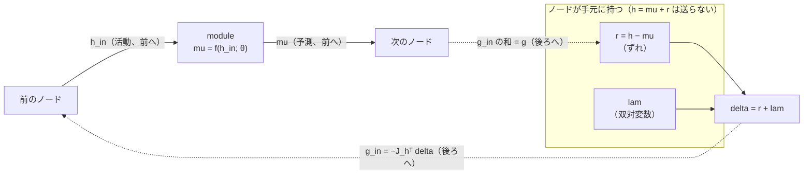
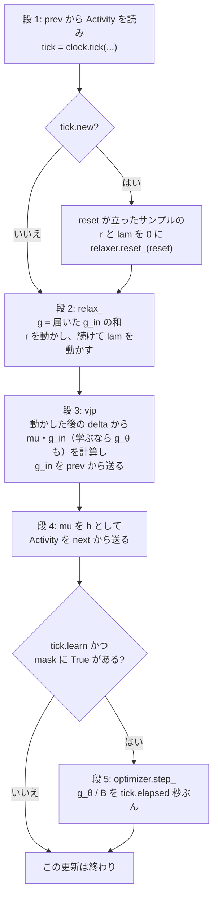
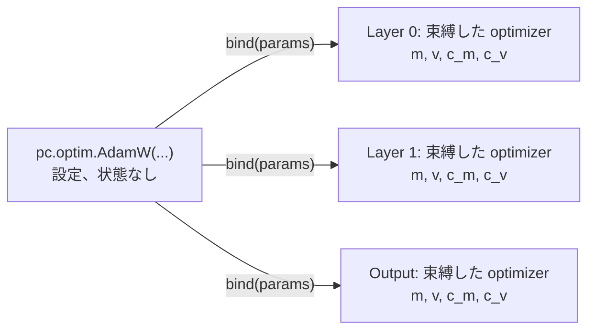

# 🔩 mujou.pc の仕組み

前提は PyTorch・BP と、Mujou の仕組みの [ノード](../concepts.md#nodes) と [`dt`](../concepts.md#time) で、predictive coding の知識は要らない。
使い方は [5. PC-ALM で学習する](../tutorial/5-learn-with-pc.md)、値の決め方は [PC-ALM](pc.md)、理論は [PC-ALM の記事](https://pub.sakana.ai/pc-alm/) にある。

## BP との違い {#vs-bp}

| 項目                    | 普通の PyTorch の BP                                  | `mujou.pc`                                                                                                                                                                                            |
| ----------------------- | ----------------------------------------------------- | ----------------------------------------------------------------------------------------------------------------------------------------------------------------------------------------------------- |
| 推論と学習              | forward、backward、`optimizer.step()` を順に          | 同時に進む。各ノードが自分の周期で更新し、ホストが入力を見せている間に学ぶ。モードは無く、`mask` が False のサンプルからは学ばない                                                                    |
| 損失                    | 普通はバッチの平均                                    | サンプルごとの損失（shape はバッチの shape）を `Output` が合計する                                                                                                                                    |
| 勾配と計算グラフ        | モデル全体を通して `.backward()`                      | 各ノードの内側だけ（`vjp` が `h_in` を detach する）。隣のノードとは活動と勾配 `g_in` をメッセージでやり取りする                                                                                      |
| credit の伝わり方       | 1 回の逆向きの掃引。届いた勾配に VJP を掛けてすぐ前へ | 届いた `g_in` の和 `g` で自分の `r` と `lam` を動かし、動かした `delta` から作った `g_in` を送る。1 回の更新に 1 ノードずつ入力側へ。段階も待ち合わせも無く、手元の最新の `g`（古いこともある）を使う |
| BP の勾配と一致するとき | 常に                                                  | 平衡点だけ。そのためノードは `learn_interval` だけ待ってから学ぶ                                                                                                                                      |
| 1 バッチの計算量        | forward と backward が 1 回ずつ                       | バッチを `S` 周期見せると、ノードごとに forward と VJP が `S` 回（測った値は [PC-ALM の実験](pc-benchmarks.md#mnist)）                                                                                |

## ノードが持つ量 {#quantities}



| 量      | 式                                   | 意味                                                                         |
| ------- | ------------------------------------ | ---------------------------------------------------------------------------- |
| `h_in`  |                                      | 前のノードから届いた活動                                                     |
| `mu`    | $\mu = f(h_{\mathrm{in}};\theta)$    | 予測。ノードの `module` の出力。$\theta$ は `module` の重み                  |
| `r`     | $r = h - \mu$                        | 予測からのずれ。ノードはこれを持つ                                           |
| `h`     | $h = \mu + r$                        | 自分の活動。ノードの中にとどまり、次のノードは `mu` を読む                   |
| `lam`   | $\tau_\lambda\dot\lambda = r$        | 双対変数。ずれを時間で溜めた値                                               |
| `delta` | $\delta = r + \lambda$               | ノードの誤差                                                                 |
| `g_in`  | $g_{\mathrm{in}} = -J_h^\top \delta$ | 前のノードへ送り返す勾配（$J_h$ は `module` の `h_in` についてのヤコビアン） |
| `g`     |                                      | 次のノードたちから届いた `g_in` の和                                         |

`r` と `lam` が両方止まった平衡点では `r = 0` で、`lam` が BP の credit $-\partial\ell/\partial h$ になり、重みの勾配が BP と一致する（[`pc.Layer`][mujou.pc.Layer]）。

### ノードが r を持ち、mu を送る理由 {#r-mu}

| 選び方             | 記事のノード: `h` を持ち $\mu + r$ を送る                                        | mujou のノード: `r` を持ち `mu` を送る |
| ------------------ | -------------------------------------------------------------------------------- | -------------------------------------- |
| `mu` が跳んだとき  | `h` が残り、$r = h - \mu$ が急に大きくなる。偽の誤差が `g_in` と重みの勾配に入る | ずれ `r` をそのまま保つ                |
| 前へ流れる活動     | $\mu + r$                                                                        | 順伝播の値 `mu`                        |
| credit の流れ      | `r` の動きが上のノードの活動を動かし、自分へ戻るループ                           | 後ろへだけ                             |
| 順伝播が増幅する鎖 | 刻みをどれだけ短くしても発散                                                     | 1 ノードで安定な刻みは、どの鎖でも安定 |
| 平衡点             | 同じ                                                                             | 同じ                                   |

予測 `mu` は新しいサンプルが来たとき、下のノードが学んだとき、自分が学んだときに一度に跳ぶが、`r` を持つノードはそのどれでもずれを保つ。

$\mu + r$ でなく `mu` を送るのは predictive coding の固定予測の仮定（fixed prediction assumption）にあたり、上のノードを通って自分に戻るループを切る。

## 部品 {#parts}

| 部品                                                           | 種類       | 役割                                                                    | 使う場面        |
| -------------------------------------------------------------- | ---------- | ----------------------------------------------------------------------- | --------------- |
| [`pc.Chain`][mujou.pc.Chain]                                   | Network    | `Input → Layer → … → Output` を作ってつなぐ                             | 普段            |
| [`pc.show`][mujou.pc.show]                                     | 関数       | サンプルを書いて一定時間見せ、学ぶ前の予測を返す                        | 普段            |
| [`pc.TimeConstants`][mujou.pc.TimeConstants]                   | 設定       | `r` と `lam` の速さ（[TimeConstants](#time-constants)）                 | 普段            |
| [`pc.optim`][mujou.pc.optim] の `SGD`・`RMSProp`・`AdamW`      | 設定       | 重みを時間で動かす（[optimizer](#optimizer)）                           | 普段            |
| [`pc.loss`][mujou.pc.loss] の `MSELoss`・`CrossEntropyLoss`    | 損失       | サンプルごとの損失。`Output` に渡す                                     | 普段            |
| [`pc.msg`][mujou.pc.msg] の `Sample`・`Activity`・`Prediction` | メッセージ | 流れるデータの型（[つながり](#messages)）                               | `Sample` は普段 |
| [`pc.Input`][mujou.pc.Input]                                   | ノード     | ホストが書いた `x` を活動として送る。何も持たない                       | 手で組む        |
| [`pc.Layer`][mujou.pc.Layer]                                   | ノード     | `module` を 1 つ持ち、`r` と `lam` を動かし、重みを学ぶ                 | 手で組む        |
| [`pc.Output`][mujou.pc.Output]                                 | ノード     | 最後の `module` と損失を持ち、予測を送り、重みを学ぶ。`r`・`lam` は無い | 手で組む        |
| [`pc.relax.Euler`][mujou.pc.relax.Euler]                       | 設定       | `r` を時間で動かす relaxer の既定（[relaxer](#relaxer)）                | 既定のまま      |
| [`pc.clock.LearnClock`][mujou.pc.clock.LearnClock]             | 部品       | いつ学ぶかを決める（[LearnClock](#learnclock)）                         | 自分のノード    |
| [`pc.functional`][mujou.pc.functional]                         | 関数群     | 状態を持たない式（`vjp`・`loss_vjp`・`relax_`）                         | 自分のノード    |
| [`pc.msg.activity_spec`][mujou.pc.msg.activity_spec]           | 関数       | `Activity` の spec を作る                                               | 自分のノード    |

`Layer` と `Output` は `LearnClock`・`functional`・optimizer の組み合わせなので、同じ部品を使えば入力が 2 つのノードのように `Layer` で書けないノードも作れる（[自分のノードを書く](pc.md#own-node)）。

## つながりと流れるもの {#messages}


| メッセージ                                     | フィールド                        | 流れ                         |
| ---------------------------------------------- | --------------------------------- | ---------------------------- |
| [`pc.msg.Sample`][mujou.pc.msg.Sample]         | `x`、`y`、`mask`、`reset`         | ホスト → `Input.prev`        |
| [`pc.msg.Activity`][mujou.pc.msg.Activity]     | `h`、`y`、`mask`、`reset`、`time` | `next` → 次のノードの `prev` |
| `g_in`                                         | テンソル（`h_in` と同じ shape）   | `prev` → 前のノードの `next` |
| [`pc.msg.Prediction`][mujou.pc.msg.Prediction] | `y_hat`、`y`、`mask`、`time`      | `Output.next` → ホスト       |

| ノード   | Port   | 種類        | 受け取る                             | 送る         |
| -------- | ------ | ----------- | ------------------------------------ | ------------ |
| `Input`  | `prev` | `Port`      | `Sample`（ホストが書く）             | —            |
| `Input`  | `next` | `MultiPort` | `g_in`（読まない）                   | `Activity`   |
| `Layer`  | `prev` | `Port`      | `Activity`                           | `g_in`       |
| `Layer`  | `next` | `MultiPort` | 相手ごとの `g_in`（和を `g` にする） | `Activity`   |
| `Output` | `prev` | `Port`      | `Activity`                           | `g_in`       |
| `Output` | `next` | `Port`      | —                                    | `Prediction` |

目標 `y`・`mask`・`reset`・時刻 `time` を活動と同じメッセージで運ぶ理由は [目標を中継する](update-rules.md#relay-targets) にある。

## Layer の 1 回の更新 {#layer-update}



=== "避ける: 緩和の前に g_in を送る"

    ```python
    # 受け取った credit を送るのが 1 回の更新ぶん遅れる
    mu, g_in, g_theta = pc.functional.vjp(self.module, act["h"], lambda _: self.r + self.lam, params)
    self.prev.send(g_in)
    pc.functional.relax_(self.r, self.lam, g, tick.dt, tau, self.relaxer)
    ```

=== "こう書く: 緩和してから送る"

    ```python
    # 動かした後の delta から g_in を作るので、受け取った credit が同じ更新のうちに前へ渡る
    pc.functional.relax_(self.r, self.lam, g, tick.dt, tau, self.relaxer)
    mu, g_in, g_theta = pc.functional.vjp(self.module, act["h"], lambda _: self.r + self.lam, params)
    self.prev.send(g_in)
    ```

| 段  | `Layer`                      | `Output`（`r` と `lam` を持たない）                                                                                                     |
| --- | ---------------------------- | --------------------------------------------------------------------------------------------------------------------------------------- |
| 2   | `relax_`                     | 無し                                                                                                                                    |
| 3   | `vjp`。`g_in = -J_h^T delta` | `functional.loss_vjp`。損失 $\ell = \sum_b \mathrm{mask}_b\,\ell_b$ の勾配 $\partial\ell/\partial h_{\mathrm{in}}$ を `g_in` として送る |
| 4   | `Activity` を送る            | `Prediction` を送る                                                                                                                     |
| 5   | 学ぶ条件と `optimizer.step_` | `Layer` と同じ                                                                                                                          |

## LearnClock {#learnclock}

<figure class="mujou-diagram">
<svg viewBox="0 0 640 200" role="img" aria-label="LearnClock が学ぶ更新。ホストが時刻 time に入力を書き、ノードは一定の間隔で更新する。time + L、time + 2L、time + 3L の各時刻以降の最初の更新で学び、学ぶ更新の間の時間が elapsed になる">
<text class="mujou-label" x="10" y="54">ホスト</text>
<line class="mujou-lane" x1="90" y1="50" x2="620" y2="50"/>
<g class="mujou-tick-b"><line x1="110" y1="38" x2="110" y2="62"/></g>
<text class="mujou-note" x="110" y="30" text-anchor="middle">書く（time）</text>
<text class="mujou-label" x="10" y="114">ノード</text>
<line class="mujou-lane" x1="90" y1="110" x2="620" y2="110"/>
<line class="mujou-lane" x1="270" y1="40" x2="270" y2="160" stroke-dasharray="4 3"/>
<line class="mujou-lane" x1="430" y1="40" x2="430" y2="160" stroke-dasharray="4 3"/>
<line class="mujou-lane" x1="590" y1="40" x2="590" y2="160" stroke-dasharray="4 3"/>
<g class="mujou-tick-a"><line x1="130" y1="98" x2="130" y2="122"/><line x1="170" y1="98" x2="170" y2="122"/><line x1="210" y1="98" x2="210" y2="122"/><line x1="250" y1="98" x2="250" y2="122"/><line x1="330" y1="98" x2="330" y2="122"/><line x1="370" y1="98" x2="370" y2="122"/><line x1="410" y1="98" x2="410" y2="122"/><line x1="490" y1="98" x2="490" y2="122"/><line x1="530" y1="98" x2="530" y2="122"/><line x1="570" y1="98" x2="570" y2="122"/></g>
<g class="mujou-tick-b"><line x1="290" y1="92" x2="290" y2="128"/><line x1="450" y1="92" x2="450" y2="128"/><line x1="610" y1="92" x2="610" y2="128"/></g>
<text class="mujou-note" x="130" y="142" text-anchor="middle">new</text>
<text class="mujou-note" x="290" y="142" text-anchor="middle">学ぶ</text>
<text class="mujou-note" x="450" y="142" text-anchor="middle">学ぶ</text>
<text class="mujou-note" x="610" y="142" text-anchor="end">学ぶ</text>
<path class="mujou-brace" d="M 292 90 Q 292 82 300 82 L 440 82 Q 448 82 448 90"/>
<text class="mujou-note" x="370" y="76" text-anchor="middle">elapsed ≈ L</text>
<line class="mujou-axis" x1="90" y1="160" x2="620" y2="160"/>
<text class="mujou-note" x="270" y="176" text-anchor="middle">time + L</text>
<text class="mujou-note" x="430" y="176" text-anchor="middle">time + 2L</text>
<text class="mujou-note" x="590" y="176" text-anchor="middle">time + 3L</text>
<text class="mujou-label" x="90" y="196">実行のタイマー →</text>
</svg>
<figcaption>L は正の <code>learn_interval</code></figcaption>
</figure>

1 回の学習の刻みを [`Tick`][mujou.pc.clock.Tick] の `elapsed`（前に学んでからの時間）で重み付けするので、刻みの列は勾配流をたどり、どれだけ学ぶかは更新の回数でなく時間で決まる。

$$W \leftarrow W - \frac{\text{elapsed}}{\tau}\,\nabla \qquad\Longrightarrow\qquad \tau \dot W = -\nabla$$

[`LearnClock`][mujou.pc.clock.LearnClock] はノードが入力を受け取った時刻でなく、ホストの書き込み時刻 `time` から数えるので、経路上のノードは深さによらずほぼ同時に学ぶ（受け取った時刻から数えると深いノードほど遅れ、下のノードが学んだ重みにまだ応じていない `delta` で学んでしまう）。学ばせない書き方は [optimizer を選ぶ](pc.md#optimizer) にある。

## TimeConstants {#time-constants}

| 値        | 何の速さか                | `math.inf` にすると                                              |
| --------- | ------------------------- | ---------------------------------------------------------------- |
| `tau.h`   | ずれ `r` が緩和する速さ   | 不可（有限で正）                                                 |
| `tau.lam` | `lam` が `r` を溜める速さ | `lam` は 0 のまま。`r` が 0 に戻らず、代わりに credit を持つ     |
| `tau.r`   | ずれ `r` が減衰する速さ   | 減衰しない。安定だが、`delta` が `-g` に追いつくのに複数回かかる |

??? question "なぜふつうは `tau.r = tau.h`、`tau.lam = tau.h / 2`、周期 `tau.h / 2` にするの？"

    この組なら 1 周期の更新で `delta = r + lam` がちょうど `-g` になり、行き過ぎずに同じ更新のうちに送り返せる。
    刻みを長くすると行き過ぎ、その分は通るノードごとに大きくなる。
    周期の既定は [`period`][mujou.pc.TimeConstants.period]、1 回に数える `dt` の上限は [`max_dt`][mujou.pc.TimeConstants.max_dt] で、どちらも時定数から決まる。

[`TimeConstants`][mujou.pc.TimeConstants] は `r` と `lam` の時定数を秒で持ち、重みの時定数は optimizer が持つ。重みの時定数と `tau.h` の関係は [時定数を決める](pc.md#choose-time-constants)、credit の往復の時間は [credit の往復](pc.md#credit) にある。

## optimizer {#optimizer}



optimizer は重みを時間の流れとして動かし、1 歩はその歩みが受け持つ `elapsed` 秒だけ進むので、学ぶ頻度を変えても重みが 1 秒あたりに動く速さは変わらない。

<figure class="mujou-diagram">
<svg viewBox="0 0 640 220" role="img" aria-label="質量 c_m の時間変化。τ_m = 0.1 秒で c_m = 1 − e^(−t/τ_m)。0.05 秒を 2 回進めても 0.1 秒を 1 回進めても 0.1 秒の時点で 0.632 になる。β を 0.05 秒に固定してステップを数えると、0.1 秒の 1 歩は 0.393 になる">
<line class="mujou-axis" x1="80" y1="180" x2="580" y2="180"/>
<line class="mujou-axis" x1="80" y1="180" x2="80" y2="20"/>
<line class="mujou-lane" x1="80" y1="30" x2="580" y2="30" stroke-dasharray="4 3"/>
<text class="mujou-note" x="72" y="34" text-anchor="end">1</text>
<text class="mujou-note" x="72" y="89" text-anchor="end">0.632</text>
<text class="mujou-note" x="72" y="125" text-anchor="end">0.393</text>
<text class="mujou-note" x="72" y="184" text-anchor="end">0</text>
<text class="mujou-note" x="80" y="196" text-anchor="middle">0</text>
<text class="mujou-note" x="200" y="196" text-anchor="middle">0.05</text>
<text class="mujou-note" x="320" y="196" text-anchor="middle">0.1</text>
<text class="mujou-note" x="440" y="196" text-anchor="middle">0.15</text>
<text class="mujou-note" x="560" y="196" text-anchor="middle">0.2</text>
<text class="mujou-label" x="580" y="214" text-anchor="end">歩みの秒数の合計（秒）→</text>
<text class="mujou-label" x="12" y="16">c_m</text>
<path class="mujou-brace" d="M 80 180 L 110 162.7 L 140 146.8 L 170 133.1 L 200 121.0 L 230 110.3 L 260 100.9 L 290 92.6 L 320 85.2 L 380 73.0 L 440 63.5 L 500 56.1 L 560 50.3"/>
<text class="mujou-note" x="420" y="48" text-anchor="middle">c_m = 1 − e^(−t/τ_m)、τ_m = 0.1 秒</text>
<circle cx="200" cy="121" r="5" style="fill: var(--md-typeset-a-color)"/>
<circle cx="320" cy="85.2" r="5" style="fill: var(--md-typeset-a-color)"/>
<circle cx="320" cy="85.2" r="9" style="fill: none; stroke: var(--md-typeset-a-color); stroke-width: 1.5"/>
<circle cx="320" cy="121" r="5" style="fill: var(--md-accent-fg-color)"/>
<text class="mujou-note" x="336" y="100">0.05 秒 × 2 も 0.1 秒 × 1 も 0.632</text>
<text class="mujou-note" x="336" y="136">β 固定でステップを数えた 0.1 秒 × 1 は 0.393</text>
</svg>
<figcaption>bias 補正に使う質量 c_m（moment のうちこれまでの勾配が占める割合）は、歩みの秒数の合計だけで決まる。ステップを数える補正は、歩みの長さが変わるとずれる</figcaption>
</figure>

| `pc.optim`（$\beta = e^{-\Delta t/\tau}$、$\Delta t$ は 2 回の学習の間） | 対応する torch の optimizer                      | torch の bias 補正                     | 歩みが一致するとき（$\Delta t$ が一定）                                |
| ------------------------------------------------------------------------ | ------------------------------------------------ | -------------------------------------- | ---------------------------------------------------------------------- |
| [`AdamW`][mujou.pc.optim.AdamW]                                          | `torch.optim.AdamW`                              | ステップ数 $t$ で $1 - \beta^t$ で割る | 最初から                                                               |
| [`SGD`][mujou.pc.optim.SGD]（`tau_m` を渡す）                            | `torch.optim.SGD`（`momentum=β`、`dampening=β`） | 無い（buffer を最初の勾配から始める）  | 質量が 1 になってから（差は $\beta^t$ で減る）。$g$ が一定なら最初から |
| [`RMSProp`][mujou.pc.optim.RMSProp]                                      | `torch.optim.RMSprop`（`alpha=β`）               | 無い（平均二乗を 0 から始める）        | 質量が 1 になってから（差は $\beta^t$ で減る）                         |

`torch.optim` を使わない理由は [`mujou.pc.optim`][mujou.pc.optim] にある。

## relaxer {#relaxer}

|                          | optimizer                                                                                  | relaxer                                                                            |
| ------------------------ | ------------------------------------------------------------------------------------------ | ---------------------------------------------------------------------------------- |
| 動かすもの               | 重み $\theta$ を `elapsed` 秒                                                              | ずれ `r` を `dt` 秒                                                                |
| 沿うもの                 | 勾配                                                                                       | `r` に掛かる力 $F$（[`pc.relax`][mujou.pc.relax]）                                 |
| 自作するときの基底クラス | [`Optimizer`][mujou.pc.optim.Optimizer]・[`BoundOptimizer`][mujou.pc.optim.BoundOptimizer] | [`Relaxer`][mujou.pc.relax.Relaxer]・[`BoundRelaxer`][mujou.pc.relax.BoundRelaxer] |
| 既定                     | 無し（必須）                                                                               | [`pc.relax.Euler()`][mujou.pc.relax.Euler]                                         |
| `Output`                 | 取る                                                                                       | 取らない（`r` を持たない）                                                         |

予測が跳んでも `r` も力も跳ばないので、`reset` が立ったサンプルを新しく見たときだけ [`reset_`][mujou.pc.relax.BoundRelaxer.reset_] を呼ぶ。
