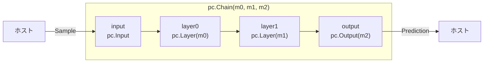
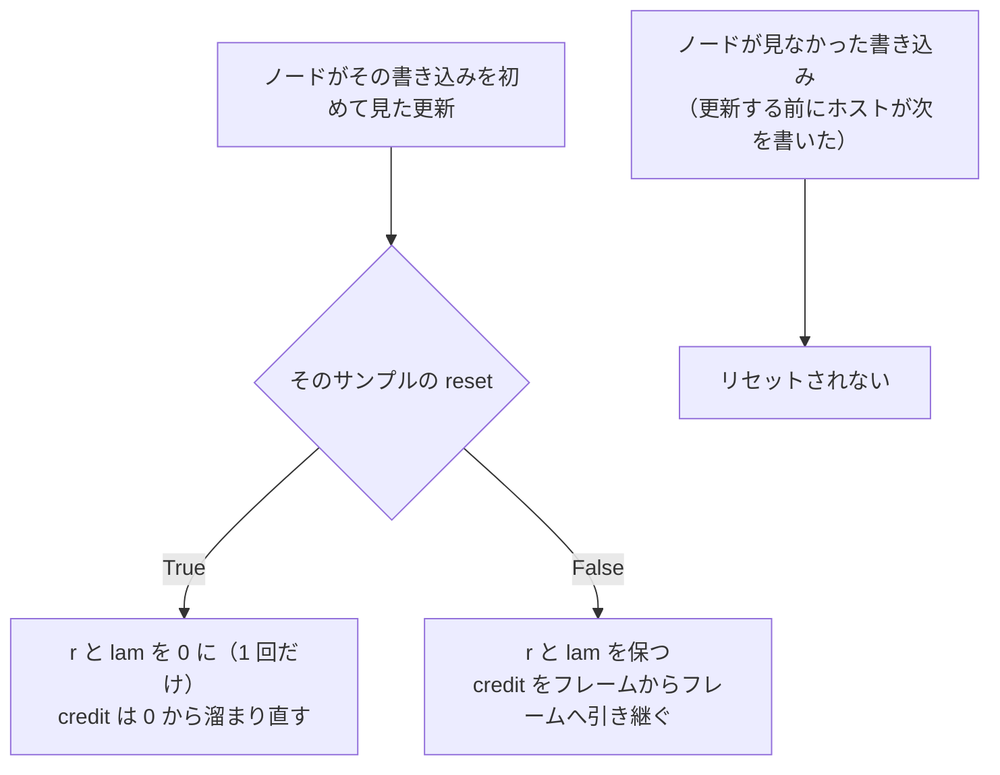
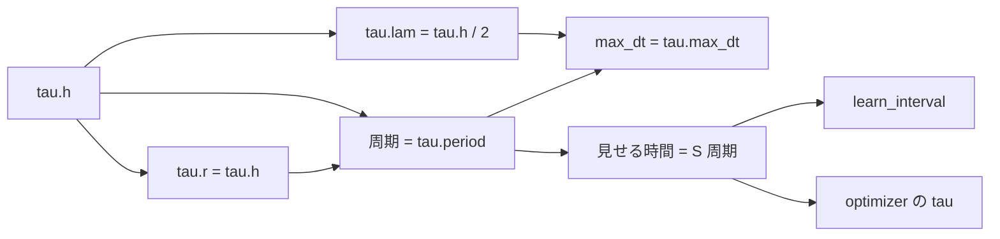
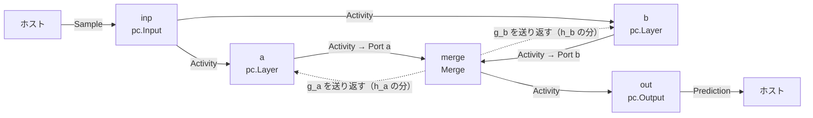

# 🧠 PC-ALM

`mujou.pc` は PyTorch のモデルをノードに分け、PC-ALM（Augmented Lagrangian Predictive Coding、<https://pub.sakana.ai/pc-alm/>）で学習させる。仕組みは [mujou.pc の仕組み](pc-concepts.md)、使い方は [5. PC-ALM で学習する](../tutorial/5-learn-with-pc.md) にあり、このページは値の決め方を扱う。

## ノード {#nodes}



[`pc.Chain`][mujou.pc.Chain] の子の名前 `input`・`layer0`・…・`output` は `run.state_dict()` のパスにもなる。

### ノードを 1 つずつ組む {#build-by-hand}

`pc.Chain` は全ノードを同じ周期で動かすので、周期を変える場合や鎖でない形にする場合は `pc.Input`・`pc.Layer`・`pc.Output` を 1 つずつ組んでつなぐ。`pc.show` で見せるなら、`mujou.Network` とあわせて [`pc.Shown`][mujou.pc.Shown] を継承し、`Input` の `prev` と `Output` の `next` をネットワークの `prev` と `next` として公開する。

### ノードに入れるモジュール {#modules}

| モジュール                                                                       | 扱い                           | 理由・注意                                       |
| -------------------------------------------------------------------------------- | ------------------------------ | ------------------------------------------------ |
| バッチの各サンプルを独立に扱う `nn.Module`（1 層、層を重ねたもの、残差ブロック） | 使える                         | —                                                |
| `LayerNorm`                                                                      | 使える                         | —                                                |
| `Dropout`、`BatchNorm`                                                           | 使えない                       | training mode でサンプルを落としたり混ぜたりする |
| 学ばせないパラメータ                                                             | `requires_grad=False` にする   | —                                                |
| 重みの初期化                                                                     | モジュールを作るときに済ませる | ノードは初期化しない                             |

## 新しく始めるサンプル: `reset` {#reset}

| データ                               | [`reset`][mujou.pc.msg.Sample]             |
| ------------------------------------ | ------------------------------------------ |
| シャッフルしたバッチ、独立なサンプル | すべて True                                |
| 各フレームが前に続くストリーム       | False。エピソードの最初のフレームだけ True |
| テストのバッチ                       | 学習と同じく True                          |



## 時定数を決める {#choose-time-constants}



| 値（意味は [TimeConstants](pc-concepts.md#time-constants)） | 決め方                                                                                                           | MNIST                    |
| ----------------------------------------------------------- | ---------------------------------------------------------------------------------------------------------------- | ------------------------ |
| `tau.h`                                                     | 最初に決める。ほかはここから決まる                                                                               | 4 ms                     |
| `tau.r`                                                     | `tau.h`                                                                                                          | 4 ms                     |
| `tau.lam`                                                   | `tau.h / 2`                                                                                                      | 2 ms                     |
| 周期                                                        | 既定の [`tau.period`][mujou.pc.TimeConstants.period]（`tau.r = tau.h` なら `tau.h / 2`）                         | 2 ms                     |
| `max_dt`                                                    | 既定の [`tau.max_dt`][mujou.pc.TimeConstants.max_dt]（上の組なら 1 周期）                                        | 2 ms                     |
| 見せる時間                                                  | `S` 周期。`S` は [credit の往復](#credit) `2 × hops` 周期より数周期長くする                                      | 16 周期、32 ms           |
| `learn_interval`                                            | 見せる時間の半分より長く、見せる時間より短く、`2 × hops × 周期` より長くする（下の表）。MNIST は見せる時間の 3/4 | 24 ms                    |
| optimizer の `tau`                                          | `tau.h` よりずっと長くする（重みは活動が落ち着いた後の `delta` で学ぶ）。値は [換算の表](#optimizer)             | `pc.optim.SGD(tau=0.32)` |

<figure class="mujou-diagram">
<svg viewBox="0 0 640 210" role="img" aria-label="MNIST で 1 バッチを見せる 32 ms。ホストは 0 ms に書き、32 ms に次を書く。ノードは 2 ms ごとに更新する。credit の往復は最大 12 ms。learn_interval は見せる時間の半分の 16 ms と見せる時間 32 ms の間に置き、MNIST では 24 ms で学ぶ">
<text class="mujou-label" x="10" y="54">ホスト</text>
<line class="mujou-lane" x1="90" y1="50" x2="620" y2="50"/>
<g class="mujou-tick-b"><line x1="90" y1="38" x2="90" y2="62"/><line x1="602" y1="38" x2="602" y2="62"/></g>
<text class="mujou-note" x="94" y="30">書く</text>
<text class="mujou-note" x="602" y="30" text-anchor="end">次を書く</text>
<text class="mujou-label" x="10" y="114">ノード</text>
<rect x="346" y="94" width="256" height="32" style="fill: var(--md-accent-fg-color--transparent)"/>
<line class="mujou-lane" x1="90" y1="110" x2="620" y2="110"/>
<g class="mujou-tick-a"><line x1="122" y1="100" x2="122" y2="120"/><line x1="154" y1="100" x2="154" y2="120"/><line x1="186" y1="100" x2="186" y2="120"/><line x1="218" y1="100" x2="218" y2="120"/><line x1="250" y1="100" x2="250" y2="120"/><line x1="282" y1="100" x2="282" y2="120"/><line x1="314" y1="100" x2="314" y2="120"/><line x1="346" y1="100" x2="346" y2="120"/><line x1="378" y1="100" x2="378" y2="120"/><line x1="410" y1="100" x2="410" y2="120"/><line x1="442" y1="100" x2="442" y2="120"/><line x1="506" y1="100" x2="506" y2="120"/><line x1="538" y1="100" x2="538" y2="120"/><line x1="570" y1="100" x2="570" y2="120"/><line x1="602" y1="100" x2="602" y2="120"/></g>
<g class="mujou-tick-b"><line x1="474" y1="90" x2="474" y2="130"/></g>
<text class="mujou-note" x="474" y="144" text-anchor="middle">学ぶ（24 ms）</text>
<path class="mujou-brace" d="M 92 92 Q 92 84 100 84 L 274 84 Q 282 84 282 92"/>
<text class="mujou-note" x="186" y="78" text-anchor="middle">credit の往復 ≤ 2 × 3 × 2 ms = 12 ms</text>
<line class="mujou-axis" x1="90" y1="160" x2="620" y2="160"/>
<text class="mujou-note" x="90" y="176" text-anchor="middle">0</text>
<text class="mujou-note" x="282" y="176" text-anchor="middle">12 ms</text>
<text class="mujou-note" x="346" y="176" text-anchor="middle">S/2 = 16 ms</text>
<text class="mujou-note" x="602" y="176" text-anchor="end">S = 32 ms</text>
<text class="mujou-note" x="474" y="196" text-anchor="middle">learn_interval を置く範囲</text>
<text class="mujou-label" x="90" y="206">実行のタイマー →</text>
</svg>
</figure>

| `learn_interval`                             | 結果                                                                                               |
| -------------------------------------------- | -------------------------------------------------------------------------------------------------- |
| 見せる時間の半分より短い                     | 1 バッチで 2 回以上学ぶ                                                                            |
| 見せる時間の半分より長く、見せる時間より短い | 1 バッチに 1 回学ぶ（勧める範囲）                                                                  |
| 見せる時間以上                               | 先に次のバッチが書かれ、ノードは一度も学ばない                                                     |
| `2 × hops × 周期` より短い                   | 検査はしない。credit が戻る前に学び、入力に近いノードは credit の一部からしか学べない              |
| `None`                                       | 毎回の更新で学ぶ。入力がフレームごとに変わるストリーム向け。ストリームに適した値はまだ測っていない |

`hops` は `Input` から `Output` までの接続の数で、`pc.Chain` ではモジュールの数と同じ（MNIST は 3）。どのノードも 1 周期ごとに forward と VJP を 1 回ずつ計算するので、大きいノードを少なく置くほど 1 バッチに要る周期は少ない（[ノードの数と周期](pc-benchmarks.md#node-count)）。

### credit の往復 {#credit}

| 実行の仕方                                                                  | credit が 1 ホップ戻る時間    | 往復（入力が `Output` まで進み、credit が先頭の `Layer` まで戻る） |
| --------------------------------------------------------------------------- | ----------------------------- | ------------------------------------------------------------------ |
| [`ManualRun.step(dt)`][mujou.ManualRun.step]（1 ステップに全ノードが 1 回） | 1 ステップ                    | ちょうど `2 × hops` ステップ                                       |
| [`mujou.run`][mujou.run]、全ノードの周期が同じ                              | 最大 1 周期                   | 約 `hops` 周期（上限は `2 × hops` 周期）                           |
| 周期が違う                                                                  | 行き先のノードの約 1 周期まで | 上限だけ言える                                                     |

## optimizer を選ぶ {#optimizer}

| optimizer                                                                    | `elapsed` 秒の 1 回の学習                                                                                          |
| ---------------------------------------------------------------------------- | ------------------------------------------------------------------------------------------------------------------ |
| [`pc.optim.SGD(tau=..., tau_m=None)`][mujou.pc.optim.SGD]                    | `p -= (elapsed / tau) * g`。`tau_m` を渡すと `g` の代わりに、勾配を時定数 `tau_m` で平均した `m_hat`（momentum）   |
| [`pc.optim.RMSProp(tau=..., tau_v=..., eps=1e-8)`][mujou.pc.optim.RMSProp]   | 学習率 `elapsed / tau` の RMSProp。二乗平均の `v` は時定数 `tau_v` で減衰する                                      |
| [`pc.optim.AdamW(tau=..., tau_m=..., tau_v=..., ...)`][mujou.pc.optim.AdamW] | 学習率 `elapsed / tau` の AdamW。moment の `m` と `v` は時定数 `tau_m` と `tau_v` で減衰する                       |
| [`pc.optim.TimeScaled(optimizer, scale=...)`][mujou.pc.optim.TimeScaled]     | `optimizer` を `elapsed * scale` 秒ぶん進める（[1 本のストリーム](#one-stream-as-a-batch-of-consecutive-samples)） |

`Δt` は 2 回の学習の間の時間で、1 バッチに 1 回学ぶなら見せる時間。

| optimizer       | ふるまい                                                                                                              | torch の値からの換算                                                                                                                                                          | `mujou.pc` で測った例                 |
| --------------- | --------------------------------------------------------------------------------------------------------------------- | ----------------------------------------------------------------------------------------------------------------------------------------------------------------------------- | ------------------------------------- |
| SGD             | 勾配に比例して動かす                                                                                                  | `tau` = 見せる時間 / 1 バッチあたりの学習率                                                                                                                                   | [MNIST](pc-benchmarks.md#mnist)       |
| SGD の momentum | 勾配をおよそ直近 `tau_m` 秒で平均し、学習率は変えない。勾配が一定なら momentum 無しと同じだけ動く                     | `torch.optim.SGD(lr, momentum=beta, dampening=beta)` から `tau = Δt / lr`、`tau_m = -Δt / ln(beta)`。torch の既定の `dampening=0` に合わせるなら `tau = (1 - beta) * Δt / lr` | まだ測っていない                      |
| RMSProp         | 勾配をその二乗平均の平方根で割る。momentum と weight decay は無い。各重みを 1 回に最大でおよそ `elapsed / tau` 動かす | `torch.optim.RMSprop(lr, alpha, eps)` から `tau = Δt / lr`、`tau_v = -Δt / ln(alpha)`                                                                                         | まだ測っていない                      |
| AdamW           | 勾配の大きさによらず、各重みを 1 回におよそ `elapsed / tau` 動かす                                                    | `torch.optim.AdamW` の `lr`・`betas` から `tau = Δt / lr`、`tau_m = -Δt / ln(beta1)`、`tau_v = -Δt / ln(beta2)`。`Δt` が一定なら歩みは `torch.optim.AdamW` と同じ             | [CIFAR-10](pc-benchmarks.md#cifar-10) |

ノードに学ばせないときは、optimizer の `tau` を無限大にせず `learn_interval=math.inf` を渡す。

=== "避ける"

    ```python
    optimizer = pc.optim.SGD(tau=math.inf)  # ValueError
    ```

=== "こう書く"

    ```python
    # その pc.Layer か pc.Output に渡す。pc.Chain は 1 つの learn_interval を全ノードに渡す
    layer = pc.Layer(module, act_spec=spec, tau=tau, optimizer=optimizer, learn_interval=math.inf)
    ```

## relaxer を選ぶ {#choose-relaxer}

`pc.Layer` と `pc.Chain` の `relaxer=` は省略でき、既定は [`pc.relax.Euler`][mujou.pc.relax.Euler]。`pc.Output` は `r` を持たないため relaxer を取らない。relaxer の仕組みと自作は [mujou.pc の仕組み](pc-concepts.md#relaxer) を参照。

## バッチ {#batch}

| [`batch`][mujou.pc.Chain] | `x`（入力 784） | `y`（クラス 1 つ） | `mask`   | 用途                                                                      |
| ------------------------- | --------------- | ------------------ | -------- | ------------------------------------------------------------------------- |
| `()`（既定）              | `(784,)`        | `()`               | `()`     | センサーのように 1 サンプルずつ受け取る                                   |
| `64`                      | `(64, 784)`     | `(64,)`            | `(64,)`  | 64 サンプル                                                               |
| `(8, 4)`                  | `(8, 4, 784)`   | `(8, 4)`           | `(8, 4)` | たとえば 8 個の環境それぞれに 4 エージェント。`batch=32` と同じに学ぶ     |
| `64`                      | `(64, T, 784)`  | `(64,)`            | `(64,)`  | `T` ステップの系列 64 本。module が混ぜる時間はバッチでなくサンプルの次元 |

## 1 本のストリームを連続したサンプルのバッチで流す {#one-stream-as-a-batch-of-consecutive-samples}

| バッチ（`c = 4`。数字はストリームのサンプルの番号） | 行 0 | 行 1 | 行 2 | 行 3 |
| --------------------------------------------------- | ---- | ---- | ---- | ---- |
| 1 つ目                                              | 0    | 1    | 2    | 3    |
| 2 つ目                                              | 4    | 5    | 6    | 7    |
| 3 つ目                                              | 8    | 9    | 10   | 11   |

| 手順 | 設定                                                                                                                                                      | 理由                                                                         | 1 サンプルずつ流すときとの違い                                                                                                                                |
| ---- | --------------------------------------------------------------------------------------------------------------------------------------------------------- | ---------------------------------------------------------------------------- | ------------------------------------------------------------------------------------------------------------------------------------------------------------- |
| 1    | 各バッチは、ストリームの 1 サンプル分の時間だけ見せる。これが見せる時間                                                                                   | 見せる時間まで `c` 倍にすると時間を二重に倍にし、重みが `c` 倍速く学びすぎる | —                                                                                                                                                             |
| 2    | `optimizer` の時定数は、1 サンプルずつ流すときと同じくストリームの秒で書く                                                                                | `TimeScaled` が `c` で割るので、割り忘れが起きない                           | 1 バッチの歩みは 1 サンプルずつの `c` 歩の和と比べ、`pc.optim.SGD` なら 1 次の近似で同じ、RMSProp と AdamW では 1〜約 `√c` 倍（平均した勾配はノイズが小さい） |
| 3    | 学習するすべてのノードの optimizer を、同じ [`pc.optim.TimeScaled(optimizer, scale=c)`][mujou.pc.optim.TimeScaled] で包む（`pc.Chain` なら `optimizer=`） | `scale` が違うノードは、ほかのノードより速く、または遅く学ぶ                 | 重みは `c` 歩の代わりに `c` 倍の時間を 1 歩で進む。`c` が大きいと、学習が遅れることも、学びすぎて不安定になることもある                                       |
| 4    | `tau.h`・`tau.r`・`tau.lam`・周期・`learn_interval` は、この見せる時間から[時定数を決める](#choose-time-constants)のとおりに決める                        | どれも run の秒のまま。`TimeScaled` が変えるのは重みの時間だけ               | `reset` が False なら、各行は `c` 個前のサンプル（前のバッチの同じ行）から続く。直前のサンプルからではない                                                    |

RMSProp と AdamW で歩みが大きすぎるなら `tau` を伸ばす。良い倍率はまだ測っていない。

## 落とし穴 {#pitfalls}

| 落とし穴                                                                        | 症状                                                                                                                  | 対処                                                                            |
| ------------------------------------------------------------------------------- | --------------------------------------------------------------------------------------------------------------------- | ------------------------------------------------------------------------------- |
| バッチを鎖と損失の片方にしか渡さない（`batch` は spec の shape から読まれない） | どこにも渡さないと各サンプルの credit が 1/64（64 サンプルのとき）。片方だけならエラー                                | `pc.Chain`（か `pc.Input`）と損失に同じ `batch`                                 |
| バッチで平均する損失（`nn.MSELoss()` など）を渡す                               | `pc.Output` が `ValueError`                                                                                           | サンプルごとの損失を返す [`pc.loss.MSELoss(batch)`][mujou.pc.loss.MSELoss] など |
| `Layer` の `next` から予測を読む                                                | ネットワークの予測は入っていない                                                                                      | `pc.Output` の `next`（`pc.Chain` なら `net.next`）                             |
| 最初のサンプルが届く前に読む                                                    | `mask` がすべて False の予測                                                                                          | `write` が返した時刻と `time` を照合する（`pc.show` と同じ）                    |
| 負荷が高い                                                                      | 発散か精度の低下。MNIST は `y_hat` が有限でなくなると止まるが、予測が有限のまま発散すると精度の低下としてしか見えない | 時間の速さを下げる。ほかに何も動いていない機械で回す（下の表）                  |
| シャッフルしたサンプルに `reset` を立てない                                     | 入力に近いノードが関係のないサンプルの credit から学ぶ                                                                | 前に続かないサンプルには `reset` を True（[reset](#reset)）                     |

=== "避ける"

    ```python
    net = pc.Chain(*modules, x=TensorSpec((64, 784)), y=y_spec, loss=pc.loss.MSELoss(), ...)  # credit が 1/64
    out = pc.Output(module, act_spec=spec, loss=nn.MSELoss(), ...)  # ValueError
    ```

=== "こう書く"

    ```python
    net = pc.Chain(*modules, x=TensorSpec((64, 784)), y=y_spec, batch=64, loss=pc.loss.MSELoss(64), ...)
    out = pc.Output(module, act_spec=spec, loss=pc.loss.MSELoss(64), ...)
    ```

あるノードが遅れると、隣のノードはその古いメッセージから学び続ける。わかっている原因は 2 つある。`max_dt` では防げない（1 回の更新で数える時間の上限で、超えた分は緩和からも重みの更新からも捨てられる）。

| 負荷の原因                       | 観測                                                                                                                                                                                                                                                          | 対処                                                                              |
| -------------------------------- | ------------------------------------------------------------------------------------------------------------------------------------------------------------------------------------------------------------------------------------------------------------- | --------------------------------------------------------------------------------- |
| 時間の速さが速すぎる             | 例は `--time-scale` で実行のタイマーを速める。速すぎると最も遅いノードの計算が周期に収まらない。残差ブロックごとに切った CIFAR-10 では、周期を実時間 2 ms にすると更新の間隔が平均 1.1〜1.3 周期に延び、最大で 100 周期ほど止まり、精度が約 20 ポイント落ちた | `--watch`（MNIST）で 1 epoch 回し、警告が出ず発散もしない最も速い時間の速さを選ぶ |
| ほかのプロセスがコアを使っている | コアを待つノードがあると、隣のノードが先に進む。32 コアの機械で時間の速さ 1 なら、busy loop 26 本と並べて 1 epoch を完走し、32 本では発散した。0.5 なら 32 本でも完走した                                                                                     | ほかに何も動いていない機械で回すか、時間の速さを下げる                            |

## 自分のノードを書く {#own-node}

`pc.Layer` で書けないノード（入力が複数のノードなど）は、[`pc.functional`][mujou.pc.functional] の式と [`pc.clock.LearnClock`][mujou.pc.clock.LearnClock]、optimizer、relaxer を組み合わせて書く。1 回の更新の段は [Layer の 1 回の更新](pc-concepts.md#layer-update) と同じにして、optimizer と relaxer はノードごとに bind し、bind したものをノードの間で共有しない。



```python
--8<-- "examples/pc_merge.py:merge"
```

| `pc.Layer` との違い | `Merge`（`examples/pc_merge.py`）                                         |
| ------------------- | ------------------------------------------------------------------------- |
| Port                | 入力ごとに持つ（`a` と `b`）                                              |
| `g_in`              | `h_a` と `h_b` の幅で `g_a` と `g_b` に分け、それぞれの Port から送り返す |
