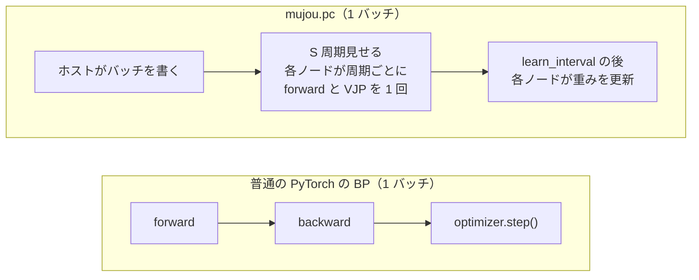
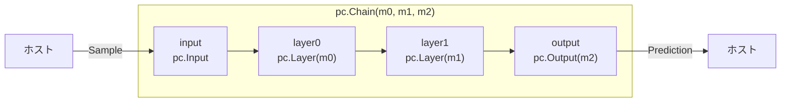
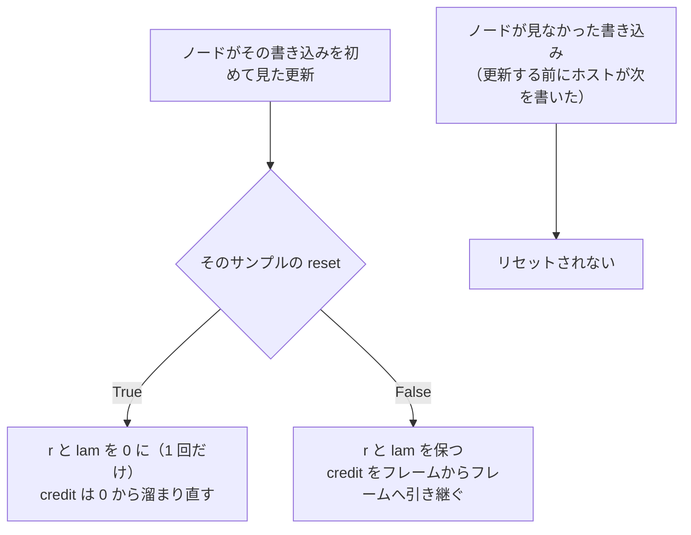
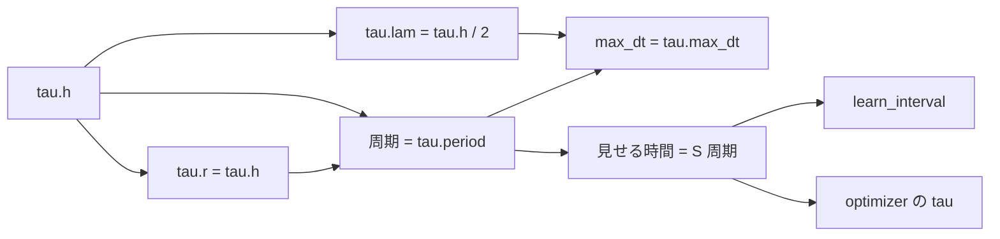
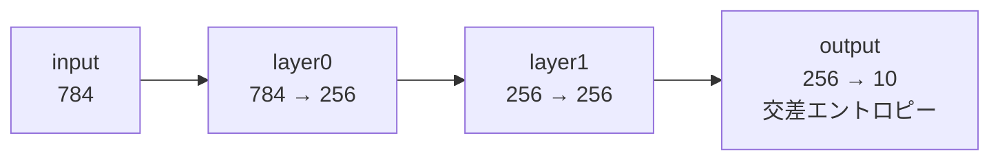
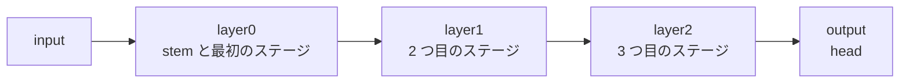
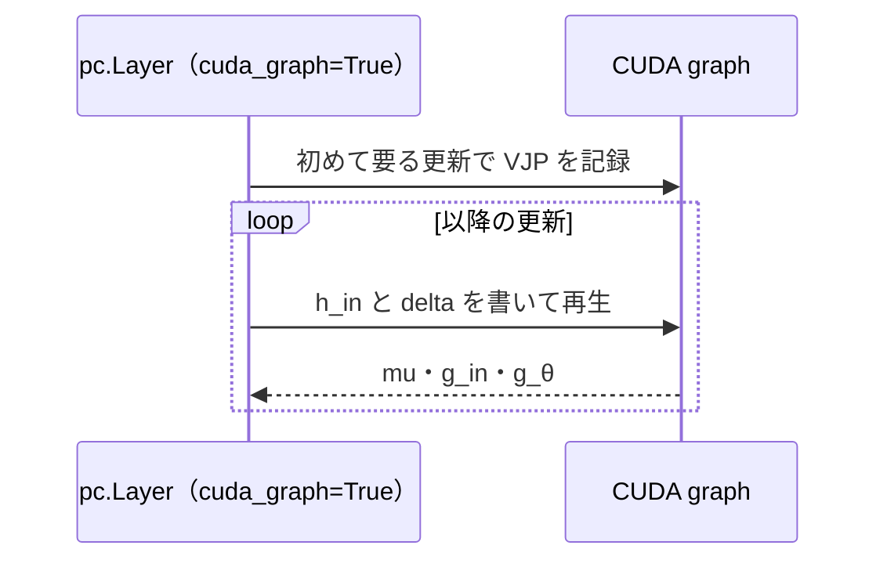
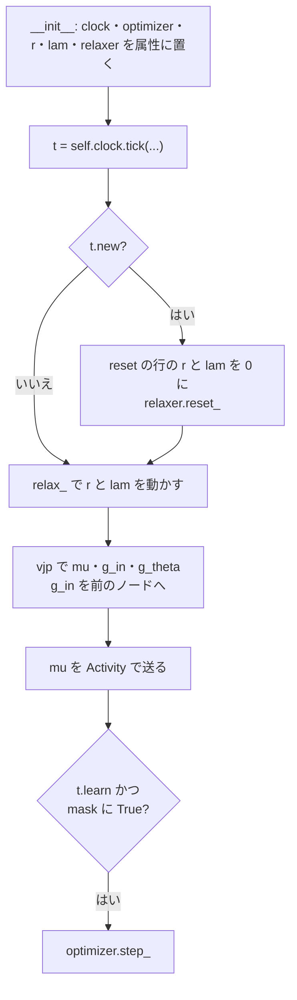
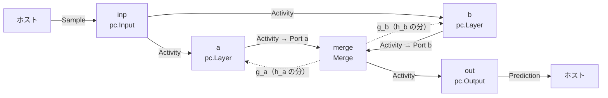

# 🧠 PC-ALM

`mujou.pc` は PyTorch のモデルをノードに分け、PC-ALM（Augmented Lagrangian Predictive Coding、<https://pub.sakana.ai/pc-alm/>）で学習させるモジュール。[5. PC-ALM で学習する](../tutorial/5-learn-with-pc.md) では `pc.Chain` で鎖を組み、`pc.show` でバッチを見せた。このページでは時定数・optimizer・relaxer の決め方、BP との違い、落とし穴、MNIST と CIFAR-10、自作のノードを扱う。

!!! abstract "このページで分かること"

    - BP との違いと、`pc.Chain` が作るノード
    - 新しく始めるサンプルの `reset`
    - 時定数・`learn_interval`・optimizer・relaxer の決め方
    - MNIST と CIFAR-10 の例と、GPU で速くする `cuda_graph`
    - バッチと、1 本のストリームをバッチで流す方法
    - 落とし穴と、自分のノードの書き方

    部品の名前（`mu`・`r`・`lam`・`g_in`・`Tick`）と 1 回の更新の中身は [mujou.pc の仕組み](pc-concepts.md)で説明している。

## BP との違い

!!! abstract "要点"

    BP は forward・backward・`optimizer.step()` を順に回す。`mujou.pc` では各ノードが自分の周期で更新し、ホストがバッチを見せている間に推論と学習が同時に進む。



| 項目           | 普通の PyTorch の BP                         | `mujou.pc`                                                                                                               |
| -------------- | -------------------------------------------- | ------------------------------------------------------------------------------------------------------------------------ |
| 推論と学習     | forward、backward、`optimizer.step()` を順に | 同時に進む。各ノードが自分の周期で更新し、入力を見せている間に学習する                                                   |
| 1 回の学習     | 1 バッチ                                     | ホストがバッチを一定の時間（`S` 周期）見せる。ノードは目標に向かって緩和し、その後に重みを更新する                       |
| 目標           | バッチと一緒に損失関数に渡す                 | 入力と一緒に書き込み、活動と組にしてノードからノードへ出力ノードまで運ぶ                                                 |
| 学習とテスト   | `model.train()` / `model.eval()`             | モードは無い。`mask` が False のサンプルからは学習しないので、テストのバッチも走っている同じノードに流す                 |
| 損失           | 普通はバッチの平均                           | サンプルごとの損失で、shape はバッチの shape。出力ノードが合計する                                                       |
| 勾配を取る範囲 | モデル全体を通して `.backward()`             | 各ノードの内側だけ。隣のノードとは活動とエネルギーの勾配をメッセージでやり取りする                                       |
| 計算量         | 1 バッチに forward と backward が 1 回ずつ   | 1 周期にノードごとに forward と VJP が 1 回なので、1 バッチで `S` 回。MNIST では CPU 上で 1 バッチに BP の約 40 倍かかる |

## ノード

!!! abstract "要点"

    `pc.Chain` は `Input → Layer → … → Output` をつなぐ。`Layer` は予測 `mu` を送り、ずれ `r` と双対変数 `lam` を手元に持つ。



最後のモジュールが `pc.Output` に、それより前のモジュールがそれぞれ `pc.Layer` になる。子の名前 `input`・`layer0`・…・`output` は `run.state_dict()` のパスでもある。

| ノード      | 持つもの                                       | Port                                                                                                                                                                  |
| ----------- | ---------------------------------------------- | --------------------------------------------------------------------------------------------------------------------------------------------------------------------- |
| `pc.Input`  | 何も持たない                                   | `prev`: ホストが `pc.msg.Sample`（`x`、`y`、`mask`、`reset`）を書く。`next`: `x` を `pc.msg.Activity` の `h` として、`y`・`mask`・`reset`・書き込みの時刻と一緒に送る |
| `pc.Layer`  | モジュール、ずれ `r`、双対変数 `lam`、クロック | `prev` と `next`。`next` は予測 `mu` を `h` として、入力と一緒に届いた `y`・`mask`・`reset`・`time` と組にして `pc.msg.Activity` で送る                               |
| `pc.Output` | 最後のモジュール、損失、クロック               | `prev`。`next` はホストが読む `pc.msg.Prediction`（`y_hat`、`y`、`mask`、`time`）を送る                                                                               |

`pc.msg.Activity` は `h`・`y`・`mask`・`reset`・`time` を運ぶ。`pc.Layer` は活動の予測 `mu = module(h_in)` からのずれ `r = h - mu` と双対変数 `lam` を持ち、`mu` を送る。前へ流れるのは順伝播の値で、credit は後ろへだけ流れる。何が `mu` を動かしても（新しいサンプル、下のノードの学習、自分の学習）、`r` と `lam` は値を保ったまま緩和を続ける。ただし新しく始まるサンプルでは 0 に戻す（[新しく始めるサンプル](#reset)）。

### ノードを 1 つずつ組む

`pc.Chain` は全ノードを同じ周期で動かす。周期は `period=` を渡さなければ `tau.period`（`tau.r = tau.h` なら `tau.h / 2`）。ノードごとに別の周期にするときや別の形にするときは、ノードを 1 つずつ組む。手順は下のとおり。

1. `pc.Input` に spec の `x` と `y`、`period` を渡す
2. 各 `pc.Layer` と `pc.Output` に、前のノードの `act_spec`（受け取る `pc.msg.Activity` の spec）を渡す
3. 鎖に沿って、前のノードの `next` を次のノードの `prev` につなぐ
4. `pc.show` で見せるなら、`mujou.Network` とあわせて `pc.Shown` を継承し、`Input` の `prev` と `Output` の `next` を自分の `prev` と `next` として公開する

### ノードに入れるモジュール

| 区分                  | モジュール                                                                     | 理由・注意                                       |
| --------------------- | ------------------------------------------------------------------------------ | ------------------------------------------------ |
| 使える                | バッチの各サンプルを独立に扱う `nn.Module`。1 層、層を重ねたもの、残差ブロック | —                                                |
| 使える                | `LayerNorm`                                                                    | —                                                |
| 使えない              | `Dropout`、`BatchNorm`                                                         | training mode でサンプルを落としたり混ぜたりする |
| 重みの初期化          | モジュールを作るときに済ませる                                                 | ノードは初期化しない                             |
| `requires_grad=False` | そのパラメータ                                                                 | 学習しない                                       |

## 新しく始めるサンプル: `reset` {#reset}

!!! abstract "要点"

    `r` と `lam` はノードが見てきたサンプルの credit。ホストはサンプルごとに `reset` を書き、新しく始まるサンプルでは 0 に戻させ、前に続くサンプルでは持ち越させる。

`reset` はサンプルごとの bool で、`mask` と同じ shape。ホストは書くサンプルごとに、新しく始まるかを `reset` で伝える。データごとの値は下の表のとおり。

| データ                               | `reset`                                    |
| ------------------------------------ | ------------------------------------------ |
| シャッフルしたバッチ、独立なサンプル | すべて True                                |
| 各フレームが前に続くストリーム       | False。エピソードの最初のフレームだけ True |
| テストのバッチ                       | 学習と同じく True                          |



`reset` が True のサンプルは、関係のないサンプルの credit が残らず、新しいサンプルの credit は 0 から始まり、出力から戻ってくるにつれて溜まる。`reset` が False のサンプルは `r` と `lam` を保つので、credit がフレームからフレームへ引き継がれる。ノードが更新する前にホストが次を書いた書き込み（ノードが見なかったもの）はリセットされない。

```python
new = torch.ones_like(mask)  # シャッフルしたデータ: どのサンプルも新しく始まる
p = pc.show(run, net, pc.msg.Sample(x=x, y=y, mask=mask, reset=new), seconds=shown)
```

## 時定数を決める

!!! abstract "要点"

    速さはすべて実行のタイマーの秒で、時定数として指定する。時定数が短いほど速く動く。`tau.h` を最初に決め、ほかはそこから決まる。



次の表の順に決める。

| 値               | 決めるもの                                   | 決め方                                                                                                                                                 | MNIST                    |
| ---------------- | -------------------------------------------- | ------------------------------------------------------------------------------------------------------------------------------------------------------ | ------------------------ |
| `tau.h`          | ずれ `r` が緩和する速さ                      | 最初に決める。ほかはここから決まる                                                                                                                     | 4 ms                     |
| `tau.r`          | ずれ `r = h - mu` が減衰する速さ             | `tau.h`。必須で、既定値は無い。`math.inf` で減衰を切る                                                                                                 | 4 ms                     |
| `tau.lam`        | 双対変数 `lam` が追従する速さ                | `tau.h / 2`                                                                                                                                            | 2 ms                     |
| 周期             | 各ノードが更新する間隔                       | `tau.period`（`tau.r = tau.h` なら `tau.h / 2`）。`Layer`・`Output`・`pc.Chain`（`period=`）の既定。上の 2 つと組むと、credit は 1 ホップに最大 1 周期 | 2 ms                     |
| `relaxer`        | `r` が自分に掛かる力に沿ってどう動くか       | 既定は `pc.relax.Euler()`。[relaxer を選ぶ](#relaxer-%E3%82%92%E9%81%B8%E3%81%B6)を見る                                                                |                          |
| 見せる時間       | ホストが各バッチを見せる長さ                 | `S` 周期。`S` は credit の最長の往復 `2 × ホップ数` より数周期長くする                                                                                 | 16 周期、32 ms           |
| `learn_interval` | ホストの書き込みから重みを更新するまでの時間 | 見せる時間の半分より長く、見せる時間より短く、`2 × ホップ数 × 周期` より長くする。MNIST では見せる時間の 3/4                                           | 24 ms                    |
| `optimizer`      | 重みが学ぶ速さ                               | `pc.optim.SGD(tau=見せる時間 / lr)`。`lr` は 1 バッチあたりの学習率。[optimizer を選ぶ](#optimizer-%E3%82%92%E9%81%B8%E3%81%B6)を参照                  | `pc.optim.SGD(tau=0.32)` |
| `max_dt`         | 1 回の更新で数える `dt` の上限               | 既定の `tau.max_dt`。ここでは 1 周期。下の「周期と `max_dt`」を見る                                                                                    | 2 ms                     |

### 1 バッチの中の時間

MNIST の値（周期 2 ms、ホップ数 3、16 周期見せる）で、1 バッチを見せる間に起きること。

<figure class="mujou-diagram">
<svg viewBox="0 0 640 210" role="img" aria-label="MNIST で 1 バッチを見せる 32 ms。ホストは 0 ms に書き、32 ms に次を書く。ノードは 2 ms ごとに更新する。credit の往復は最大 12 ms。learn_interval は見せる時間の半分の 16 ms と見せる時間 32 ms の間に置き、MNIST では 24 ms で学ぶ">
<text class="mujou-label" x="10" y="54">ホスト</text>
<line class="mujou-lane" x1="90" y1="50" x2="620" y2="50"/>
<g class="mujou-tick-b"><line x1="90" y1="38" x2="90" y2="62"/><line x1="602" y1="38" x2="602" y2="62"/></g>
<text class="mujou-note" x="94" y="30">書く</text>
<text class="mujou-note" x="602" y="30" text-anchor="end">次を書く</text>
<text class="mujou-label" x="10" y="114">ノード</text>
<rect x="346" y="94" width="256" height="32" style="fill: var(--md-accent-fg-color--transparent)"/>
<line class="mujou-lane" x1="90" y1="110" x2="620" y2="110"/>
<g class="mujou-tick-a"><line x1="122" y1="100" x2="122" y2="120"/><line x1="154" y1="100" x2="154" y2="120"/><line x1="186" y1="100" x2="186" y2="120"/><line x1="218" y1="100" x2="218" y2="120"/><line x1="250" y1="100" x2="250" y2="120"/><line x1="282" y1="100" x2="282" y2="120"/><line x1="314" y1="100" x2="314" y2="120"/><line x1="346" y1="100" x2="346" y2="120"/><line x1="378" y1="100" x2="378" y2="120"/><line x1="410" y1="100" x2="410" y2="120"/><line x1="442" y1="100" x2="442" y2="120"/><line x1="506" y1="100" x2="506" y2="120"/><line x1="538" y1="100" x2="538" y2="120"/><line x1="570" y1="100" x2="570" y2="120"/><line x1="602" y1="100" x2="602" y2="120"/></g>
<g class="mujou-tick-b"><line x1="474" y1="90" x2="474" y2="130"/></g>
<text class="mujou-note" x="474" y="144" text-anchor="middle">学ぶ（24 ms）</text>
<path class="mujou-brace" d="M 92 92 Q 92 84 100 84 L 274 84 Q 282 84 282 92"/>
<text class="mujou-note" x="186" y="78" text-anchor="middle">credit の往復 ≤ 2 × 3 × 2 ms = 12 ms</text>
<line class="mujou-axis" x1="90" y1="160" x2="620" y2="160"/>
<text class="mujou-note" x="90" y="176" text-anchor="middle">0</text>
<text class="mujou-note" x="282" y="176" text-anchor="middle">12 ms</text>
<text class="mujou-note" x="346" y="176" text-anchor="middle">S/2 = 16 ms</text>
<text class="mujou-note" x="602" y="176" text-anchor="end">S = 32 ms</text>
<text class="mujou-note" x="474" y="196" text-anchor="middle">learn_interval を置く範囲</text>
<text class="mujou-label" x="90" y="206">実行のタイマー →</text>
</svg>
<figcaption>細い縦線がノードの更新（2 ms ごと）、太い縦線が学ぶ更新。色を付けた範囲が <code>learn_interval</code> を置く範囲</figcaption>
</figure>

### 周期と `max_dt`

| 値                       | 既定                                     | 注意                                                      |
| ------------------------ | ---------------------------------------- | --------------------------------------------------------- |
| 周期（`tau.period`）     | `tau.h / (1 + tau.h / tau.r)`            | —                                                         |
| `max_dt`（`tau.max_dt`） | `tau.period` と `2 * tau.lam` の短いほう | 周期より短い `max_dt` は、ノードを作るときに `ValueError` |

`tau.lam >= tau.period / 2` なら、既定の `max_dt` は既定の周期と同じになる。

### 学習率

`pc.optim.SGD` では、重みは 1 回の学習で `elapsed / tau` にバッチの勾配の平均を掛けた分だけ動く。`elapsed` はそのノードが前に学んでからの時間。1 バッチに 1 回学ぶなら `elapsed` は見せる時間なので、`pc.optim.SGD(tau=見せる時間 / lr)` とすれば 1 バッチあたりの学習率が `lr` になる。`elapsed` はその間の各更新の `dt`（1 回ごとに `max_dt` で打ち切ったもの）の和で、周期どおりに更新するなら `dt` は 1 周期なのでそのまま数えられる。

**勾配の平均**は、サンプルごとの勾配の和を、バッチのサンプルの数 `B`（バッチが無ければ 1）で割ったもの。`mask` が False のサンプルは和に何も足さないが、`B` には数える。

### `learn_interval` の範囲

| `learn_interval`                             | 結果                                                                                  |
| -------------------------------------------- | ------------------------------------------------------------------------------------- |
| 見せる時間の半分より短い                     | 1 バッチで 2 回以上学ぶ                                                               |
| 見せる時間の半分より長く、見せる時間より短い | 1 バッチに 1 回学ぶ（勧める範囲）                                                     |
| 見せる時間以上                               | 先に次のバッチが書かれ、ノードは一度も学ばない                                        |
| `2 × ホップ数 × 周期` より短い               | 検査はしない。credit が戻る前に学び、入力に近いノードは credit の一部からしか学べない |

`learn_interval` はホストが書き込んだ時刻（活動の `time`）から数え、ノードが受け取った時刻からは数えない。そのためノードは深さによらずほぼ同じ時刻に学ぶ。ノードは書き込みから `learn_interval` 後に学び、バッチを見せている間は以後 `learn_interval` ごとに学ぶ。だから範囲は上の表のようになる。

### credit の往復

ノードは入力を初めて見た更新では学ばず、credit が経路を往復するにも時間が要る。入力は前へ、credit は後ろへ 1 ホップに最大 1 周期で進む。ホップ数は `Input` から `Output` までの接続の数で、`pc.Chain` ではモジュールの数と同じ（MNIST は 3）。往復は最大 `2 × ホップ数 × 周期`（MNIST は 6 周期）。実行の仕方ごとの時間は下の表。

| 実行の仕方                        | 往復にかかる時間                                              |
| --------------------------------- | ------------------------------------------------------------- |
| `ManualRun` の `run.step(dt)`     | ちょうど `2 × ホップ数` ステップ                              |
| `mujou.run`、全ノードの周期が同じ | その約半分の `ホップ数 × 周期`                                |
| 周期が違う                        | 上限だけ言える。1 ホップの待ちは行き先のノードの約 1 周期まで |

`learn_interval` は、どちらの実行でも credit が戻るよう `2 × ホップ数 × 周期` より長くすることを勧める。どのノードも 1 周期ごとに forward と VJP を 1 回ずつ計算するので、大きいノードを少なく置くほど 1 バッチに要る周期は少ない。

### 入力がフレームごとに変わるストリーム

`learn_interval=None` を渡す。ノードは入力が変わったかどうかによらず毎回の更新で学び、1 秒あたりの学習率は `pc.optim.SGD` の `1 / tau` になる。ストリームに適した値はまだ測っていない。

### `r` の減衰

`tau.r` が効くのは `tau.h * dr/dt` に `-(tau.h / tau.r) * r` が加わるところ。`lam` が `r` を積分するので、`tau.r` によらず平衡点では `r = 0` で、`lam` は BP の credit のまま。`r` を引く力が `1 + tau.h / tau.r` 倍になるので、既定の周期もその倍率で割った長さになる。

??? question "この値にするのはなぜ？"

    `tau.r = tau.h`、`tau.lam = tau.h / 2`、周期 `tau.h / 2` なら、1 回の更新で `delta = r + lam` がちょうど `-g` になり、ノードはその `delta` の `g_in` を同じ更新のうちに送る。credit は 1 ホップに最大 1 周期で戻り、行き過ぎない。ノードは `mu` を送るので credit は後ろへだけ流れ、モジュールのヤコビアンによらず、深い鎖でも 1 ノードのときと同じ刻みで安定する。長い刻み（`dt = tau.h = tau.lam`、減衰なし）では `delta` が 2 倍に行き過ぎ、その行き過ぎは通るノードごとに大きくなる。短い刻みは安定だが、多くの周期が要る。

## optimizer を選ぶ

!!! abstract "要点"

    `optimizer=` は必須。状態を持たない設定なので `pc.Chain` は同じものを全ノードに渡し、各ノードが自分の重みに bind して状態を持つ。時定数はステップでなく秒。

| optimizer                                                                    | `elapsed` 秒の 1 回の学習                                                                    | 状態                   |
| ---------------------------------------------------------------------------- | -------------------------------------------------------------------------------------------- | ---------------------- |
| `pc.optim.SGD(tau=...)`                                                      | `p -= (elapsed / tau) * g`                                                                   | 無し                   |
| `pc.optim.SGD(tau=..., tau_m=...)`                                           | `p -= (elapsed / tau) * m_hat`。momentum の `m` は勾配を時定数 `tau_m` で平均したもの        | `m`、`c_m`             |
| `pc.optim.RMSProp(tau=..., tau_v=..., eps=1e-8)`                             | 学習率 `elapsed / tau` の RMSProp。二乗平均の `v` は時定数 `tau_v` で減衰する                | `v`、`c_v`             |
| `pc.optim.AdamW(tau=..., tau_m=..., tau_v=..., eps=1e-8, weight_decay=1e-2)` | 学習率 `elapsed / tau` の AdamW。moment の `m` と `v` は時定数 `tau_m` と `tau_v` で減衰する | `m`、`v`、`c_m`、`c_v` |
| `pc.optim.TimeScaled(optimizer, scale=...)`                                  | `optimizer` を `elapsed * scale` 秒ぶん進める                                                | `optimizer` の状態     |

optimizer はノードが学ぶときに、バッチの勾配の平均 `g` で重みをどう動かすかを決める。**ステップでなく時間**: `tau` はどれも秒。`elapsed` はノードが前に学んでからの時間なので、1 バッチの間に何回学んでも、各歩みの `elapsed` を合わせると見せる時間になる。そのため `pc.optim.SGD` では 1 バッチに 1 回学んでも 2 回学んでも、1 バッチで重みが動く量は同じ。

### 選び方と torch からの換算

`Δt` は 2 回の学習の間の時間で、1 バッチに 1 回学ぶなら見せる時間。

| optimizer       | ふるまい                                                                                                              | torch の値からの換算                                                                                                                                                          | `mujou.pc` での値 |
| --------------- | --------------------------------------------------------------------------------------------------------------------- | ----------------------------------------------------------------------------------------------------------------------------------------------------------------------------- | ----------------- |
| SGD             | MNIST が使うもの                                                                                                      | `tau` = 見せる時間 / 1 バッチあたりの学習率（時定数の表のとおり）                                                                                                             | MNIST で使用      |
| SGD の momentum | 勾配をおよそ直近 `tau_m` 秒で平均し、学習率は変えない。勾配が一定なら momentum 無しと同じだけ動く                     | `torch.optim.SGD(lr, momentum=beta, dampening=beta)` から `tau = Δt / lr`、`tau_m = -Δt / ln(beta)`。torch の既定の `dampening=0` に合わせるなら `tau = (1 - beta) * Δt / lr` | まだ測っていない  |
| RMSProp         | 勾配をその二乗平均の平方根で割る。momentum と weight decay は無い。各重みを 1 回に最大でおよそ `elapsed / tau` 動かす | `torch.optim.RMSprop(lr, alpha, eps)` から `tau = Δt / lr`、`tau_v = -Δt / ln(alpha)`                                                                                         | まだ測っていない  |
| AdamW           | 勾配の大きさによらず、各重みを 1 回におよそ `elapsed / tau` 動かす                                                    | `torch.optim.AdamW` の `lr`・`betas` から `tau = Δt / lr`、`tau_m = -Δt / ln(beta1)`、`tau_v = -Δt / ln(beta2)`。`Δt` が一定なら歩みは `torch.optim.AdamW` と同じ             | まだ測っていない  |

torch の既定の `dampening=0` では、buffer がたまると SGD の歩みが `1 / (1 - beta)` 倍になる（上の表の `(1 - beta)` はこれに合わせるため）。AdamW の換算の例として、32 ms に 1 回学ぶなら `beta1 = 0.9` は `tau_m` ≈ 0.30 s、`beta2 = 0.999` は `tau_v` ≈ 32 s になる（下のコード）。

```python
# torch の lr=1e-3, betas=(0.9, 0.999) を、32 ms のバッチごとに 1 回学ぶ場合に換算して丸めたもの。
optimizer = pc.optim.AdamW(tau=0.032 / 1e-3, tau_m=0.3, tau_v=32.0)
```

### 値の規則と状態

| 項目           | 規則                                                                                                                               |
| -------------- | ---------------------------------------------------------------------------------------------------------------------------------- |
| `weight_decay` | `torch.optim.AdamW` と同じく単位を持たない。重みを時定数 `tau / weight_decay` で減衰させる                                         |
| 不正な値       | `tau`（渡したなら SGD の `tau_m` も）と `eps` は有限で > 0、`weight_decay` は有限で >= 0。そうでなければ optimizer が `ValueError` |
| 学ぶ重みだけ   | ノードは `requires_grad=True` のパラメータだけを bind する。凍結したパラメータには weight decay も掛からない                       |

ノードに学ばせないときは、無限大の `tau` でなく `learn_interval=math.inf` を渡す。

=== "避ける"

    ```python
    optimizer = pc.optim.SGD(tau=math.inf)  # ValueError
    ```

=== "こう書く"

    ```python
    # その pc.Layer か pc.Output に渡す。pc.Chain は 1 つの learn_interval を全ノードに渡す
    layer = pc.Layer(module, act_spec=spec, tau=tau, optimizer=optimizer, learn_interval=math.inf)
    ```

ノードの optimizer の状態は `run.state_dict()["nodes"][path]["state"]["optimizer"]` にあり、実行のほかの状態と一緒に保存・復元される。中身は下の表のとおり。

| optimizer                         | `"optimizer"` の中身                        |
| --------------------------------- | ------------------------------------------- |
| `pc.optim.AdamW`                  | キー `"m"`・`"v"`・`"c_m"`・`"c_v"` の dict |
| `pc.optim.RMSProp`                | `"v"`・`"c_v"`                              |
| `tau_m` を渡した `pc.optim.SGD`   | `"m"`・`"c_m"`                              |
| `tau_m` を渡さない `pc.optim.SGD` | 空の dict                                   |

??? question "`torch.optim` を使わないのはなぜ？"

    `torch.optim` の optimizer は時間でなくステップを数えるので、`betas` が与える時定数がノードの学ぶ頻度で変わる。また、作るだけで free-threaded の Python に GIL が戻る。

## relaxer を選ぶ

!!! abstract "要点"

    relaxer はずれ `r` が自分に掛かる力に沿ってどう動くかを決める、`r` にとっての optimizer。省略でき、既定は `pc.relax.Euler()`。

`pc.Layer` と `pc.Chain` は `relaxer=` を取る。relaxer は、ずれ `r` が自分に掛かる力 `F = (1 + tau.h / tau.r) * r + lam + g` に沿ってどう動くかを決める。状態を持たない設定なので、`pc.Chain` は同じものを全 `pc.Layer` に渡す。各 `pc.Layer` はそれを自分の `r` に bind し、`r` の状態を自分で持つ。`pc.Output` は `r` を持たないので、relaxer を取らない。

`dt` 秒の 1 回で、`pc.relax.Euler()` は次のように動かす。状態は持たない。

```python
r -= (dt / tau.h) * F
```

| 項目     | 内容                                                                                                                                                               |
| -------- | ------------------------------------------------------------------------------------------------------------------------------------------------------------------ |
| 不動点   | relaxer が変えるのは `r` が不動点に着くまでの道で、不動点ではない。不動点では `F = 0` で、`lam` は BP の credit になる                                             |
| `lam`    | どの relaxer が `r` を動かしても、動かした後の `r` で進む                                                                                                          |
| 状態     | `run.state_dict()["nodes"][path]["state"]["relaxer"]`。`pc.relax.Euler` なら空の dict、自作の relaxer ならそれが持つもの。実行のほかの状態と一緒に保存・復元される |
| `reset_` | ノードは新しい入力のたびに `reset_(reset)` を呼ぶ。力を覚える relaxer は、新しく始まるサンプルの分だけ覚えた力を捨てる                                             |
| 自作     | optimizer を自作するときと同じく、`pc.relax.Relaxer` と `pc.relax.BoundRelaxer` を継承して書く（[mujou.pc の仕組み](pc-concepts.md#7-relaxer)）                    |

!!! warning "自作の relaxer の不動点"

    `lam` が credit になるのは `F = 0` のところだけなので、自作の relaxer の不動点はそこでなければならない。

## MNIST

!!! abstract "要点"

    `examples/mnist/` は 784-256-256-10 の ReLU ネットワークを `pc.Chain` で学習させ、同じ初期重み・同じバッチの BP と比べる。3 epoch 後のテスト精度は BP とほぼ同じ。



| 結果（seed 0）         | PC-ALM                                      | BP     |
| ---------------------- | ------------------------------------------- | ------ |
| 3 epoch 後のテスト精度 | 97.69%                                      | 97.53% |
| prequential 精度       | どの epoch も BP との差が 0.11 ポイント以内 | —      |

```sh
uv run python examples/mnist/main.py            # 3 epoch、約 2 分
uv run python examples/mnist/main.py --epochs 1 --watch
```

```python
--8<-- "examples/mnist/main.py:chain"
```

```python
--8<-- "examples/mnist/main.py:run"
```

| 用語・オプション                 | 意味                                                                                                                                                                         |
| -------------------------------- | ---------------------------------------------------------------------------------------------------------------------------------------------------------------------------- |
| prequential 精度（学習中）       | 各バッチへの最初の予測で測る。`pc.show` が返すもので、どのノードもまだそのバッチから学んでいない時点のもの。まだ見ていないデータをどれだけ当てられるか                       |
| テスト精度                       | ホストはテストのバッチを `mask` をすべて False にして見せるので、どのノードもそこから学ばない。採点には元の `mask` を取っておく。切り替える推論モードは無い                  |
| 最後のバッチ                     | `data.batches` は、どのバッチも spec の大きさになるよう、最後のバッチの不足分を `mask` が False のゼロで埋める。正解を数えるのは元の `mask` が True のサンプルだけ           |
| `--watch`                        | 各ノードの `dt` を数え（`watch.py`）、更新が中央値で 1.5 周期、99% 点で 2 周期より遅れると警告する。`--time-scale 2` でも更新の 99% が 1.25 周期以内に来て、精度も同じだった |
| `data.py`・`metrics.py`・`bp.py` | `mujou.pc` に依存しない。データは素のテンソルで、BP の基準は素の PyTorch                                                                                                     |

## CIFAR-10

!!! abstract "要点"

    `examples/cifar10/` は CUDA の上の ResNet-20 をステージごとのノードにして CIFAR-10 を学習させ、同じ初期重み・同じバッチ・同じ `pc.optim.AdamW` の GPU 上の BP と比べる。



`pc.Chain` の `Input` の後ろには、stem と最初のステージ、2 つ目のステージ、3 つ目のステージ、head の 4 つのモジュールがそれぞれノードとして並び、`Input` を含めて 5 ノード（上の図）。32 サンプルのバッチを 12 周期ずつ見せた結果は下の表（seed 0）。

| 結果（seed 0）          | PC-ALM | BP      |
| ----------------------- | ------ | ------- |
| 3 epoch 目 prequential  | 57.11% | 55.91%  |
| 3 epoch 後 テスト       | 59.47% | 61.76%  |
| 10 epoch 目 prequential | 73.05% | 73.20%  |
| 10 epoch 後 テスト      | 73.90% | 74.35%  |
| 1 epoch の時間          | 48 秒  | 8〜9 秒 |

学習率を減衰させないので、テスト精度はどちらも epoch ごとに数ポイント動く。GPU の計算も実行ごとにビット単位では一致しない。

```sh
uv run python examples/cifar10/main.py            # 3 epoch、RTX 4090 で約 4 分
uv run python examples/cifar10/main.py --epochs 10  # 約 13 分
```

```python
--8<-- "examples/cifar10/main.py:chain"
```

| 設定                 | 内容                                                                                                                                                                                                                                                                                                                              |
| -------------------- | --------------------------------------------------------------------------------------------------------------------------------------------------------------------------------------------------------------------------------------------------------------------------------------------------------------------------------- |
| ステージごとのノード | ノードの内側では autograd がモジュール（ブロックとそのスキップ接続・活性化を含む）を微分し（BP）、ノードの間には PC-ALM のメッセージだけが流れる                                                                                                                                                                                  |
| 1 バッチに 12 周期   | 学ぶのはその 0.9 の時点。credit は 1 ホップに最大 1 周期で戻るので、`Input` から `Output` までの往復は最大 8 周期                                                                                                                                                                                                                 |
| GPU で実時間の 2 倍  | `device="cuda"` ですべてのノードが GPU で計算し、ノードの間のメッセージも GPU に置かれたまま渡る（[デバイス](threads-and-devices.md#%E3%83%87%E3%83%90%E3%82%A4%E3%82%B9)）。`tau.h` は 10 ms なので周期はタイマーで 5 ms。タイマーを実時間の 2 倍で進める（`--time-scale` 2）ので、実時間では 2.5 ms。更新の間隔は平均 1.00 周期 |
| バッチは 32          | 1 回の更新のコストは 32 サンプルでも 128 サンプルでもほぼ同じ。大きいバッチで得をするのは BP のほう                                                                                                                                                                                                                               |
| AdamW                | [optimizer を選ぶ](#optimizer-%E3%82%92%E9%81%B8%E3%81%B6)のとおり、Adam の `lr` から作る。BP の基準も同じ `pc.optim.AdamW` をモデル全体に束ね、1 バッチに 1 回、見せる時間だけ進める                                                                                                                                             |
| GroupNorm            | BatchNorm の代わり。移動統計も切り替えるモードも無い。詰め物も含め、バッチの中のサンプルは互いに影響しない                                                                                                                                                                                                                        |

ノードが 1 回の学習で進める時間（前に学んでからの時間）は見せる時間に近い。そのため同じ勾配なら、BP の基準は PC-ALM とほぼ同じ歩みで重みを動かす。

### ノードが少ないほど周期も少ない

GPU 1 枚では、全ノードの 1 周期のコストはネットワークの切り方によらずほぼ同じ。CPU によるカーネルの起動で律速され、1 回の更新に約 1.7 ms かかる。切り方ごとの結果は下の表。

| 切り方               | ノード数 | バッチ | 1 バッチの周期 | 周期                           | 結果                                                               |
| -------------------- | -------- | ------ | -------------- | ------------------------------ | ------------------------------------------------------------------ |
| ステージごと（既定） | 5        | 32     | 12             | タイマーで 5 ms、実時間 2.5 ms | 上の結果                                                           |
| 残差ブロックごと     | 11       | —      | 24             | 実時間 2.5 ms                  | ノードが周期に追いつかなかった                                     |
| 残差ブロックごと     | 11       | 128    | —              | 5 ms                           | 3 epoch 目は prequential 53.94%・テスト 57.67%。時間は BP の 17 倍 |

## GPU で更新を速くする: `cuda_graph`

!!! abstract "要点"

    GPU で小さいバッチを扱うと、`pc.Layer` の更新はカーネルを CPU から起動する手間で律速される。`cuda_graph=True` にすると VJP を CUDA graph に記録して再生し、結果をビット単位で変えずに起動の手間を無くす。



GPU で小さいバッチを扱うと、`pc.Layer` の 1 回の更新は GPU ではなく、vector-Jacobian product のカーネルを CPU から起動するところで律速される。`cuda_graph=True` にすると、ノードは最初の更新でこの積を CUDA graph に記録し、それ以降の更新ではそれを再生する。更新の結果はビット単位で変わらず、起動の手間だけが無くなる。

```python
layer = pc.Layer(
    stage,  # CUDA の上
    act_spec=spec,
    tau=tau,
    optimizer=optimizer,
    learn_interval=learn_interval,
    device="cuda",
    cuda_graph=True,
)
```

| 項目                     | 内容                                                                                                                                                     |
| ------------------------ | -------------------------------------------------------------------------------------------------------------------------------------------------------- |
| どの入力にも同じカーネル | shape は spec で決まるので固定。module はホストと同期しないこと（`.item()`、テンソルの値による分岐）。パラメータは `pc.optim` のようにその場で変えること |
| 効果の例                 | ViT の視覚のステージ、1 サンプル（RTX 4090）で、積が 2.06 ms から 0.47 ms に                                                                             |
| 状態                     | graph は状態に入らない。state dict から作り直したノードは、graph を記録し直す                                                                            |

## バッチ

!!! abstract "要点"

    バッチはメッセージのどのテンソルも先頭に持つ shape。`pc.Chain`・`pc.Input`・`pc.msg.activity_spec` に `batch` で渡し、spec の `x` と `y` もこの shape で始める。

`pc.Layer` と `pc.Output` はバッチを、受け取る `act_spec` から読む。入力が 784、クラスが 1 つのときの shape の例が下の表。

| `batch`      | `x`（入力 784） | `y`（クラス 1 つ） | `mask`   | 用途                                         |
| ------------ | --------------- | ------------------ | -------- | -------------------------------------------- |
| `()`（既定） | `(784,)`        | `()`               | `()`     | センサーのように 1 サンプルずつ受け取る      |
| `64`         | `(64, 784)`     | `(64,)`            | `(64,)`  | 64 サンプル                                  |
| `(8, 4)`     | `(8, 4, 784)`   | `(8, 4)`           | `(8, 4)` | たとえば 8 個の環境それぞれに 4 エージェント |

| 規則                      | 内容                                                                                                                                                                                                  |
| ------------------------- | ----------------------------------------------------------------------------------------------------------------------------------------------------------------------------------------------------- |
| サンプルは独立            | module はバッチのどの次元についても、各サンプルを別々に計算する。系列の時間のように module が混ぜる次元はバッチでなくサンプルの次元。`T` ステップの系列 64 本なら `batch=64` で `x` は `(64, T, 784)` |
| 多次元のバッチ            | 同じサンプルを 1 次元に並べたものと同じように学ぶ。`(8, 4)` は `32` と同じ                                                                                                                            |
| 損失                      | 損失もバッチを受け取る。`pc.loss.MSELoss(batch)` と `pc.loss.CrossEntropyLoss(batch)`                                                                                                                 |
| `CrossEntropyLoss` の `y` | クラス（int64 で、`y_hat` からクラスの次元を除いた shape）か、クラスごとの確率（`y_hat` と同じ shape）                                                                                                |
| クラスの次元              | `nn.CrossEntropyLoss` と同じく `y_hat` のバッチの直後。その後ろの次元（画像の画素など）は平均する                                                                                                     |

## 1 本のストリームを連続したサンプルのバッチで流す {#one-stream-as-a-batch-of-consecutive-samples}

!!! abstract "要点"

    連続した `c` 個のサンプルを 1 つのバッチで見せると、長いストリームを速く流せる。重みの時間だけを `c` 倍にする `pc.optim.TimeScaled(optimizer, scale=c)` で包む。

長いストリームを速く流すには、連続した `c` 個のサンプルを 1 つのバッチで見せる。サンプル `t` から `t + c - 1` を一度に見せ、次の `c` 個へ進む（下の表は `c = 4` の例）。1 回の学習がストリームの `c` サンプル分になり、run の 1 秒がストリームの `c` 秒に当たるので、重みはその `c` 秒の分だけ学ぶ必要がある。`pc.optim.TimeScaled(optimizer, scale=c)` は経った時間を `c` 倍にして `optimizer` を進め、これを行う。

| バッチ（`c = 4`） | 行 0 | 行 1 | 行 2 | 行 3 |
| ----------------- | ---- | ---- | ---- | ---- |
| 1 つ目            | 0    | 1    | 2    | 3    |
| 2 つ目            | 4    | 5    | 6    | 7    |
| 3 つ目            | 8    | 9    | 10   | 11   |

表の数字はストリームのサンプルの番号。各行は `c` 個前のサンプル（前のバッチの同じ行）から続く。

### 設定の手順

| 手順 | 設定                                                                                                                                                                                                   | 理由・注意                                                                                                                                                                                                                                                           |
| ---- | ------------------------------------------------------------------------------------------------------------------------------------------------------------------------------------------------------ | -------------------------------------------------------------------------------------------------------------------------------------------------------------------------------------------------------------------------------------------------------------------- |
| 1    | 各バッチは、ストリームの 1 サンプル分の時間だけ見せる。これが見せる時間                                                                                                                                | 見せる時間まで `c` 倍にすると時間を二重に倍にし、重みが `c` 倍速く学びすぎる                                                                                                                                                                                         |
| 2    | `optimizer` の時定数は、1 サンプルずつ流す実行と同じくストリームの秒で書く                                                                                                                             | `TimeScaled` がそれぞれを `c` で割る（`tau`・`tau_m`・`tau_v`、`elapsed` を `elapsed / tau` の形でだけ使う自作の optimizer の時定数）ので、割り忘れが起きない。`weight_decay` は無次元でそのまま。減衰の時定数 `tau / weight_decay` は `tau` とともに `c` で割られる |
| 3    | 学習するすべてのノード（各 `pc.Layer` と `pc.Output`、`pc.Chain` なら `optimizer=`）の optimizer を、同じ `scale=c` で包む                                                                             | `scale` が違うノードは、ほかのノードより速く、または遅く学ぶ                                                                                                                                                                                                         |
| 4    | `tau.h`・`tau.r`・`tau.lam`・周期・`learn_interval` は、1 サンプルずつ流す実行と同じく、この見せる時間から決める（[時定数を決める](#%E6%99%82%E5%AE%9A%E6%95%B0%E3%82%92%E6%B1%BA%E3%82%81%E3%82%8B)） | どれも run の秒のまま。`TimeScaled` が変えるのは重みの時間だけ                                                                                                                                                                                                       |

```python
# 32 ms に 1 サンプルのストリームを、連続した 8 サンプルのバッチで見せる。
# 各バッチを見せるのは 32 ms。時定数は torch の lr=1e-3 と betas=(0.9, 0.999) を、
# ストリームの 1 サンプルにつき 1 歩として換算したもの。
optimizer = pc.optim.TimeScaled(
    pc.optim.AdamW(tau=0.032 / 1e-3, tau_m=0.3, tau_v=32.0), scale=8
)
```

### 1 サンプルずつ流す実行との違い

`TimeScaled` が変換するのは時間だけ。1 サンプルずつ流す実行とは下の表の点が違うと予想されるので、その実行と比べて確かめる。

| 違い                                       | 内容                                                                                                                                                                                                                                                        | 対処                                                                                                                                                               |
| ------------------------------------------ | ----------------------------------------------------------------------------------------------------------------------------------------------------------------------------------------------------------------------------------------------------------- | ------------------------------------------------------------------------------------------------------------------------------------------------------------------ |
| RMSProp と AdamW では歩みが大きくなる      | 勾配は 1 組の重みで取ったバッチの平均。`v` は平均した勾配のもので、そのノイズの分散は 1 サンプルの `c` 分の 1。1 バッチの歩みは、1 サンプルずつの `c` 歩の和と少なくとも同じくらい。平均の勾配が支配的ならほぼ同じ、ノイズが支配的なら最大で約 `sqrt(c)` 倍 | 歩みが大きすぎるなら `tau` を伸ばす。倍率はノイズの割合に応じて 1 から約 `sqrt(c)` の間で、良い値はまだ測っていない。`pc.optim.SGD` なら 1 次の近似で `c` 歩と同じ |
| `r` と `lam` は `c` 個前のサンプルから続く | `r` と `lam`（と relaxer の状態）はバッチの行ごとに持つ。`reset` が False なら、各行はストリームで `c` 個前のサンプル（前のバッチの同じ行）から続く。直前のサンプルからではない                                                                             | —                                                                                                                                                                  |
| `c` が大きいと不安定になりうる             | 重みは `c` 歩の代わりに、`c` 倍の時間を 1 歩で進む                                                                                                                                                                                                          | `c` が大きいと、1 本のストリームより学習が遅れることも、学びすぎて不安定になることもある                                                                           |

## 落とし穴

!!! abstract "要点"

    よくある落とし穴は 6 つ。症状と対処を表にまとめ、詳しくは下の各項目で説明する。

| 落とし穴                                    | 症状                                                                                   | 対処                                                     |
| ------------------------------------------- | -------------------------------------------------------------------------------------- | -------------------------------------------------------- |
| バッチを鎖と損失の片方にしか渡さない        | どこにも渡さないと各サンプルの credit が 1/64（64 サンプルのとき）。片方だけならエラー | `pc.Chain`（か `pc.Input`）と損失に同じ `batch`          |
| バッチで平均する損失を渡す                  | `pc.Output` が `ValueError`                                                            | サンプルごとの損失を返す `pc.loss.MSELoss(batch)` など   |
| `Layer` の `next` から予測を読む            | ネットワークの予測は入っていない                                                       | `pc.Output` の `next`（`pc.Chain` なら `net.next`）      |
| 最初のサンプルが届く前に読む                | `mask` がすべて False の予測                                                           | `write` が返した時刻と `time` を照合（`pc.show` と同じ） |
| 負荷が高い                                  | 発散、または精度の低下                                                                 | 時間の速さを下げる。ほかに何も動いていない機械で回す     |
| シャッフルしたサンプルに `reset` を立てない | 入力に近いノードが関係のないサンプルの credit から学ぶ                                 | 前に続かないサンプルには `reset` を True                 |

!!! warning "バッチは鎖と損失の両方に渡す"

    `batch` の既定は `()`（1 サンプル）で、spec の shape からは読まない。64 サンプルの spec でどこにも `batch` を渡さないと、鎖は 64 サンプルを 1 つのサンプルとして扱い、`pc.loss.MSELoss()` はそれらを平均する。それでも動くが、各サンプルの credit は本来の 1/64 になる。`pc.Chain`（か `pc.Input`）と損失に同じ `batch` を渡す。片方だけに渡すと `pc.Output` がエラーを送出する。

=== "避ける"

    ```python
    net = pc.Chain(*modules, x=TensorSpec((64, 784)), y=y_spec, loss=pc.loss.MSELoss(), ...)
    ```

=== "こう書く"

    ```python
    net = pc.Chain(*modules, x=TensorSpec((64, 784)), y=y_spec, batch=64, loss=pc.loss.MSELoss(64), ...)
    ```

!!! warning "損失関数はサンプルごとの損失を返す"

    損失には `pc.loss.MSELoss(batch)`、`pc.loss.CrossEntropyLoss(batch)`、またはバッチの shape を返す `(y_hat, y)` の自作の関数を渡す。`nn.MSELoss()` のようにバッチで平均する損失を渡すと、`pc.Output` が `ValueError` を送出する。`pc.loss.MSELoss` は `nn.MSELoss` と同じく各サンプルのすべての次元（バッチ以外）で平均し、`0.5` は付けない。重みはバッチに対する `nn.MSELoss()` の勾配に沿って動く。

=== "避ける"

    ```python
    out = pc.Output(module, act_spec=spec, loss=nn.MSELoss(), ...)  # ValueError
    ```

=== "こう書く"

    ```python
    out = pc.Output(module, act_spec=spec, loss=pc.loss.MSELoss(B), ...)
    ```

!!! warning "予測は出力ノードから読む"

    予測を送るのは `pc.Output` の `next`（`pc.Chain` なら `net.next`）だけ。`Layer` の `next` が送るのは自分の予測 `mu`（`h` として）と、中継する `y`・`mask`・`reset`・`time` で、ネットワークの予測は含まない。層の `lam` を見るときは `run.state_dict()["nodes"]["layer0"]["state"]["lam"]` を読む。走っている間にノードの属性を読むと、その更新と競合する。

!!! warning "最初のサンプルが届くまで活動はゼロ"

    ホストの最初の書き込みが届くまで、ノードが受け取る活動は `time` が 0 で `mask` がすべて False。このとき `run.read(net.next)` は `mask` がすべて False の予測を返し、ノードは学ばない。書いたバッチの予測を得るには、`pc.show` のように `write` が返した時刻と `time` を照合する。

!!! warning "負荷が高いとネットワークが発散する"

    ノードはそれぞれ更新しながらメッセージをやり取りする。あるノードが遅れると、隣のノードはその古いメッセージから学び続け、ネットワークが発散するか精度が落ちる。MNIST は `y_hat` が有限でないと止まるが、予測が有限のまま発散したときは精度の低下としてしか見えない。わかっている原因は下の表の 2 つ。

    | 原因                             | 観測                                                                                                                                                                                                                                                          | 対処                                                                              |
    | -------------------------------- | ------------------------------------------------------------------------------------------------------------------------------------------------------------------------------------------------------------------------------------------------------------- | --------------------------------------------------------------------------------- |
    | 時間の速さが速すぎる             | 例は `--time-scale` で実行のタイマーを速める。速すぎると最も遅いノードの計算が周期に収まらない。残差ブロックごとに切った CIFAR-10 では、周期を実時間 2 ms にすると更新の間隔が平均 1.1〜1.3 周期に延び、最大で 100 周期ほど止まり、精度が約 20 ポイント落ちた | `--watch`（MNIST）で 1 epoch 回し、警告が出ず発散もしない最も速い時間の速さを選ぶ |
    | ほかのプロセスがコアを使っている | コアを待つノードがあると、隣のノードが先に進む。32 コアの機械で時間の速さ 1 なら、busy loop 26 本と並べて 1 epoch を完走し、32 本では発散した。0.5 なら 32 本でも完走した                                                                                     | ほかに何も動いていない機械で回すか、時間の速さを下げる                            |

    `max_dt` ではこれを防げない。`max_dt` は 1 回の更新で数える時間の上限で、超えた分は緩和からも次の重みの更新からも捨てられる。

!!! warning "シャッフルしたサンプルには `reset` を立てる"

    `reset` を False で書くと、各ノードはそのサンプルの credit が出力から戻るまで、前のサンプルの `r` と `lam` を持ち続ける。シャッフルしたバッチでは、それは関係のないサンプルの credit である。その間、入力に近いノードは誤った credit を持ち、早く学べばそこから学ぶ。前に続かないサンプルには、どれも `reset` を True にする。

=== "避ける"

    ```python
    sample = pc.msg.Sample(x=x, y=y, mask=mask, reset=torch.zeros_like(mask))  # シャッフルしたバッチ
    ```

=== "こう書く"

    ```python
    sample = pc.msg.Sample(x=x, y=y, mask=mask, reset=torch.ones_like(mask))  # どのサンプルも新しく始まる
    ```

## 自分のノードを書く

!!! abstract "要点"

    `pc.Layer` で書けないノード（入力が複数のノードなど）は、`pc.functional` の式と `pc.clock.LearnClock`・optimizer・relaxer を組み合わせて書く。`pc.Layer` と同じく `r` を持ち、`mu` を送る。

| 部品                     | 役割                                                     |
| ------------------------ | -------------------------------------------------------- |
| `pc.functional.vjp`      | ノードのエネルギーの勾配（予測 `mu`、`g_in`、`g_theta`） |
| `pc.functional.loss_vjp` | 出力ノードの損失の勾配                                   |
| `pc.functional.relax_`   | `r` と `lam` の 1 ステップ                               |
| optimizer                | 重みを動かす                                             |
| relaxer                  | `r` を動かす                                             |

ここに出てくる名前（`mu`・`r`・`lam`・`g_in`・`Tick`）は[mujou.pc の仕組み](pc-concepts.md)で説明している。書き方は下の手順のとおり。



1. `__init__` で module を device に載せた後、次を属性に置く。どれもそれだけでノードの状態に入る
    - クロック: `self.clock = pc.clock.LearnClock.of(tau, period=self.period, learn_interval=...)`。`max_dt` は `pc.Layer` と同じく `tau` の既定
    - bind した optimizer: `self.optimizer = optimizer.bind(params)`。`params` は学ぶパラメータ。bind はノードごと。bind した同じ optimizer を 2 つのノードに持たせない
    - ずれ `r` と双対変数 `lam`: `mu` と同じ shape のゼロ
    - `r` を自作の relaxer で動かすなら bind した relaxer: `self.relaxer = relaxer.bind(self.r)`。同じくノードごと。置かなければ `relax_` は素の 1 歩を進める
2. 毎回の更新で `t = self.clock.tick(dt, act["time"], self.timer.now())` を呼ぶ。`t.new` が True なら、`reset` が立ったサンプルの `r` と `lam` を 0 にし（`self.r.masked_fill_(rows, 0.0)`。`rows` は `reset` を `r` の shape に合わせたもの）、relaxer を持つなら `self.relaxer.reset_(act["reset"])` を呼ぶ
3. 次のノードたちが送った値の和を `g` として、`pc.functional.relax_(self.r, self.lam, g, t.dt, tau, self.relaxer)` で `r` と `lam` を動かす
4. 動かした後の `r` と `lam` で `delta = r + lam`（`mask` が False のサンプルは 0）を作り、bind した `params` と同じ順で `pc.functional.vjp` に渡す。予測 `mu`、`g_in`、学ぶなら `g_theta` を求め、`g_in` を前のノードへ送る
5. `mu` を `h` として `pc.msg.Activity` で送る。受け取った活動の `y`・`mask`・`reset`・`time` を組にする
6. `t.learn` が True で `mask` が True のサンプルがあれば、`self.optimizer.step_([g / B for g in g_theta], t.elapsed)` で学ぶ。`B` はバッチのサンプルの数。optimizer はバッチを知らないので、`B` で割るのはノード

緩和を先にすれば `g_in` がこの更新で受け取った credit を運び、credit は 1 更新に 1 ホップ戻る。`vjp` を `relax_` より先にすると、ホップごとに 1 更新余分に待つ。

`pc.Layer` と同じく `h` ではなく `r` を持ち、`mu + r` ではなく `mu` を送る。こうすると何が `mu` を動かしても `r` と `lam` は引き継がれる。credit は後ろへだけ流れるので、どの鎖でも刻みが安定する（[mujou.pc の仕組み](pc-concepts.md#r-mu)）。

`mujou.pc` のノードとつなぐには、Port の spec に前のノードの `act_spec` か `pc.msg.activity_spec(h, y, batch)` を使う。引数は [API リファレンス](../api/pc.md)にある。PC 以外の、ノードをまたいで学ぶ則は[更新則](update-rules.md)を参照。

### 例: 入力が 2 つのノード

`examples/pc_merge.py` の `Merge` は 2 本の塔（`pc.Layer`）の活動をつないだものから予測する。毎回の更新で学ぶ（`learn_interval=None`）。ネットワークの形は下の図（点線は送り返す `g_in`）。



```python
--8<-- "examples/pc_merge.py:merge"
```

`pc.Layer` との違いは次の 2 つだけ。

| `pc.Layer` との違い | `Merge`                                                                   |
| ------------------- | ------------------------------------------------------------------------- |
| Port                | 入力ごとに持つ（`a` と `b`）                                              |
| `g_in`              | `h_a` と `h_b` の幅で `g_a` と `g_b` に分け、それぞれの Port から送り返す |
