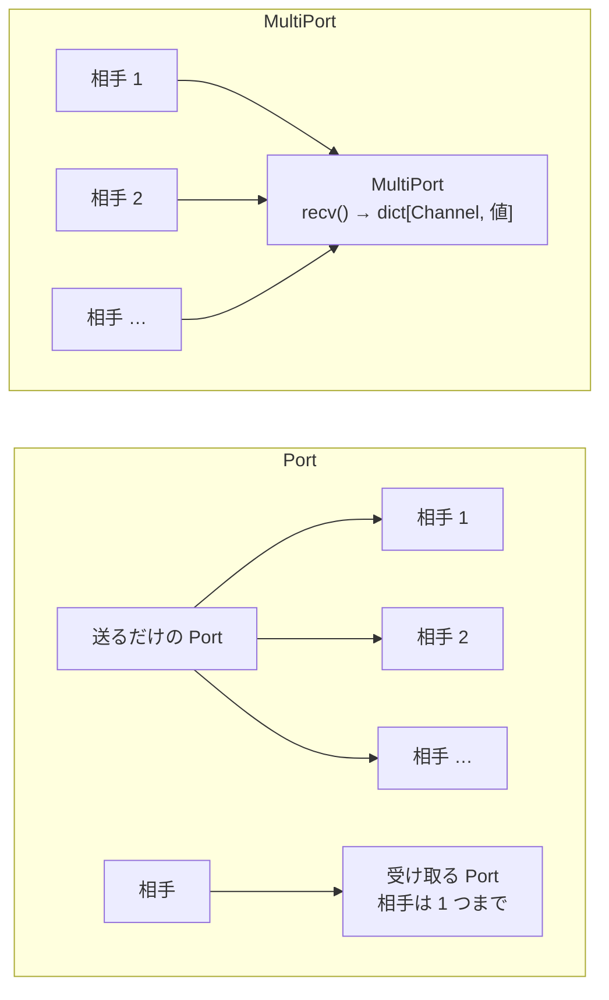
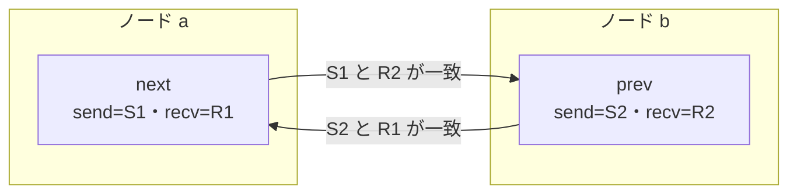
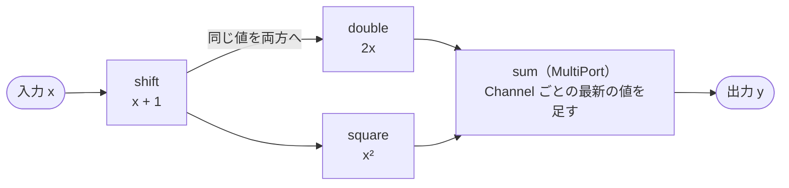
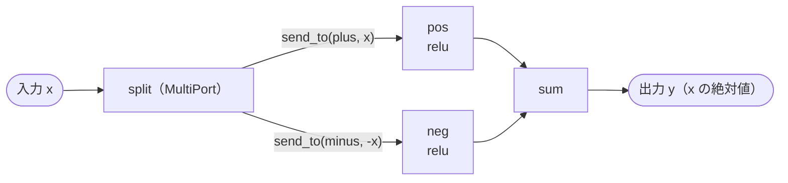
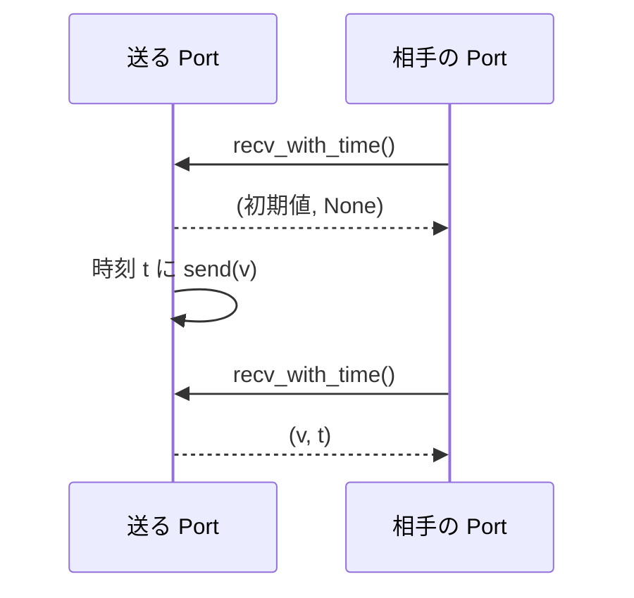
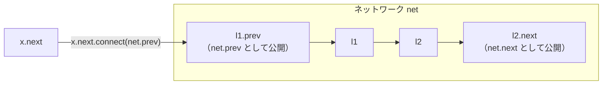

# 🔌 Port と Channel

Port はノードの接続口。`connect` で 2 つの Port を 1 本の Channel でつなぐ。

!!! abstract "このページで分かること"

    - `Port` と `MultiPort` の違いと、宣言の仕方
    - spec の種類と、spec から作れる値
    - `connect` の規則
    - fan-out・合流と、1 つの Channel だけへの送信
    - 誰も送る前に Port が持つ値
    - ネットワークが子の Port を公開する方法

## Port の種類

!!! abstract "要点"

    `Port` は受け取る相手が 1 つまで、送るだけなら相手はいくつでも。同じ種類の相手を束ねるなら `MultiPort`。



| 種類        | 相手                                          | `recv()` が返すもの                  |
| ----------- | --------------------------------------------- | ------------------------------------ |
| `Port`      | 受け取るなら 1 つまで。送るだけならいくつでも | 値                                   |
| `MultiPort` | 同じ種類の相手をいくつでも                    | `connect` の順の `dict[Channel, 値]` |

### 宣言の仕方

Port は `__init__` で `super().__init__()` を呼んだ後に、属性として 1 つずつ宣言する。実行は走り始めるときにインスタンスの属性を読む。リスト・タプル・dict に入れた Port には実行が、クラス属性として宣言した Port にはクラス文が `TypeError` を送出する。同じ種類の相手を束ねるなら `MultiPort` を使う。

=== "避ける"

    ```python
    class Bad(Node):
        prev = Port(recv=VECTOR)  # クラス属性: クラス文が TypeError

        def __init__(self) -> None:
            super().__init__()
            self.inputs = [Port(recv=VECTOR), Port(recv=VECTOR)]  # リスト: 実行が TypeError
    ```

=== "こう書く"

    ```python
    class Good(Node):
        def __init__(self) -> None:
            super().__init__()  # Port はこの後に宣言する
            self.a = Port(recv=VECTOR)  # 1 つずつ属性に代入する
            self.b = Port(recv=VECTOR)
            self.many = MultiPort(recv=VECTOR)  # 同じ種類の相手をいくつでも
    ```

### 役割の違う入力は別々の Port で

入力とその教師信号、予測と誤差のように役割の違う入力は、役割がわかる名前の別々の `Port` で受ける。`MultiPort` は、ノードが同じように束ねる相手のためのもの。

=== "避ける"

    ```python
    self.prev = MultiPort(recv=VECTOR)  # 入力と教師信号を 1 つに束ねる
    ```

=== "こう書く"

    ```python
    self.prev = Port(recv=VECTOR)     # 入力
    self.teacher = Port(recv=VECTOR)  # 教師信号
    ```

## spec

!!! abstract "要点"

    Port は送るものの spec を `send=`、受け取るものの spec を `recv=` で宣言する。片方向の Port では使わない方を省く。

```python
self.prev = Port(recv=TensorSpec((32, 784)))  # 受け取るだけ
self.next = MultiPort(send=TensorSpec((32, 256)), recv=TensorSpec((32, 256)))  # 両方向
```

| spec                            | 運ぶ値                                 | 初期値            |
| ------------------------------- | -------------------------------------- | ----------------- |
| `TensorSpec(shape, dtype)`      | テンソル 1 つ                          | ゼロ              |
| `IntSpec(bits=64, signed=True)` | 8 / 16 / 32 / 64 bit の `int`          | `0`               |
| `FloatSpec()`                   | `float`（64 bit）                      | `0.0`             |
| `BoolSpec()`                    | `bool`                                 | `False`           |
| `TimestampSpec()`               | `mujou.time.Timestamp`                 | `Timestamp(ns=0)` |
| `DictSpec(TypedDict, ...)`      | キーごとに上の spec を持つ `TypedDict` | キーごとの初期値  |

### テンソル

`TensorSpec(shape, dtype)` はテンソル 1 つの spec。dtype を省くと `torch.get_default_dtype()` の設定によらず `torch.float32` になる。送る値は shape と dtype が spec と一致しなければならず、dtype は変換しない。取れる dtype は `TensorSpec.dtypes` にある。

spec から、その shape と dtype の値を作れる。ノードの状態やテストに使う。

| メソッド                         | 作る値                       | 持つ spec                |
| -------------------------------- | ---------------------------- | ------------------------ |
| `spec.zeros()`                   | ゼロのテンソル               | `TensorSpec`・`DictSpec` |
| `spec.empty()`                   | 中身を設定していないテンソル | `TensorSpec`・`DictSpec` |
| `TensorSpec.rand(generator=...)` | \[0, 1) の一様乱数のテンソル | `TensorSpec`             |

`DictSpec` の `zeros()` と `empty()` は、キーごとの値を持つ dict を返す。スカラーのキーはどちらも `0`・`0.0`・`False`・`Timestamp(ns=0)`。

### スカラー

回数・フラグ・時刻は、テンソルではなく Python のスカラー（`IntSpec`・`FloatSpec`・`BoolSpec`・`TimestampSpec`）で運ぶ。受け取る側は `int(...)` で取り出す必要がない。`IntSpec` は bit 数を持つ。メッセージの大きさは固定なので、範囲外の `int` は送るとき `OverflowError` になり、折り返さない。スカラーの spec は shape を持たず値も作らない。値が要るときは `0` や `False` と書けばよい。

### 組になる値は DictSpec で

!!! warning "2 つの Port の値は別々に届く"

    読む側は一方の新しい値と、もう一方の古い値を同時に読むことがある。入力とその目標のように組になる値は 1 つのメッセージで送る。

`DictSpec` は `TypedDict` のキーごとに spec を与える。dict 全体が一度に届き、キーごとの型は型検査器にも伝わる。1 つのキーの spec を使うときは種別を指定して取り出す（`SAMPLE.field("x", TensorSpec).shape`）。種別が違えば `TypeError`。

```python
class Sample(TypedDict):
    x: torch.Tensor
    y: torch.Tensor


SAMPLE = DictSpec(Sample, x=TensorSpec((32, 4)), y=TensorSpec((32, 2)))

self.next = Port(send=SAMPLE)  # 送る側: self.next.send({"x": x, "y": y})
self.prev = Port(recv=SAMPLE)  # 受け取る側: sample = self.prev.recv(); sample["x"]
```

### 型の注釈

Port の型は型検査器が spec から推論する。注釈が要るとき（補助関数の引数など）だけ下の表の形で書く。

| 書き方            | 意味                                                               |
| ----------------- | ------------------------------------------------------------------ |
| `Port[S, R]`      | `S` を送り、`R` を受け取る `Port`                                  |
| `MultiPort[S, R]` | `S` を送り、`R` を受け取る `MultiPort`                             |
| 省いた向き        | `Never`。何も送らない Port の `send` は型検査器が拒む              |
| `MessageSpec[T]`  | 値の型が `T` の任意の spec。任意の spec を受け取る関数の注釈に使う |

```python
from typing import Never

from mujou import MessageSpec, MultiPort, Port


def mean_of(port: MultiPort[Never, torch.Tensor]) -> torch.Tensor:
    return torch.stack(list(port.recv().values())).mean(0)


def sender[T](spec: MessageSpec[T]) -> Port[T]:
    return Port(send=spec)
```

## つなぐ

!!! abstract "要点"

    `a.next.connect(b.prev)` が 2 つの Port をつなぎ、`Channel` を返す。両方向で spec が一致しなければならない。



ノードとネットワークは `connect` を持たず、つなぐのは Port 同士。ノードは入出力が複数あるので、つなぐ 2 つの Port を両方書けば経路が読める。

| 場合                                    | 結果                                                          |
| --------------------------------------- | ------------------------------------------------------------- |
| spec がどちらかの向きで一致しない       | `connect` が `TypeError`                                      |
| 受け取る `Port` に 2 つ目の相手をつなぐ | `ValueError`。複数の相手から受け取るなら `MultiPort`          |
| 同じ 2 つの Port をもう一度つなぐ       | すでにある Channel が返る                                     |
| 自分のノードの Port 同士をつなぐ        | つなげる                                                      |
| 循環してつなぐ・送る相手から受け取る    | つなげる（`mujou.pc` のノードは両方向の Port でそうしている） |
| 実行するノードの木の外の Port とつなぐ  | `mujou.run` が `ValueError`                                   |

## fan-out と合流

!!! abstract "要点"

    送るだけの `Port` は送った値を相手全員に届ける。合流には `MultiPort` を使い、`recv()` は Channel ごとの最新の値を返す。

`shift → (double, square) → sum` の菱形のネットワークで $y = 2(x + 1) + (x + 1)^2$ を計算する。`shift` の送るだけの Port が `double` と `square` に同じ値を届け、`sum` の `MultiPort` が 2 つを合流する。



```python
--8<-- "examples/branching.py:fan-out"
```

`MultiPort` の `recv()` で、まだ一度も送っていない相手の値は、相手の Port の初期値になる。値をどう束ねるか（足す、平均する、相手ごとに重みを掛ける）は受け取るノードが決める。

### 相手ごとに扱いを変える

相手ごとに扱いを変えるときは、`connect` が返した `Channel` を受け取るノードの属性に持たせ、それをキーにして `recv()` の dict から引く。

```python
# ネットワーク
self.sum.from_double = self.double.next.connect(self.sum.prev)

# 受け取るノード（sum）
x = self.prev.recv()[self.from_double]
```

## 1 つの Channel に送る

!!! abstract "要点"

    `MultiPort` は `send` で相手全員に、`send_to` で 1 つの Channel の先だけに送る。Channel は `connect` の戻り値をノードに渡す。

`split` が `plus` の Channel に $x$、`minus` の Channel に $-x$ を送る。それぞれ relu を通して足すと、$y = \mathrm{relu}(x) + \mathrm{relu}(-x) = |x|$ になる。



| 送り方                    | 送り先                   | `Run.read` が返すもの |
| ------------------------- | ------------------------ | --------------------- |
| `send(value)`             | すべての相手に同じ値     | この値                |
| `send_to(channel, value)` | `channel` の先の相手だけ | 変わらない            |

```python
--8<-- "examples/branching.py:send-to"
```

### Channel の渡し方

ネットワークは `connect` が返した Channel をノードの属性に渡す（`self.split.plus = ...`）。`self.next.channels` から順に取り出すと、`connect` の書く順を入れ替えたときにエラーも出ず送り先が入れ替わる。`Channel` を持つ属性は状態に入らない。

=== "避ける"

    ```python
    # connect の順を入れ替えると、黙って plus と minus が入れ替わる
    self.split.plus, self.split.minus = self.split.next.channels
    ```

=== "こう書く"

    ```python
    self.split.plus = self.split.next.connect(self.pos.prev)
    self.split.minus = self.split.next.connect(self.neg.prev)
    ```

### ホストが読めるもの

| Port と送り方        | ホストが `Run.read` で読めるか     |
| -------------------- | ---------------------------------- |
| `send` で送る Port   | 読める。最初の `send` までは初期値 |
| `send_to` で送った値 | 読めない                           |
| 受け取るだけの Port  | 読めない                           |

## 誰も送る前

!!! abstract "要点"

    Port が最初に送るまで、相手もホストも Port の初期値を受け取る。その時刻は `None`。



| Port の宣言                      | 最初に送るまでの値                   |
| -------------------------------- | ------------------------------------ |
| `Port(send=spec)`                | ゼロ（スカラーは spec の表の初期値） |
| `Port(send=spec, initial=value)` | `value`                              |

```python
self.next = Port(send=TensorSpec((32, 256)), initial=torch.full((32, 256), 0.5))
```

`initial` は `send` の spec と一致しなければならない。実行は走り始めるときに `initial` をコピーし、spec と照らし合わせる。

### 新しい値か読み直しかを見分ける

`recv_with_time()` は値を、送られた時刻（`mujou.time.Timestamp`）と一緒に返す。最初に送られるまで時刻は `None`。前回読んだ時刻と比べれば、新しい値か読み直しかがわかる。

```python
value, t = self.prev.recv_with_time()
if t is not None and t != self.last_t:  # 前回から新しい値が届いた
    self.last_t = t
```

ホストが書く Port（つながっていない受け取る Port）は、実行の `inputs=` か、ホストの最初の `write` から送られたものとして扱う。詳しくは [ホストの入出力](host-io.md#%E5%88%9D%E6%9C%9F%E5%80%A4) を参照。

## 公開した Port

!!! abstract "要点"

    ネットワークは子の Port を自分の属性に代入して公開する。外からはノードの Port と同じようにつなぐ。



```python
self.prev = self.l1.prev  # 最初のノードの Port
self.next = self.l2.next  # 最後のノードの Port
```

公開した属性はただの参照で、Port は子のノードのもののまま。慣習では最初のノードの Port を `prev`、最後のノードの Port を `next` として公開し、ネットワークもノードと同じようにつなげるようにする。
