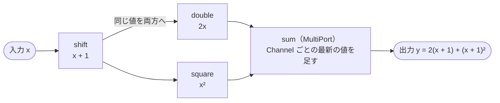
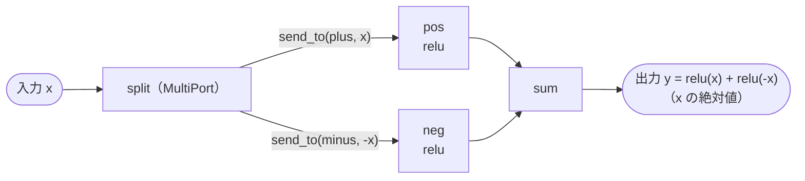

# 🔌 Port と Channel

## Port の種類 {#kinds}

| 種類                           | 相手                                          | `recv()` が返すもの                  |
| ------------------------------ | --------------------------------------------- | ------------------------------------ |
| [`Port`][mujou.Port]           | 受け取るなら 1 つまで。送るだけならいくつでも | 値                                   |
| [`MultiPort`][mujou.MultiPort] | 同じ役割の相手をいくつでも                    | `connect` の順の `dict[Channel, 値]` |

役割の違う入力（入力と教師信号、予測と誤差など）は、役割の分かる名前の別々の `Port` で受ける。`MultiPort` は、ノードが同じように束ねる同じ役割の相手のためのもの。

=== "避ける"

    ```python
    class Bad(Node):
        prev = Port(recv=VECTOR)  # クラス属性: クラス文が TypeError

        def __init__(self) -> None:
            super().__init__()
            self.inputs = [Port(recv=VECTOR), Port(recv=VECTOR)]  # リスト: 実行が TypeError
    ```

=== "こう書く"

    ```python
    class Good(Node):
        def __init__(self) -> None:
            super().__init__()  # Port はこの後に宣言する
            self.a = Port(recv=VECTOR)  # 1 つずつ属性に代入する
            self.b = Port(recv=VECTOR)
            self.many = MultiPort(recv=VECTOR)  # 同じ役割の相手をいくつでも
    ```

## spec {#spec}

| spec                                                                                                                             | 使いどころ                                                | 初期値                                 |
| -------------------------------------------------------------------------------------------------------------------------------- | --------------------------------------------------------- | -------------------------------------- |
| [`TensorSpec`][mujou.TensorSpec]                                                                                                 | 活動や誤差のようなテンソル 1 つ                           | ゼロ                                   |
| [`IntSpec`][mujou.IntSpec]・[`FloatSpec`][mujou.FloatSpec]・[`BoolSpec`][mujou.BoolSpec]・[`TimestampSpec`][mujou.TimestampSpec] | 回数・フラグ・時刻                                        | `0`・`0.0`・`False`・`Timestamp(ns=0)` |
| [`DictSpec`][mujou.DictSpec]                                                                                                     | 入力とその目標のように一緒に届けたい値の組（`TypedDict`） | キーごとの初期値                       |

回数・フラグ・時刻はテンソルに包まず、スカラーの spec で Python のスカラーとして運ぶ。受け取る側は `int(...)` で取り出さずにそのまま使える。

### 組になる値は DictSpec で {#pairs}

2 つの Port の値は別々に届くので、読む側は一方の新しい値ともう一方の古い値を組にして読むことがある。入力とその目標のように組になる値は 1 つの `DictSpec` にまとめれば、dict 全体が一度に届く。

```python
class Sample(TypedDict):
    x: torch.Tensor
    y: torch.Tensor


SAMPLE = DictSpec(Sample, x=TensorSpec((32, 4)), y=TensorSpec((32, 2)))

self.next = Port(send=SAMPLE)  # 送る側: self.next.send({"x": x, "y": y})
self.prev = Port(recv=SAMPLE)  # 受け取る側: sample = self.prev.recv(); sample["x"]
```

### 型の注釈 {#typing}

Port の型は型検査器が spec から推論する。注釈は補助関数の引数など要るときだけ `Port[S, R]`・`MultiPort[S, R]`（`S` を送り `R` を受け取る）と書き、省いた向きは `Never` になる（何も送らない Port の `send` は型検査器が拒む）。任意の spec を受け取る関数は [`MessageSpec`][mujou.MessageSpec] で注釈する。

```python
def mean_of(port: MultiPort[Never, torch.Tensor]) -> torch.Tensor:
    return torch.stack(list(port.recv().values())).mean(0)
```

## つなぐ {#connect}

[`connect`][mujou.Port.connect] でつなぐのは Port 同士だけで、ノードとネットワークは `connect` を持たない。ノードは入出力が多いので、つなぐ 2 つの Port を両方書けば経路が読める。
循環（`mujou.pc` のノードは両方向の Port でそうしている）も、同じノードの Port 同士もつないでよい。実行する木の外の Port とつながっていると [`mujou.run`][mujou.run] が `ValueError` を送出する。

## fan-out と合流 {#fan-out}



```python
--8<-- "examples/branching.py:fan-out"
```

値をどう束ねるか（足す、平均する、相手ごとに重みを掛ける）は受け取るノードが決める。

### 相手ごとに扱いを変える {#per-channel}

相手ごとに扱いを変えるときは、`connect` が返した Channel を受け取るノードの属性に持たせ、`recv()` の dict のキーにする。

```python
# ネットワーク
self.sum.from_double = self.double.next.connect(self.sum.prev)

# 受け取るノード（sum）
x = self.prev.recv()[self.from_double]
```

## 1 つの Channel に送る {#send-to}



```python
--8<-- "examples/branching.py:send-to"
```

[`send_to`][mujou.MultiPort.send_to] に渡す Channel は、ネットワークが `connect` の戻り値をノードの属性に代入して渡す。Channel を持つ属性は状態に入らない。

=== "避ける"

    ```python
    # connect の順を入れ替えると、エラーも出ずに plus と minus が入れ替わる
    self.split.plus, self.split.minus = self.split.next.channels
    ```

=== "こう書く"

    ```python
    self.split.plus = self.split.next.connect(self.pos.prev)
    self.split.minus = self.split.next.connect(self.neg.prev)
    ```

## 新しい値か読み直しか {#new-or-reread}

```python
value, t = self.prev.recv_with_time()
if t is not None and t != self.last_t:  # 前回から新しい値が届いた
    self.last_t = t
```

送り手が最初に送るまで、[`recv_with_time`][mujou.Port.recv_with_time] は初期値と時刻 `None` を返す。ホストが書く Port の初期値は [初期値](host-io.md#initial-values) にある。
