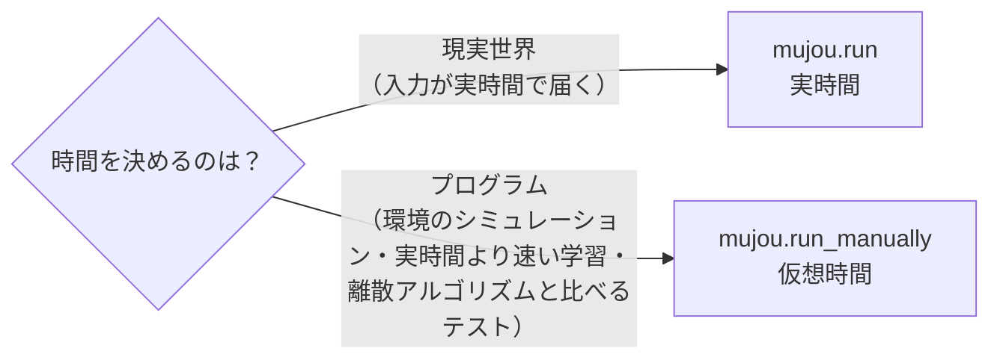
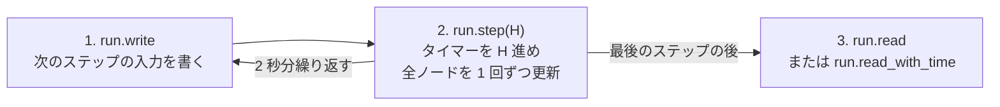

# 🕹️ シミュレーション

`mujou.run` は実時間で走らせ、現実世界に配備するための実行。`mujou.run_manually` は仮想時間で計算能力いっぱいに走らせ、シミュレーションとテストのための実行。このページでは両者の使い分け、2 種類のステップ、スレッド、決定的に保つ条件を扱う。

!!! abstract "このページで分かること"

    - `mujou.run` と `mujou.run_manually` のどちらを使うか
    - `step(dt)` と `step(dt, *nodes)` がどのノードを更新し、各ノードが何を読むか
    - シミュレーションを毎回ビット単位で同じ結果にする条件

    前提は[実行](../concepts.md#5-%E5%AE%9F%E8%A1%8C)と[時間](time.md)。

## 2 つの走らせ方

!!! abstract "要点"

    現実世界とつながるなら `mujou.run`、時間を自分で決めるなら `mujou.run_manually`。



|                    | `mujou.run`                            | `mujou.run_manually`                                       |
| ------------------ | -------------------------------------- | ---------------------------------------------------------- |
| 用途               | 現実世界への配備（センサー、ロボット） | シミュレーションとテスト                                   |
| 時間               | 実時間（既定は `global_timer`）        | 仮想時間。`step` でだけ進む `VirtualTimer`                 |
| ノードが更新する時 | 各自で平均 `period` ごと               | それを更新する `run.step` ごとに 1 回。`period` は使わない |
| `dt`               | 実際に経った時間                       | `step` で進めた時間ちょうど                                |
| 速さ               | 時計に合わせて待つ                     | 待たずに計算能力いっぱい                                   |
| 結果               | 実行ごとに揺らぐ                       | 毎回ビット単位で同じ                                       |
| 戻り値             | `Run`                                  | `ManualRun`（`step` を持つ `Run`）                         |

現実世界とつながるなら `mujou.run` を使う。実際の入力は実時間で届き、ネットワークはそれに追いつかなければならない。環境のシミュレーション、実時間より速い学習、離散アルゴリズムと比べるテストのように時間を自分で決めるなら `mujou.run_manually` を使う。

`mujou.run_manually` の引数は `mujou.run` と同じ。違うのは `timer` だけ。

| 引数                         | `mujou.run_manually` での扱い                                                       |
| ---------------------------- | ----------------------------------------------------------------------------------- |
| `timer`                      | `VirtualTimer` に限る。既定は時刻 0（`state` を渡したならその時刻）からの新しいもの |
| `inputs`・`state`・`workers` | `mujou.run` と同じ                                                                  |

??? question "`mujou.run` で時間の速さを大きくするのではだめ？"

    `time_scale=10` の `Timer` は 10 倍速く進むが、ノードの更新は相変わらずマシンの都合で決まり、`dt` も結果も揺らぐ。マシンがどれだけ速くても、その倍率より速くはならない。`ManualRun` は前のステップが終わるまで時間を進めない。

## シミュレーションのループ

!!! abstract "要点"

    ループの 1 回は「書く → 進める」。読むのはステップの間。

[ノードを書く](../tutorial/2-node.md) の `LeakyChain` に正弦波を入れ、仮想時間で 2 秒分を 1 ms 刻みで進める。

```python
--8<-- "examples/simulation.py:simulate"
```



1. ホストが次のステップの入力を `run.write` で書く
2. `run.step(H)` がタイマーを `H` 進め、全ノードを 1 回ずつ更新。全ノードの更新が終わってから戻る
3. ステップの間（ここでは最後のステップの後）に、ホストが `run.read` か `run.read_with_time` で読む

仮想時間の 2 秒は実時間で 1 秒もかからない。

## 2 種類のステップ

!!! abstract "要点"

    `step(dt)` は全ノードを同時に更新し、どのノードもステップ開始時の値を読む。`step(dt, *nodes)` は渡したノードを順に更新し、後のノードは前のノードが送った値を読む。

|                    | `run.step(dt)`                         | `run.step(dt, *nodes)`             |
| ------------------ | -------------------------------------- | ---------------------------------- |
| 更新するノード     | 実行の全ノード                         | 渡したノードだけ                   |
| 進め方             | 実行のワーカーと専用のスレッドで並列に | 渡した順に 1 つずつ                |
| ノードが読む値     | ステップ開始時の値                     | このステップで前のノードが送った値 |
| 送った値が見える時 | 全ノードの更新が終わった時             | そのノードの更新が終わった時       |
| 数値計算での名前   | Jacobi                                 | Gauss-Seidel                       |

どちらもタイマーを `dt` 進めてから更新する。更新の順が問題になるとき（`a` → `b` の順に更新するアルゴリズムと比べるときなど）以外は `step(dt)` を使う。

=== "`run.step(h)`"

    ```mermaid
    sequenceDiagram
        participant H as ホスト
        participant R as ManualRun
        participant A as net.a
        participant B as net.b
        H->>R: run.step(h)
        R->>R: 仮想のタイマーを h 進める
        par ワーカーで並列に
            R->>A: on_update(h)
        and
            R->>B: on_update(h)、ステップ開始時の a の値を読む
        end
        Note over A,B: a と b が送った値がここで見える
        R-->>H: 戻る
    ```

=== "`run.step(h, net.a, net.b)`"

    ```mermaid
    sequenceDiagram
        participant H as ホスト
        participant R as ManualRun
        participant A as net.a
        participant B as net.b
        H->>R: run.step(h, net.a, net.b)
        R->>R: 仮想のタイマーを h 進める
        R->>A: on_update(h)
        A-->>B: send（すぐ見える）
        R->>B: on_update(h)、a の新しい値を読む
        R-->>H: 戻る
    ```

### 順をそろえる

!!! abstract "要点"

    全ノードを渡しても `step(dt)` と同じとは限らない。同じになるのは、ループの無いネットワークを出力側から順に渡したとき。

chain `u → a → b` を 3 通りの進め方で比べる。

```python
--8<-- "examples/simulation.py:orders"
```

| 進め方                  | `b` が読む `a`                     | 結果             |
| ----------------------- | ---------------------------------- | ---------------- |
| `step(h)`               | ステップ開始時の `a`               | 基準             |
| `step(h, net.b, net.a)` | 古い `a`（`b` が先に更新するため） | `step(h)` と同じ |
| `step(h, net.a, net.b)` | このステップで送られた `a`         | 違う             |

| ネットワークの形                                              | `step(dt)` と同じ結果になる順 |
| ------------------------------------------------------------- | ----------------------------- |
| 一方向にだけ流れる（ループ無し。chain など）                  | 出力側から入力側への順        |
| 逆向きにも流れる（ループ `a ↔ b`、PC-ALM の `pc.Chain` など） | 一般に無い                    |

## どのステップにも共通の規則

!!! abstract "要点"

    ノードは周期によらず、それを更新するステップごとに 1 回更新する。`dt` は自分の前回の更新からの時間。

| 項目                                          | 規則                                                                                                  |
| --------------------------------------------- | ----------------------------------------------------------------------------------------------------- |
| `period`                                      | 使わない。それを更新するステップごとに 1 回                                                           |
| `dt`                                          | 自分の前回の更新からの時間。最初の更新では実行の開始から。外れたステップの時間は次の `dt` に足される  |
| 1 つのステップに 2 回渡したノード             | 1 回だけ更新（2 回目は時間が進んでいない）。同じ理由で、開始直後の `step(0)` はどのノードも更新しない |
| ステップ中に送ったメッセージの時刻            | すべてそのステップの時刻                                                                              |
| 自分の Port につないだ Port                   | 同じ更新の中で読むと、ステップ前の値                                                                  |
| 複数の実行に渡した `VirtualTimer`（`timer=`） | 1 本の時間軸。1 つの実行の `step` がほかの実行の時間も進める                                          |

<figure class="mujou-diagram">
<svg viewBox="0 0 640 170" role="img" aria-label="3 回のステップ。net.a は毎回更新して dt は h。net.b は 3 回目だけ更新し、dt は実行の開始からの 3h">
<line class="mujou-axis" x1="110" y1="150" x2="620" y2="150"/>
<text class="mujou-note" x="130" y="166" text-anchor="middle">開始</text>
<text class="mujou-note" x="270" y="166" text-anchor="middle">h</text>
<text class="mujou-note" x="410" y="166" text-anchor="middle">2h</text>
<text class="mujou-note" x="550" y="166" text-anchor="middle">3h</text>
<text class="mujou-label" x="10" y="54">net.a</text>
<line class="mujou-lane" x1="110" y1="50" x2="620" y2="50"/>
<g class="mujou-tick-a"><line x1="270" y1="38" x2="270" y2="62"/><line x1="410" y1="38" x2="410" y2="62"/><line x1="550" y1="38" x2="550" y2="62"/></g>
<text class="mujou-note" x="200" y="30" text-anchor="middle">dt = h</text>
<text class="mujou-note" x="340" y="30" text-anchor="middle">dt = h</text>
<text class="mujou-note" x="480" y="30" text-anchor="middle">dt = h</text>
<text class="mujou-label" x="10" y="114">net.b</text>
<line class="mujou-lane" x1="110" y1="110" x2="620" y2="110"/>
<g class="mujou-tick-b"><line x1="550" y1="98" x2="550" y2="122"/></g>
<path class="mujou-brace" d="M 132 98 Q 132 90 140 90 L 540 90 Q 548 90 548 98"/>
<text class="mujou-note" x="340" y="84" text-anchor="middle">dt = 3h（外れた 2 回のステップの時間も足される）</text>
</svg>
<figcaption>1・2 回目は <code>step(h, net.a)</code>、3 回目は <code>step(h)</code>。縦の線が更新。<code>net.b</code> の最初の更新は実行の開始からの時間を <code>dt</code> として受け取る</figcaption>
</figure>

## ワーカーとスレッド

!!! abstract "要点"

    `step(dt)` は並列に走るが、結果はワーカーの数にもスレッドの割り当てにもよらない。

`step(dt)` は、実行の `workers`（既定は `mujou.run` と同じ。[ワーカー](threads-and-devices.md#%E3%83%AF%E3%83%BC%E3%82%AB%E3%83%BC)を参照）と `dedicated_thread=True` のノードのスレッドで更新を走らせる。結果はワーカーの数にも、どのスレッドがどのノードを走らせるかにもよらない。GIL が有効な間は Python のコードを走らせるスレッドが同時に 1 つなので、更新が重なるのは torch の演算の中だけ。それでも結果は同じ。

!!! warning "torch のスレッドを少なくする"

    CPU 上で torch の演算を走らせるワーカーは、それぞれ torch 自身のスレッドをさらに使う。ワーカーが多いと、そのスレッド同士でコアを取り合いステップが遅くなる。torch のスレッド数は、ホストが実行の前に 1 回だけ設定する。

    ```python
    --8<-- "examples/simulation.py:threads"
    ```

    目安は[スレッドとデバイス](threads-and-devices.md#%E3%83%97%E3%83%AD%E3%82%BB%E3%82%B9%E5%85%A8%E4%BD%93%E3%81%AE%E8%A8%AD%E5%AE%9A)に。

## 決定的に保つ

!!! abstract "要点"

    次の 4 つの規則を守れば、`ManualRun` は毎回ビット単位で同じ結果になる。

| 規則                                             | 理由                                                                                 |
| ------------------------------------------------ | ------------------------------------------------------------------------------------ |
| 乱数は `seed` を渡した `self.generator` から引く | 既定の乱数生成器は全ノードが共有し、引く順が毎回変わる                               |
| 時間は `step` でだけ進める                       | タイマーを自分で進める（`run.timer.advance`）と、ノードが想定外の `dt` を見る        |
| `write` はステップの間に呼ぶ                     | ステップ中の書き込みは、そのステップで届くノードと次のステップで届くノードに分かれる |
| ノード同士で Python のオブジェクトを共有しない   | 1 つのリストに追記するノードなどは、追記の順が毎回変わる                             |

### ホストの呼び出し

!!! abstract "要点"

    ホストは `write` → `step` → `read` を、ステップを回す 1 本のスレッドで順に呼ぶ。

| 呼び出し                                        | 規則                                                                                                                                                                       |
| ----------------------------------------------- | -------------------------------------------------------------------------------------------------------------------------------------------------------------------------- |
| `write`、`read`、`read_with_time`、`state_dict` | ステップの間に呼ぶ。`step(dt)` の最中にほかのスレッドから `read` するとステップ前の値。`step(dt, *nodes)` の最中なら、このステップで更新済みのノードが送った値のこともある |
| `wait_for`、`subscribe`、`run.timer.sleep`      | ステップを回すスレッドでは呼ばない。次のステップまで何も送られず時間も進まないので、タイムアウトまで（無ければいつまでも）待つ。代わりに `read` を使う                     |

=== "避ける"

    ```python
    run.step(H)
    # 次の step まで何も送られず時間も進まない: timeout が無ければいつまでも待つ
    y, _ = run.wait_for(net.next, lambda v: bool(v > 0.5))
    ```

=== "こう書く"

    ```python
    run.step(H)
    y = run.read(net.next)  # ステップの間に読む
    ```

## ステップの境界はシミュレーションだけのもの

!!! abstract "要点"

    更新則はステップの境界に頼らない。`run.step(dt)` でしか動かないネットワークは、`mujou.run` で配備すると壊れる。

|                      | `ManualRun` の 2 つのステップの間 | `mujou.run`                      |
| -------------------- | --------------------------------- | -------------------------------- |
| 全ノードの更新       | 終えている                        | 各ノードが自分の時刻にばらばらに |
| 時間                 | 止まっている                      | 進み続ける                       |
| `dt`                 | `step` で進めた時間               | ノードごと・更新ごとにばらばら   |
| 全ノードがそろう瞬間 | ある                              | 無い                             |

??? question "全ノードを待つのはノードが守る規則に反しない？"

    ノードは[ノードが守る規則](../concepts.md#%E3%83%8E%E3%83%BC%E3%83%89%E3%81%8C%E5%AE%88%E3%82%8B%E8%A6%8F%E5%89%87)のとおり、ほかのノードを待たない。ステップの境界はどのノードの一部でもなく、状態を取得するための一時停止と同じく、実行のタイマーが止まっている間に起きる。ノードは自分が `ManualRun` にいることを知らず、読むのは自分の状態と隣のノードの最新の値だけ。

## 保存・再開と例外

!!! abstract "要点"

    状態はステップの間に取得し、新しいインスタンスで続きから走らせる。ノードの例外で実行は止まり、`step` が `NetworkError` を送出する。

| 場面                                                           | 起きること                                                                                                                                             |
| -------------------------------------------------------------- | ------------------------------------------------------------------------------------------------------------------------------------------------------ |
| `run.state_dict()`                                             | ステップの間に状態を取得                                                                                                                               |
| `mujou.run_manually(新しいインスタンス, state=tree)`           | 状態の時刻から始まる新しい `VirtualTimer` で続きから。その後のステップは止めずに続けた実行と同じ結果（[保存と再開](../tutorial/6-save-and-resume.md)） |
| ステップ中にノードが例外                                       | 走っている更新は最後まで走り、まだ始めていないノードは更新しない。実行は停止（[例外と終了](errors.md)）                                                |
| ↳ `step` が送出するもの                                        | `NetworkError`。`__cause__` はそのノードの例外。`step(dt)` なら、そのステップでノードが送った値は公開されない                                          |
| 実行に無いノード、負・非有限の `dt`                            | `ValueError`                                                                                                                                           |
| 正常終了後、タイマーの一時停止中、ノードの hook からの呼び出し | `RuntimeError`                                                                                                                                         |

`mujou.run_manually` でノードをテストする方法は、[ノードをテストする](../tutorial/3-test.md)で説明する。
