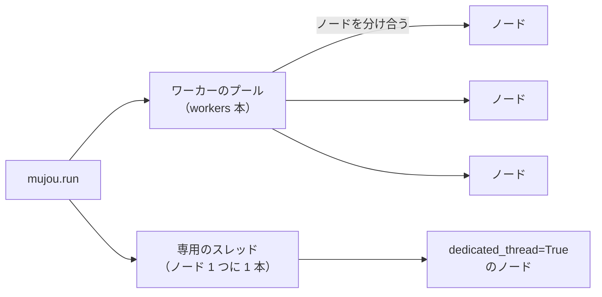
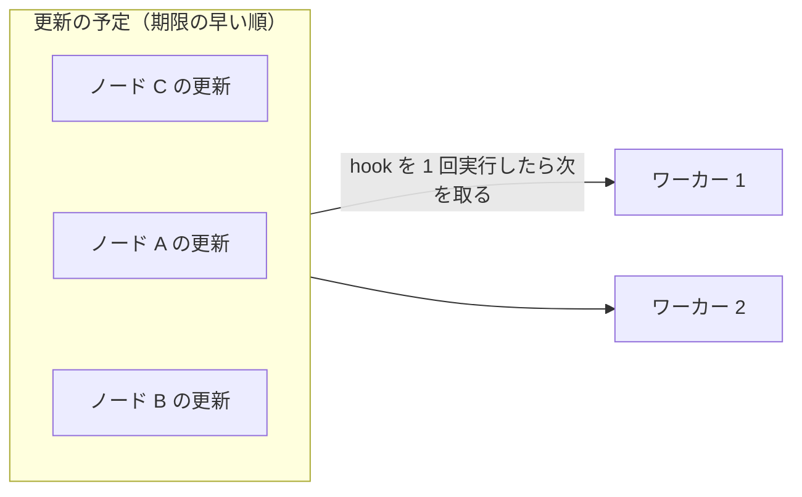
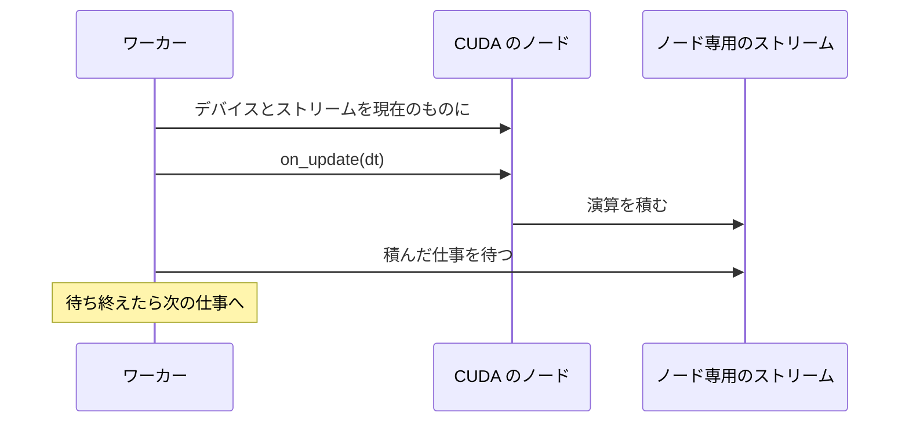
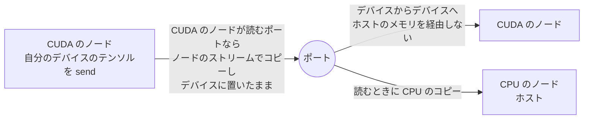

# 🧵 スレッドとデバイス

実行が計算に使うスレッド、ノードの設定（`device`・`seed`・`dedicated_thread`）、CUDA、プロセス全体で共有する torch の設定を扱う。

!!! abstract "このページで分かること"

    - ノードがどのスレッドで動くか（ワーカーと専用のスレッド）
    - スレッドごとの設定と乱数を、ほかのノードに漏らさない書き方
    - CUDA のノードのストリームと、メッセージがどこを通るか
    - ホストが実行の前に 1 回だけ決める torch の設定



## `Node` の引数

!!! abstract "要点"

    `super().__init__` のキーワード引数で、周期・乱数・デバイス・スレッドを決める。どれも省略可能。

| 引数               | 意味                                             | 既定               |
| ------------------ | ------------------------------------------------ | ------------------ |
| `period`           | 更新と更新の間の平均の時間。実行のタイマーの秒   | `0.01`             |
| `seed`             | ノード専用の乱数生成器 `self.generator` の seed  | `None`（毎回違う） |
| `device`           | ノードが計算する場所。`"cpu"` か CUDA のデバイス | `"cpu"`            |
| `dedicated_thread` | 実行のワーカーでなく専用のスレッドで動かす       | `False`            |

これらの値は、読み取り専用の property `period`・`generator`・`device`・`dedicated_thread` で読める。

## ワーカー

!!! abstract "要点"

    実行はノードごとにスレッドを立てない。少数のワーカーが、期限の早い更新から順にノードを分け合って動かす。



ワーカーは hook を 1 回実行するたびに、期限の早い更新から次の仕事を取る。ノードが多くてもスレッドは少ないままで、OS のスレッド切り替えに時間を取られない。

| ワーカーの数（`mujou.run(net, workers=n)`） | 既定                                                                                            |
| ------------------------------------------- | ----------------------------------------------------------------------------------------------- |
| GIL が無効                                  | プロセスが使える CPU の数（論理コア数。CPU の affinity や割り当ての上限があればそれより少ない） |
| GIL が有効                                  | その半分（1 以上）                                                                              |
| どちらでも                                  | ワーカーに載るノードの数を超えない                                                              |

| ワーカーの上のノードについて | 決まっていること                                                                                                                                                    |
| ---------------------------- | ------------------------------------------------------------------------------------------------------------------------------------------------------------------- |
| hook の同時実行              | 1 つのノードの hook が同時に走ることは無い                                                                                                                          |
| hook の間の値                | 前の hook が書いた値は次の hook から見える                                                                                                                          |
| 動かすワーカー               | hook ごとに変わりうる                                                                                                                                               |
| ブロッキングする hook        | その間ワーカーをふさぎ、ほかのノードの `dt` が伸びる（[ノードが守る規則](../concepts.md#%E3%83%8E%E3%83%BC%E3%83%89%E3%81%8C%E5%AE%88%E3%82%8B%E8%A6%8F%E5%89%87)） |

??? question "GIL が有効なとき、既定を半分にするのはなぜ？"

    GIL が有効なとき（GIL ありのビルド、または free-threaded のビルドで `PYTHON_GIL=1` のとき）は、Python のコードを同時に動かせるのは 1 本のスレッドだけで、ノードが並列に動けるのは torch の演算の中だけになる。CPU の数の半分を超えて増やしても GIL を取り合うだけなので、既定は半分にしている。Python の処理が大半のノードなら、さらに減らしても速さはほとんど変わらない。

## 専用のスレッド

!!! abstract "要点"

    ワーカーをふさぐノードと、スレッドに 1 回だけ設定するノードには `dedicated_thread=True` を渡す。

| 使う場面                                             | 理由                                                              |
| ---------------------------------------------------- | ----------------------------------------------------------------- |
| hook がデバイス・ソケット・lock を待ってブロッキング | ワーカーの上だと、その間ワーカーをふさぐ                          |
| 1 回だけ設定するスレッドごとの状態に頼る             | `on_start` がこのノードのスレッドで呼ばれるので、そこで設定できる |

```python
class Camera(Node):
    def __init__(self) -> None:
        super().__init__(period=1 / 30, dedicated_thread=True)
```

## スレッドごとの設定

!!! abstract "要点"

    ワーカーの上では、hook がスレッドに設定したものが次の hook にも、同じワーカーで次に走る別のノードにも見えうる。設定は hook の中で閉じる。

ワーカーの上では hook ごとに別のスレッドで走りうるうえ、そのスレッドはほかのノードも動かす。設定が次の hook に見えるかはスケジュール次第で、同じワーカーで次に走る別のノードにも見える。

| 設定                                                                     | ワーカーの上でのふるまい                                                                                          | 書き方                             |
| ------------------------------------------------------------------------ | ----------------------------------------------------------------------------------------------------------------- | ---------------------------------- |
| `threading.local`・`threading.current_thread()`・`threading.get_ident()` | hook ごとに変わりうる                                                                                             | 1 回だけ設定するなら専用のスレッド |
| torch のスレッドごとの設定（`torch.autocast`、勾配の記録など）           | 戻さないと、同じワーカーで次に走るノードに漏れる                                                                  | hook の中の `with` に閉じる        |
| `contextvars`                                                            | 持ち越される。各ノードは自分専用の `contextvars.Context` で hook を実行。空から始まり、ホストの文脈を引き継がない | そのまま使える                     |
| CUDA の現在のデバイスとストリーム                                        | mujou が CUDA のノードの hook の前ごとに設定。mujou 自身が設定するのはこれだけ                                    | —                                  |

=== "避ける"

    ```python
    @override
    def on_update(self, dt: float) -> None:
        super().on_update(dt)
        torch.set_grad_enabled(False)  # 戻さないと同じワーカーの次のノードに漏れる
        ...
    ```

=== "こう書く"

    ```python
    @override
    def on_update(self, dt: float) -> None:
        super().on_update(dt)
        with torch.no_grad():  # hook を抜ける前に戻る
            ...
    ```

## seed と乱数

!!! abstract "要点"

    乱数はノード自身の生成器 `self.generator` から引く。`seed` で再現できるのはこの生成器だけ。

```python
nn.init.normal_(self.model.weight, std=0.1, generator=self.generator)
noise = torch.randn(4, generator=self.generator, device=self.device)
```

`self.generator` は `seed` から作られ、ノードのデバイス上にある。`super().__init__()` の直後から、`__init__` の中でも使える。その状態はノードの状態に入るので、再開した実行は同じ乱数列の続きから引く。

| すること                                           | 理由                                         |
| -------------------------------------------------- | -------------------------------------------- |
| 乱数は `self.generator` から引く                   | `seed` で再現できるのはこれだけ              |
| `nn.Linear` などは `self.generator` で初期化し直す | 既定の初期化は全ノードが共有する生成器を使う |
| ノードの中で `torch.manual_seed` を呼ばない        | ほかのノードの乱数まで変わる                 |

=== "避ける"

    ```python
    super().__init__(seed=0)
    torch.manual_seed(0)  # ほかのノードの乱数まで変わる
    self.model = nn.Linear(4, 2)  # 全ノードが共有する生成器で初期化される
    ```

=== "こう書く"

    ```python
    super().__init__(seed=0)
    self.model = nn.Linear(4, 2)
    nn.init.normal_(self.model.weight, std=0.1, generator=self.generator)
    nn.init.zeros_(self.model.bias)
    ```

## デバイス

!!! abstract "要点"

    `device` は CPU か CUDA のデバイス。受け取ったメッセージはノードのデバイスに届くので、テンソルは `device=self.device` で確保する。

| `device` の値                      | 結果                                       |
| ---------------------------------- | ------------------------------------------ |
| `"cpu"`（既定）                    | CPU で計算                                 |
| CUDA のデバイス（`"cuda:0"` など） | そのデバイスで計算                         |
| 番号を付けない `"cuda"`            | ノードを作った時点のホストの現在のデバイス |
| それ以外（`"mps"`、`"meta"` など） | `ValueError`                               |
| CUDA が使えない環境での CUDA       | `ValueError`                               |

### CUDA のノードに mujou がすること

!!! abstract "要点"

    各 CUDA のノードは専用のストリームを持ち、mujou がその切り替えと待ち合わせをする。ノードは同期を書かなくてよい。

| いつ                                | mujou がすること                                                                                           |
| ----------------------------------- | ---------------------------------------------------------------------------------------------------------- |
| 各 hook の中                        | ノードのデバイスとノード専用の CUDA ストリームを現在のものに。ノードの演算はすべてこのストリームに積まれる |
| 各 `on_update` の後、状態の復元の後 | そのストリームに積んだ仕事を待つ。その間は、ブロッキングする hook と同じくワーカーが待つ                   |
| `state_dict` の前後                 | 待つ。ワーカーでなく mujou の別のスレッド（実行の終了後はホストのスレッド）で行うので、ワーカーは待たない  |



### メッセージの通り道

!!! abstract "要点"

    ポートを CUDA のノードが読むなら、テンソルはデバイスに置いたまま渡る。CPU のノードとホストは、読むときに CPU のコピーを受け取る。



| 送るテンソルと読み手                                                        | 通り道                                                                                                                                          |
| --------------------------------------------------------------------------- | ----------------------------------------------------------------------------------------------------------------------------------------------- |
| ノードのデバイスのテンソル、ポートを CUDA のノードが読む                    | デバイスに置いたまま。`send` がノードのストリームの上でコピーし、相手が読めるようになる前にそのストリームを待つ                                 |
| ↳ CUDA の相手                                                               | デバイスからデバイスへコピー。ホストのメモリを経由しない（ピアアクセスの無い 2 つの GPU の間では、CUDA のドライバがホストを中継することはある） |
| ↳ CPU のノード、ホスト（`run.read`、`subscribe`、`wait_for`、`state_dict`） | 読むときに CPU のコピー                                                                                                                         |
| ポートを CPU のノードだけ（またはホストだけ）が読む                         | ホストのメモリ経由（そのほうが速い）                                                                                                            |
| ノードと別のデバイスのテンソル                                              | ホストのメモリ経由                                                                                                                              |
| hook の中で別のデバイスを現在のものにしている間（`torch.cuda.device(...)`） | それでもデバイスに置いたまま                                                                                                                    |

別のデバイスの CUDA のノードからメッセージを受け取るノード（CPU のノードや別の GPU のノード）は、そのデバイスの上の自分専用のストリームでコピーする。mujou はこのストリームも各 hook の中で現在のものにする。CUDA のノードから受け取らない CPU のノードは CUDA に触れず、ワーカーに残った CUDA のノードのストリームも使わない。

### ホストの書き込み

| `run.write`（と `inputs=`）のテンソル                                | 通り道                                                                                                                                             |
| -------------------------------------------------------------------- | -------------------------------------------------------------------------------------------------------------------------------------------------- |
| ポートを持つノードの CUDA のデバイスの上                             | そのデバイスに置く。ホストのそのデバイスの現在のストリームでコピーし、そのストリームを待つ。現在のデバイスがどれでも、ホストは同期を書かなくてよい |
| それ以外（CPU のノードへの書き込み、ノードと別のデバイスのテンソル） | ホストのメモリ経由                                                                                                                                 |

どちらの場合も、ホストが書き込みの後に GPU に積んだ仕事をどのノードも待たない。

### 同期とストリーム

!!! abstract "要点"

    自分で同期するときは、自分のストリームだけを待つ。デバイス全体を待たない。

=== "避ける"

    ```python
    torch.cuda.synchronize()  # デバイス全体を待つ: ほかのノードの仕事まで待つ
    ```

=== "こう書く"

    ```python
    torch.cuda.current_stream().record_event().synchronize()  # 自分のストリームだけ
    ```

| ストリームについて | 内容                                                                                                     |
| ------------------ | -------------------------------------------------------------------------------------------------------- |
| プール             | デバイスごとに 32 本から割り当て                                                                         |
| 数に入るもの       | ノードのストリームと、別のデバイスを読むノードのコピー用のストリーム                                     |
| 32 本を超えたら    | いくつかのノードが 1 本を共有。結果は正しいが、遅くなることがある                                        |
| 共有したときの待ち | 書き手とストリームを共有した読み手は、書き手が送った後に積んだ仕事を待つ。CPU のノードならホストでも待つ |

!!! tip "CUDA のテンソルとモジュールは `on_start` で作る"

    `mujou.run` はノードを起動する前にホストのストリームを同期するので、`__init__` で CUDA に作っても動くが、`on_start` 以降で作るほうがよい。PyTorch のキャッシュアロケータは確保した時点のストリームに結び付け、`__init__` で確保したメモリはホストのストリームに結び付いたまま残る。ノードがそのテンソルを捨てると、ノードの計算が終わる前にホストの確保に再利用されうる。復元は `on_start` の後に状態を読み込むので、そこで作った状態も復元される。

    === "避ける"

        ```python
        def __init__(self) -> None:
            super().__init__(device="cuda:0")
            self.w = torch.zeros(256, 256, device=self.device)  # ホストのストリームに結び付く
        ```

    === "こう書く"

        ```python
        @override
        def on_start(self) -> None:
            super().on_start()
            self.w = torch.zeros(256, 256, device=self.device)  # ノードのストリームで確保
        ```

### 状態の木と CUDA

| 項目                     | 内容                                                                           |
| ------------------------ | ------------------------------------------------------------------------------ |
| 状態の木                 | CUDA のノードの状態も CPU のコピーで持つ                                       |
| 既定の `load_state_dict` | ノードのデバイスへコピーし直す                                                 |
| 復元先                   | CUDA のノードから保存した木は CUDA のノードにだけ（別の GPU のマシンでもよい） |
| 理由                     | 乱数生成器の状態が CPU と CUDA で違う                                          |

## プロセス全体の設定

!!! abstract "要点"

    プロセス全体で共有する設定は、ノードの中では変えない。ホストが `mujou.run` の前に 1 回だけ設定する。

| 種類                 | 設定・操作                                                                                 |
| -------------------- | ------------------------------------------------------------------------------------------ |
| 乱数                 | `torch.manual_seed` と既定の乱数生成器                                                     |
| torch の動作         | `torch.set_num_threads`、`torch.use_deterministic_algorithms`、`torch.backends.*` のフラグ |
| デバイス全体への操作 | `torch.cuda.synchronize()`、`torch.cuda.empty_cache()` など                                |

CPU 上の torch の演算は、計算するスレッドごとに内部のスレッドをさらに使う。多すぎるとノード同士でコアを取り合い全体が遅くなるので、ホストで少なくしておく（次のコード）。

```python
--8<-- "examples/online_learning.py:threads"
```

!!! tip "スレッド数の目安"

    **（ワーカーの数 ＋ `dedicated_thread=True` のノードの数）× `n` ≦ 物理コア数**

    `n` は `torch.set_num_threads(n)` の値。小さな行列を扱うノードが多いときは `n = 1` でよい。
