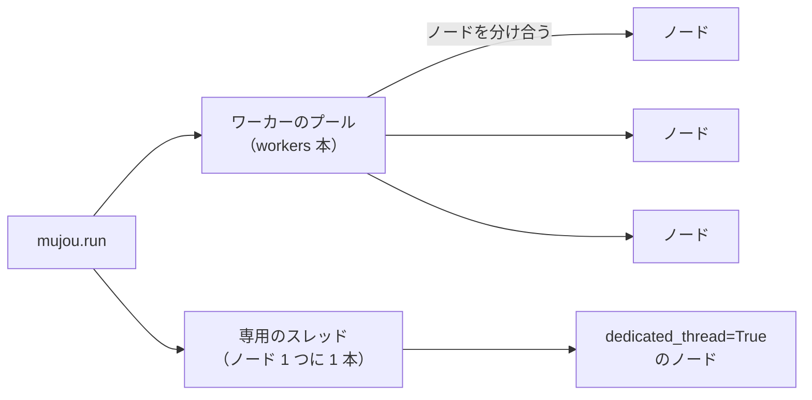
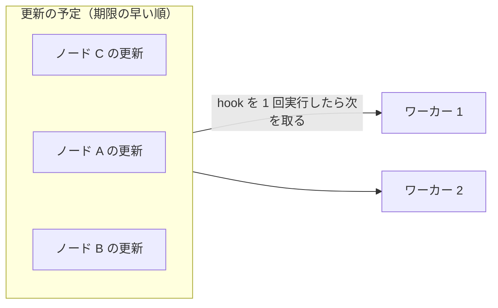
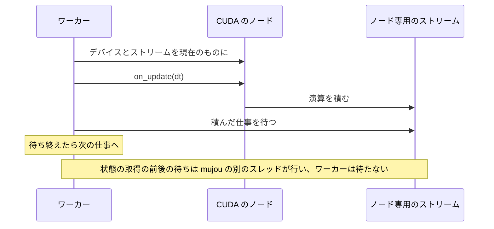
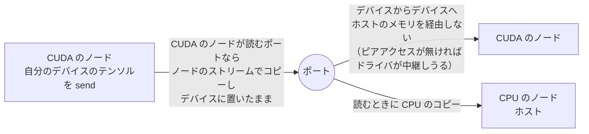

# 🧵 スレッドとデバイス



## ワーカー {#workers}



実行はノードごとにスレッドを立てないので、ノードが多くてもスレッドは少ないままで、OS のスレッドの切り替えに時間を取られない。ワーカーの数とその既定は [`mujou.run`][mujou.run] の `workers`。

??? question "GIL が有効なとき、既定を半分にするのはなぜ？"

    GIL が有効なとき（GIL ありのビルド、または free-threaded のビルドで `PYTHON_GIL=1` のとき）は、Python のコードを同時に動かせるのは 1 本のスレッドだけで、ノードが並列に動けるのは torch の演算の中だけになる。CPU の数の半分を超えて増やしても GIL を取り合うだけなので、既定は半分にしている。Python の処理が大半のノードなら、さらに減らしても速さはほとんど変わらない。

## 専用のスレッド {#dedicated}

hook がデバイス・ソケット・lock を待ってブロッキングするノードや、`on_start` で 1 回だけ設定するスレッドごとの状態に頼るノードには、[`dedicated_thread=True`][mujou.Node.dedicated_thread] を渡す。

```python
class Camera(Node):
    def __init__(self) -> None:
        super().__init__(period=1 / 30, dedicated_thread=True)
```

## スレッドごとの設定 {#per-thread}

| 設定                                                                     | ワーカーの上でのふるまい                                                                                          | 書き方                             |
| ------------------------------------------------------------------------ | ----------------------------------------------------------------------------------------------------------------- | ---------------------------------- |
| `threading.local`・`threading.current_thread()`・`threading.get_ident()` | hook ごとに変わりうる                                                                                             | 1 回だけ設定するなら専用のスレッド |
| torch のスレッドごとの設定（`torch.autocast`、勾配の記録など）           | 戻さないと、同じワーカーで次に走るノードに漏れる                                                                  | hook の中の `with` に閉じる        |
| `contextvars`                                                            | 持ち越される。各ノードは自分専用の `contextvars.Context` で hook を実行。空から始まり、ホストの文脈を引き継がない | そのまま使える                     |
| CUDA の現在のデバイスとストリーム                                        | mujou が CUDA のノードの hook の前ごとに設定。mujou 自身が設定するのはこれだけ                                    | —                                  |

=== "避ける"

    ```python
    @override
    def on_update(self, dt: float) -> None:
        super().on_update(dt)
        torch.set_grad_enabled(False)  # 戻さないと同じワーカーの次のノードに漏れる
        ...
    ```

=== "こう書く"

    ```python
    @override
    def on_update(self, dt: float) -> None:
        super().on_update(dt)
        with torch.no_grad():  # hook を抜ける前に戻る
            ...
    ```

## seed と乱数 {#seed}

`seed` で再現できるのはノード自身の生成器 [`self.generator`][mujou.Node.generator] だけなので、`nn.Linear` などのモジュールもこの生成器で初期化し直す（既定の初期化は全ノードが共有する生成器を使う）。

=== "避ける"

    ```python
    super().__init__(seed=0)
    torch.manual_seed(0)  # ほかのノードの乱数まで変わる
    self.model = nn.Linear(4, 2)  # 全ノードが共有する生成器で初期化される
    ```

=== "こう書く"

    ```python
    super().__init__(seed=0)
    self.model = nn.Linear(4, 2)
    nn.init.normal_(self.model.weight, std=0.1, generator=self.generator)
    nn.init.zeros_(self.model.bias)
    ```

## デバイス {#devices}

受け取ったメッセージはノードの [`device`][mujou.Node.device] に届くので、テンソルは `device=self.device` で確保する。CUDA のノードから取得した状態の木は CUDA のノードにだけ戻せる（別の GPU のマシンでもよい。理由は [`Node.load_state_dict`][mujou.Node.load_state_dict]）。

### CUDA のノードに mujou がすること {#cuda}



各 CUDA のノードは専用のストリームを持ち、その切り替えと待ち合わせは mujou がするので、ノードは同期を書かなくてよい。

### メッセージの通り道 {#message-paths}



規則の全体は [`Port.send`][mujou.Port.send]、ホストの書き込みは [`Run.write`][mujou.Run.write]。別のデバイスの CUDA のノードからメッセージを受け取るノード（CPU のノードや別の GPU のノード）は、そのデバイスの上の自分専用のストリームでコピーし、mujou はこのストリームも各 hook の中で現在のものにする。CUDA のノードから受け取らない CPU のノードは CUDA に触れず、ワーカーに残った CUDA のノードのストリームも使わない。

### 同期とストリーム {#streams}

=== "避ける"

    ```python
    torch.cuda.synchronize()  # デバイス全体を待つ: ほかのノードの仕事まで待つ
    ```

=== "こう書く"

    ```python
    torch.cuda.current_stream().record_event().synchronize()  # 自分のストリームだけ
    ```

ストリームはデバイスごとに 32 本のプールから割り当て、ノードのストリームと、別のデバイスを読むノードのコピー用のストリームを数える。超えるといくつかのノードが 1 本を共有し、結果は正しいが、書き手と共有した読み手は書き手が送った後に積んだ仕事も待つので遅くなることがある（CPU のノードならホストでも待つ）。

!!! tip "CUDA のテンソルとモジュールは `on_start` で作る"

    `mujou.run` はノードを起動する前にホストのストリームを同期するので、`__init__` で CUDA に作っても動くが、`on_start` 以降で作るほうがよい。PyTorch のキャッシュアロケータはメモリを確保した時点のストリームに結び付けるので、`__init__` で確保したメモリはホストのストリームに結び付いたまま残り、ノードがそのテンソルを捨てると、ノードの計算が終わる前にホストの確保に再利用されうる。復元は `on_start` の後に状態を読み込むので、そこで作った状態も復元される。

    === "避ける"

        ```python
        def __init__(self) -> None:
            super().__init__(device="cuda:0")
            self.w = torch.zeros(256, 256, device=self.device)  # ホストのストリームに結び付く
        ```

    === "こう書く"

        ```python
        @override
        def on_start(self) -> None:
            super().on_start()
            self.w = torch.zeros(256, 256, device=self.device)  # ノードのストリームで確保
        ```

## プロセス全体の設定 {#process-settings}

プロセス全体で共有する設定はノードの中では変えず、ホストが `mujou.run` の前に 1 回だけ設定する。

| 種類                 | 設定・操作                                                                                 |
| -------------------- | ------------------------------------------------------------------------------------------ |
| 乱数                 | `torch.manual_seed` と既定の乱数生成器                                                     |
| torch の動作         | `torch.set_num_threads`、`torch.use_deterministic_algorithms`、`torch.backends.*` のフラグ |
| デバイス全体への操作 | `torch.cuda.synchronize()`、`torch.cuda.empty_cache()` など                                |

```python
--8<-- "examples/online_learning.py:threads"
```

!!! tip "スレッド数の目安"

    **（ワーカーの数 ＋ `dedicated_thread=True` のノードの数）× `n` ≦ 物理コア数**

    `n` は `torch.set_num_threads(n)` の値。小さな行列を扱うノードが多いときは `n = 1` でよい。
