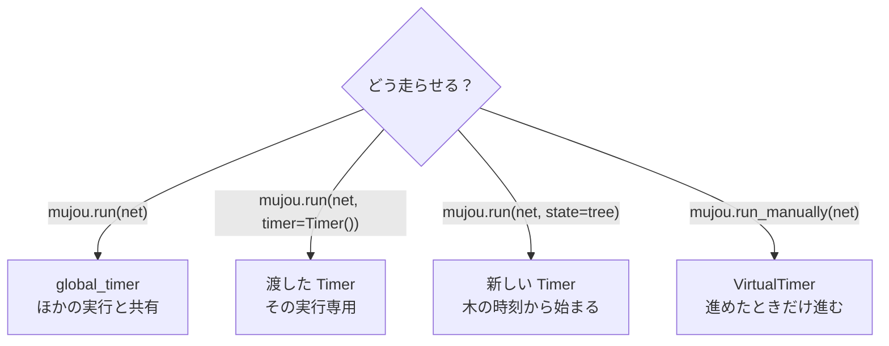
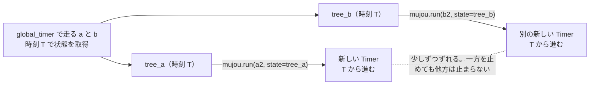

# ⏱️ 時間

1 つの実行には時間軸が 1 本あり、ノードの dt・メッセージの時刻・一時停止はすべてその実行のタイマー上にある（dt で更新する理由は [Mujou の仕組みの時間](../concepts.md#time)）。

## タイマー {#timers}



タイマーの型（Timer・VirtualTimer・ReadOnlyTimer・Timestamp・global_timer）は [`mujou.time`][mujou.time] にある。

### ホストとノードができること {#host-and-node}

| 操作                                                                 | ホスト（`run.timer`） | ノード（[`self.timer`][mujou.Node.timer]） |
| -------------------------------------------------------------------- | --------------------- | ------------------------------------------ |
| `now()`・`time_scale()`                                              | できる                | できる                                     |
| `is_paused()`                                                        | できる                | 無い                                       |
| `sleep`・`pause`・`resume`・`set_time_scale`・`VirtualTimer.advance` | できる                | 無い。hook の中で呼ぶと `RuntimeError`     |

=== "避ける"

    ```python
    def on_update(self, dt: float) -> None:
        super().on_update(dt)
        global_timer.sleep(0.1)  # hook の中では RuntimeError
    ```

=== "こう書く"

    ```python
    def __init__(self) -> None:
        super().__init__(period=0.1)  # 平均 0.1 秒ごとに更新する
    ```

## 単位 {#units}

| 単位               | 使うもの                                                                                        |
| ------------------ | ----------------------------------------------------------------------------------------------- |
| 実行のタイマーの秒 | `dt`、`period`、`Timer.sleep`、`VirtualTimer.advance`、`pc.show(seconds=)`、`mujou.pc` の時定数 |
| 実時間の秒         | すべての `timeout`                                                                              |

??? question "timeout が実時間なのはなぜ？"

    時間の速さや一時停止によらず、止まった実行を見切れるようにするため。

## Timestamp {#timestamp}

[`Timestamp`][mujou.time.Timestamp] はどのタイマーの時刻かを持たないので、比べるのは同じタイマーの時刻同士（1 つの実行の時刻とその `run.timer.now()` など）に限る。

```python
--8<-- "examples/timers.py:timestamp"
```

```python
t_in = run.write({net.prev: x})
run.timer.sleep(0.1)
y, t_out = run.read_with_time(net.next)
if t_out is not None and t_out >= t_in:  # y は x を書いた後に送られた
    print(t_out - t_in)  # 書いてから y が送られるまでの秒数
```

## 実行専用のタイマーと速さ {#own-timer}

`mujou.run` に [`Timer`][mujou.time.Timer] を渡した実行は、そのタイマーの速さを変えても止めても、ほかの実行に響かない（実行を分けるか 1 つにまとめるかは [Group](groups.md#one-or-many)）。

```python
--8<-- "examples/timers.py:own-timer"
```

[`global_timer`][mujou.time.global_timer] の速さも変えられ、それで走るすべての実行に響く。

```python
--8<-- "examples/timers.py:global-scale"
```

## 時間を止める {#pause}

<figure class="mujou-diagram">
<svg viewBox="0 0 640 175" role="img" aria-label="ノードは一定の間隔で更新するが、pause から resume までの間は更新しない。resume の後の最初の dt には、止まっていた時間が入らない">
<rect x="260" y="28" width="160" height="112" style="fill: var(--md-default-fg-color--lightest)"/>
<text class="mujou-note" x="260" y="20" text-anchor="middle">pause()</text>
<text class="mujou-note" x="420" y="20" text-anchor="middle">resume()</text>
<text class="mujou-label" x="340" y="52" text-anchor="middle">時間が止まる</text>
<text class="mujou-note" x="340" y="70" text-anchor="middle">更新しない・sleep は戻らない</text>
<text class="mujou-label" x="10" y="104">ノード</text>
<line class="mujou-lane" x1="90" y1="100" x2="620" y2="100"/>
<g class="mujou-tick-a"><line x1="100" y1="88" x2="100" y2="112"/><line x1="160" y1="88" x2="160" y2="112"/><line x1="220" y1="88" x2="220" y2="112"/><line x1="450" y1="88" x2="450" y2="112"/><line x1="510" y1="88" x2="510" y2="112"/><line x1="570" y1="88" x2="570" y2="112"/></g>
<path class="mujou-brace" d="M 222 118 Q 222 126 230 126 L 442 126 Q 450 126 450 118"/>
<text class="mujou-note" x="336" y="142" text-anchor="middle">次の dt は止まる前と後に経った時間だけ</text>
<line class="mujou-axis" x1="90" y1="152" x2="620" y2="152"/>
<text class="mujou-label" x="620" y="168" text-anchor="end">実時間 →</text>
</svg>
</figure>

[`Timer.pause`][mujou.time.Timer.pause] から resume までは、そのタイマーで走るすべての実行が止まる（`global_timer.pause()` ならグローバルタイマーで走るすべての実行）。
利用者の pause と、状態の取得のための停止（[保存と再開](../tutorial/6-save-and-resume.md#pause)）は別のスイッチ。

!!! warning "一時停止は状態の取得と観測のためのもの"

    学習の手順の一部にしない。

### 複数の実行の状態を同じ時刻で取得する {#multi-run-state}

```python
--8<-- "examples/timers.py:pause"
```

=== "避ける"

    ```python
    global_timer.pause()
    tree_a = run_a.state_dict()
    tree_b = run_b.state_dict()
    global_timer.resume()  # 途中で例外が出ると、時間が止まったまま
    ```

=== "こう書く"

    ```python
    global_timer.pause()
    try:
        tree_a = run_a.state_dict()
        tree_b = run_b.state_dict()
    finally:
        global_timer.resume()  # 例外でも必ず再開する
    ```

## 再開した実行のタイマー {#restored-timer}



```python
--8<-- "examples/timers.py:restore"
```

再開後も 1 本の時間軸に載せたい実行は、最初から [`Group`][mujou.Group] で 1 つの実行として走らせる（`mujou.run(Group(a=a, b=b))`。1 つの実行の木は 1 つのタイマーに復元される）。
