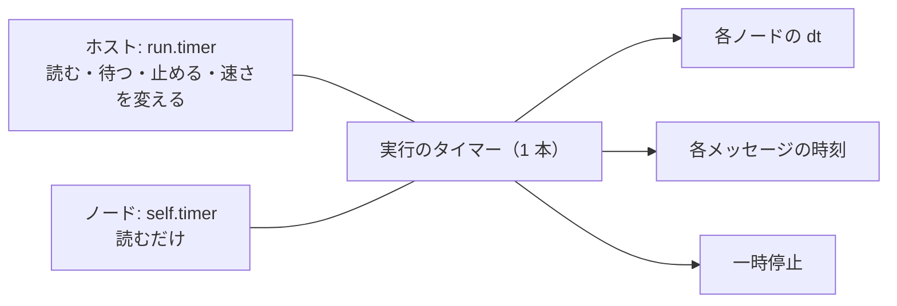
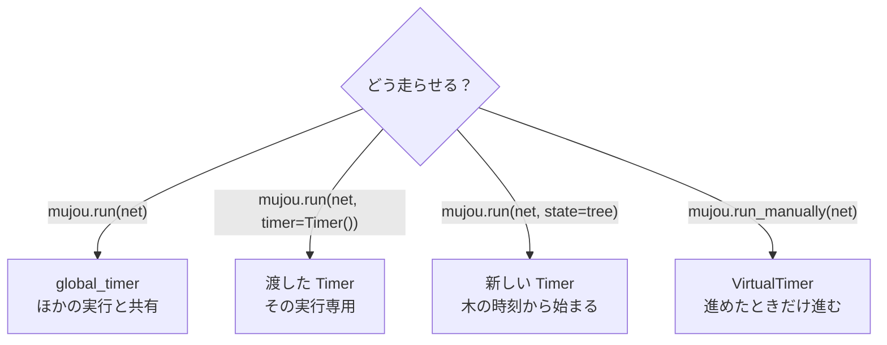
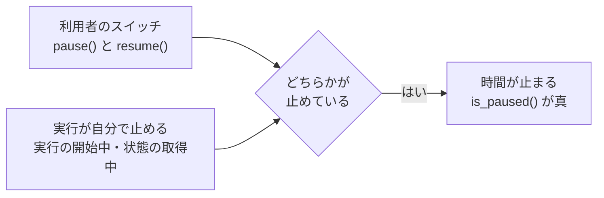
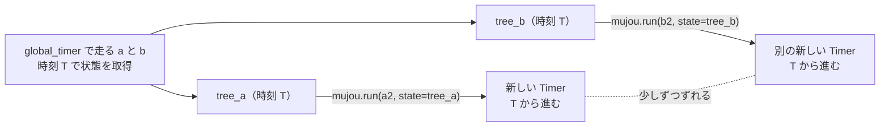

# ⏱️ 時間

時間軸は実行ごとに 1 本あり、それが実行のタイマー。各ノードの `dt`、メッセージの時刻、一時停止はすべてその上にある。



!!! abstract "このページで分かること"

    - 実行がどのタイマーで走るか
    - 時間の単位（実行のタイマーの秒と実時間の秒）
    - `Timestamp` の比べ方
    - 時間の速さの変え方と、時間の止め方
    - 再開した実行のタイマー
    - ノードから見た時間

## タイマー

!!! abstract "要点"

    `timer` を渡さない実行は `global_timer` を共有する。`Timer()` を渡せばその実行専用、`state=` で再開すれば新しい `Timer` で走る。



| 名前                        | 何か                                                                                                  |
| --------------------------- | ----------------------------------------------------------------------------------------------------- |
| `mujou.time.global_timer`   | 自分のタイマーを渡さないすべての実行のタイマー。プロセスで初めて使ったときに 0 から始まる             |
| `mujou.time.Timer()`        | 1 つの実行専用のタイマー（`mujou.run(net, timer=Timer())`）。`start`（0）から `time_scale`（1）で進む |
| `mujou.time.VirtualTimer()` | 進めたとき（`advance(seconds)`）だけ進む `Timer`。`mujou.run_manually` が使う                         |
| `mujou.time.ReadOnlyTimer`  | タイマーを読むだけのビュー。ノードの `self.timer` がこれ                                              |
| `mujou.time.Timestamp`      | タイマーの上の時刻                                                                                    |

### ホストとノードができること

| 操作                    | ホスト（`run.timer`） | ノード（`self.timer`） |
| ----------------------- | --------------------- | ---------------------- |
| `now()`                 | できる                | できる                 |
| `time_scale()`          | できる                | できる                 |
| `sleep(seconds)`        | できる                | 無い                   |
| `pause()`・`resume()`   | できる                | 無い                   |
| `is_paused()`           | できる                | 無い                   |
| `set_time_scale(scale)` | できる                | 無い                   |

## 単位

!!! abstract "要点"

    `timeout` だけが実時間の秒。それ以外の秒はすべて実行のタイマーの秒。

| 単位               | 使うもの                                                                                        |
| ------------------ | ----------------------------------------------------------------------------------------------- |
| 実行のタイマーの秒 | `dt`、`period`、`Timer.sleep`、`VirtualTimer.advance`、`pc.show(seconds=)`、`mujou.pc` の時定数 |
| 実時間の秒         | すべての `timeout`                                                                              |

??? question "timeout が実時間なのはなぜ？"

    時間の速さや一時停止によらず、止まった実行を見切れるようにするため。

## Timestamp

!!! abstract "要点"

    `Timestamp` はタイマーの上の時刻。前後を比べ、引き算で間の秒数を得る。比べるのは同じタイマーの時刻同士だけ。

```python
--8<-- "examples/timers.py:timestamp"
```

| 書き方       | 結果                                                   |
| ------------ | ------------------------------------------------------ |
| `float(t)`   | 秒                                                     |
| `t.ns`       | ナノ秒（正確な値）                                     |
| `a - b`      | `b` から `a` までの秒（`float`）。`a` の方が早ければ負 |
| `a < b` など | 時刻の前後                                             |

`write`・`read_with_time`・`subscribe`・`wait_for`・`recv_with_time`・`now()` は `Timestamp` を返す。まだ送られていない値の時刻は `None`。

!!! warning "同じタイマーの時刻同士だけを比べる"

    `Timestamp` はどのタイマーの時刻かを持たない。1 つの実行の時刻とその `run.timer.now()` のように、同じタイマーの時刻同士だけを比べる。

```python
t_in = run.write({net.prev: x})
run.timer.sleep(0.1)
y, t_out = run.read_with_time(net.next)
if t_out is not None and t_out >= t_in:  # y は x を書いた後に送られた
    print(t_out - t_in)  # 書いてから y が送られるまでの秒数
```

## 実行専用のタイマー

!!! abstract "要点"

    `mujou.run(net, timer=Timer(...))` で、その実行だけの時間軸を持たせる。速さを変えても止めても、ほかの実行には響かない。

| 使いどころ                             | 例                                   |
| -------------------------------------- | ------------------------------------ |
| その実行だけ時間を速める・遅くする     | デバッグ、実時間より速い試行         |
| ほかの実行と一緒に止まらないようにする | 一方の状態を取得しても他方は止めない |

```python
--8<-- "examples/timers.py:own-timer"
```

### 時間の速さ

`time_scale` は実時間 1 秒の間にタイマーが進む秒数。有限で 0 より大きい数に限り、それ以外は `ValueError`。止めるには 0 にせず `pause` を使う。

| `time_scale` | 実時間 1 秒で進むタイマーの秒 |
| ------------ | ----------------------------- |
| `1`（既定）  | 1 秒                          |
| `10`         | 10 秒                         |
| `0.5`        | 0.5 秒                        |

グローバルタイマーの速さも変えられる。変えると、それで走るすべての実行に響く。

```python
--8<-- "examples/timers.py:global-scale"
```

## 時間を止める

!!! abstract "要点"

    `timer.pause()` から `timer.resume()` まで、そのタイマーで走る全実行の時間が止まる。複数の実行の状態を同じ時刻で取得するときに使う。

<figure class="mujou-diagram">
<svg viewBox="0 0 640 175" role="img" aria-label="ノードは一定の間隔で更新するが、pause から resume までの間は更新しない。resume の後の最初の dt には、止まっていた時間が入らない">
<rect x="260" y="28" width="160" height="112" style="fill: var(--md-default-fg-color--lightest)"/>
<text class="mujou-note" x="260" y="20" text-anchor="middle">pause()</text>
<text class="mujou-note" x="420" y="20" text-anchor="middle">resume()</text>
<text class="mujou-label" x="340" y="52" text-anchor="middle">時間が止まる</text>
<text class="mujou-note" x="340" y="70" text-anchor="middle">更新しない・sleep は戻らない</text>
<text class="mujou-label" x="10" y="104">ノード</text>
<line class="mujou-lane" x1="90" y1="100" x2="620" y2="100"/>
<g class="mujou-tick-a"><line x1="100" y1="88" x2="100" y2="112"/><line x1="160" y1="88" x2="160" y2="112"/><line x1="220" y1="88" x2="220" y2="112"/><line x1="450" y1="88" x2="450" y2="112"/><line x1="510" y1="88" x2="510" y2="112"/><line x1="570" y1="88" x2="570" y2="112"/></g>
<path class="mujou-brace" d="M 222 118 Q 222 126 230 126 L 442 126 Q 450 126 450 118"/>
<text class="mujou-note" x="336" y="142" text-anchor="middle">次の dt は止まる前と後に経った時間だけ</text>
<line class="mujou-axis" x1="90" y1="152" x2="620" y2="152"/>
<text class="mujou-label" x="620" y="168" text-anchor="end">実時間 →</text>
</svg>
<figcaption>縦の線がノードの更新。止まっている間は更新せず、<code>resume</code> の後の最初の <code>dt</code> に停止中の時間は入らない</figcaption>
</figure>

| 止まっている間の対象             | 振る舞い                                                           |
| -------------------------------- | ------------------------------------------------------------------ |
| そのタイマーで走る全実行のノード | 更新しない。`resume` 後の最初の `dt` に停止中の時間は入らない      |
| ノードへの知らせ                 | 無い。`on_pause` と `on_resume` が呼ばれるのは状態の取得の前後だけ |
| そのタイマーの `sleep`           | `resume` まで戻らない                                              |
| `VirtualTimer.advance`           | `RuntimeError`                                                     |
| `run.state_dict()`               | 取得できる。止めた時刻の状態が返る                                 |

`global_timer.pause()` は、グローバルタイマーで走るすべての実行を止める。

### pause と状態の取得



状態の取得も、利用者の `pause` とは別に実行のタイマーを止める。`pause` は回数を数えないスイッチで、2 回呼んでも `resume` 1 回で解ける。取得中の停止は `resume` では解けず、取得が終わっても利用者の `pause` は残る。

### 複数の実行の状態を同じ時刻で取得する

1 つのタイマーで走る複数の実行の状態は、そのタイマーを止めてから 1 つずつ取得する。

| 取り方                               | 取得した状態の時刻               |
| ------------------------------------ | -------------------------------- |
| 1 つずつ `run.state_dict()`          | 後に取得した状態ほど時刻が遅れる |
| タイマーを `pause` してから 1 つずつ | どれも止めた時刻 T               |

```python
--8<-- "examples/timers.py:pause"
```

=== "避ける"

    ```python
    global_timer.pause()
    tree_a = run_a.state_dict()
    tree_b = run_b.state_dict()
    global_timer.resume()  # 途中で例外が出ると、時間が止まったまま
    ```

=== "こう書く"

    ```python
    global_timer.pause()
    try:
        tree_a = run_a.state_dict()
        tree_b = run_b.state_dict()
    finally:
        global_timer.resume()  # 例外でも必ず再開する
    ```

!!! warning "一時停止は状態の取得と観測のためのもの"

    学習の手順の一部にしない。

## 再開した実行のタイマー

!!! abstract "要点"

    `mujou.run(net, state=tree)` で再開した実行は、木の時刻と時間の速さから始まる新しい `Timer` で走る。グローバルタイマーやほかの実行の時刻は戻らない。



```python
--8<-- "examples/timers.py:restore"
```

| すること                                 | 結果                                                               |
| ---------------------------------------- | ------------------------------------------------------------------ |
| `state=` と一緒に `timer=` を渡す        | `ValueError`                                                       |
| `global_timer.pause()`                   | 再開した実行は止まらない。その実行の `run.timer` を止める          |
| 同じ時刻で取得した木から、別々に再開する | 時間軸を共有しない。タイマーはずれ、1 つを止めてもほかは止まらない |

再開した後も 1 本の時間軸に載せたい実行は、最初から 1 つの実行（`mujou.run(Group(a=a, b=b))`）として走らせる。1 つの実行の木は、1 つのタイマーに復元される。

=== "別々の実行の木から"

    ```python
    # 別々の実行の木から再開すると、タイマーも別々になる
    run_a = mujou.run(Clock(), state=tree_a)
    run_b = mujou.run(Clock(), state=tree_b)
    ```

=== "1 つの実行の木から"

    ```python
    # 1 つの実行の木なら、1 つのタイマーに復元される
    with mujou.run(Group(a=Clock(), b=Clock()), state=tree) as run:
        ...
    ```

## ノードは時間を読むだけ

!!! abstract "要点"

    ノードの `self.timer` は読むだけの `ReadOnlyTimer` で、hook の中でだけ読める。時間を動かせるのはホストだけ。

| どこから読むか                  | `self.timer`                       |
| ------------------------------- | ---------------------------------- |
| `on_start` を含むどの hook の中 | 読める                             |
| `__init__` の中                 | `RuntimeError`                     |
| ホスト                          | `RuntimeError`                     |
| `on_exception`・`on_stop`       | 実行が終わった時刻で止まって見える |

時間を動かせるのはホストだけ。ノードの hook の中で `sleep`・`pause`・`resume`・`set_time_scale`・`VirtualTimer.advance` を呼ぶと `RuntimeError` になる（規則は [ノードが守る規則](../concepts.md#%E3%83%8E%E3%83%BC%E3%83%89%E3%81%8C%E5%AE%88%E3%82%8B%E8%A6%8F%E5%89%87)）。一定間隔で更新したいなら、ノードに `period` を渡す。

=== "避ける"

    ```python
    def on_update(self, dt: float) -> None:
        super().on_update(dt)
        global_timer.sleep(0.1)  # hook の中では RuntimeError
    ```

=== "こう書く"

    ```python
    def __init__(self) -> None:
        super().__init__(period=0.1)  # 平均 0.1 秒ごとに更新する
    ```
