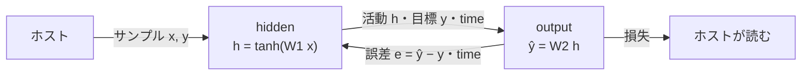

# 🧮 更新則

更新則の選び方は [Mujou の仕組み](../concepts.md#learning) にある。ここでは、ノードの間で学ぶ自作の則を feedback alignment で示す。

## feedback alignment {#feedback-alignment}

`examples/feedback_alignment.py` は $\hat y = W_2 \tanh(W_1 x)$ を 2 つのノード `hidden` と `output` で学ぶ。`hidden` は `W2` を知らず、固定の乱数行列 $B$ で学べる（[Lillicrap et al., 2016](https://doi.org/10.1038/ncomms13276)）。



|                         | BP           | feedback alignment                      |
| ----------------------- | ------------ | --------------------------------------- |
| `hidden` が使う credit  | $W_2^\top e$ | $B e$（$B$ は `hidden` 固定の乱数行列） |
| `hidden` が `W2` を知る | 要る         | 要らない                                |
| 学べる理由              | 勾配そのもの | $W_2$ が $B^\top$ にそろっていく        |

```sh
uv run python examples/feedback_alignment.py
```

```python
--8<-- "examples/feedback_alignment.py:hidden"
```

```python
--8<-- "examples/feedback_alignment.py:output"
```

| 条件               | 表示される `output` の損失（各バッチから学ぶ前） |
| ------------------ | ------------------------------------------------ |
| 両方のノードが学ぶ | 6 秒で約 1.5 から約 0.02 まで下がる              |
| `hidden` を固定    | 0.15 を下回らない                                |

## 両方向の Port {#bidirectional}

この例は活動と誤差を 1 本の接続（`hidden.next` と `output.prev`）で運ぶ。つなぎ方は[循環してもよい](ports.md#connect)ので、誤差を別の Port で返す書き方もできる。

| Port          | `send`     | `recv`     |
| ------------- | ---------- | ---------- |
| `hidden.next` | `ACTIVITY` | `ERROR`    |
| `output.prev` | `ERROR`    | `ACTIVITY` |

## 目標を中継する {#relay-targets}

=== "避ける: 目標を別の Port で"

    ```mermaid
    sequenceDiagram
        participant H as hidden
        participant O as output
        H->>O: 活動 h（サンプル 2）
        Note over O: 目標の Port はまだサンプル 1 の y
        O->>O: サンプル 2 の予測をサンプル 1 の y と比べてしまう
        H->>O: 目標 y（サンプル 2）
    ```

=== "こう書く: 1 つのメッセージで"

    ```mermaid
    sequenceDiagram
        participant H as hidden
        participant O as output
        H->>O: h・y・time（サンプル 2）
        O->>O: 予測を自分の目標と比べる
        O->>H: e・time
        H->>H: 持っている入力と同じ time の誤差だけから学ぶ
    ```

`mujou.pc` のノードも、`y`・`mask`・`time` を [`pc.msg.Activity`][mujou.pc.msg.Activity] で活動と 1 つのメッセージに載せて運ぶ。

各サンプルから 1 回だけ学ぶノードは、`recv()` が新しいかどうかによらず最新の値を返すため、時刻で新しいサンプルを見分ける（[新しい値か読み直しか](ports.md#new-or-reread)）。

## `pc.clock.LearnClock` {#learnclock}

```python
tick = self.clock.tick(dt, t, self.timer.now())  # dt、入力が書かれた時刻、今の時刻
if tick.learn:
    self.optimizer.step_([grad], tick.elapsed)  # 前に学んでからの時間で重み付け
```

いつ学ぶかを決める [`LearnClock`][mujou.pc.clock.LearnClock] は `mujou.pc` の部品だが PC-ALM に限らずどの則でも使え、学ぶ量は `elapsed` で重み付けして更新の回数でなく時間に比例させる（[mujou.pc の仕組み](pc-concepts.md#learnclock)）。
