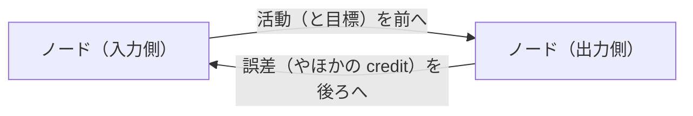

# 🧮 更新則

更新則（学習則）は、ノードが `on_update(dt)` に書く更新そのもの。mujou はノード・Port・スケジューラに更新則を組み込まないので、ノードごとに選べ、同じネットワークのまま差し替えられる。このページでは、ノードをまたいで学ぶ則の書き方を feedback alignment で示す。

!!! abstract "このページで分かること"

    - ノードをまたいで学ぶ則が、何をメッセージで送るか
    - 両方向の Port、目標の中継、新しいサンプルの見分け方
    - いつ学ぶかを決める `pc.clock.LearnClock`

| どこで学ぶか             | 例                 | ページ                                                      |
| ------------------------ | ------------------ | ----------------------------------------------------------- |
| 1 つのノードの内側       | 誤差逆伝播法（BP） | [4. ノードの中で学習する](../tutorial/4-learn-in-a-node.md) |
| ノードの間（`mujou.pc`） | PC-ALM             | [PC-ALM](pc.md)                                             |
| ノードの間（ほかの則）   | feedback alignment | このページ                                                  |

## ノードの内側と、ノードの間

!!! abstract "要点"

    ノードの間では計算グラフをつなげない。ノードをまたいで学ぶ則は、各ノードが要るものをメッセージで送る。

|            | ノードの内側                              | ノードの間                                    |
| ---------- | ----------------------------------------- | --------------------------------------------- |
| 使えるもの | PyTorch で計算できることは何でも（BP も） | Port のメッセージだけ                         |
| 計算グラフ | つながる                                  | つながらない。Port が送るのは切り離したコピー |
| 学ぶ材料   | ノードの状態                              | 自分の状態と隣のメッセージだけ                |



## feedback alignment

!!! abstract "要点"

    `hidden` は `W2` を知らないので、BP の credit $W_2^\top e$ の代わりに、自分の固定の乱数行列 $B$ で $B e$ を使う。それでも学べる。

`examples/feedback_alignment.py` は $\hat y = W_2 \tanh(W_1 x)$ を 2 つのノード `hidden` と `output` で学ぶ。`hidden` が活動を前へ送り、`output` が誤差 $e = \hat y - y$ を後ろへ返す。$B e$ を使っても $W_2$ が $B^\top$ にそろっていくので学べる（[Lillicrap et al., 2016](https://doi.org/10.1038/ncomms13276)）。


|                         | BP           | feedback alignment                      |
| ----------------------- | ------------ | --------------------------------------- |
| `hidden` が使う credit  | $W_2^\top e$ | $B e$（$B$ は `hidden` 固定の乱数行列） |
| `hidden` が `W2` を知る | 要る         | 要らない                                |
| 学べる理由              | 勾配そのもの | $W_2$ が $B^\top$ にそろっていく        |

```sh
uv run python examples/feedback_alignment.py
```

```python
--8<-- "examples/feedback_alignment.py:hidden"
```

```python
--8<-- "examples/feedback_alignment.py:output"
```

プログラムは各バッチから学ぶ前の `output` の損失を表示する（結果は次の表）。

| 条件               | `output` の損失                     |
| ------------------ | ----------------------------------- |
| 両方のノードが学ぶ | 6 秒で約 1.5 から約 0.02 まで下がる |
| `hidden` を固定    | 0.15 を下回らない                   |

## 両方向の Port

!!! abstract "要点"

    1 本の接続で、活動を前へ、誤差を後ろへ運ぶ。

| Port          | `send`     | `recv`     |
| ------------- | ---------- | ---------- |
| `hidden.next` | `ACTIVITY` | `ERROR`    |
| `output.prev` | `ERROR`    | `ACTIVITY` |

つなぎ方は循環してもよいので、誤差を別の Port で返す書き方もできる。

## 目標を中継する

!!! abstract "要点"

    目標 `y` と書き込みの時刻 `time` は、活動と同じメッセージで運ぶ。別の Port で送ると、予測を別のサンプルの目標と組んでしまうことがある。

=== "避ける: 目標を別の Port で"

    ```mermaid
    sequenceDiagram
        participant H as hidden
        participant O as output
        H->>O: 活動 h（サンプル 2）
        Note over O: 目標の Port はまだサンプル 1 の y
        O->>O: サンプル 2 の予測をサンプル 1 の y と比べてしまう
        H->>O: 目標 y（サンプル 2）
    ```

=== "こう書く: 1 つのメッセージで"

    ```mermaid
    sequenceDiagram
        participant H as hidden
        participant O as output
        H->>O: h・y・time（サンプル 2）
        O->>O: 予測を自分の目標と比べる
        O->>H: e・time
        H->>H: 持っている入力と同じ time の誤差だけから学ぶ
    ```

2 つの Port の値は別々に届くので、1 つのメッセージにまとめる（`mujou.pc` の [PC-ALM](pc.md#%E3%83%8E%E3%83%BC%E3%83%89) のノードも `y`・`mask`・`time` を `pc.msg.Activity` で同じように運ぶ）。こうすると `output` は予測を自分の目標と比べ、`hidden` は持っている入力と同じ `time` の誤差だけから学ぶ。

## 新しいかどうかを判定する

!!! abstract "要点"

    `recv()` は新しいかどうかによらず最新の値を返す。各サンプルから 1 回だけ学ぶノードは、時刻で新しいサンプルを見分ける。

| 使う時刻                      | 誰も送る前の時刻                                     |
| ----------------------------- | ---------------------------------------------------- |
| `recv_with_time()` が返す時刻 | `None`                                               |
| メッセージが運ぶ時刻          | その初期値（`TimestampSpec` なら `Timestamp(ns=0)`） |

```python
sample, t = self.prev.recv_with_time()
if t is None:  # まだ誰も書いていない
    return
```

## `pc.clock.LearnClock`

!!! abstract "要点"

    いつ学ぶかは `pc.clock.LearnClock` が決める。`mujou.pc` の部品だが、どの則でも使える。

```python
tick = self.clock.tick(dt, t, self.timer.now())  # dt、入力が書かれた時刻、今の時刻
if tick.learn:
    self.optimizer.step_([grad], tick.elapsed)  # 前に学んでからの時間で重み付け
```

更新のたびに `tick(dt, time, now)` へ `dt`、入力が書かれた時刻、今の時刻を渡すと、`pc.clock.Tick` が返る（各フィールドは次の表）。

| `Tick` のフィールド | 意味                                                 |
| ------------------- | ---------------------------------------------------- |
| `new`               | 入力が新しい（時刻が前回見たものと違う）             |
| `learn`             | この更新で学ぶ                                       |
| `elapsed`           | 前に学んでからの時間。各 `dt` は `max_dt` で打ち切る |
| `dt`                | `max_dt` で打ち切った `dt`                           |

| `learn_interval` | `learn` になる更新                                                                                                               |
| ---------------- | -------------------------------------------------------------------------------------------------------------------------------- |
| 秒数             | 各書き込みから `learn_interval` 後の最初の更新。入力が変わらない間は以後 `learn_interval` ごと。入力を初めて見た更新では学ばない |
| `None`           | 毎回                                                                                                                             |
| `math.inf`       | 学ばない                                                                                                                         |

<figure class="mujou-diagram">
<svg viewBox="0 0 640 190" role="img" aria-label="入力が書かれた後のノードの更新。書き込み直後の更新は new で学ばず、書き込みから learn_interval 後の最初の更新で学び、以後 learn_interval ごとに学ぶ。elapsed は前に学んでからの時間">
<line class="mujou-axis" x1="90" y1="170" x2="620" y2="170"/>
<text class="mujou-label" x="620" y="186" text-anchor="end">実行のタイマー →</text>
<line class="mujou-lane" x1="120" y1="40" x2="120" y2="170"/>
<text class="mujou-note" x="120" y="186" text-anchor="middle">書き込み</text>
<text class="mujou-label" x="10" y="104">更新</text>
<line class="mujou-lane" x1="90" y1="100" x2="620" y2="100"/>
<g class="mujou-tick-a"><line x1="130" y1="88" x2="130" y2="112"/><line x1="160" y1="88" x2="160" y2="112"/><line x1="190" y1="88" x2="190" y2="112"/><line x1="220" y1="88" x2="220" y2="112"/><line x1="250" y1="88" x2="250" y2="112"/><line x1="310" y1="88" x2="310" y2="112"/><line x1="340" y1="88" x2="340" y2="112"/><line x1="370" y1="88" x2="370" y2="112"/><line x1="400" y1="88" x2="400" y2="112"/><line x1="460" y1="88" x2="460" y2="112"/><line x1="490" y1="88" x2="490" y2="112"/><line x1="520" y1="88" x2="520" y2="112"/><line x1="550" y1="88" x2="550" y2="112"/></g>
<g class="mujou-tick-b"><line x1="280" y1="84" x2="280" y2="116"/><line x1="430" y1="84" x2="430" y2="116"/><line x1="580" y1="84" x2="580" y2="116"/></g>
<text class="mujou-note" x="130" y="132" text-anchor="middle">new</text>
<text class="mujou-note" x="130" y="146" text-anchor="middle">（学ばない）</text>
<text class="mujou-note" x="280" y="132" text-anchor="middle">learn</text>
<text class="mujou-note" x="430" y="132" text-anchor="middle">learn</text>
<text class="mujou-note" x="580" y="132" text-anchor="middle">learn</text>
<path class="mujou-brace" d="M 122 72 Q 122 64 130 64 L 262 64 Q 270 64 270 72"/>
<text class="mujou-note" x="196" y="58" text-anchor="middle">learn_interval</text>
<path class="mujou-brace" d="M 272 72 Q 272 64 280 64 L 412 64 Q 420 64 420 72"/>
<text class="mujou-note" x="346" y="58" text-anchor="middle">learn_interval</text>
<path class="mujou-brace" d="M 284 30 Q 284 22 292 22 L 420 22 Q 428 22 428 30"/>
<text class="mujou-note" x="356" y="16" text-anchor="middle">elapsed（前に学んでから）</text>
</svg>
<figcaption>入力が変わらない間の 1 つのノード。縦の線が更新で、色の違う長い線が <code>learn</code> の更新。書き込みから <code>learn_interval</code> の倍数の時刻に達した後の最初の更新で学ぶ。<code>elapsed</code> は前に学んでからの時間（各 <code>dt</code> は <code>max_dt</code> で打ち切る）</figcaption>
</figure>

学ぶ刻みは `elapsed` で重み付けする。

|                  | 式                                                     |
| ---------------- | ------------------------------------------------------ |
| 1 回の学習の刻み | $W \leftarrow W - \frac{\text{elapsed}}{\tau}\,\nabla$ |
| たどる勾配流     | $\tau \dot W = -\nabla$                                |

この重み付けで、どれだけ学ぶかは更新の回数ではなく時間で決まる。クロックは `mujou.Stateful` なので、属性に置くだけでノードの状態に入る。経路上のノードは実行の 1 本のタイマーを読むので、深さによらず各書き込みからほぼ同じ時刻に学ぶ。
