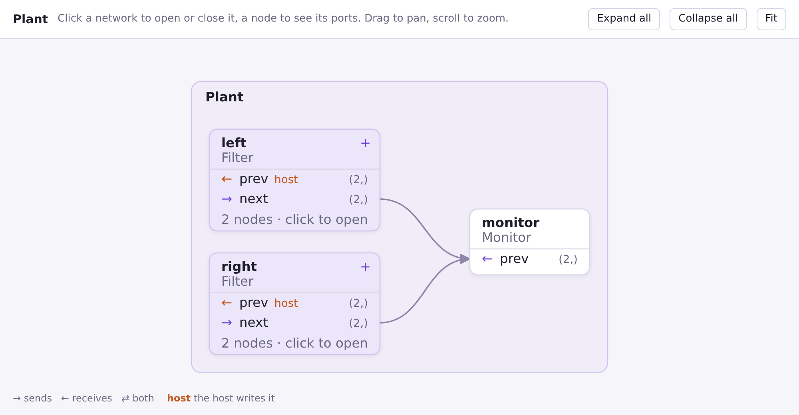
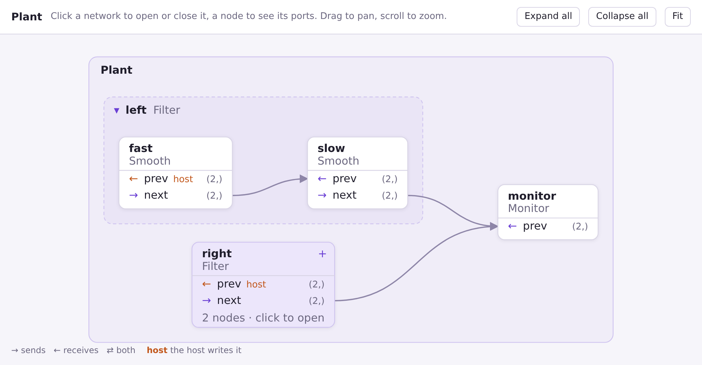
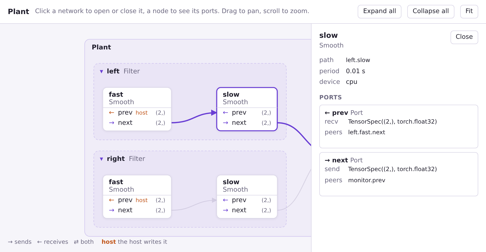

# 🔭 ネットワークの可視化

`mujou.viz.to_html` はネットワークのグラフを HTML のページに描く。ページはネットワークの最上位から始まり、ネットワークをクリックすると開き、ノードをクリックすると Port が見える。このページではページの書き出し方と読み方を説明する。

!!! abstract "このページで分かること"

    - ネットワークを走らせずにページを書き出す方法
    - ページの箱・行・矢印の意味
    - 中のネットワークの開き方と、ノードの Port の spec の見方

    [Port と Channel](ports.md) と、ネットワークの[パス](groups.md#%E3%83%91%E3%82%B9)を知っていることを前提にする。

## ページを書き出す

!!! abstract "要点"

    `mujou.viz.to_html(net)` はページを文字列で返す。ファイルに保存してブラウザで開く。

```python
--8<-- "examples/visualize.py:viz"
```

`to_html` はネットワークを `mujou.run` と同じように読むが、何も走らせない。hook は呼ばれず、スレッドも起動しない。そのためノードは実行と同じパスで表示される。`mujou.run` が受け付けないネットワーク（ネットワークの外のノードに繋がった Port など）では、ここでも同じ例外が出る。

ページは 1 つのファイルで、読み込むものが無い。オフラインで開け、そのまま人に送れる。`mujou.viz` は `import mujou` では読み込まれないので、名前で import する。

## 試す

!!! abstract "要点"

    下は、上のプログラムが書き出したページそのもの。箱をクリックして開いたり、ノードを選んだりできる。

<iframe class="mujou-viz" src="../../../assets/viz/plant.html" title="Plant のページ" loading="lazy"></iframe>

[新しいタブで開く](../../assets/viz/plant.html){ target="_blank" }

## ページを読む

!!! abstract "要点"

    ネットワークは開くまで `+` の付いた箱。ノードは白い箱で、Port ごとに 1 行。矢印は Channel で、受け取る側を指す。



| ページの表示                      | 意味                                                                                    |
| --------------------------------- | --------------------------------------------------------------------------------------- |
| 外側の枠（`Plant`）               | `to_html` に渡したルート                                                                |
| `+` の付いた箱（`left`、`right`） | 閉じたネットワーク。行はそのネットワークが公開した Port（`self.prev = self.fast.prev`） |
| 白い箱（`monitor`）               | ノード。太字が属性名、その下がクラス                                                    |
| 行                                | Port。印は働き: `→` は送る、`←` は受け取る、`⇄` は両方                                  |
| 行の右の文字                      | spec の shape: `(2,)`。受け取るものが違えば `in … · out …`                              |
| `host`                            | 繋がっていない、受け取る `Port`。ホストが `Run.write` で書く                            |
| 矢印                              | Channel。矢じりは受け取る側。両方向の Channel には 2 つ                                 |
| 矢印の `×3`                       | 同じ 2 行の間の 3 本の Channel を 1 本で描いたもの                                      |

## ネットワークを開く

!!! abstract "要点"

    閉じたネットワークをクリックすると開き、見出しをクリックすると閉じる。閉じたネットワークの中のノードへの Channel は、そのネットワークの箱に繋がる。



`left` を開くと、破線の枠の中に 2 つのノード `fast` と `slow` が出る。`left` から `monitor` への Channel は、`left.next` が指す `slow.next` から出るようになる。`right` は閉じたままなので、その Channel は `right` の箱から出る。

レイアウトはネットワークごとに決まる。子は Channel の順に左から右へ並び（送るノードが受け取るノードより先）、同じ列の子は代入の順に並ぶ。

## ノードを見る

!!! abstract "要点"

    ノードをクリックすると、パス・周期・デバイスと、各 Port の spec の全体と相手が見える。



箱にマウスを載せると、その箱の Channel が強調される。パネルには箱に書ききれないものが出る。

| パネル     | 意味                                                             |
| ---------- | ---------------------------------------------------------------- |
| path       | 実行の中のノードのパス（`left.slow`）。`Run.state_dict()` と同じ |
| period     | `Node(period=...)`。実行のタイマーの秒                           |
| device     | `Node(device=...)`                                               |
| send、recv | Port の spec の全体。dtype も含む                                |
| peers      | Channel の相手の Port。無ければ「the host writes it」            |

## 動かす

| したいこと                         | 操作                          |
| ---------------------------------- | ----------------------------- |
| すべてのネットワークを開く・閉じる | `Expand all` / `Collapse all` |
| グラフ全体を見る                   | `Fit`                         |
| 表示を動かす                       | 背景をドラッグ                |
| 拡大・縮小                         | スクロール                    |

ページはブラウザのライト・ダークのテーマに従う。

## `pc.Chain`

`to_html` は `mujou.pc` のネットワークも含め、どのネットワークでも描く。

```python
--8<-- "examples/visualize.py:chain"
```

`pc.Chain` は `input`、`layer0`、…、`output` を 1 列に並べる。隣どうしは両方向の Channel で繋がり、活動が前へ進み、フィードバックが戻る。書き出したページは [chain.html](../../assets/viz/chain.html){ target="_blank" } で見られる。

??? question "画像ではなく HTML にしたのはなぜ？"

    ノードの多いネットワークは、読める大きさの 1 枚の画像に収まらない。ページは最初はネットワークの最上位だけを見せ、見たいところを開いていける。必要なのはブラウザだけで、Mujou のほかにパッケージは要らない。
