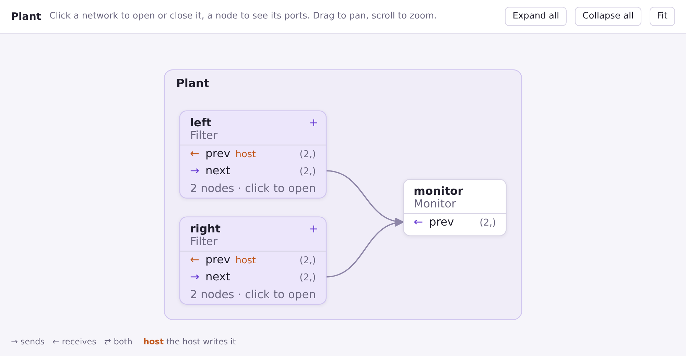
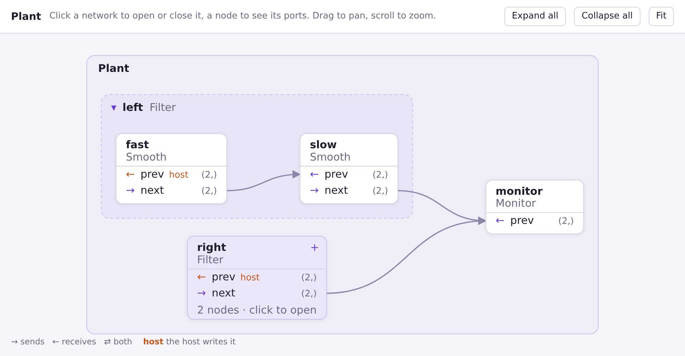
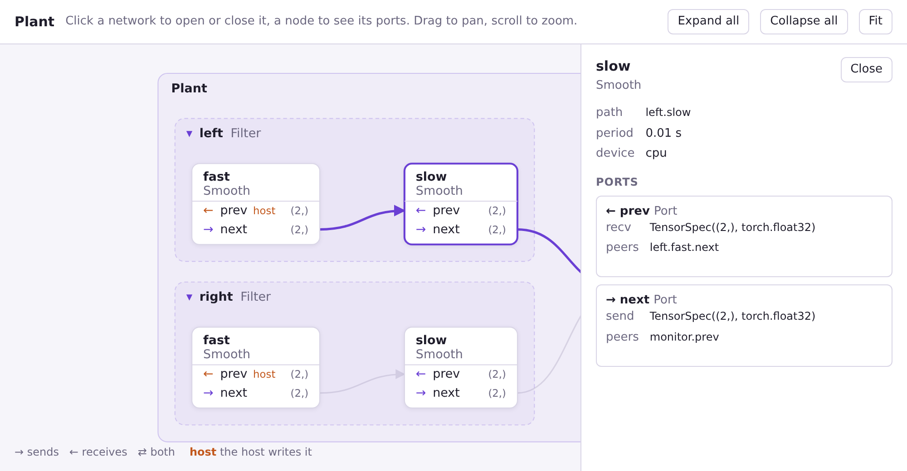

# 🔭 ネットワークの可視化

## ページを書き出す {#export}

```python
--8<-- "examples/visualize.py:viz"
```

[`to_html`][mujou.viz.to_html] は [`mujou.run`][mujou.run] と同じくネットワークの木を読むが、hook を呼ばず、スレッドも起動せず、何も走らせない。そのためノードは実行と同じパス（[ネットワークとパス](../concepts.md#networks)）で表示される。

書き出したページは 1 つの HTML ファイルで、読み込むものが無いのでオフラインでも開け、そのまま人に送れる。

## 試す {#try}

<iframe class="mujou-viz" src="../../../assets/viz/plant.html" title="Plant のページ" loading="lazy"></iframe>

[新しいタブで開く](../../assets/viz/plant.html){ target="_blank" }

## ページを読む {#legend}



| ページの表示                      | 意味                                                                                                                               |
| --------------------------------- | ---------------------------------------------------------------------------------------------------------------------------------- |
| 外側の枠（`Plant`）               | `to_html` に渡したルート                                                                                                           |
| `+` の付いた箱（`left`、`right`） | 閉じたネットワーク。行はそのネットワークが公開した Port（`self.prev = self.fast.prev`）。中のノードへの Channel もこの箱につながる |
| 白い箱（`monitor`）               | ノード。太字が属性名、その下がクラス                                                                                               |
| 行                                | Port。印は働き: `→` は送る、`←` は受け取る、`⇄` は両方                                                                             |
| 行の右の文字                      | spec の shape: `(2,)`。受け取るものが違えば `in … · out …`                                                                         |
| `host`                            | つながっていない、受け取る `Port`。ホストが [`Run.write`][mujou.Run.write] で書く                                                  |
| 矢印                              | Channel。矢じりは受け取る側で、両方向の Channel には 2 つ。`×3` は同じ 2 行の間の 3 本を 1 本で描いたもの                          |

## ネットワークを開く {#open}



| レイアウト     | 決まり方                                       |
| -------------- | ---------------------------------------------- |
| 単位           | ネットワークごと                               |
| 列（左から右） | Channel の順。送るノードが受け取るノードより先 |
| 同じ列の中     | 代入の順                                       |

## ノードを見る {#inspect}



| パネル（ノードをクリックで開く） | 意味                                                                                     |
| -------------------------------- | ---------------------------------------------------------------------------------------- |
| path                             | 実行の中のノードのパス（`left.slow`）。[`Run.state_dict()`][mujou.Run.state_dict] と同じ |
| period                           | [`Node(period=...)`][mujou.Node]。実行のタイマーの秒                                     |
| device                           | `Node(device=...)`                                                                       |
| send、recv                       | Port の spec の全体。dtype も含む                                                        |
| peers                            | Channel の相手の Port。無ければ「the host writes it」                                    |

## 動かす {#controls}

| したいこと                 | 操作                                                                                   |
| -------------------------- | -------------------------------------------------------------------------------------- |
| ネットワークを開く・閉じる | 閉じた箱をクリック・開いた枠の見出しをクリック。全部なら `Expand all` / `Collapse all` |
| 箱の Channel を強調する    | 箱にマウスを載せる                                                                     |
| 表示を動かす               | 背景をドラッグ、スクロールで拡大・縮小、`Fit` で全体                                   |
| ライト・ダークのテーマ     | ブラウザの設定に従う                                                                   |

## `pc.Chain` {#pc-chain}

```python
--8<-- "examples/visualize.py:chain"
```

[書き出した chain.html を開く](../../assets/viz/chain.html){ target="_blank" }

??? question "画像ではなく HTML にしたのはなぜ？"

    ノードの多いネットワークは、読める大きさの 1 枚の画像に収まらない。ページは最初に最上位だけを見せ、見たいところを開いていける。必要なのはブラウザだけで、Mujou のほかにパッケージは不要。
