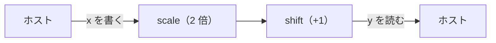

# 🚀 1. ネットワークを走らせる

最小のプログラムを走らせ、1 行ずつ説明する。2 つのノードで $y = 2x + 1$ を計算するプログラムである。後半ではネットワークを分岐させ、合流させる。



## プログラム

```python title="examples/quickstart.py"
--8<-- "examples/quickstart.py"
```

リポジトリのルートで次のように実行する。

```sh
uv run python examples/quickstart.py
```

次のような 1 行が表示される。

```text
y = tensor([3., 5., 7.]) at t = 0.017 s
```

`y` は `x = [1, 2, 3]` に対する $2x + 1$ である。`t` は `shift` が `y` を送った時刻で、単位は実行のタイマーの秒。値は実行ごとに変わる。

## ノード

```python
--8<-- "examples/quickstart.py:node"
```

- ノードは `mujou.Node` を継承したクラス。どのサブクラスとも同じく、`__init__` では最初に `super().__init__()` を呼び、各 hook でも最初に `super()` の同じ hook を呼ぶ
- `__init__` でノードの Port を属性として宣言する。`Port(recv=VECTOR)` は長さ 3 の float32 のベクトルを受け取り、`Port(send=VECTOR)` はそれを送る。慣習では前のノード側の Port を `prev`、次のノード側を `next` と名付ける
- `a` と `b` は設定。引数から決めた数値で、状態ではない
- `on_update(dt)` はノードの 1 回分の処理。mujou がおよそ 10 ms ごとに繰り返し呼ぶ。`recv()` は相手が送った最新の値を待たずに返し、`send()` はすべての相手にコピーを送る

## ネットワーク

```python
--8<-- "examples/quickstart.py:network"
```

ネットワークはノードを属性として持ち、その Port を `connect` でつなぎ、外から使う Port を自分の属性として公開する（`self.prev`、`self.next`）。`connect` は互いの送る spec が相手の受け取る spec と一致するかを確かめ、一致しなければ `TypeError` を送出する。

## 実行

```python
--8<-- "examples/quickstart.py:run"
```

- `mujou.run(net)` はネットワークを検査して全ノードを起動し、動き出したら `Run` を返す。各ノードは実行のワーカースレッドの上で `on_update` を繰り返し、ホストのスレッドは先へ進む
- `run.write` はつながっていない Port `net.prev` に `x` を書く。値は次に書くまで残る
- `recv()` は待たないので、`x` が `scale` を通り抜けるまで `shift` は前の入力（最初はゼロ）から計算した値を送り続ける。`run.wait_for` は条件を満たした最初の出力を時刻と一緒に返す。実時間で 5 秒たつと `TimeoutError` を送出する
- `with` ブロックを抜けると実行が終了する。ノードの例外も遅くともそこでホストに届く

## 分岐と合流

送るだけの `Port` は相手をいくつでも取れる。複数の Port につなげば、送った値はそれぞれに届く（fan-out）。合流には `MultiPort` を使う。その `recv()` は Channel ごとに値を 1 つずつ、`connect` の順の `dict[Channel, 値]` で返し、どう束ねるかはノードが決める。

```python
--8<-- "examples/branching.py:fan-out"
```

`Diamond` は $y = 2(x + 1) + (x + 1)^2$ を計算する。`shift` が両方の枝へ送り、`sum` が 2 つの枝の値を足す。受け取る `Port` の `recv()` は値を 1 つ返すので、受け取る相手は 1 つだけ。複数の相手から受け取るなら `MultiPort` を使う。`uv run python examples/branching.py` で実行できる。同じプログラムの後半は相手ごとに違う値を送る。説明は [Port と Channel](../topics/ports.md#1-%E3%81%A4%E3%81%AE-channel-%E3%81%AB%E9%80%81%E3%82%8B) にある。

## 次へ

- 時間とともに変わる状態を持つノードを書く: [2. ノードを書く](2-node.md)
- ホストのほかの書き方・読み方: [ホストの入出力](../topics/host-io.md)
