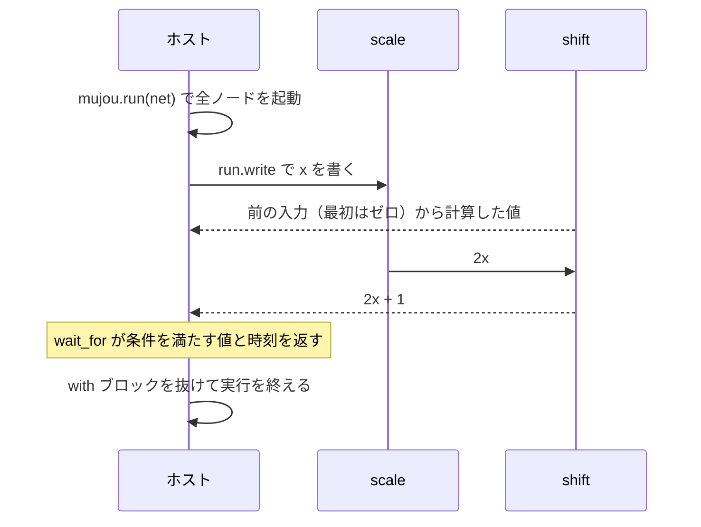

# 🚀 1. ネットワークを走らせる

2 つのノードで $y = 2x + 1$ を計算する最小のプログラム `examples/quickstart.py` を走らせ、ノード・ネットワーク・実行の書き方を見る。


## 動かす {#program}

```python title="examples/quickstart.py"
--8<-- "examples/quickstart.py"
```

=== "ソースを checkout した場合"

    リポジトリのルートで:

    ```sh
    uv run python examples/quickstart.py
    ```

=== "PyPI からインストールした場合"

    [`examples/quickstart.py`](https://github.com/Geson-anko/mujou/blob/main/examples/quickstart.py) を手元にコピーしてから:

    ```sh
    python quickstart.py
    ```

```text
y = tensor([3., 5., 7.]) at t = 0.017 s
```

`t` は `shift` が `y` を送った[実行のタイマー](../topics/time.md#timers)の時刻（秒）で、走らせるたびに変わる。

## ノード {#node}

`Affine` は [`Node`][mujou.Node] を継承し、`__init__` で Port を属性として作る。前から受ける Port を `prev`、次へ送る Port を `next` と名づけるのが慣習で、`a` と `b` は引数で決まる設定（状態ではない）。

1 回分の処理は、mujou が繰り返し呼ぶ [`on_update(dt)`][mujou.Node.on_update] に書き、[`recv`][mujou.Port.recv] で読んで [`send`][mujou.Port.send] で送る。

## ネットワーク {#network}

| `Pipeline`（[`Network`][mujou.Network]）がすること | コード                                                    |
| -------------------------------------------------- | --------------------------------------------------------- |
| ノードを属性に持つ                                 | `self.scale = Affine(2.0, 0.0)`                           |
| Port をつなぐ（[`connect`][mujou.Port.connect]）   | `self.scale.next.connect(self.shift.prev)`                |
| 外から使う Port を公開する                         | `self.prev, self.next = self.scale.prev, self.shift.next` |

## 実行 {#run}



[`with mujou.run(net) as run:`][mujou.run] のブロックでは、書いた直後の出力は前の入力から計算した値なので、[`read`][mujou.Run.read] ではなく [`wait_for`][mujou.Run.wait_for] で条件を満たす出力を待つ。

## 次へ

- 時間とともに変わる状態を持つノードを書く: [2. ノードを書く](2-node.md)
- 分岐（fan-out）と `MultiPort` での合流: [Port と Channel](../topics/ports.md#fan-out)
- ホストのほかの書き方・読み方: [ホストの入出力](../topics/host-io.md)
