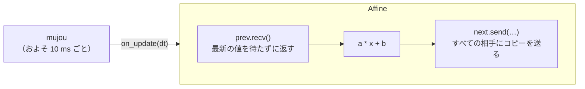
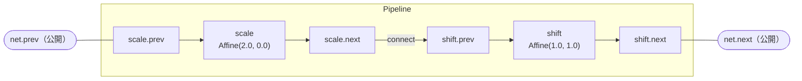
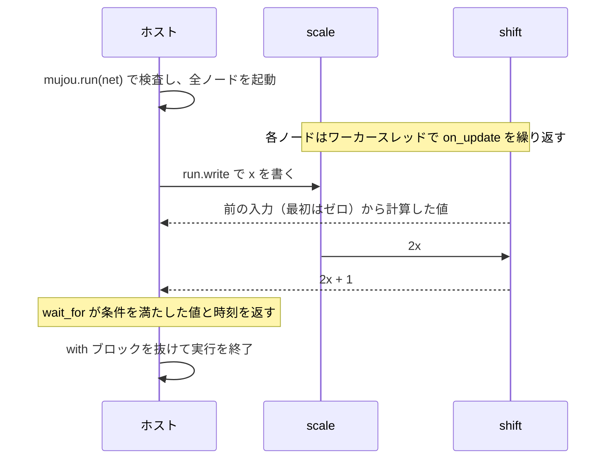
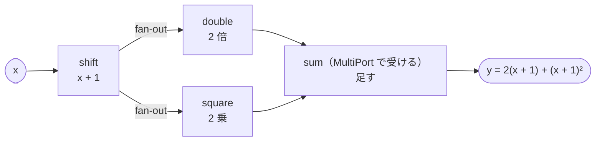

# 🚀 1. ネットワークを走らせる

2 つのノードで $y = 2x + 1$ を計算する最小のプログラムを走らせ、1 行ずつ説明する。後半はネットワークを分岐させ、合流させる。

!!! abstract "このページで分かること"

    - ノード・ネットワーク・実行の 3 つの部品と、それぞれに書くもの
    - ホストが入力を書き、出力が届くまで待つ流れ
    - ネットワークを分岐させ（fan-out）、`MultiPort` で合流させる方法


| 部品         | プログラムの中               | 書くもの                            | 節                                                                      |
| ------------ | ---------------------------- | ----------------------------------- | ----------------------------------------------------------------------- |
| ノード       | `class Affine(Node)`         | 1 回分の処理（`on_update`）         | [ノード](#%E3%83%8E%E3%83%BC%E3%83%89)                                  |
| ネットワーク | `class Pipeline(Network)`    | ノードのつなぎ方と、外から使う Port | [ネットワーク](#%E3%83%8D%E3%83%83%E3%83%88%E3%83%AF%E3%83%BC%E3%82%AF) |
| 実行         | `with mujou.run(net) as run` | 入力を書き、出力を待ち、終える      | [実行](#%E5%AE%9F%E8%A1%8C)                                             |

## プログラム

!!! abstract "要点"

    1 つのファイルで完結するプログラム。走らせると `y` と、それが送られた時刻を 1 行表示する。

```python title="examples/quickstart.py"
--8<-- "examples/quickstart.py"
```

1. リポジトリのルートで実行する

    ```sh
    uv run python examples/quickstart.py
    ```

2. 次のような 1 行が表示される

    ```text
    y = tensor([3., 5., 7.]) at t = 0.017 s
    ```

| 表示 | 意味                                                                        |
| ---- | --------------------------------------------------------------------------- |
| `y`  | `x = [1, 2, 3]` に対する $2x + 1$                                           |
| `t`  | `shift` が `y` を送った時刻。単位は実行のタイマーの秒。値は実行ごとに変わる |

## ノード

!!! abstract "要点"

    ノードは `mujou.Node` を継承したクラス。`__init__` で Port を宣言し、`on_update(dt)` に 1 回分の処理を書く。

```python
--8<-- "examples/quickstart.py:node"
```



| コード                          | 役割                                                                         |
| ------------------------------- | ---------------------------------------------------------------------------- |
| `class Affine(Node)`            | `mujou.Node` を継承したクラス                                                |
| `self.a, self.b = a, b`         | 設定。引数から決めた数値で、状態ではない                                     |
| `self.prev = Port(recv=VECTOR)` | 長さ 3 の float32 のベクトルを受け取る Port。前のノード側なので慣習で `prev` |
| `self.next = Port(send=VECTOR)` | 同じベクトルを送る Port。次のノード側なので慣習で `next`                     |
| `on_update(dt)`                 | 1 回分の処理。mujou がおよそ 10 ms ごとに繰り返し呼ぶ                        |
| `recv()`                        | 相手が送った最新の値を、待たずに返す                                         |
| `send()`                        | すべての相手にコピーを送る                                                   |

どのサブクラスでも、`__init__` と各 hook の最初で `super()` の同じメソッドを呼ぶ。

=== "避ける"

    ```python
    def __init__(self, a: float, b: float) -> None:
        self.a, self.b = a, b  # super().__init__() を呼んでいない
        ...

    def on_update(self, dt: float) -> None:
        self.next.send(self.a * self.prev.recv() + self.b)  # super() を呼んでいない
    ```

=== "こう書く"

    ```python
    def __init__(self, a: float, b: float) -> None:
        super().__init__()  # 最初に呼ぶ
        self.a, self.b = a, b
        ...

    def on_update(self, dt: float) -> None:
        super().on_update(dt)  # hook でも最初に呼ぶ
        self.next.send(self.a * self.prev.recv() + self.b)
    ```

## ネットワーク

!!! abstract "要点"

    ネットワークはノードを属性に持ち、その Port を `connect` でつなぎ、外から使う Port を自分の属性として公開する。

```python
--8<-- "examples/quickstart.py:network"
```



| すること                   | コード                                                    |
| -------------------------- | --------------------------------------------------------- |
| ノードを属性に持つ         | `self.scale = Affine(2.0, 0.0)`                           |
| Port をつなぐ              | `self.scale.next.connect(self.shift.prev)`                |
| 外から使う Port を公開する | `self.prev, self.next = self.scale.prev, self.shift.next` |

`connect` はつなぐ前に spec を確かめる。

| 互いの送る spec が相手の受け取る spec と | `connect` の結果   |
| ---------------------------------------- | ------------------ |
| 一致する                                 | つながる           |
| 一致しない                               | `TypeError` を送出 |

## 実行

!!! abstract "要点"

    `mujou.run(net)` が全ノードを裏で動かし、`Run` を返す。ホストは `Run` で入力を書き、条件を満たす出力が届くまで待つ。

```python
--8<-- "examples/quickstart.py:run"
```



| 呼び出し                                    | すること                                                        | 注意                                                                          |
| ------------------------------------------- | --------------------------------------------------------------- | ----------------------------------------------------------------------------- |
| `mujou.run(net)`                            | ネットワークを検査し、全ノードを起動。動き出したら `Run` を返す | ノードはワーカースレッドで `on_update` を繰り返し、ホストのスレッドは先へ進む |
| `run.write({net.prev: x})`                  | つながっていない Port `net.prev` に `x` を書く                  | 値は次に書くまで残る                                                          |
| `run.wait_for(net.next, 条件, timeout=5.0)` | 条件を満たした最初の出力を、時刻と一緒に返す                    | 実時間で 5 秒たつと `TimeoutError`                                            |
| `with` ブロックを抜ける                     | 実行を終了                                                      | ノードの例外も遅くともここでホストに届く                                      |

??? question "`read` ではなく `wait_for` で待つのはなぜ？"

    `recv()` は待たないため、`x` が `scale` を抜けるまで `shift` は前の入力（最初はゼロ）から計算した値を送り続ける。書いた直後に読んでも `2x + 1` とは限らない。`wait_for` は条件（ここでは `y` が `2x + 1` に等しい）を満たした最初の出力を、送られた時刻と一緒に返す。

## 分岐と合流

!!! abstract "要点"

    送るだけの `Port` は相手をいくつでも取れ、送った値はそれぞれに届く（fan-out）。合流には `MultiPort` を使う。



|               | 受け取る `Port` | `MultiPort`                                                       |
| ------------- | --------------- | ----------------------------------------------------------------- |
| 受け取る相手  | 1 つだけ        | いくつでも                                                        |
| `recv()` の値 | 値 1 つ         | Channel ごとに値を 1 つずつ。`connect` の順の `dict[Channel, 値]` |
| 束ね方        | ―               | ノードが決める（`Sum` は足す）                                    |

```python
--8<-- "examples/branching.py:fan-out"
```

`Diamond` は $y = 2(x + 1) + (x + 1)^2$ を計算する。`shift` が両方の枝（`double` と `square`）へ送り、`sum` が 2 つの枝の値を足す。受け取る `Port` の `recv()` は値を 1 つ返すので、受け取る相手は 1 つだけ。複数の相手から受け取るときは `MultiPort` を使う。

```sh
uv run python examples/branching.py
```

!!! info "相手ごとに違う値を送る"

    同じプログラム（`examples/branching.py`）の後半は、相手ごとに違う値を送る。その説明は [Port と Channel](../topics/ports.md#1-%E3%81%A4%E3%81%AE-channel-%E3%81%AB%E9%80%81%E3%82%8B) にある。

## 次へ

- 時間とともに変わる状態を持つノードを書く: [2. ノードを書く](2-node.md)
- ホストのほかの書き方・読み方: [ホストの入出力](../topics/host-io.md)
