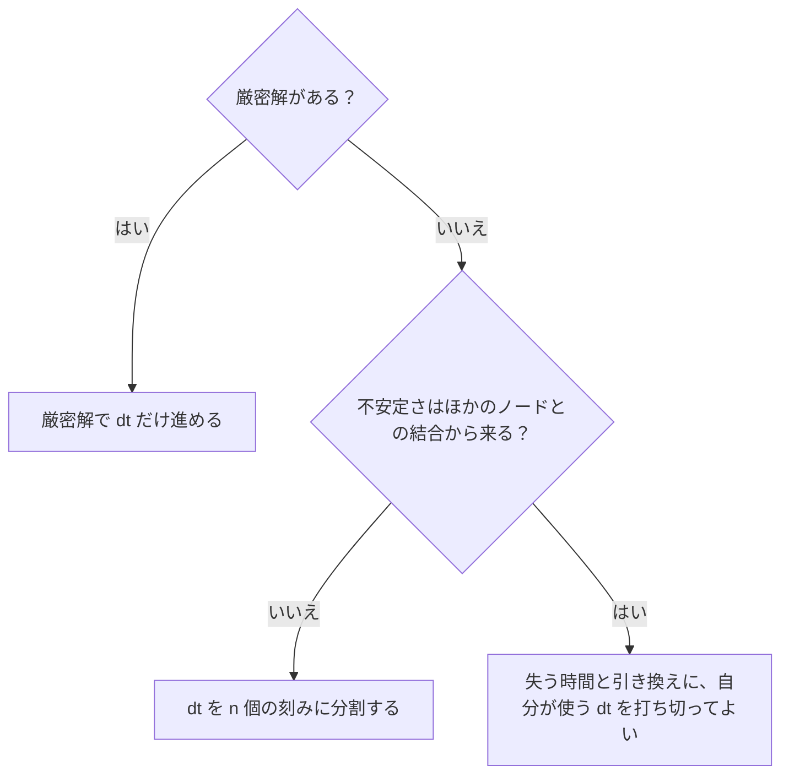

# 🧩 2. ノードを書く

状態が微分方程式に従うノード、リーク積分器 `Leaky` を書き、2 つを並べて走らせる。扱うのは `dt`、状態、周期。どのノードも守る規則は [Mujou の仕組み](../concepts.md#%E3%83%8E%E3%83%BC%E3%83%89%E3%81%8C%E5%AE%88%E3%82%8B%E8%A6%8F%E5%89%87) にある。

!!! abstract "このページで分かること"

    - 連続時間の微分方程式を、1 回分の更新 `on_update(dt)` として書く方法
    - 起こりうる最も長い `dt` でも安定に更新する方法
    - 状態と設定の分け方、周期 `period` の決め方

## ノード

!!! abstract "要点"

    `Leaky` は入力 $u$ を時定数 $\tau$ で追いかけるノード。状態 $x$ は次の微分方程式に従う。

$$
\frac{dx}{dt} = \frac{u - x}{\tau}
$$

```python
--8<-- "examples/leaky.py:node"
```

| 場所            | 書くもの                                           |
| --------------- | -------------------------------------------------- |
| `__init__`      | 設定（`tau`）、状態（`x`）、Port（`prev`、`next`） |
| `on_update(dt)` | 入力を読み、状態を `dt` だけ進め、結果を送る       |
| ループ          | 書かない。`on_update` は mujou が繰り返し呼ぶ      |

## `dt` に比例して更新する

!!! abstract "要点"

    `dt` は前回の更新から実際に経った秒数。更新はいつも `dt` に比例させ、起こりうる最も長い `dt` でも安定に保つ。

| `dt` について | 内容                                                                     |
| ------------- | ------------------------------------------------------------------------ |
| 測るもの      | このノードの前回の更新からの秒数。実行のタイマーで測る                   |
| 最初の `dt`   | 実行の開始から数える。数え始めるのは全ノードの `on_start` が終わった時点 |
| 長さ          | 一定ではない。マシンが混むと長くなる                                     |

<figure class="mujou-diagram">
<svg viewBox="0 0 640 250" role="img" aria-label="更新の速さが違う 2 つのノード。1 回あたりの刻みを固定すると速いノードほど速く変化し、dt に比例させると両方が同じ曲線に乗る">
<line class="mujou-axis" x1="50" y1="190" x2="300" y2="190"/>
<line class="mujou-axis" x1="50" y1="190" x2="50" y2="40"/>
<text class="mujou-label" x="175.0" y="24" text-anchor="middle">1 回あたりの刻みを固定（避ける）</text>
<polyline class="mujou-lane" style="fill: none; stroke-dasharray: 4 4" points="50,190 52.5,185.4 55,181 57.5,176.7 60,172.5 62.5,168.5 65,164.6 67.5,160.9 70,157.2 72.5,153.7 75,150.3 77.5,147 80,143.8 82.5,140.8 85,137.8 87.5,134.9 90,132.1 92.5,129.4 95,126.8 97.5,124.3 100,121.9 102.5,119.5 105,117.2 107.5,115 110,112.9 112.5,110.8 115,108.8 117.5,106.9 120,105.1 122.5,103.2 125,101.5 127.5,99.8 130,98.2 132.5,96.6 135,95.1 137.5,93.6 140,92.2 142.5,90.8 145,89.4 147.5,88.2 150,86.9 152.5,85.7 155,84.5 157.5,83.4 160,82.3 162.5,81.2 165,80.2 167.5,79.2 170,78.3 172.5,77.3 175,76.4 177.5,75.6 180,74.7 182.5,73.9 185,73.1 187.5,72.4 190,71.6 192.5,70.9 195,70.3 197.5,69.6 200,68.9 202.5,68.3 205,67.7 207.5,67.1 210,66.6 212.5,66 215,65.5 217.5,65 220,64.5 222.5,64 225,63.6 227.5,63.1 230,62.7 232.5,62.3 235,61.9 237.5,61.5 240,61.1 242.5,60.8 245,60.4 247.5,60.1 250,59.7 252.5,59.4 255,59.1 257.5,58.8 260,58.5 262.5,58.2 265,58 267.5,57.7 270,57.5 272.5,57.2 275,57 277.5,56.7 280,56.5 282.5,56.3 285,56.1 287.5,55.9 290,55.7 292.5,55.5 295,55.3 297.5,55.2 300,55"/>
<circle style="fill: var(--md-typeset-a-color)" cx="75" cy="150.3" r="4"/>
<circle style="fill: var(--md-typeset-a-color)" cx="100" cy="121.9" r="4"/>
<circle style="fill: var(--md-typeset-a-color)" cx="125" cy="101.5" r="4"/>
<circle style="fill: var(--md-typeset-a-color)" cx="150" cy="86.9" r="4"/>
<circle style="fill: var(--md-typeset-a-color)" cx="175" cy="76.4" r="4"/>
<circle style="fill: var(--md-typeset-a-color)" cx="200" cy="68.9" r="4"/>
<circle style="fill: var(--md-typeset-a-color)" cx="225" cy="63.6" r="4"/>
<circle style="fill: var(--md-typeset-a-color)" cx="250" cy="59.7" r="4"/>
<circle style="fill: var(--md-typeset-a-color)" cx="275" cy="57" r="4"/>
<circle style="fill: var(--md-typeset-a-color)" cx="300" cy="55" r="4"/>
<rect style="fill: var(--md-accent-fg-color)" x="108.5" y="146.3" width="8" height="8"/>
<rect style="fill: var(--md-accent-fg-color)" x="171" y="117.9" width="8" height="8"/>
<rect style="fill: var(--md-accent-fg-color)" x="233.5" y="97.5" width="8" height="8"/>
<rect style="fill: var(--md-accent-fg-color)" x="296" y="82.9" width="8" height="8"/>
<text class="mujou-note" x="300" y="206" text-anchor="end">時刻 →</text>
<line class="mujou-axis" x1="360" y1="190" x2="610" y2="190"/>
<line class="mujou-axis" x1="360" y1="190" x2="360" y2="40"/>
<text class="mujou-label" x="485.0" y="24" text-anchor="middle">dt に比例（こう書く）</text>
<polyline class="mujou-lane" style="fill: none; stroke-dasharray: 4 4" points="360,190 362.5,185.4 365,181 367.5,176.7 370,172.5 372.5,168.5 375,164.6 377.5,160.9 380,157.2 382.5,153.7 385,150.3 387.5,147 390,143.8 392.5,140.8 395,137.8 397.5,134.9 400,132.1 402.5,129.4 405,126.8 407.5,124.3 410,121.9 412.5,119.5 415,117.2 417.5,115 420,112.9 422.5,110.8 425,108.8 427.5,106.9 430,105.1 432.5,103.2 435,101.5 437.5,99.8 440,98.2 442.5,96.6 445,95.1 447.5,93.6 450,92.2 452.5,90.8 455,89.4 457.5,88.2 460,86.9 462.5,85.7 465,84.5 467.5,83.4 470,82.3 472.5,81.2 475,80.2 477.5,79.2 480,78.3 482.5,77.3 485,76.4 487.5,75.6 490,74.7 492.5,73.9 495,73.1 497.5,72.4 500,71.6 502.5,70.9 505,70.3 507.5,69.6 510,68.9 512.5,68.3 515,67.7 517.5,67.1 520,66.6 522.5,66 525,65.5 527.5,65 530,64.5 532.5,64 535,63.6 537.5,63.1 540,62.7 542.5,62.3 545,61.9 547.5,61.5 550,61.1 552.5,60.8 555,60.4 557.5,60.1 560,59.7 562.5,59.4 565,59.1 567.5,58.8 570,58.5 572.5,58.2 575,58 577.5,57.7 580,57.5 582.5,57.2 585,57 587.5,56.7 590,56.5 592.5,56.3 595,56.1 597.5,55.9 600,55.7 602.5,55.5 605,55.3 607.5,55.2 610,55"/>
<circle style="fill: var(--md-typeset-a-color)" cx="385" cy="150.3" r="4"/>
<circle style="fill: var(--md-typeset-a-color)" cx="410" cy="121.9" r="4"/>
<circle style="fill: var(--md-typeset-a-color)" cx="435" cy="101.5" r="4"/>
<circle style="fill: var(--md-typeset-a-color)" cx="460" cy="86.9" r="4"/>
<circle style="fill: var(--md-typeset-a-color)" cx="485" cy="76.4" r="4"/>
<circle style="fill: var(--md-typeset-a-color)" cx="510" cy="68.9" r="4"/>
<circle style="fill: var(--md-typeset-a-color)" cx="535" cy="63.6" r="4"/>
<circle style="fill: var(--md-typeset-a-color)" cx="560" cy="59.7" r="4"/>
<circle style="fill: var(--md-typeset-a-color)" cx="585" cy="57" r="4"/>
<circle style="fill: var(--md-typeset-a-color)" cx="610" cy="55" r="4"/>
<rect style="fill: var(--md-accent-fg-color)" x="418.5" y="106.8" width="8" height="8"/>
<rect style="fill: var(--md-accent-fg-color)" x="481" y="72.4" width="8" height="8"/>
<rect style="fill: var(--md-accent-fg-color)" x="543.5" y="57.5" width="8" height="8"/>
<rect style="fill: var(--md-accent-fg-color)" x="606" y="51" width="8" height="8"/>
<text class="mujou-note" x="610" y="206" text-anchor="end">時刻 →</text>
<circle style="fill: var(--md-typeset-a-color)" cx="60" cy="232" r="4"/>
<text class="mujou-note" x="70" y="236">ノード A（速く回る）</text>
<rect style="fill: var(--md-accent-fg-color)" x="216" y="228" width="8" height="8"/>
<text class="mujou-note" x="230" y="236">ノード B（遅く回る）</text>
<line class="mujou-lane" style="fill: none; stroke-dasharray: 4 4" x1="380" y1="232" x2="410" y2="232"/>
<text class="mujou-note" x="416" y="236">連続時間の解</text>
</svg>
<figcaption>更新の速さが違う 2 つのノード。点が更新で、点線が連続時間の解。刻みを固定すると速いノード A ほど速く変化し、<code>dt</code> に比例させると両方が同じ解に乗る</figcaption>
</figure>

=== "避ける"

    ```python
    # 1 回あたりの刻みを固定する: 速く回るノードほど速く変化する
    self.x += 0.001 * (u - self.x) / self.tau

    # dt を切り捨てる: 切った分の時間が失われ、連続時間の解からずれる（例外は下の「長い dt でも安定に保つ」）
    self.x += min(dt, 0.001) * (u - self.x) / self.tau
    ```

=== "こう書く"

    ```python
    # dt に比例させる。dx/dt = f(x) の最も簡単な更新は陽的 Euler 法 x += dt * f(x)
    self.x += dt * (u - self.x) / self.tau
    ```

??? question "`dt` に比例させるのはなぜ？"

    ノードは自分の速さで更新し、その速さは負荷で揺らぐ。`dt` に比例させれば、どのノードも同じ時間の流れの上で同じダイナミクスに従い、マシンが混んでも `dt` が伸びるだけで済む。刻みを固定すると、速く回るノードほど速く変化してしまう（上の図の左）。

### 長い `dt` でも安定に保つ

`dt` を切り捨てると時間が失われ、連続時間の解からずれる。切り捨てずに、起こりうる最も長い `dt` でも安定な更新を選ぶ（方法は下の図と表）。



| 方法            | やり方                                                                                               | 例                                              |
| --------------- | ---------------------------------------------------------------------------------------------------- | ----------------------------------------------- |
| 厳密解で進める  | 厳密解で `dt` だけ進める                                                                             | `Leaky`（下の式）                               |
| 刻みを分割する  | 1 回の `on_update` の中で `dt` を安定な長さ以下の `n` 個の刻みに分け、`for` ループで `n` 回更新      | [4. ノードの中で学習する](4-learn-in-a-node.md) |
| `dt` を打ち切る | 不安定さがほかのノードとの結合から来るときに限り、失う時間と引き換えに自分が使う `dt` に上限を設ける | `mujou.pc` のノードの `max_dt`                  |

`Leaky` の 1 回の更新:

$$
x \leftarrow x + \left(1 - e^{-\Delta t / \tau}\right)(u - x)
$$

`Leaky` は `x` を `u` までの距離の `1 - exp(-dt / tau)` 倍だけ動かす。`u` が一定の間この式は厳密で、係数はどんな `dt` でも 1 未満なので `x` が `u` を行き過ぎない。

??? question "結合から来る不安定さは、分割しても安定にならないのはなぜ？"

    読んだメッセージ（ほかのノードの値）は `dt` の間変わらないため、刻みを分割しても結合による不安定さは解消しない。そのようなノードは、失う時間と引き換えに使う `dt` を打ち切ってよい（`mujou.pc` のノードは `max_dt` で打ち切る）。

### 雑音を足すとき

| 足すもの               | 比例させる量 |
| ---------------------- | ------------ |
| 連続時間の更新（変化） | `dt`         |
| 雑音の標準偏差         | $\sqrt{dt}$  |

連続時間の更新に雑音を足すときは、標準偏差を $\sqrt{dt}$ に比例させ、結果がノードの更新頻度に依存しないようにする。

## 状態

!!! abstract "要点"

    テンソルの属性は自動で状態に入る。状態は `__init__` で作り、`on_update` ではその場で更新する。

| 属性                                 | 種類 | 状態に入るか                                                                                     |
| ------------------------------------ | ---- | ------------------------------------------------------------------------------------------------ |
| `self.x`（テンソル）                 | 状態 | 自動で入る。`run.state_dict()` が取得し、復元で書き戻す（[6. 保存と再開](6-save-and-resume.md)） |
| `self.tau`（引数から決めた数値）     | 設定 | 入らない。別の `tau` で作ったノードに復元しても、そのノードの設定のまま                          |
| 実行中に変わる素の値（カウンタなど） | 状態 | `register_state` で加える（[4. ノードの中で学習する](4-learn-in-a-node.md)の例）                 |

=== "避ける"

    ```python
    self.x = self.x + (1 - math.exp(-dt / self.tau)) * (u - self.x)  # 新しいテンソルを代入し直す
    ```

=== "こう書く"

    ```python
    self.x += (1 - math.exp(-dt / self.tau)) * (u - self.x)  # その場で更新する（+=、copy_ など）
    ```

??? question "新しいテンソルを代入し直すと何が困る？"

    ```mermaid
    flowchart LR
        subgraph before["代入し直す前"]
            X1["self.x"] --> T1["テンソル 1"]
            O1["ほかの属性・optimizer"] --> T1
        end
        subgraph after["self.x に新しいテンソルを代入した後"]
            X2["self.x"] --> T2["テンソル 2（以後の状態）"]
            O2["ほかの属性・optimizer"] --> T1b["テンソル 1（古いまま）"]
        end
    ```

    新しいテンソルを代入し直してもエラーにはならず、以後は新しいテンソルが状態になる。ただし、ほかの属性や optimizer が最初のテンソルを参照していると、その参照は古いテンソルを指したまま残る。復元もノードが持つテンソルにその場で書き込む。

!!! tip "送った後で `self.x` を書き換えてよい"

    `Leaky` は `self.x` を送った後も書き換えるが、`send` は値をコピーするので送った値は変わらず問題ない。

## 周期

!!! abstract "要点"

    ノードは平均 `period` 秒に 1 回更新する。既定は 0.01 秒。ただし `dt` は `period` ちょうどにはならない。

<figure class="mujou-diagram">
<svg viewBox="0 0 640 150" role="img" aria-label="平均 period ごとの更新。遅れた更新の dt は長く、その次の dt は短い">
<line class="mujou-axis" x1="90" y1="120" x2="620" y2="120"/>
<text class="mujou-label" x="620" y="142" text-anchor="end">実行のタイマー →</text>
<text class="mujou-label" x="10" y="84">ノード</text>
<line class="mujou-lane" x1="90" y1="80" x2="620" y2="80"/>
<g class="mujou-lane" style="stroke-dasharray: 3 3"><line x1="100" y1="96" x2="100" y2="120"/><line x1="180" y1="96" x2="180" y2="120"/><line x1="260" y1="96" x2="260" y2="120"/><line x1="340" y1="96" x2="340" y2="120"/><line x1="420" y1="96" x2="420" y2="120"/><line x1="500" y1="96" x2="500" y2="120"/><line x1="580" y1="96" x2="580" y2="120"/></g>
<text class="mujou-note" x="140" y="114" text-anchor="middle">period</text>
<text class="mujou-note" x="220" y="114" text-anchor="middle">period</text>
<g class="mujou-tick-a"><line x1="100" y1="68" x2="100" y2="92"/><line x1="180" y1="68" x2="180" y2="92"/><line x1="260" y1="68" x2="260" y2="92"/><line x1="385" y1="68" x2="385" y2="92"/><line x1="420" y1="68" x2="420" y2="92"/><line x1="500" y1="68" x2="500" y2="92"/><line x1="580" y1="68" x2="580" y2="92"/></g>
<text class="mujou-note" x="140" y="58" text-anchor="middle">dt ≈ period</text>
<path class="mujou-brace" d="M 262 62 Q 262 54 270 54 L 375 54 Q 383 54 383 62"/>
<text class="mujou-note" x="322" y="44" text-anchor="middle">遅れると長い dt</text>
<path class="mujou-brace" d="M 387 62 Q 387 54 395 54 L 410 54 Q 418 54 418 62"/>
<text class="mujou-note" x="420" y="30" text-anchor="middle">その次は短い dt</text>
<line class="mujou-lane" x1="403" y1="34" x2="403" y2="52"/>
</svg>
<figcaption>縦の線が更新、下の点線が平均 <code>period</code> の目安。遅れた更新の <code>dt</code> は長く、その次は短い</figcaption>
</figure>

| 周期について               | 内容                                             |
| -------------------------- | ------------------------------------------------ |
| 既定の `period`            | 0.01 秒                                          |
| `on_update` にかかった時間 | 周期に含む                                       |
| 遅れたとき                 | 取り戻そうと続けて何回も更新することはない       |
| `dt`                       | 実際に経った時間。遅れると長く、その次は短くなる |
| 周期を決めたときの更新     | やはり `dt` に比例させる                         |

| 場面                                               | 周期の決め方                                             |
| -------------------------------------------------- | -------------------------------------------------------- |
| 後ろのノードが見る遅れを小さくする                 | 時定数より十分短く。`Leaky` の既定は `tau` より短い 1 ms |
| 周期を持つノード（センサーなど）から入力を受ける鎖 | 後ろのノードの周期は入力の周期以下                       |
| 待ってはいけないノード                             | `period=0.0`（下の警告）                                 |

後ろのノードは出力を最大で 1 周期ほど遅れて見る。`Leaky` の既定の周期 1 ms なら、`tau` に比べて小さい遅れで済む。周期を持つノード（センサーなど）から入力を受ける鎖では、後ろのノードは次の入力が来るまで同じ入力を読む。

!!! warning "`period=0.0` は CPU のコアを使い切る"

    `period=0.0` を渡すと、時刻が少しでも進めばすぐ次の `on_update` が呼ばれる。そのノードは CPU のコアを 1 つ使い切り、ほかのノードの計算時間を奪ってその `dt` を不規則にする。待ってはいけないノードにだけ渡す。

## 2 つ並べる

!!! abstract "要点"

    `LeakyChain` は `Leaky` を 2 つ並べた鎖。入力を 0 から 1 に切り替え、各出力を、それが送られた時刻の厳密解と比べる。


```python
--8<-- "examples/leaky.py:chain"
```

<figure class="mujou-diagram">
<svg viewBox="0 0 640 262" role="img" aria-label="入力を 0 から 1 に切り替えた後の a と b の出力。a は 1 - exp(-t/τ)、b はさらに遅れて立ち上がり、どちらも 1 に近づく">
<line class="mujou-axis" x1="70" y1="190" x2="590" y2="190"/>
<line class="mujou-axis" x1="70" y1="190" x2="70" y2="30"/>
<line class="mujou-lane" style="fill: none; stroke-dasharray: 4 4" x1="70" y1="40" x2="590" y2="40"/>
<text class="mujou-note" x="62" y="44" text-anchor="end">1</text>
<text class="mujou-note" x="62" y="194" text-anchor="end">0</text>
<text class="mujou-note" x="70" y="208" text-anchor="middle">0</text>
<text class="mujou-note" x="174" y="208" text-anchor="middle">1τ</text>
<text class="mujou-note" x="278" y="208" text-anchor="middle">2τ</text>
<text class="mujou-note" x="382" y="208" text-anchor="middle">3τ</text>
<text class="mujou-note" x="486" y="208" text-anchor="middle">4τ</text>
<text class="mujou-note" x="590" y="208" text-anchor="middle">5τ</text>
<text class="mujou-label" x="590" y="228" text-anchor="end">切り替えからの時間 →</text>
<polyline style="fill: none; stroke: var(--md-typeset-a-color); stroke-width: 2.5" points="70,190 75.2,182.7 80.4,175.7 85.6,169.1 90.8,162.8 96,156.8 101.2,151.1 106.4,145.7 111.6,140.5 116.8,135.6 122,131 127.2,126.5 132.4,122.3 137.6,118.3 142.8,114.5 148,110.9 153.2,107.4 158.4,104.1 163.6,101 168.8,98 174,95.2 179.2,92.5 184.4,89.9 189.6,87.5 194.8,85.2 200,83 205.2,80.9 210.4,78.9 215.6,77 220.8,75.2 226,73.5 231.2,71.8 236.4,70.3 241.6,68.8 246.8,67.4 252,66.1 257.2,64.8 262.4,63.6 267.6,62.4 272.8,61.3 278,60.3 283.2,59.3 288.4,58.4 293.6,57.5 298.8,56.6 304,55.8 309.2,55 314.4,54.3 319.6,53.6 324.8,52.9 330,52.3 335.2,51.7 340.4,51.1 345.6,50.6 350.8,50.1 356,49.6 361.2,49.1 366.4,48.7 371.6,48.3 376.8,47.9 382,47.5 387.2,47.1 392.4,46.8 397.6,46.4 402.8,46.1 408,45.8 413.2,45.5 418.4,45.3 423.6,45 428.8,44.8 434,44.5 439.2,44.3 444.4,44.1 449.6,43.9 454.8,43.7 460,43.5 465.2,43.4 470.4,43.2 475.6,43 480.8,42.9 486,42.7 491.2,42.6 496.4,42.5 501.6,42.4 506.8,42.2 512,42.1 517.2,42 522.4,41.9 527.6,41.8 532.8,41.8 538,41.7 543.2,41.6 548.4,41.5 553.6,41.4 558.8,41.4 564,41.3 569.2,41.2 574.4,41.2 579.6,41.1 584.8,41.1 590,41"/>
<polyline style="fill: none; stroke: var(--md-accent-fg-color); stroke-width: 2.5" points="70,190 75.2,189.8 80.4,189.3 85.6,188.5 90.8,187.4 96,186 101.2,184.5 106.4,182.7 111.6,180.8 116.8,178.7 122,176.5 127.2,174.1 132.4,171.7 137.6,169.2 142.8,166.6 148,164 153.2,161.3 158.4,158.6 163.6,155.9 168.8,153.1 174,150.4 179.2,147.6 184.4,144.9 189.6,142.1 194.8,139.4 200,136.7 205.2,134 210.4,131.4 215.6,128.8 220.8,126.2 226,123.7 231.2,121.2 236.4,118.7 241.6,116.3 246.8,114 252,111.7 257.2,109.4 262.4,107.2 267.6,105.1 272.8,103 278,100.9 283.2,98.9 288.4,96.9 293.6,95 298.8,93.2 304,91.4 309.2,89.6 314.4,87.9 319.6,86.3 324.8,84.7 330,83.1 335.2,81.6 340.4,80.1 345.6,78.7 350.8,77.3 356,76 361.2,74.7 366.4,73.4 371.6,72.2 376.8,71 382,69.9 387.2,68.8 392.4,67.7 397.6,66.7 402.8,65.7 408,64.7 413.2,63.8 418.4,62.9 423.6,62 428.8,61.2 434,60.4 439.2,59.6 444.4,58.9 449.6,58.1 454.8,57.4 460,56.8 465.2,56.1 470.4,55.5 475.6,54.9 480.8,54.3 486,53.7 491.2,53.2 496.4,52.7 501.6,52.2 506.8,51.7 512,51.2 517.2,50.8 522.4,50.4 527.6,49.9 532.8,49.5 538,49.2 543.2,48.8 548.4,48.4 553.6,48.1 558.8,47.8 564,47.5 569.2,47.2 574.4,46.9 579.6,46.6 584.8,46.3 590,46.1"/>
<line class="mujou-lane" x1="122" y1="190" x2="122" y2="40"/>
<line class="mujou-lane" x1="174" y1="190" x2="174" y2="40"/>
<line class="mujou-lane" x1="226" y1="190" x2="226" y2="40"/>
<line class="mujou-lane" x1="278" y1="190" x2="278" y2="40"/>
<text class="mujou-note" x="200" y="24" text-anchor="middle">τ/2 ごとに 4 回読む</text>
<line style="fill: none; stroke: var(--md-typeset-a-color); stroke-width: 2.5" x1="90" y1="246" x2="120" y2="246"/>
<text class="mujou-note" x="126" y="250">a: 1 − e^(−t/τ)</text>
<line style="fill: none; stroke: var(--md-accent-fg-color); stroke-width: 2.5" x1="300" y1="246" x2="330" y2="246"/>
<text class="mujou-note" x="336" y="250">b: 1 − e^(−t/τ)(1 + t/τ)</text>
</svg>
<figcaption>入力を時刻 0 で 0 から 1 に切り替えた後の厳密解（<code>leaky.py</code> の <code>step_response</code>）。<code>b</code> は <code>a</code> を追うので遅れて立ち上がる。縦の線は <code>main</code> が出力を読むおよその時刻</figcaption>
</figure>

```python
--8<-- "examples/leaky.py:main"
```

```sh
uv run python examples/leaky.py
```

| 呼び出し                   | 返すもの                                                  |
| -------------------------- | --------------------------------------------------------- |
| `run.write(...)`           | 書いた時刻。ここでは入力を切り替えた時刻 `start`          |
| `run.read_with_time(port)` | 出力と、それが送られた時刻（まだ送っていなければ `None`） |
| `run.timer.sleep(tau / 2)` | 実行のタイマーで `tau / 2` 秒待つ                         |

出力の時刻と `start` の差は、実行のタイマーで測った切り替えからの時間で、ノードのスケジュールに関係なく正しい。マシンが混んでいると、ノードが切り替え後にまだ送っていないことがあり、その差は負になる（切り替え前の厳密解 0 と比べる）。

## 次へ

- このノードを決定的にテストする: [3. ノードをテストする](3-test.md)
- Port の詳細（spec、初期値、組になる値を 1 つのメッセージで送る）: [Port と Channel](../topics/ports.md)
- ノードの seed、デバイス、スレッド: [スレッドとデバイス](../topics/threads-and-devices.md)
