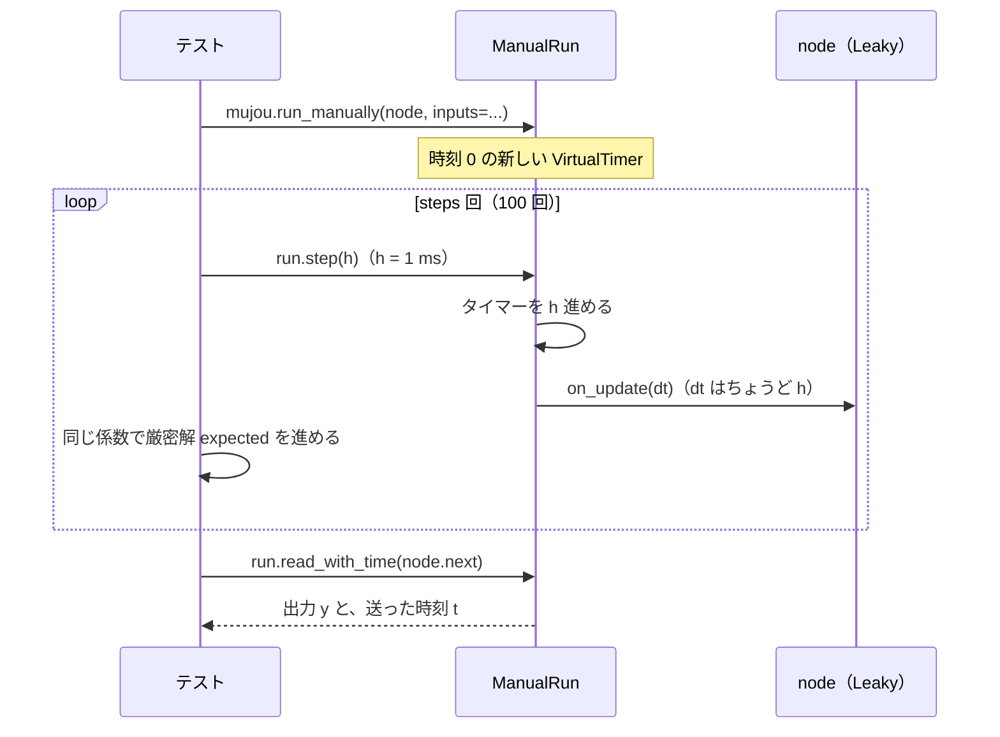
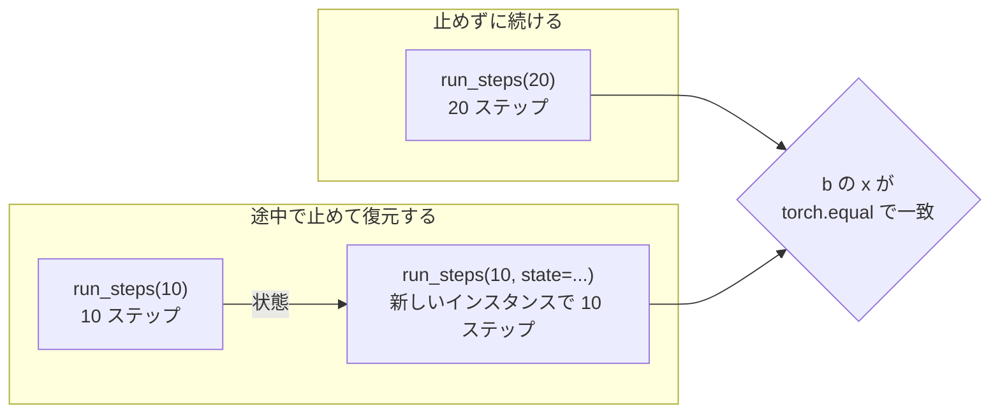
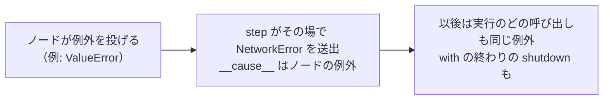

# 🧪 3. ノードをテストする

`mujou.run` では `dt` が実時間で決まり、更新の順序も毎回違うため、結果は毎回わずかに変わる。このページでは [2. ノードを書く](2-node.md) のノードを `mujou.run_manually` で走らせ、毎回同じ結果になるようにテストする。

!!! abstract "このページで分かること"

    - `mujou.run_manually` と `ManualRun.step` で、時間を手で進めてノードをテストする方法
    - `step(dt)` と `step(dt, *nodes)` で、ノードが読む値がどう違うか
    - 保存と復元、例外、決定的にするためのほかの条件

|              | `mujou.run`          | `mujou.run_manually` |
| ------------ | -------------------- | -------------------- |
| 時間を進める | 実時間の経過         | `step`               |
| `dt`         | 実時間の経過で決まる | `step` で進めた時間  |
| 更新の順序   | 毎回違う             | `step` が決める      |
| 周期         | 使う                 | 使わない             |
| 結果         | 毎回わずかに変わる   | 毎回同じ             |

## 道具

!!! abstract "要点"

    `mujou.run_manually` が `ManualRun` を返し、`ManualRun.step` が時間を進めてからノードを 1 回ずつ更新する。

| 名前                            | 役割                                                                                                                                                                                           |
| ------------------------------- | ---------------------------------------------------------------------------------------------------------------------------------------------------------------------------------------------- |
| `mujou.run_manually(root, ...)` | `mujou.run` の `timer`・`inputs`・`state`・`workers` を受け取って木を走らせ、`ManualRun` を返す。ノードは `step` が更新するまで更新しない。既定では新しい `mujou.time.VirtualTimer` の上で走る |
| `ManualRun.step(dt)`            | タイマーを `dt` 秒進めてから、全ノードを同時に 1 回ずつ更新する                                                                                                                                |
| `ManualRun.step(dt, *nodes)`    | タイマーを `dt` 秒進めてから、渡したノードだけを渡した順に 1 回ずつ更新する                                                                                                                    |
| `ManualRun.timer`               | 実行の `VirtualTimer`                                                                                                                                                                          |

`ManualRun` は `Run` なので、`write`・`read`・`state_dict` なども `mujou.run` と同じように使える。

## テスト

!!! abstract "要点"

    `run.step(h)` で時間を `h` 秒ずつ進め、出力を同じ係数で計算した厳密解と比べる。

```python
--8<-- "examples/test_leaky.py:test"
```

```sh
uv run pytest examples/test_leaky.py
```



| ポイント         | 内容                                                                                   |
| ---------------- | -------------------------------------------------------------------------------------- |
| `inputs`         | 開始時からの入力の Port の値                                                           |
| 各 `run.step(h)` | 時間を `h` 秒進めてから全ノードを 1 回ずつ更新。ノードの `dt` はちょうど `h`           |
| 値 `y`           | 同じ係数で計算した厳密解と `torch.testing.assert_close` で比べる                       |
| 時刻 `t`         | ちょうど `steps` ミリ秒（`t.ns == steps * 1_000_000`）。手動の実行には実時間が入らない |

!!! tip "`assert_close` と `torch.equal`"

    期待値がノードと同じ演算を同じ順に行うなら、`assert_close` の代わりに `torch.equal` でビット単位に比べられる。その例が次の節「更新の順序」のテスト。

## 更新の順序

!!! abstract "要点"

    `step(dt)` は全ノードを同時に、`step(dt, *nodes)` は渡したノードを渡した順に更新する。後のノードが読む値が違う。

```python
--8<-- "examples/test_leaky.py:chain"
```

=== "step(h)"

    ```mermaid
    sequenceDiagram
        participant R as ManualRun
        participant A as net.a
        participant B as net.b
        R->>R: タイマーを h 進める
        par 同時に
            R->>A: on_update(h)
        and
            R->>B: on_update(h)、ステップ開始時の a の値を読む
        end
        Note over A,B: このステップで送った値は次のステップで届く
    ```

=== "step(h, net.a, net.b)"

    ```mermaid
    sequenceDiagram
        participant R as ManualRun
        participant A as net.a
        participant B as net.b
        R->>R: タイマーを h 進める
        R->>A: on_update(h)
        A-->>B: このステップで送った値
        R->>B: on_update(h)、a がこのステップで送った値を読む
    ```

=== "step(h, net.b, net.a)"

    ```mermaid
    sequenceDiagram
        participant R as ManualRun
        participant A as net.a
        participant B as net.b
        R->>R: タイマーを h 進める
        R->>B: on_update(h)、a が前のステップで送った値を読む
        R->>A: on_update(h)
    ```

| 呼び出し           | 更新するノード                         | 読む値                                                                       |
| ------------------ | -------------------------------------- | ---------------------------------------------------------------------------- |
| `step(dt)`         | 全ノードを同時に（実行のワーカーで）   | ステップ開始時の値。ステップ中に送った値がほかのノードに届くのは次のステップ |
| `step(dt, *nodes)` | 渡したノードだけを、1 つずつ渡した順に | 後のノードは、前のノードがこのステップで送った値                             |

全ノードを `step(dt, *nodes)` に渡しても、`step(dt)` と同じにはならない。

| メッセージの流れ             | `step(dt)` と一致する順                                                                |
| ---------------------------- | -------------------------------------------------------------------------------------- |
| 出力の方向にだけ流れる chain | 出力側から入力側への順（`test_a_step_without_nodes_equals_the_order_from_the_output`） |
| 逆向きにも流れる             | 一般にはどの順とも一致しない                                                           |

| 細かい規則                      | ふるまい                                           |
| ------------------------------- | -------------------------------------------------- |
| ノードの `dt`                   | 前回の更新からの時間。最初は実行の開始から         |
| 同じ `step` に 2 回渡したノード | 1 回だけ更新。2 回目は時刻が進んでいないので飛ばす |
| ノードの周期                    | 手動の実行では使わない                             |

## 保存と復元

!!! abstract "要点"

    途中で状態を取得し、新しいインスタンスで続けた結果は、止めずに続けた結果とビット単位で一致する。



```python
--8<-- "examples/test_leaky.py:restore"
```

状態から復元した実行は、時刻 0 ではなく、その状態の時刻から始まる自分の `VirtualTimer` で走る。

## 例外

!!! abstract "要点"

    ノードが例外を投げると、`step` は `NetworkError` を送出する。`pytest.raises` は同じ `with` 文に並べ、ブロック全体を囲む。



=== "避ける"

    ```python
    with mujou.run_manually(net) as run:
        with pytest.raises(NetworkError):
            run.step(0.001)  # ここでノードが ValueError を投げる
    # with ブロックの終わりの shutdown が同じ NetworkError を再び送出する
    ```

=== "こう書く"

    ```python
    from mujou import NetworkError

    with pytest.raises(NetworkError) as info, mujou.run_manually(net) as run:
        run.step(0.001)  # ここでノードが ValueError を投げる
    assert isinstance(info.value.__cause__, ValueError)
    ```

ノードが例外を投げると `step` はその場で `NetworkError` を送出し、その `__cause__` にノードの例外が入る。以後は `with` ブロックの終わりの `shutdown` を含め、実行のどの呼び出しも同じ例外を送出する。そのため `pytest.raises` は、ブロック全体を囲むように同じ `with` 文に並べる。

## 決定的にするためのほかの条件

!!! abstract "要点"

    乱数、共有するオブジェクト、時間の進め方、複数の実行のタイマーをそろえる。

| 条件                           | こうする                                                                                                                                            | 理由・注意                                                                                                                             |
| ------------------------------ | --------------------------------------------------------------------------------------------------------------------------------------------------- | -------------------------------------------------------------------------------------------------------------------------------------- |
| 乱数                           | ノードに `seed` を渡し、乱数は `self.generator` から引く（[スレッドとデバイス](../topics/threads-and-devices.md#seed-%E3%81%A8%E4%B9%B1%E6%95%B0)） | ―                                                                                                                                      |
| 変更する Python のオブジェクト | ノード同士で共有しない。避けられないなら `step(dt, *nodes)` で順を固定して更新する                                                                  | `step(dt)` はノードを同時に更新するので、どちらが先に動いたかで結果が変わる                                                            |
| 時間                           | `step` でだけ進める                                                                                                                                 | `step` を呼ばなければ何も送られない。`step` を呼ぶスレッドで `timeout` なしに `wait_for` や `subscribe` で待つと、いつまでも終わらない |
| 複数の実行                     | `mujou.time.VirtualTimer()` を作り、同じものを各実行に渡す                                                                                          | 1 本の時間軸に載り、1 つの実行の `step` でほかも進む                                                                                   |

=== "避ける"

    ```python
    with mujou.run_manually(node, inputs={node.prev: one}) as run:
        # step を呼ぶスレッドで timeout なしに待つ: 何も送られず、終わらない
        y, t = run.wait_for(node.next, lambda y: y.item() > 0.5)
    ```

=== "こう書く"

    ```python
    with mujou.run_manually(node, inputs={node.prev: one}) as run:
        while run.read(node.next).item() <= 0.5:
            run.step(0.001)  # 時間は step でだけ進む
    ```

```python
timer = mujou.time.VirtualTimer()  # 複数の実行で 1 本の時間軸を共有する
with (
    mujou.run_manually(a, timer=timer) as run_a,
    mujou.run_manually(b, timer=timer) as run_b,
):
    run_a.step(0.001)  # run_b のタイマーも 1 ms 進む
```

## 次へ

- 学習するノード: [4. ノードの中で学習する](4-learn-in-a-node.md)
- 手動の実行の仕組みとシミュレーションの方法: [シミュレーション](../topics/simulation.md)
