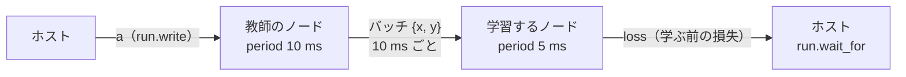
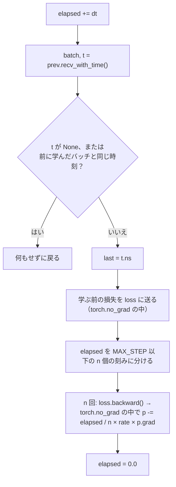
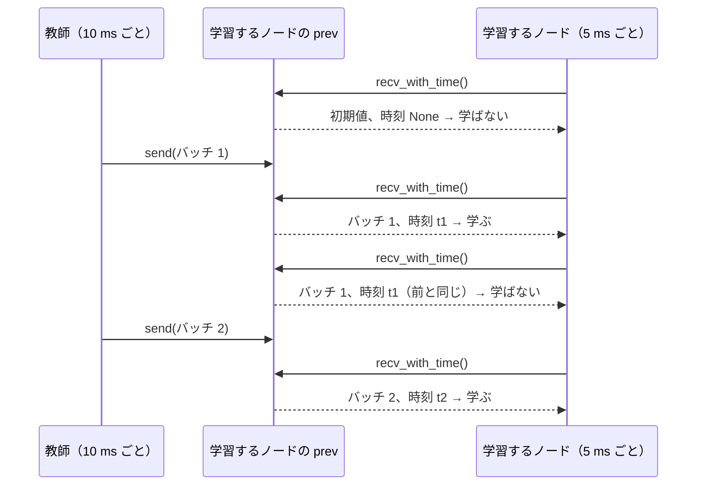
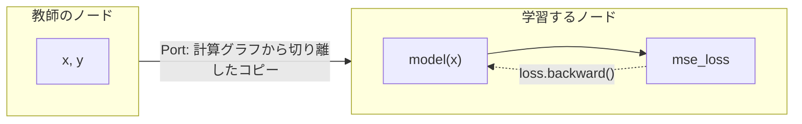
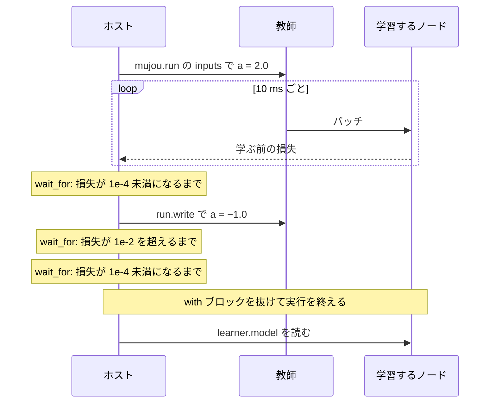

# 🔥 4. ノードの中で学習する

このページでは、ノードの内側で誤差逆伝播法（BP）によって学ぶノードを書く。相手は実行中に目標が変わっていくストリームで、学習と推論の段階は無い。ノードは新しいバッチが届くたびに予測し、学ぶ。

!!! abstract "このページで分かること"

    - ノードの中の BP（`loss.backward()`）で、ストリームから学び続けるノードの書き方
    - 学ぶ量をバッチの数ではなく経過時間で決める書き方
    - 学習するノードの状態（モジュール・seed・`register_state`）
    - ホストが実行の途中で目標を変え、損失を追う方法

    前提は [2. ノードを書く](2-node.md)。

## プログラム

!!! abstract "要点"

    教師のノードが $y = a x + b$ のバッチを送り、ホストは実行の途中で `a` を変える。学習するノードはモードを切り替えずに学び続ける。



教師のノードは、ホストが書く `a` を使い、$y = a x + b$（8 サンプル、b = 0.5）のバッチを 10 ms ごとに送る。ホストは実行の途中で `a` を 2.0 から −1.0 に変える。学習するノードの損失は下がり、目標が変わると跳ね上がり、また下がる。

```sh
uv run python examples/online_learning.py
```

```text
t = 0.48 s: loss = 0.000090  (learned a = 2.0)
t = 0.49 s: loss = 3.405589  (a changed at 0.48 s)
t = 0.97 s: loss = 0.000095  (learned a = -1.0)
the learner's weight = -0.988, bias = 0.498
```

<figure class="mujou-diagram">
<svg viewBox="0 0 640 190" role="img" aria-label="学ぶ前の損失の動き。最初は大きく、a = 2.0 を学ぶにつれて下がる。0.48 秒にホストが a を -1.0 に変えると跳ね上がり、a = -1.0 を学ぶにつれてまた下がる">
<line class="mujou-axis" x1="70" y1="150" x2="620" y2="150"/>
<line class="mujou-axis" x1="70" y1="24" x2="70" y2="150"/>
<text class="mujou-label" x="76" y="20">学ぶ前の損失</text>
<line class="mujou-lane" x1="322" y1="34" x2="322" y2="150" style="stroke-dasharray: 4 3"/>
<text class="mujou-note" x="330" y="40">ホストが a を −1.0 に変える</text>
<path class="mujou-brace" style="stroke: var(--md-typeset-a-color); stroke-width: 2.5" d="M 76 44 C 126 132, 206 145, 320 147 L 325 48 C 375 132, 455 145, 574 147"/>
<text class="mujou-label" x="190" y="96" text-anchor="middle">a = 2.0 を学ぶ</text>
<text class="mujou-label" x="455" y="96" text-anchor="middle">a = −1.0 を学ぶ</text>
<line class="mujou-axis" x1="320" y1="150" x2="320" y2="156"/>
<line class="mujou-axis" x1="574" y1="150" x2="574" y2="156"/>
<text class="mujou-note" x="70" y="170" text-anchor="middle">0</text>
<text class="mujou-note" x="320" y="170" text-anchor="middle">0.48 s</text>
<text class="mujou-note" x="574" y="170" text-anchor="middle">0.97 s</text>
<text class="mujou-label" x="620" y="186" text-anchor="end">実行のタイマー →</text>
</svg>
<figcaption>上の出力をもとにした模式図。損失が 1e-4 を下回るとホストは <code>a</code> を変え、同じノードがそのまま学び直す</figcaption>
</figure>

## 学習するノード

!!! abstract "要点"

    BP は通常の PyTorch と同じく `on_update` の中に書く。どれだけ学ぶかは、バッチの数ではなく前に学んでからの時間で決める。

```python
--8<-- "examples/online_learning.py:node"
```

1 回の `on_update(dt)` の流れ。



### 状態になるもの

| 属性             | 中身                                | 状態への入り方                     |
| ---------------- | ----------------------------------- | ---------------------------------- |
| `self.model`     | `nn.Linear(1, 1)`。`mujou.Stateful` | 自動（テンソルの属性と同じ）       |
| `self.generator` | ノード専用の乱数生成器。`seed=0`    | 自動                               |
| `self.last`      | 前に学んだバッチの時刻（ns）        | `register_state("last")` で登録    |
| `self.elapsed`   | 前に学んでからの秒                  | `register_state("elapsed")` で登録 |
| `self.rate`      | 学習の速さ。変わらない設定          | 入らない                           |

`last` と `elapsed` は実行中に変わるが、テンソルでもモジュールでもない。`register_state` で登録すると、ほかの状態と一緒に保存・復元される。

### 重みは self.generator で初期化する

`self.generator` は `seed=0` のノード専用の乱数生成器で、seed が再現するのはこの生成器だけ。`nn.Linear` の既定の初期化は全ノード共有の生成器を使うので、重みは `self.generator` で初期化し直す。

=== "避ける"

    ```python
    self.model = nn.Linear(1, 1)  # 全ノードが共有する生成器で初期化される
    ```

=== "こう書く"

    ```python
    self.model = nn.Linear(1, 1)
    nn.init.normal_(self.model.weight, std=0.1, generator=self.generator)
    nn.init.zeros_(self.model.bias)
    ```

### 新しいバッチから 1 回だけ学ぶ



`recv_with_time()` はバッチを送られた時刻と一緒に返す。教師が最初に送るまで時刻は `None`、次に送るまで時刻は変わらないので、学習するノードは各バッチから 1 回だけ学ぶ。

### 勾配は通常の PyTorch と同じ

| 計算                         | 書き方                                          | 計算グラフ                       |
| ---------------------------- | ----------------------------------------------- | -------------------------------- |
| 学ぶ前の損失（送るためだけ） | `torch.no_grad()` の中                          | 要らない                         |
| 学ぶための損失               | ふつうに計算し `loss.backward()`                | 記録する。`p.grad` が埋まる      |
| パラメータの更新             | `torch.no_grad()` の中で `p -= ...`（その場で） | 要らない。更新後 `p.grad = None` |



ノードの hook は通常の PyTorch と同じく勾配を記録する。BP はノードの中に閉じる。Port は計算グラフから切り離したコピーを送るので、勾配がノードをまたぐことはない。

### バッチの数ではなく時間で学ぶ

学習するノードは、バッチごとの固定の刻みではなく、前に学んでからの時間 `elapsed` だけ勾配流をたどる。どれだけ学ぶかはノードが何回回ったかではなく時間で決まる。学ぶ速さ `rate` はこの例で 5.0。

$$
\frac{dW}{dt} = -\text{rate}\,\frac{\partial L}{\partial W}
$$

|                    | バッチごとに固定の刻み | 経過時間 `elapsed` だけ進む（この例）  |
| ------------------ | ---------------------- | -------------------------------------- |
| 1 回の学習で動く量 | 一定の学習率 × 勾配    | `elapsed` × `rate` × 勾配              |
| 学ぶ量を決めるもの | ノードが何回回ったか   | 経った時間                             |
| 長い間隔           | —                      | `MAX_STEP` 以下の `n` 個の刻みに分ける |

<figure class="mujou-diagram">
<svg viewBox="0 0 640 130" role="img" aria-label="25 ミリ秒の elapsed を、MAX_STEP の 10 ミリ秒以下の 3 つの等しい刻みに分ける例">
<path class="mujou-brace" d="M 80 38 Q 80 30 88 30 L 572 30 Q 580 30 580 38"/>
<text class="mujou-label" x="330" y="22" text-anchor="middle">elapsed = 25 ms（例）</text>
<line class="mujou-axis" x1="80" y1="70" x2="580" y2="70"/>
<g class="mujou-tick-a"><line x1="80" y1="58" x2="80" y2="82"/><line x1="247" y1="58" x2="247" y2="82"/><line x1="413" y1="58" x2="413" y2="82"/><line x1="580" y1="58" x2="580" y2="82"/></g>
<text class="mujou-note" x="163" y="54" text-anchor="middle">刻み 1 ≈ 8.3 ms</text>
<text class="mujou-note" x="330" y="54" text-anchor="middle">刻み 2 ≈ 8.3 ms</text>
<text class="mujou-note" x="497" y="54" text-anchor="middle">刻み 3 ≈ 8.3 ms</text>
<path class="mujou-brace" d="M 80 92 Q 80 100 88 100 L 272 100 Q 280 100 280 92"/>
<text class="mujou-note" x="180" y="118" text-anchor="middle">MAX_STEP = 10 ms</text>
<text class="mujou-label" x="440" y="118" text-anchor="middle">n = ceil(25 / 10) = 3</text>
</svg>
<figcaption><code>n = max(1, ceil(elapsed / MAX_STEP))</code> 個の等しい刻みに分け、各刻みで陽的 Euler 法の 1 歩を進める</figcaption>
</figure>

??? question "刻みを分けるのはなぜ？"

    陽的 Euler 法は 1 歩が長すぎると発散しうる。長い `elapsed` は `MAX_STEP`（0.01 秒）以下の刻みに分け、ノードの更新が遅れて `elapsed` が伸びても発散しないようにする。

## torch の設定

!!! abstract "要点"

    プロセス全体の設定は、ホストが実行の前に決める。ノードが変えてよいのは自分のスレッドの設定だけ。

```python
--8<-- "examples/online_learning.py:threads"
```

| 設定                                   | 決めるもの | いつ                                   |
| -------------------------------------- | ---------- | -------------------------------------- |
| プロセス全体（torch のスレッド数など） | ホスト     | 実行の前                               |
| 自分のスレッドの設定                   | ノード     | hook の中で変え、hook を抜ける前に戻す |

??? question "スレッド数を 1 にするのはなぜ？"

    ノードは実行のワーカースレッドで計算し、torch はその上に自分のスレッドをさらに足す。スレッドを少なく保つため、ホストが実行の前に `torch.set_num_threads(1)` にする。詳しくは [スレッドとデバイス](../topics/threads-and-devices.md)。

## 実行

!!! abstract "要点"

    ホストは `run.wait_for` で損失を追い、`run.write` で途中から目標を変える。学習の段階を切り替える操作は無い。

```python
--8<-- "examples/online_learning.py:run"
```



| `run.wait_for` で待つもの  | 条件        | `timeout`   |
| -------------------------- | ----------- | ----------- |
| `a = 2.0` を学び終える     | 損失 < 1e-4 | 実時間 5 秒 |
| `a` を変えた後の跳ね上がり | 損失 > 1e-2 | 実時間 5 秒 |
| `a = -1.0` を学び終える    | 損失 < 1e-4 | 実時間 5 秒 |

`run.wait_for` は条件を満たすまで損失の Port を追い、値と送った時刻を返す。Port の初期値は inf で、教師のバッチから計算した損失が届くまで時刻は `None`。学ぶ速さは時間で決まるので、各段階に実時間で最大 5 秒を与える。実行が終わった後は、ノードの属性をホストが読んでよい。`learner.model` が学習したモジュールで、出力例では weight = −0.988、bias = 0.498（目標は a = −1.0、b = 0.5）。

## 次へ

- ノードをまたいで学ぶ則と、経路に沿って運ぶ目標: [更新則](../topics/update-rules.md)
- PC-ALM、`mujou.pc` のノード: [5. PC-ALM で学習する](5-learn-with-pc.md)
