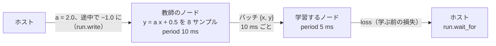
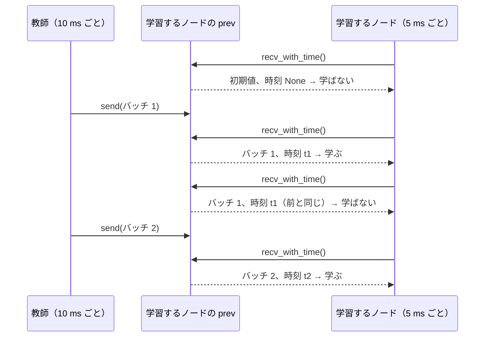

# 🔥 4. ノードの中で学習する

目標が実行中に変わるストリームから学び続けるノードを、ノードの内側の誤差逆伝播法（BP、`loss.backward()`）で書く。学ぶ量はバッチの数でなく時間で決める。前提は [2. ノードを書く](2-node.md)。

## プログラム {#program}



```sh
uv run python examples/online_learning.py
```

```text
t = 0.48 s: loss = 0.000090  (learned a = 2.0)
t = 0.49 s: loss = 3.405589  (a changed at 0.48 s)
t = 0.97 s: loss = 0.000095  (learned a = -1.0)
the learner's weight = -0.988, bias = 0.498
```

## 学習するノード {#node}

```python
--8<-- "examples/online_learning.py:node"
```

| この例で使う書き方                                                                                                   | 理由                                                                               | 詳しく                                                      |
| -------------------------------------------------------------------------------------------------------------------- | ---------------------------------------------------------------------------------- | ----------------------------------------------------------- |
| `model` と `generator` は自動で、`last` と `elapsed` は [`register_state`][mujou.Node.register_state] で状態に入れる | 再開したときに学習の途中から続けるため                                             | [自分の値を状態に入れる](6-save-and-resume.md#custom-state) |
| 重みを `self.generator` で初期化し直す                                                                               | `nn.Linear` の既定の初期化は全ノードで共有するグローバルな乱数を使い、再現できない | [seed と乱数](../topics/threads-and-devices.md#seed)        |
| [`recv_with_time`][mujou.Port.recv_with_time] の時刻を前回と比べ、新しいバッチから 1 回だけ学ぶ                      | 学習するノードは教師より速く回り、同じバッチを何度も読む                           | [新しい値か読み直しか](../topics/ports.md#new-or-reread)    |
| 勾配は通常の PyTorch で求め、計算グラフは 1 回の更新の中に閉じる                                                     | ノードをまたいでグラフをつなぐと局所性が壊れる                                     | [ノードが守る規則](../concepts.md#rules)                    |



### 時間で学ぶ {#learn-by-time}

学習するノードは、バッチごとの固定の刻みでなく前に学んでからの時間 `elapsed` だけ勾配流をたどるので、学ぶ量は回数でなく経った時間で決まる（この例では `rate` = 5.0、`MAX_STEP` = 0.01 秒）。

$$
\frac{dW}{dt} = -\text{rate}\,\frac{\partial L}{\partial W}
$$

<figure class="mujou-diagram">
<svg viewBox="0 0 640 130" role="img" aria-label="25 ミリ秒の elapsed を、MAX_STEP の 10 ミリ秒以下の 3 つの等しい刻みに分ける例">
<path class="mujou-brace" d="M 80 38 Q 80 30 88 30 L 572 30 Q 580 30 580 38"/>
<text class="mujou-label" x="330" y="22" text-anchor="middle">elapsed = 25 ms（例）</text>
<line class="mujou-axis" x1="80" y1="70" x2="580" y2="70"/>
<g class="mujou-tick-a"><line x1="80" y1="58" x2="80" y2="82"/><line x1="247" y1="58" x2="247" y2="82"/><line x1="413" y1="58" x2="413" y2="82"/><line x1="580" y1="58" x2="580" y2="82"/></g>
<text class="mujou-note" x="163" y="54" text-anchor="middle">刻み 1 ≈ 8.3 ms</text>
<text class="mujou-note" x="330" y="54" text-anchor="middle">刻み 2 ≈ 8.3 ms</text>
<text class="mujou-note" x="497" y="54" text-anchor="middle">刻み 3 ≈ 8.3 ms</text>
<path class="mujou-brace" d="M 80 92 Q 80 100 88 100 L 272 100 Q 280 100 280 92"/>
<text class="mujou-note" x="180" y="118" text-anchor="middle">MAX_STEP = 10 ms</text>
<text class="mujou-label" x="440" y="118" text-anchor="middle">n = ceil(25 / 10) = 3</text>
</svg>
<figcaption><code>n = max(1, ceil(elapsed / MAX_STEP))</code> 個の等しい刻みに分け、各刻みで陽的 Euler 法の 1 歩を進める</figcaption>
</figure>

## 実行 {#run}

```python
--8<-- "examples/online_learning.py:run"
```

ホストは [`wait_for`][mujou.Run.wait_for] で損失を追い、[`write`][mujou.Run.write] で途中から目標の `a` を変える。学習と推論のモードを切り替える操作は無い。

torch のスレッド数（この例では `torch.set_num_threads(1)`）はプロセス全体の設定なので、ホストが実行の前に決める（[プロセス全体の設定](../topics/threads-and-devices.md#process-settings)）。

## 次へ

- ノードをまたいで学ぶ則と、経路に沿って運ぶ目標: [更新則](../topics/update-rules.md)
- `mujou.pc` のノードで学ぶ: [5. PC-ALM で学習する](5-learn-with-pc.md)
