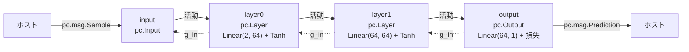
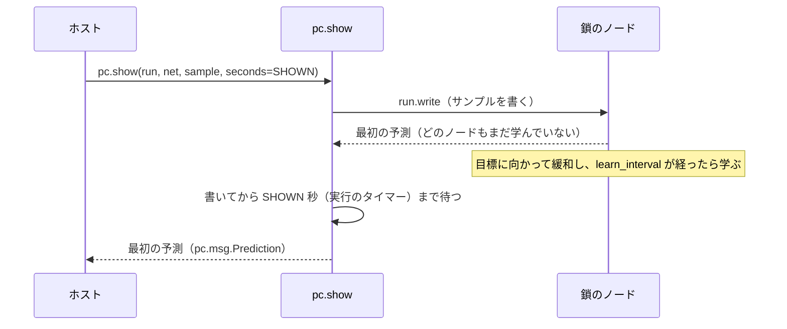

# 🧠 5. PC-ALM で学習する

`mujou.pc` は PyTorch のモデルをノードに分け、PC-ALM（Augmented Lagrangian Predictive Coding、<https://pub.sakana.ai/pc-alm/>）で学習させるモジュールである。各ノードはモデルの一部を持ち、隣のノードのメッセージだけから学ぶ。平衡点では、その勾配が誤差逆伝播法（BP）の勾配と一致する。このページでは回帰を学習させる。

!!! abstract "このページで分かること"

    - `pc.Chain` で `nn.Sequential` と同じ順のモジュールを PC-ALM のノードの鎖にする方法
    - 決める値（時定数・重みの optimizer・学ぶ時刻・見せる時間）とその意味
    - `pc.show` でバッチを見せて学ばせ、学ぶ前の予測で損失を測る方法

    前提は [4. ノードの中で学習する](4-learn-in-a-node.md)。

モデル・spec・損失のほかに決める値は次の 4 つだけ。

| 決めるもの             | 引数                           | この例                                       |
| ---------------------- | ------------------------------ | -------------------------------------------- |
| 活動と双対変数の時定数 | `pc.Chain(tau=...)`            | `pc.TimeConstants(h=4e-3, lam=2e-3, r=4e-3)` |
| 重みの optimizer       | `pc.Chain(optimizer=...)`      | `pc.optim.SGD(tau=SHOWN / 0.3)`              |
| 学ぶ時刻               | `pc.Chain(learn_interval=...)` | `0.75 * SHOWN`                               |
| 各バッチを見せる時間   | `pc.show(..., seconds=...)`    | `SHOWN = 0.032`（秒）                        |

## プログラム

!!! abstract "要点"

    32 サンプルずつのバッチのストリームから $y = \sin(2 x_1)\cos(x_2)$ を学ぶ。学ぶ前の損失は約 0.4 から 0.01 未満に下がる。

```sh
uv run python examples/pc_regression.py
```

```text
batch   1: loss 0.4157 (the mean of the last 1)
batch  50: loss 0.1686 (the mean of the last 50)
...
batch 300: loss 0.0043 (the mean of the last 50)
```

## 鎖

!!! abstract "要点"

    `pc.Chain` はモジュールごとにノードを 1 つ作り、`nn.Sequential` が計算する順につなぐ。

```python
--8<-- "examples/pc_regression.py:chain"
```



実線は活動を前へ送り、点線は勾配 `g_in` を後ろへ送り返す。各ノードは隣のノードとのメッセージだけでやり取りする。

| 子（状態のパス） | クラス      | 持つもの                            |
| ---------------- | ----------- | ----------------------------------- |
| `input`          | `pc.Input`  | サンプルを受け取る                  |
| `layer0`         | `pc.Layer`  | 1 つ目のモジュール。`net.layers[0]` |
| `layer1`         | `pc.Layer`  | 2 つ目のモジュール。`net.layers[1]` |
| `output`         | `pc.Output` | 最後のモジュールと損失              |

最後以外のモジュールは `pc.Layer` になり、最後のモジュールは損失を持つ `pc.Output` になる。子の名前 `input`・`layer0`・`layer1`・`output` がそのまま状態のパスになり、層は `net.layers` で順に取れる。

### 引数

| 引数             | 意味                                         | この例                                       | 既定値                        |
| ---------------- | -------------------------------------------- | -------------------------------------------- | ----------------------------- |
| `x`・`y`         | 入力と目標の spec                            | `TensorSpec((B, 2))`・`TensorSpec((B, 1))`   | 無し                          |
| `batch`          | spec の先頭の shape                          | `B`（32 サンプル）                           | `()`（1 サンプルずつ）        |
| `loss`           | サンプルごとの損失。バッチの shape で返す    | `pc.loss.MSELoss(B)`                         | 無し                          |
| `tau`            | 活動と双対変数の時定数（実行のタイマーの秒） | `pc.TimeConstants(h=4e-3, lam=2e-3, r=4e-3)` | 無し                          |
| `optimizer`      | ノードが学ぶときの重みの動かし方             | `pc.optim.SGD(tau=SHOWN / 0.3)`              | 無し                          |
| `learn_interval` | 各書き込みから数えた、ノードが学ぶ時刻       | `0.75 * SHOWN`                               | 無し（`None` も明示して渡す） |

### batch と loss

|              | `batch=B`（この例）                | `batch` を省く                  |
| ------------ | ---------------------------------- | ------------------------------- |
| 受け取るもの | `B` 個のサンプル                   | サンプル 1 つずつ               |
| `x`          | `TensorSpec((B, 2))`               | `TensorSpec((2,))`              |
| `y`          | `TensorSpec((B, 1))`               | `TensorSpec((1,))`              |
| `loss`       | `pc.loss.MSELoss(B)`。shape `(B,)` | `pc.loss.MSELoss()`。shape `()` |

| 損失                          | 返すもの                                                              |
| ----------------------------- | --------------------------------------------------------------------- |
| `pc.loss.MSELoss(B)`          | サンプルごとの平均二乗誤差。`nn.MSELoss` と同じくサンプルの次元で平均 |
| `pc.loss.CrossEntropyLoss(B)` | サンプルごとの交差エントロピー                                        |
| 自作の関数                    | 同じ shape（バッチの shape）の、サンプルごとの損失                    |

損失には鎖と同じバッチを渡す。詳しくは [バッチ](../topics/pc.md#%E3%83%90%E3%83%83%E3%83%81)。

### tau: 活動と双対変数の時定数

| フィールド | 何の時定数       | この例          |
| ---------- | ---------------- | --------------- |
| `h`        | 活動             | 4e-3 秒         |
| `lam`      | 双対変数         | 2e-3 秒         |
| `r`        | ずれの減衰       | 4e-3 秒         |
| （重み）   | optimizer が持つ | `optimizer.tau` |

鎖のどのノードも `tau.period` ごとに更新する。`tau.r = tau.h` のとき `tau.period` は `tau.h / 2` になり、この例では 2 ms。この組では credit が 1 ホップ（ノード間の接続 1 つ）を最大 1 周期で戻る。重みの時定数は `tau` ではなく optimizer が持つ。

### optimizer: 重みの動かし方

$$
\theta \leftarrow \theta - \frac{\Delta t}{\tau}\,\bar g
$$

| 記号              | 意味                             | この例                           |
| ----------------- | -------------------------------- | -------------------------------- |
| $\Delta t$        | そのノードが前に学んでからの時間 | `SHOWN`（バッチごとに 1 回学ぶ） |
| $\tau$            | 重みの時定数（`optimizer.tau`）  | `SHOWN / 0.3`                    |
| $\bar g$          | バッチの平均の勾配               | —                                |
| $\Delta t / \tau$ | 1 バッチあたりの学習率           | 0.3                              |

| optimizer               | 内容                                                                                           |
| ----------------------- | ---------------------------------------------------------------------------------------------- |
| `pc.optim.SGD(tau=...)` | 勾配降下。`tau` は重みの時定数                                                                 |
| `pc.optim.AdamW`        | もう 1 つの選択肢（[optimizer を選ぶ](../topics/pc.md#optimizer-%E3%82%92%E9%81%B8%E3%81%B6)） |

各ノードは optimizer を自分の重みに結び付けるため、1 つの `pc.optim.SGD` を鎖全体で使える。`optimizer` に既定値は無い。

### learn_interval: 学ぶ時刻

| 値                            | ノードが学ぶとき                                                                     | 向くもの                                                       |
| ----------------------------- | ------------------------------------------------------------------------------------ | -------------------------------------------------------------- |
| 秒数（この例 `0.75 * SHOWN`） | 各書き込みからその時間が経った時点以降の最初の更新。入力が変わらない間はその間隔ごと | バッチを一定時間ずつ見せる。この例ではバッチごとに 1 回        |
| `None`                        | 毎回の更新                                                                           | フレームごとに入力が変わるストリーム。よい値はまだ測っていない |

<figure class="mujou-diagram">
<svg viewBox="0 0 640 175" role="img" aria-label="1 つのバッチを見せる 32 ミリ秒の流れ。0 ミリ秒に書き込み、ノードは 2 ミリ秒ごとに更新し、最初の予測は学ぶ前に届き、24 ミリ秒の後の最初の更新で学び、32 ミリ秒で pc.show が返る">
<line class="mujou-axis" x1="70" y1="140" x2="615" y2="140"/>
<g class="mujou-tick-a"><line x1="80" y1="40" x2="80" y2="140"/><line x1="464" y1="40" x2="464" y2="140"/><line x1="592" y1="22" x2="592" y2="140"/></g>
<text class="mujou-label" x="86" y="34">書き込み</text>
<text class="mujou-label" x="464" y="34" text-anchor="middle">学ぶ</text>
<text class="mujou-label" x="592" y="16" text-anchor="end">pc.show が返る</text>
<text class="mujou-note" x="96" y="66">最初の予測が届く（まだ学んでいない）</text>
<text class="mujou-note" x="10" y="99">各ノード</text>
<line class="mujou-lane" x1="80" y1="95" x2="600" y2="95"/>
<g class="mujou-tick-b"><line x1="112" y1="85" x2="112" y2="105"/><line x1="144" y1="85" x2="144" y2="105"/><line x1="176" y1="85" x2="176" y2="105"/><line x1="208" y1="85" x2="208" y2="105"/><line x1="240" y1="85" x2="240" y2="105"/><line x1="272" y1="85" x2="272" y2="105"/><line x1="304" y1="85" x2="304" y2="105"/><line x1="336" y1="85" x2="336" y2="105"/><line x1="368" y1="85" x2="368" y2="105"/><line x1="400" y1="85" x2="400" y2="105"/><line x1="432" y1="85" x2="432" y2="105"/><line x1="496" y1="85" x2="496" y2="105"/><line x1="528" y1="85" x2="528" y2="105"/><line x1="560" y1="85" x2="560" y2="105"/></g>
<path class="mujou-brace" d="M 112 110 Q 112 116 118 116 L 138 116 Q 144 116 144 110"/>
<text class="mujou-note" x="150" y="126">tau.period = 2 ms</text>
<text class="mujou-note" x="80" y="156" text-anchor="middle">0</text>
<text class="mujou-note" x="464" y="156" text-anchor="middle">24 ms</text>
<text class="mujou-note" x="592" y="156" text-anchor="middle">32 ms</text>
<text class="mujou-label" x="615" y="172" text-anchor="end">実行のタイマー →</text>
</svg>
<figcaption>この例で 1 つのバッチを見せる 32 ms（<code>SHOWN</code>）。ノードは書き込みから <code>learn_interval</code> = 24 ms が経った時点以降の最初の更新で学ぶ。見せる間に学ぶのは 1 回</figcaption>
</figure>

!!! tip "`learn_interval` の目安"

    credit が鎖を往復する時間 `2 * len(modules) * period` より長くするとよい。この例では 2 × 3 × 2 ms = 12 ms で、24 ms はそれより長い。

### 重みの初期化

ノードの内側では BP と同じくモジュールを autograd で微分する。重みはモジュールを作るときに初期化し（この例では実行の前にホストで `torch.manual_seed(0)`）、ノードは初期化しない。

## 見せて学ぶ

!!! abstract "要点"

    `pc.show` はバッチを書き、実行のタイマーで `seconds` 秒見せ、学ぶ前の予測を返す。その間にノードは緩和し、学ぶ。

```python
--8<-- "examples/pc_regression.py:run"
```



`pc.show` が返す予測は、どのノードもまだそのバッチから学んでいない時点のもの。その損失は、まだ見ていないデータをどれだけ当てられるかを表す（prequential な損失）。

### Sample: 書くもの

| フィールド | 意味                         | この例                                | ほかの使い方                                  |
| ---------- | ---------------------------- | ------------------------------------- | --------------------------------------------- |
| `x`        | 入力                         | `(B, 2)`                              | —                                             |
| `y`        | 目標                         | `(B, 1)`                              | —                                             |
| `mask`     | どのサンプルに目標があるか   | すべて True                           | すべて False で評価。重みは動かず、活動は動く |
| `reset`    | どのサンプルが新しく始まるか | すべて True（バッチを毎回新しく引く） | フレームが続くストリームでは False            |

=== "学ぶ"

    ```python
    every = torch.ones(B, dtype=torch.bool)
    sample = pc.msg.Sample(x=x, y=y, mask=every, reset=every)
    ```

=== "評価する"

    ```python
    every = torch.ones(B, dtype=torch.bool)
    none = torch.zeros(B, dtype=torch.bool)
    sample = pc.msg.Sample(x=x, y=y, mask=none, reset=every)  # 重みは動かない
    ```

`mask` が False のサンプルは損失に何も足さず、すべて False なら重みは動かない（活動は動く）。実行中の同じ鎖を評価するにはこれを使い、推論モードへの切り替えは無い。`reset` が True のサンプルでは、ノードは前のバッチについて持っていたものを捨てる（詳しくは [新しく始めるサンプル](../topics/pc.md#reset)）。

### Prediction: 返るもの

| フィールド          | 中身                                       |
| ------------------- | ------------------------------------------ |
| `y_hat`             | 予測                                       |
| `y`・`mask`・`time` | 予測の元になったサンプルの目標・mask・時刻 |

`pc.msg.Prediction` は `y_hat` を、元になったサンプルの `y`・`mask`・`time` と組で持つため、予測はいつも自分の目標と対になる。

### ノードの状態をのぞく

```python
run.state_dict()["nodes"]["layer0"]["state"]  # 最初の層の状態
```

| キー          | 中身                                           |
| ------------- | ---------------------------------------------- |
| `"r"`         | 活動の予測からのずれ                           |
| `"lam"`       | 双対変数。平衡点では誤差逆伝播法の credit      |
| `"module"`    | モジュール                                     |
| `"clock"`     | クロック（いつ学ぶかを決める）                 |
| `"optimizer"` | optimizer                                      |
| `"relaxer"`   | relaxer                                        |
| `"generator"` | ノードの乱数生成器の状態（どのノードにもある） |

ノードが送る予測 `mu` は、ノードの状態ではなく Port `next` の状態にある（[mujou.pc の仕組み](../topics/pc-concepts.md#%E3%83%8E%E3%83%BC%E3%83%89%E3%81%8C%E6%8C%81%E3%81%A4%E9%87%8F)）。

## 次へ

- 部品のつながりと、ノードが 1 回の更新で行うこと: [mujou.pc の仕組み](../topics/pc-concepts.md)
- `pc.Chain` で MNIST を学ぶ 784-256-256-10 のネットワークと BP の比較: `examples/mnist/`（`uv run python examples/mnist/main.py`）。説明は [PC-ALM](../topics/pc.md#mnist)
- GPU の上の `pc.Chain` で CIFAR-10 を学ぶ ResNet-20 と BP の比較: `examples/cifar10/`（`uv run python examples/cifar10/main.py`）。説明は [PC-ALM](../topics/pc.md#cifar-10)
- 時定数・optimizer・`learn_interval` の決め方、落とし穴、自作のノード: [PC-ALM](../topics/pc.md)
