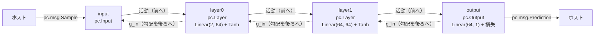

# 🧠 5. PC-ALM で学習する

[`mujou.pc`][mujou.pc] は PyTorch のモデルをノードに分け、PC-ALM（Augmented Lagrangian Predictive Coding、<https://pub.sakana.ai/pc-alm/>）で学ばせる。各ノードはモデルの一部を持ち、隣のノードとのメッセージだけから学ぶ。ここでは `pc.Chain` で回帰を学ばせる。前提は [4. ノードの中で学習する](4-learn-in-a-node.md)。

## プログラム {#program}

32 サンプルずつのバッチのストリームから $y = \sin(2 x_1)\cos(x_2)$ を学び、学ぶ前の約 0.4 の損失が 0.01 未満に下がる。

```sh
uv run python examples/pc_regression.py
```

```text
batch   1: loss 0.4157 (the mean of the last 1)
batch  50: loss 0.1686 (the mean of the last 50)
...
batch 300: loss 0.0043 (the mean of the last 50)
```

## 鎖 {#chain}

```python
--8<-- "examples/pc_regression.py:chain"
```



[`pc.Chain`][mujou.pc.Chain] の `batch=B` は `x`・`y` の spec の先頭の shape で、`loss` にも同じ `B` を渡すとサンプルごとの損失（shape `(B,)`）を返す（[バッチ](../topics/pc.md#batch)）。

## 値を決める {#values}

| 値                      | 何を決めるか                                     | この例                                                       | 決め方                                                  |
| ----------------------- | ------------------------------------------------ | ------------------------------------------------------------ | ------------------------------------------------------- |
| `tau`                   | 活動 `h` と、双対変数 `lam`・ずれ `r` の動く速さ | `pc.TimeConstants(h=4e-3, lam=2e-3, r=4e-3)`                 | [時定数を決める](../topics/pc.md#choose-time-constants) |
| `optimizer`             | 重みの動く速さ                                   | `pc.optim.SGD(tau=SHOWN / 0.3)`。1 バッチの学習率 Δt/τ = 0.3 | [optimizer を選ぶ](../topics/pc.md#optimizer)           |
| `learn_interval`        | 見せている間のいつ学ぶか                         | `0.75 * SHOWN`。書き込みから 24 ms の後                      | [時定数を決める](../topics/pc.md#choose-time-constants) |
| 見せる秒数（`seconds`） | 1 つのバッチを見せ続ける時間                     | `SHOWN = 0.032`                                              | [時定数を決める](../topics/pc.md#choose-time-constants) |

<figure class="mujou-diagram">
<svg viewBox="0 0 640 175" role="img" aria-label="1 つのバッチを見せる 32 ミリ秒の流れ。0 ミリ秒に書き込み、ノードは 2 ミリ秒ごとに更新し、最初の予測は学ぶ前に届き、24 ミリ秒の後の最初の更新で学び、32 ミリ秒で pc.show が返る">
<line class="mujou-axis" x1="70" y1="140" x2="615" y2="140"/>
<g class="mujou-tick-a"><line x1="80" y1="40" x2="80" y2="140"/><line x1="464" y1="40" x2="464" y2="140"/><line x1="592" y1="22" x2="592" y2="140"/></g>
<text class="mujou-label" x="86" y="34">書き込み</text>
<text class="mujou-label" x="464" y="34" text-anchor="middle">学ぶ</text>
<text class="mujou-label" x="592" y="16" text-anchor="end">pc.show が返る</text>
<text class="mujou-note" x="96" y="66">最初の予測が届く（まだ学んでいない）</text>
<text class="mujou-note" x="10" y="99">各ノード</text>
<line class="mujou-lane" x1="80" y1="95" x2="600" y2="95"/>
<g class="mujou-tick-b"><line x1="112" y1="85" x2="112" y2="105"/><line x1="144" y1="85" x2="144" y2="105"/><line x1="176" y1="85" x2="176" y2="105"/><line x1="208" y1="85" x2="208" y2="105"/><line x1="240" y1="85" x2="240" y2="105"/><line x1="272" y1="85" x2="272" y2="105"/><line x1="304" y1="85" x2="304" y2="105"/><line x1="336" y1="85" x2="336" y2="105"/><line x1="368" y1="85" x2="368" y2="105"/><line x1="400" y1="85" x2="400" y2="105"/><line x1="432" y1="85" x2="432" y2="105"/><line x1="496" y1="85" x2="496" y2="105"/><line x1="528" y1="85" x2="528" y2="105"/><line x1="560" y1="85" x2="560" y2="105"/></g>
<path class="mujou-brace" d="M 112 110 Q 112 116 118 116 L 138 116 Q 144 116 144 110"/>
<text class="mujou-note" x="150" y="126">tau.period = 2 ms</text>
<text class="mujou-note" x="80" y="156" text-anchor="middle">0</text>
<text class="mujou-note" x="464" y="156" text-anchor="middle">24 ms</text>
<text class="mujou-note" x="592" y="156" text-anchor="middle">32 ms</text>
<text class="mujou-label" x="615" y="172" text-anchor="end">実行のタイマー →</text>
</svg>
<figcaption>この例で 1 つのバッチを見せる 32 ms（<code>SHOWN</code>）。ノードは書き込みから <code>learn_interval</code> = 24 ms が経った後の最初の更新で、1 回だけ学ぶ</figcaption>
</figure>

重みはモジュールを作る時点（この例では実行の前にホストで `torch.manual_seed(0)`）で決まり、`mujou.pc` のノードは初期化し直さない。

## 見せて学ぶ {#show}

```python
--8<-- "examples/pc_regression.py:run"
```

[`pc.show`][mujou.pc.show] はどのノードもそのバッチから学ぶ前の予測を返すので、例の損失はまだ見ていないデータへの損失になる。

=== "学ぶ"

    ```python
    every = torch.ones(B, dtype=torch.bool)
    sample = pc.msg.Sample(x=x, y=y, mask=every, reset=every)
    ```

=== "評価する"

    ```python
    every = torch.ones(B, dtype=torch.bool)
    none = torch.zeros(B, dtype=torch.bool)
    sample = pc.msg.Sample(x=x, y=y, mask=none, reset=every)  # 重みは動かない
    ```

`mask` を全部 False にすると、実行中の同じ鎖が学ばずに評価する。推論モードへの切り替えは無い。この例はバッチを毎回新しく引き、どのサンプルも前のサンプルに続かないので、`reset=every`（全部 True）でノードが前のバッチについて持っていた `r`・`lam` を 0 に戻させる（[新しく始めるサンプル](../topics/pc.md#reset)）。

例の最後の `run.state_dict()["nodes"]["layer0"]["state"]` のように、ノードの状態はパスで取り出せ、キーは [`pc.Layer`][mujou.pc.Layer] にある。

## 次へ

- 部品のつながりと、ノードが 1 回の更新で行うこと: [mujou.pc の仕組み](../topics/pc-concepts.md)
- 値の決め方・落とし穴・自作のノード: [PC-ALM](../topics/pc.md)
- MNIST・CIFAR-10 で BP と比べる: [PC-ALM の実験](../topics/pc-benchmarks.md)
