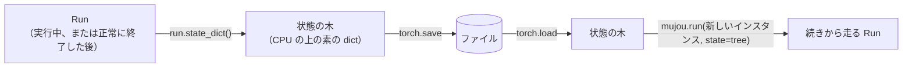
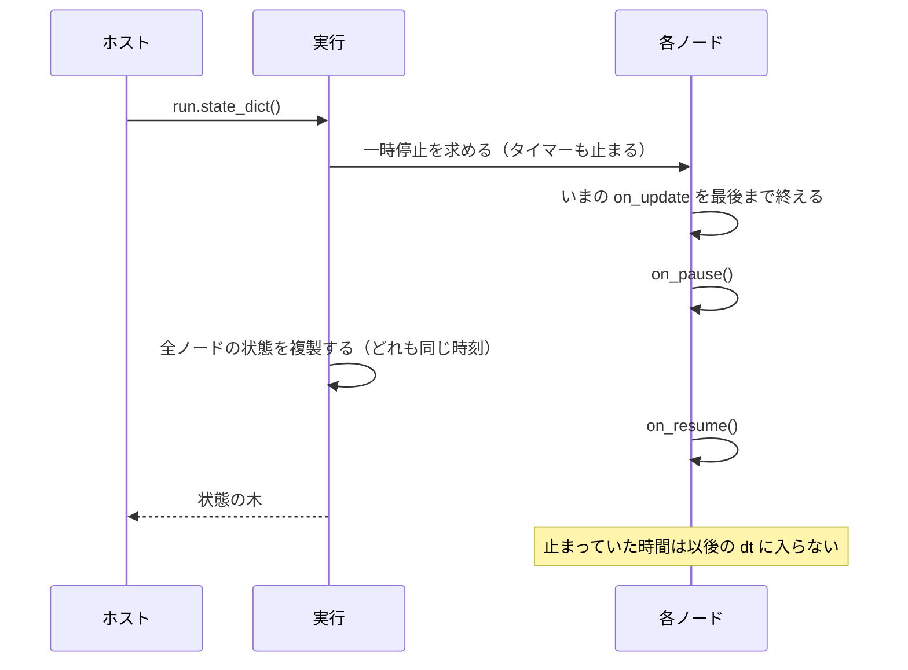
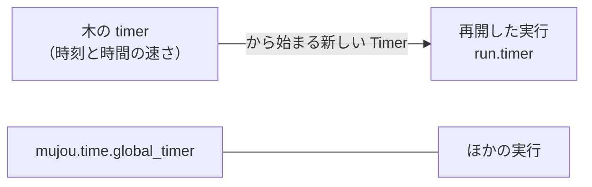
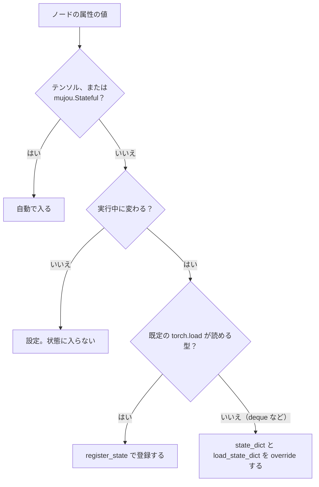
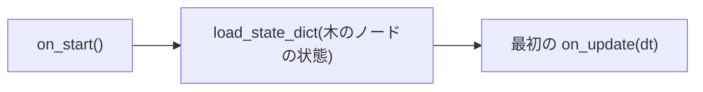
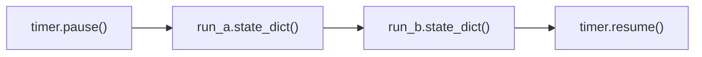

# 💾 6. 保存と再開

実行の状態を取得してファイルに保存し、新しい実行でその続きから再開する。状態に何が入るかは [Mujou の仕組み](../concepts.md#7-%E7%8A%B6%E6%85%8B) を参照。

!!! abstract "このページで分かること"

    - 実行の状態を取得・保存し、新しい実行で続きから再開する手順
    - 状態の木の中身と、取得する間に実行がどう止まるか
    - 再開するときの条件と、失敗したときに出るエラー
    - 自動で集まらない値を状態に入れる方法と、ファイルの読み方

## 手順

!!! abstract "要点"

    `run.state_dict()` で取得し、`torch.save` で保存する。再開は同じ構成の新しいインスタンスに木を渡す。



```python
--8<-- "examples/save_and_restore.py"
```

| #   | 手順                                          | 例のコード                                         | 注意                                                                       |
| --- | --------------------------------------------- | -------------------------------------------------- | -------------------------------------------------------------------------- |
| 1   | 状態を属性に持つ                              | `self.x`（テンソル）、`self.readout`（モジュール） | ノードの乱数生成器の状態と一緒に自動で集まる                               |
| 2   | `__init__` で作り、`on_update` でその場で更新 | `self.x += dt * self.prev.recv()`                  | optimizer などほかの参照も状態を指したまま（[2. ノードを書く](2-node.md)） |
| 3   | 木を取得                                      | `tree = run.state_dict()`                          | 実行中でも、正常に終了した後（この例では `with` ブロックの後）でも         |
| 4   | 保存                                          | `torch.save(tree, file)`                           | —                                                                          |
| 5   | 新しいインスタンスで再開                      | `mujou.run(restored, ..., state=loaded)`           | 同じ構成の**新しいインスタンス**                                           |

!!! warning "木を取得したネットワークでは再開できない"

    ネットワークは 1 回だけ走る。木を取得したネットワークをもう一度走らせると `mujou.run` が例外を送出する。再開には同じ構成の新しいインスタンスを作る。詳しくは [ノードが守る規則](../concepts.md#%E3%83%8E%E3%83%BC%E3%83%89%E3%81%8C%E5%AE%88%E3%82%8B%E8%A6%8F%E5%89%87)。

## 状態の木

!!! abstract "要点"

    木は CPU 上のコピーからなる素の `dict` で、ノードのパスをキーにする。

```python
{
    "timer": {"time_ns": int, "time_scale": float},
    "nodes": {
        "integrator": {
            "state": ...,  # ノードの state_dict()
            "last_update_ns": int,
            "ports": {...},
        },
    },
}
```

| キー                                  | 中身                                      |
| ------------------------------------- | ----------------------------------------- |
| `"timer"`                             | タイマーの時刻と時間の速さ                |
| `"nodes"` → パス → `"state"`          | 各ノードの状態（ノードの `state_dict()`） |
| `"nodes"` → パス → `"last_update_ns"` | 各ノードの最後の更新の時刻                |
| `"nodes"` → パス → `"ports"`          | 各 Channel の最新のメッセージとその時刻   |

正確な形は API リファレンスの [`Run.state_dict`](../api/run.md#mujou.Run.state_dict) にある。

### 取得する間の一時停止



各ノードは更新の途中では止まらず、2 回の更新の間で止まる。木の値はすべて同じ時刻になる。止まっていた時間は以後の `dt` に入らない。止まっている間の I/O は `on_pause` と `on_resume` で止められる。

|                         | `run.state_dict()` の一時停止 | タイマーの一時停止（`run.timer.pause()`） |
| ----------------------- | ----------------------------- | ----------------------------------------- |
| 目的                    | 状態の取得                    | 時間を止める                              |
| `on_pause`・`on_resume` | 呼ばれる                      | 呼ばれない                                |

### 取得するときと得られるもの

| 取得するとき         | 得られるもの                                                                                                      |
| -------------------- | ----------------------------------------------------------------------------------------------------------------- |
| ネットワークの実行中 | その時刻の状態                                                                                                    |
| 正常に終了した後     | `on_stop` の後にノードが残した値。時刻は `shutdown` が終了を求めた時点                                            |
| 例外で終了した後     | 取得できず、`state_dict` は `NetworkError` を送出する。残したい状態は実行中に取得し、長い実行では定期的に取得する |

## 再開するときの注意

!!! abstract "要点"

    再開した実行は専用のタイマーで走る。ネットワークの形とノードごとの状態は、木を取得したものとそろえる。

### 専用のタイマー



| 操作                              | 再開した実行への効果                        |
| --------------------------------- | ------------------------------------------- |
| `run.timer.pause()`               | 止まる                                      |
| `global_timer.pause()`            | 止まらない                                  |
| `state=` と一緒に `timer=` を渡す | `ValueError`                                |
| 再開                              | `global_timer` やほかの実行の時刻は戻らない |

### そろえるものと、そろわないとき

| そろえるもの                           | そろわないと                                                                                                                     | そのインスタンス                                               |
| -------------------------------------- | -------------------------------------------------------------------------------------------------------------------------------- | -------------------------------------------------------------- |
| ネットワーク: ノードのパス・Port・接続 | `mujou.run` が足りない項目と余分な項目を列挙して `ValueError` を送出                                                             | まだ何も起動していない。木を直せば同じインスタンスで再開できる |
| ノードごとの状態: キーと shape         | ノードの起動中に既定の `load_state_dict` が `ValueError`。`mujou.run` は `NetworkError`（`__cause__` がその `ValueError`）を送出 | もう走らない。新しく作り直す                                   |

!!! warning "属性名を変えるとパスが変わる"

    ノードのパスは属性名から作られるため、属性名を変えると変える前の木では再開できない。

### 入力

| `mujou.run` に渡すもの | 入力の値                          |
| ---------------------- | --------------------------------- |
| `state=` だけ          | 木の値                            |
| `state=` と `inputs=`  | `inputs` の値が木の値を置き換える |

## 自分の値を状態に入れる

!!! abstract "要点"

    テンソル・`mujou.Stateful`・乱数生成器は自動で集まる。実行中に変わる素の値は `register_state` で登録し、それ以外は `state_dict` と `load_state_dict` を override する。



| 値                                                                                                           | 状態に入るか                          |
| ------------------------------------------------------------------------------------------------------------ | ------------------------------------- |
| テンソル                                                                                                     | 自動で入る                            |
| `mujou.Stateful`（どの `nn.Module` も、`pc.clock.LearnClock` も、`mujou.Stateful` を継承した自作のクラスも） | 自動で入る                            |
| `self.generator` の状態                                                                                      | 自動で入る                            |
| 数値・文字列、テンソルのリストや dict                                                                        | 入らない。`register_state` で登録する |
| `state_dict` と `load_state_dict` という名前のメソッドを持つだけのオブジェクト                               | 入らない。`mujou.Stateful` を継承する |

=== "避ける"

    ```python
    class Counter:  # 同じ名前のメソッドを持つだけでは状態に入らない
        def state_dict(self) -> dict[str, int]: ...
        def load_state_dict(self, state: Mapping[str, int]) -> None: ...
    ```

=== "こう書く"

    ```python
    class Counter(mujou.Stateful):  # 継承すれば属性にしたとき自動で入る
        def state_dict(self) -> dict[str, int]: ...
        def load_state_dict(self, state: Mapping[str, int]) -> None: ...
    ```

### register_state

```python
self.elapsed = 0.0
self.register_state("elapsed")
```

| 規則                   | 内容                                                                                                         |
| ---------------------- | ------------------------------------------------------------------------------------------------------------ |
| 呼ぶ場所               | `__init__`。属性に代入した後                                                                                 |
| まだ代入していない名前 | `AttributeError`                                                                                             |
| 後で属性に代入した値   | それも状態に残る                                                                                             |
| 値の型                 | 既定の `torch.load` が読める型（`int`・`float`・`bool`・`str`・`None` とそのリスト・タプル・dict、テンソル） |

=== "避ける"

    ```python
    self.register_state("elapsed")  # AttributeError: まだ代入していない
    self.elapsed = 0.0
    ```

=== "こう書く"

    ```python
    self.elapsed = 0.0
    self.register_state("elapsed")
    ```

### state_dict と load_state_dict を override する

`deque` など既定の `torch.load` が読めない値は、`state_dict` と `load_state_dict` の両方を override する。`super().state_dict()` の戻り値を拡張し、自分で足したキーを除いて `super().load_state_dict` に渡す。

```python
from collections import deque
from collections.abc import Mapping
from typing import Any, override

import torch

from mujou import Node


class Recent(Node):
    """Keeps the last 8 inputs in a deque."""

    def __init__(self) -> None:
        super().__init__()
        self.recent: deque[torch.Tensor] = deque(maxlen=8)

    @override
    def state_dict(self) -> dict[str, Any]:
        return {**super().state_dict(), "recent": list(self.recent)}

    @override
    def load_state_dict(self, state: Mapping[str, Any]) -> None:
        self.recent = deque((x.clone() for x in state["recent"]), maxlen=8)  # 木の値は写して持つ
        super().load_state_dict({k: v for k, v in state.items() if k != "recent"})
```

| メソッド          | 呼ばれるとき                                    | 守ること                                                        |
| ----------------- | ----------------------------------------------- | --------------------------------------------------------------- |
| `state_dict`      | ノードが一時停止している間                      | その中では Port が受信も送信も断る。戻り値は mujou がコピーする |
| `load_state_dict` | `on_start` の後、最初の `on_update` の前に 1 回 | 木のテンソルはそのまま持たず、写して持つ                        |



`state_dict` の中で Port が受信も送信も断るのは、状態の取得をほかのノードから見えないようにするため。

## ファイル

!!! abstract "要点"

    mujou が木に入れるものは、既定の `torch.load`（`weights_only=True`）で読める。信頼できないファイルは `weights_only=False` や `pickle.load` で読まない。

| 読み方                                             | 読めるもの                                           | 注意                                                                              |
| -------------------------------------------------- | ---------------------------------------------------- | --------------------------------------------------------------------------------- |
| `torch.load(f)`（既定の `weights_only=True`）      | テンソル・数値・文字列・dict・list・tuple からなる木 | 独自クラスのオブジェクトが入った木（`register_state` や override から）は読めない |
| `torch.load(f, weights_only=False)`・`pickle.load` | 独自クラスのオブジェクトも                           | ファイルの中のコードを実行できる。信頼できないファイルを読まない                  |

| 操作                                      | デバイスの条件                                                                   |
| ----------------------------------------- | -------------------------------------------------------------------------------- |
| 木を `torch.load` で読む                  | 問わない。CUDA のノードから保存した木も GPU の無いマシンで読める                 |
| 既定の `load_state_dict` がテンソルを戻す | 各テンソルをノードのデバイスへコピーする                                         |
| 乱数生成器の状態を戻す                    | CPU と CUDA で形式が違う。保存したノードと同じ種類のデバイスのノードにだけ戻せる |

乱数生成器の状態はどのノードの状態にも入るため、木を復元できるのは保存したノードと同じ種類のデバイス（CPU か CUDA）のノードだけ。

## 複数の実行を同じ時刻で

!!! abstract "要点"

    1 つのタイマーで走る複数の実行の状態を同じ時刻で取得するには、先にタイマーを止める。



`run.state_dict()` は 1 つの実行の状態を 1 つの時刻で取得する。止めずに 1 つずつ取得すると、実行ごとに時刻がずれる。手順は [時間](../topics/time.md#%E6%99%82%E9%96%93%E3%82%92%E6%AD%A2%E3%82%81%E3%82%8B) を参照。

## 次へ

- 各部分の詳細はトピックへ。まずは [Port と Channel](../topics/ports.md)
