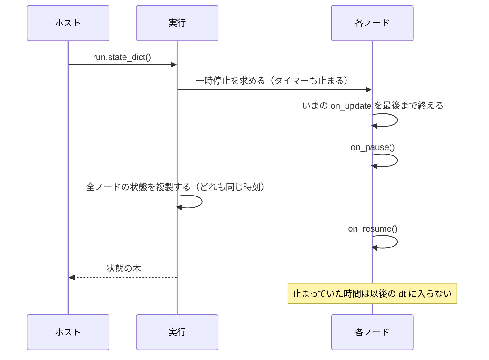
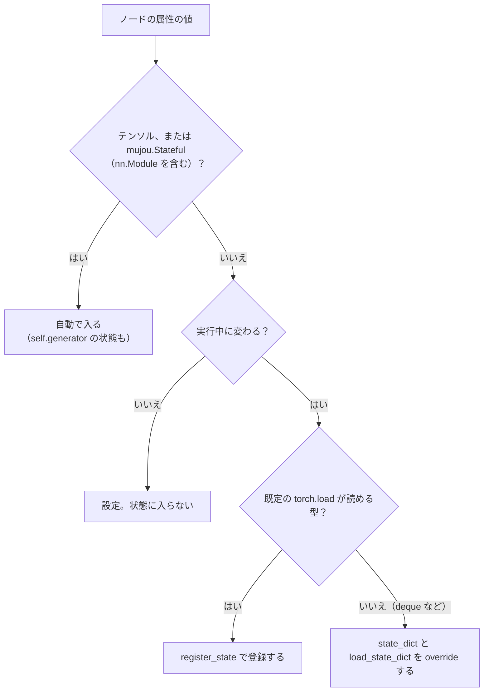

# 💾 6. 保存と再開

実行の状態を取得してファイルに保存し、同じ構成の新しいインスタンスで続きから再開する。

## 手順 {#steps}


```python
--8<-- "examples/save_and_restore.py"
```

木の形は [`Run.state_dict`][mujou.Run.state_dict] にある。ネットワークは 1 回だけ走るため、木を取ったインスタンスでは再開できない。同じ構成の新しいインスタンスを作る（[ノードが守る規則](../concepts.md#rules)）。

## 取得する間の一時停止 {#pause}



止まっている間の I/O は [`on_pause`][mujou.Node.on_pause] と `on_resume` で止められる。例外で終わった実行からは状態を取れない。長い実行は実行中に定期的に取る（[例外の後の状態](../topics/errors.md#state)）。

## 再開するときの注意 {#restore}

| 気をつけるもの     | 再開した実行では                                                    | 詳しく                                                     |
| ------------------ | ------------------------------------------------------------------- | ---------------------------------------------------------- |
| タイマー           | 木の時刻から始まる専用のタイマーで走る                              | [再開した実行のタイマー](../topics/time.md#restored-timer) |
| ネットワークと状態 | 木を取ったものと同じパス・Port・接続、同じ状態のキーと shape にする | [`mujou.run`][mujou.run] の `state`                        |
| 入力               | `inputs` は状態の後に書かれ、木の値を置き換える                     | `mujou.run` の `inputs`                                    |

!!! warning "属性名を変えるとパスが変わる"

    ノードのパスは属性名から作られるため、属性名を変えると変える前の木では再開できない。

## 自分の値を状態に入れる {#custom-state}



自作クラスは `state_dict` と `load_state_dict` を持つだけでは状態に入らず、[`Stateful`][mujou.Stateful] を継承する（素の値の登録規則は [`register_state`][mujou.Node.register_state]）。

=== "避ける"

    ```python
    class Counter:  # 同じ名前のメソッドを持つだけでは状態に入らない
        def state_dict(self) -> dict[str, int]: ...
        def load_state_dict(self, state: Mapping[str, int]) -> None: ...
    ```

=== "こう書く"

    ```python
    class Counter(mujou.Stateful):  # 継承すれば属性にしたとき自動で入る
        def state_dict(self) -> dict[str, int]: ...
        def load_state_dict(self, state: Mapping[str, int]) -> None: ...
    ```

### state_dict と load_state_dict を override する {#override}

`state_dict` は `super().state_dict()` に自分のキーを足して返し、`load_state_dict` は自分のキーを除いた残りを `super().load_state_dict` に渡して、木のテンソルは clone して持つ。

```python
from collections import deque
from collections.abc import Mapping
from typing import Any, override

import torch

from mujou import Node


class Recent(Node):
    """Keeps the last 8 inputs in a deque."""

    def __init__(self) -> None:
        super().__init__()
        self.recent: deque[torch.Tensor] = deque(maxlen=8)

    @override
    def state_dict(self) -> dict[str, Any]:
        return {**super().state_dict(), "recent": list(self.recent)}

    @override
    def load_state_dict(self, state: Mapping[str, Any]) -> None:
        self.recent = deque((x.clone() for x in state["recent"]), maxlen=8)  # 木の値は写して持つ
        super().load_state_dict({k: v for k, v in state.items() if k != "recent"})
```

## ファイル {#files}

| 読み方                                             | 読めるもの                                           | 注意                                                                            |
| -------------------------------------------------- | ---------------------------------------------------- | ------------------------------------------------------------------------------- |
| `torch.load(f)`（既定の `weights_only=True`）      | テンソル・数値・文字列・dict・list・tuple からなる木 | 自作クラスの値（`register_state` や override で入れたもの）が入った木は読めない |
| `torch.load(f, weights_only=False)`・`pickle.load` | 自作クラスの値も                                     | ファイルの中のコードを実行できる。信頼できないファイルを読まない                |

## 次へ

- 1 つのタイマーで走る複数の実行の状態を同じ時刻で取る: [時間](../topics/time.md#multi-run-state)
- 各部分の詳細はトピックへ。まずは [Port と Channel](../topics/ports.md)
